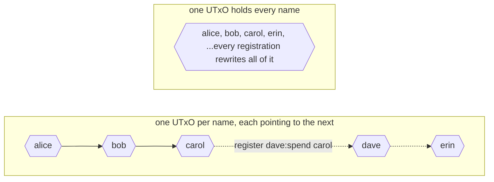
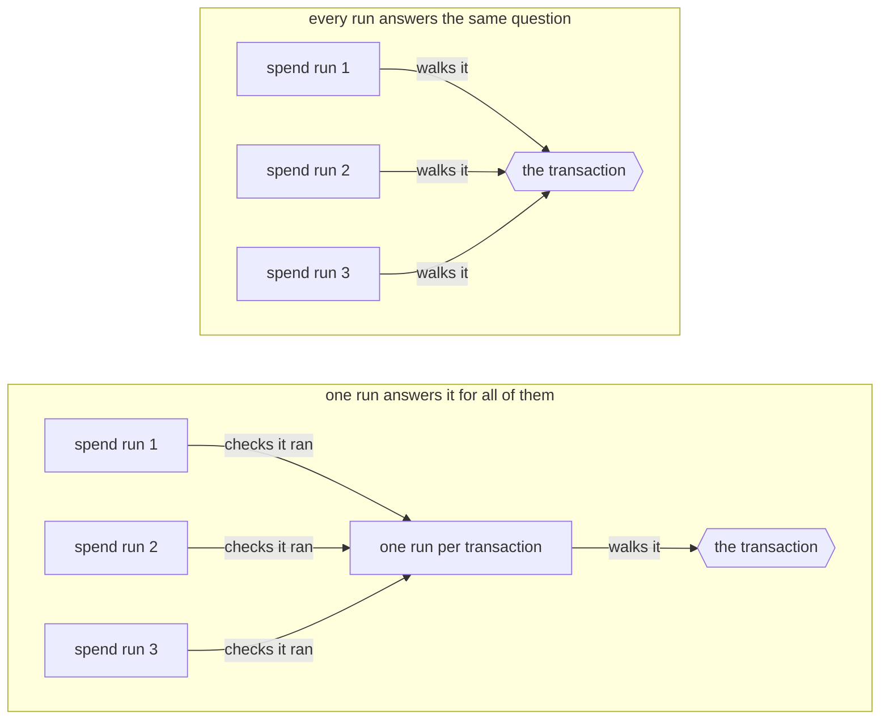
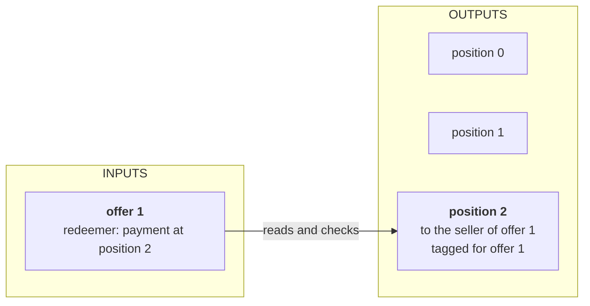

# Optimization

> The three limits a transaction has to fit under, how to measure what a validator costs before you change it, and the four levels where a contract can be made cheaper, from the protocol down to one function.

# Optimization

A validator can be correct and still be useless. In [resource limit](/docs/developers/onboarding/lectures/advanced/detecting-vulnerabilities#resource-limit) an attacker filled the splitter's pot with dust until the split needed more than a transaction is allowed to use, and the funds stayed locked. A contract reaches the same limit without any attacker: a transaction that takes ten swap offers at once is cheap, and the same transaction taking thirty reaches the limit.

Some protocols are so complex, or need so many inputs to be profitable, that they do not fit in one transaction. An aggregator that earns a small fee on every offer it fills only makes money when one transaction fills many offers. In many of those cases the protocol is still viable: optimized enough, it fits.

This lecture makes a contract cheaper to run. Whoever submits a transaction pays for every unit its scripts use, so a cheaper contract lowers the fees your users pay. It also lets one transaction do more work, so fewer transactions are needed. The app does not get faster: a transaction waits for its block, whatever its scripts cost.

## Three limits on a transaction

Every transaction has three maximums to fit under. A transaction over any one of them is invalid, whatever fee it offers.

| limit on one transaction | mainnet |
| --- | --- |
| memory units | 16,500,000 |
| CPU units | 10,000,000,000 |
| size in bytes | 16,384 |

Memory and CPU units are the **[execution units](/docs/developers/curriculum/fundamentals/core-concepts/fees#script-execution-fees)** your backend reported when it evaluated an unlock in [frontend integration](/docs/developers/onboarding/lectures/intermediate/frontend-integration). The bytes are the size of the transaction your app signs and sends. All three are protocol parameters, so governance can change them. A test network does not have to match mainnet.

The fee grows with all three. There is a price per byte, and a price per unit for memory and for CPU, and the handbook's **[fee formula](/docs/developers/curriculum/fundamentals/core-concepts/fees#the-fee-formula)** adds them up.

### Memory and CPU

Every operation a script performs has a memory price and a CPU price, both taken from the cost model in the protocol parameters. Memory counts the values the script builds, and CPU counts the steps it takes. Neither depends on the machine the script runs on. Most changes move the two together.

You can also spend one to save the other. Keeping a computed value and reading it later spends memory and saves CPU, and computing it again every time does the opposite. That exchange matters when a contract is close to one limit and far from the other. The handbook has both directions, in [replace expensive computations with lookups](/docs/developers/curriculum/smart-contracts/advanced/optimization#replace-expensive-computations-with-lookups) and [build local caches](/docs/developers/curriculum/smart-contracts/advanced/optimization#build-local-caches).

### Transaction size

The limit is on the whole serialized transaction, which means the signatures and any script inside it count as much as the inputs and the outputs. A script inside the transaction is usually the largest single part of it.

The rest grows with the work. Each input, spent or referenced, adds an output reference, which is a transaction id with an index. A transaction can carry one redeemer per validator run, with the execution units that run expects. Each output is written out in full, with its address, its value and its datum.

The datum of a UTxO you spend stays on the chain where it already is, so spending one costs the same few bytes whatever it holds. The datums a transaction creates are new bytes, and nothing limits how large a datum can be, so its outputs can grow until it no longer fits. A contract that keeps a lot of state in its datums spends more bytes on them than on its script. An output that pays ADA to an ordinary wallet address takes about 67 bytes.

A reference input takes the compiled script out of every transaction that points at it, which is what [reference scripts](/docs/developers/onboarding/lectures/intermediate/reference-inputs-and-scripts#reference-scripts) are for.

## Measure before you change anything

Three measurements answer three different questions, and none of them needs a network.

A test reports the memory and CPU of one run at one size. It measures everything the test does, including the transaction it builds first. Read it as a comparison between two versions of a contract rather than as the chain's bill.

A benchmark runs the same code at a series of sizes and plots memory and CPU against the size. A straight line means every extra item costs what the last one cost. A line that bends upward means each item costs more than the one before it, and a contract with that shape stops fitting at some size.

The blueprint your compiler writes holds the compiled script. Its length in bytes is what every transaction carrying that script pays for.

Then change the part the measurement points at, and measure again. The handbook's optimization page starts with the same advice, in [before optimizing](/docs/developers/curriculum/smart-contracts/advanced/optimization#before-optimizing).

## Four levels to optimize

A contract can be made cheaper at four levels. From the highest to the lowest, they are the protocol, the transaction, the validator, and the code inside one function.

Start at the top. The shape of the protocol sets what every transaction has to read, write and carry, so a change there usually saves more than the other three levels together. A change inside one function saves the least. While the levels above it are still wrong, you usually do not need it yet.

### Protocol level

A protocol-level change is about the shape of the whole contract: how many UTxOs hold its state, what each one holds, and how many transactions a job takes.

Take a name registry, where every name can be registered once. The first design keeps every name in the datum of one UTxO. To register a name, a transaction spends that UTxO, checks that the name is not in the list, and creates a new UTxO with the longer list.

At a hundred names it works. As the registry grows, three things go wrong together. Each check walks a longer list. Each registration writes the whole list out again, in bytes the transaction pays for. And a UTxO can be spent only once, so two people who register at the same time cannot both succeed: the second transaction fails and has to be built again against the new UTxO. At some size the list no longer fits in a transaction, and the registry stops.

A **linked list** gives each name a UTxO of its own. The names are kept in order, and each UTxO's datum points to the next name. To register `dave`, a transaction spends the UTxO of the name just before it, `carol`, which points to `erin`. Because `carol` points straight to `erin`, `dave` is not registered yet. The transaction puts `carol` back pointing to `dave`, and creates `dave` pointing to `erin`:



A registration now touches two UTxOs, whatever the size of the registry. Its datums stay small, and two people who register names in different places in the list do not spend the same UTxO.

Anyone can send a UTxO to the script's address, so the protocol has to tell its own UTxOs from anything else there. Each name's UTxO carries a token, like the beacon from [which UTxO is the oracle](/docs/developers/onboarding/lectures/intermediate/modifying-state#which-utxo-is-the-oracle).

The linked list is one of several shapes split state can take. The handbook explains it in full on its [linked list](/docs/developers/curriculum/smart-contracts/advanced/design-patterns/linked-list) page. Two more shapes:

- **[Merkle tree](/docs/developers/curriculum/smart-contracts/advanced/design-patterns/merkle-tree)**: only a root hash in the datum, and the transaction carries a proof for the one entry it needs.
- **[Merkelized validator](/docs/developers/curriculum/smart-contracts/advanced/design-patterns/merkelized-validator)**: a rarely used branch kept in a separate script, so the transactions that do not need it do not carry it.

### Transaction level

A transaction-level change is about how the script runs inside one transaction share their work.

Take an aggregator that fills thirty swap offers in one transaction. The swap script runs thirty times, once for each offer, and each run walks every output to find the payment for its own offer. Some facts belong to the whole transaction, and every run that works one out gets the same answer. "Is every offer paid?" is one of them, so one run can answer it for all thirty:



A minting policy runs once per transaction whatever it mints. A contract with nothing to mint can use the withdraw purpose from [validator purposes](/docs/developers/onboarding/lectures/intermediate/validator-purposes). A transaction that withdraws zero ADA from the script's own reward account makes the script run one more time, as a withdrawal validator, and that run can carry the check for everything else. This is called the **withdraw zero trick**. Each spend run then only checks that the withdrawal is in the transaction. The handbook explains it on its [stake validator](/docs/developers/curriculum/smart-contracts/advanced/design-patterns/stake-validator) page, and the minting version on [transaction-level minting](/docs/developers/curriculum/smart-contracts/advanced/design-patterns/tx-level-minter).

### Validator level

A validator-level change moves work from the validator to the app that builds the transaction.

Stay with the swap. Each run searches the outputs for its payment: it compares every output with the offer, one after the other, until it has seen them all. Thirty runs over sixty outputs make 1,800 comparisons. The app that built the transaction already knows where each payment sits, because it put it there.

So the app writes the positions of each offer's payment outputs in its redeemer, and the validator reads the outputs at those positions. Reaching a position still steps over the outputs before it, but stepping is cheap, since nothing is compared on the way. The validator still checks the outputs it finds there: the right address, the offer's tag, enough to cover the price. That check has to stay, because anyone can put any number in a redeemer.



The handbook calls the principle [don't compute, verify](/docs/developers/curriculum/smart-contracts/advanced/optimization#dont-compute-verify), and its [UTxO indexers](/docs/developers/curriculum/smart-contracts/advanced/design-patterns/utxo-indexers) page has the pattern in four shapes.

### Local level

A local change stays inside one function, and nothing outside it can see a difference: a cheaper representation, one walk over a list where there were two, the cheap check before the expensive one.

Take a condition made of two checks joined by "and". It stops at the first check that is false, so the second check runs only when the first one passes. Put first the check that is cheaper, and the one more likely to decide the answer on its own.

The swap looks for outputs that go to the offer's seller and carry the offer's tag. Comparing the address is one comparison. Reading the tag means opening the output's datum first. In a transaction that fills many offers from many sellers, most outputs go to somebody else. Comparing the address first decides those outputs, and the tag is read only for the few that are left.

The handbook explains it in [put cheap and likely checks first](/docs/developers/curriculum/smart-contracts/advanced/optimization#put-cheap-and-likely-checks-first), and groups the other local changes under [choose cheaper representations](/docs/developers/curriculum/smart-contracts/advanced/optimization#choose-cheaper-representations) and [traverse once](/docs/developers/curriculum/smart-contracts/advanced/optimization#traverse-once). The [Try it](#try-it) below makes three local changes to the swap and measures each one.

## Optimize before you deploy

Each of these changes produces a different compiled script, and [the hash is the address](/docs/developers/onboarding/lectures/intermediate/parameters#why-a-parameter-changes-the-address). A contract that already holds funds cannot be made cheaper at the same address. Those funds stay under the old rules where they are, and the cheaper contract is a new contract with an empty address of its own. So measuring belongs before the first deployment, and the handbook's [going to production](/docs/developers/curriculum/production/going-to-production#4-optimize) page lists it as a step before launch. Afterwards it is a migration, with a plan for everything the old address holds.

## Try it

<Tabs groupId="onchain">
<TabItem value="aiken" label="Aiken" default>

### Write the swap

This is the swap from the [tutorial](/docs/developers/onboarding/tutorial/overview), with one change: the price, in lovelace, may be paid across several outputs, so several buyers can each pay part of it. Every output that pays an offer carries the offer's output reference as its inline datum. That tag stops one payment from counting for two offers, as in the tutorial.

Start a new project:

```bash
aiken new my-name/atomic-swap
cd atomic-swap
rm validators/placeholder.ak
```

Create `validators/swap.ak`, starting with the imports:

```aiken title="validators/swap.ak"
use aiken/collection/list
use cardano/address.{Address, VerificationKey}
use cardano/assets.{from_lovelace}
use cardano/transaction.{InlineDatum, Output, OutputReference, Transaction}
```

Then the datum and the validator:

```aiken title="validators/swap.ak"
// The offer: who sold the locked asset, and the price in lovelace.
pub type SwapDatum {
  owner: Address,
  price: Int,
}

pub type SwapAction {
  Swap
  Cancel
}

validator swap {
  spend(
    datum: Option<SwapDatum>,
    redeemer: SwapAction,
    own_ref: OutputReference,
    self: Transaction,
  ) {
    expect Some(SwapDatum { owner, price }) = datum
    when redeemer is {
      Cancel -> {
        expect VerificationKey(owner_key) = owner.payment_credential
        list.has(self.extra_signatories, owner_key)
      }
      Swap -> paid_to(self.outputs, owner, own_ref) >= price
    }
  }

  else(_) {
    fail
  }
}
```

Below the validator, add `paid_to`, the function the `Swap` branch calls to add up the payment, and `marked_with`, which reads an output's tag:

```aiken title="validators/swap.ak"
// How much this swap's owner is paid: every output to the owner's address
// that carries this swap's tag, added up.
fn paid_to(
  outputs: List<Output>,
  owner: Address,
  own_ref: OutputReference,
) -> Int {
  let payments = list.filter(
    outputs,
    fn(output) { marked_with(output, own_ref) && output.address == owner },
  )
  list.foldl(
    payments,
    0,
    fn(payment, total) { assets.lovelace_of(payment.value) + total },
  )
}

// Is this output tagged with `tag` as its inline datum?
fn marked_with(output: Output, tag: Data) -> Bool {
  when output.datum is {
    InlineDatum(data) -> data == tag
    _ -> False
  }
}
```

`list.filter` walks the outputs and keeps the ones tagged for this offer that go to its seller. `list.foldl` walks what is left and adds up the lovelace.

Then the tests:

```aiken title="validators/swap.ak"
// Two sellers. 28 bytes each, like any key hash.
const alice: ByteArray =
  #"00000000000000000000000000000000000000000000000000000001"

const bob: ByteArray =
  #"00000000000000000000000000000000000000000000000000000002"

fn wallet(key: ByteArray) -> Address {
  Address { payment_credential: VerificationKey(key), stake_credential: None }
}

// The reference of the locked offer number n. It is also that offer's tag.
fn offer_ref(n: Int) -> OutputReference {
  OutputReference {
    transaction_id: #"0000000000000000000000000000000000000000000000000000000000000000",
    output_index: n,
  }
}

// A payment of `amount` lovelace to `key`, tagged for offer number n.
fn payment(key: ByteArray, amount: Int, n: Int) -> Output {
  let tag: Data = offer_ref(n)
  Output {
    address: wallet(key),
    value: from_lovelace(amount),
    datum: InlineDatum(tag),
    reference_script: None,
  }
}

fn swap_with(outputs: List<Output>) -> Bool {
  swap.spend(
    Some(SwapDatum { owner: wallet(alice), price: 10_000_000 }),
    Swap,
    offer_ref(0),
    Transaction { ..transaction.placeholder, outputs },
  )
}

test accepts_one_payment() {
  swap_with([payment(alice, 10_000_000, 0)])
}

test accepts_a_payment_split_over_two_outputs() {
  swap_with([payment(alice, 6_000_000, 0), payment(alice, 4_000_000, 0)])
}

test refuses_a_payment_that_is_short() fail {
  swap_with([payment(alice, 9_000_000, 0)])
}

test refuses_a_payment_to_somebody_else() fail {
  swap_with([payment(bob, 10_000_000, 0)])
}

test refuses_a_payment_tagged_for_another_offer() fail {
  swap_with([payment(alice, 10_000_000, 1)])
}

test the_owner_can_cancel() {
  swap.spend(
    Some(SwapDatum { owner: wallet(alice), price: 10_000_000 }),
    Cancel,
    offer_ref(0),
    Transaction { ..transaction.placeholder, extra_signatories: [alice] },
  )
}

test nobody_else_can_cancel() fail {
  swap.spend(
    Some(SwapDatum { owner: wallet(alice), price: 10_000_000 }),
    Cancel,
    offer_ref(0),
    Transaction { ..transaction.placeholder, extra_signatories: [bob] },
  )
}
```

```bash
aiken check
```

Seven passes.

### Measure it

Add a builder for a transaction that fills any number of offers, a function that runs the spend handler once for each offer, as the chain would, and two tests. Each offer is paid in two outputs, and three sellers share the offers:

```aiken title="validators/swap.ak"
// A third seller, for the transactions that fill many offers.
const carol: ByteArray =
  #"00000000000000000000000000000000000000000000000000000003"

// The seller of offer number n.
fn seller(n: Int) -> ByteArray {
  when n % 3 is {
    0 -> alice
    1 -> bob
    _ -> carol
  }
}

// One transaction that takes `count` offers. Each offer costs 10 ADA and is
// paid in two outputs, both tagged with that offer's reference.
fn batch_of(count: Int) -> Transaction {
  let offers = list.range(0, count - 1)
  Transaction {
    ..transaction.placeholder,
    outputs: list.flat_map(
      offers,
      fn(n) {
        [payment(seller(n), 6_000_000, n), payment(seller(n), 4_000_000, n)]
      },
    ),
  }
}

// Every run the chain makes for that transaction: the spend handler, once per
// offer taken.
fn run_batch(tx: Transaction, count: Int) -> Bool {
  list.all(
    list.range(0, count - 1),
    fn(n) {
      swap.spend(
        Some(SwapDatum { owner: wallet(seller(n)), price: 10_000_000 }),
        Swap,
        offer_ref(n),
        tx,
      )
    },
  )
}

test ten_offers_are_taken() {
  run_batch(batch_of(10), 10)
}

test thirty_offers_are_taken() {
  run_batch(batch_of(30), 30)
}
```

Run `aiken check` again. Nine passes. Read the memory and CPU beside each test name, as you did for the splitter's split in [donate dust](/docs/developers/onboarding/lectures/advanced/detecting-vulnerabilities#donate-dust):

| test | memory | CPU |
| --- | --- | --- |
| `ten_offers_are_taken` | 2.65 M | 1.12 B |
| `thirty_offers_are_taken` | 17.80 M | 8.19 B |

Thirty offers need more than the 16.5 M memory limit. Three times as many offers cost almost seven times as much memory, because there are three times as many runs and each run walks three times as many outputs.

Then the benchmark. A `bench` takes a sampler: a function that turns a size into a generator of inputs. The runner calls it with every size up to a maximum. The generator is the same kind that `fuzz.bytearray()` gave you in [property tests](/docs/developers/onboarding/lectures/intermediate/testing#property-tests): a `Fuzzer`, which is a function that takes the random state and returns `Some` with the state and a value. This one gives the state back unchanged, and returns the transaction for that many offers together with the count. `Fuzzer` is part of the language, so the benchmark needs no new library:

```aiken title="validators/swap.ak"
fn batch_sized(size: Int) -> Fuzzer<(Transaction, Int)> {
  fn(prng) { Some((prng, (batch_of(size), size))) }
}

bench batch(input: (Transaction, Int) via batch_sized) {
  let (tx, count) = input
  run_batch(tx, count)
}
```

```bash
aiken bench --max-size 50
```

`--max-size 50` sets that maximum. Here a size is a number of offers, so the runner measures transactions that fill from 1 offer up to 50. It prints two plots, memory and CPU against that number. Both lines bend upward: each offer costs more than the one before it.

Above the plots, `projected max size = 26` is where the runner expects the cost to cross the budget. It fits a straight line through its measurements and takes the lower of the memory crossing and the CPU crossing. Because the real lines bend, the real limit is a little lower than 26.

The third measurement is the size of the compiled script. As first written, the swap compiles to 616 bytes.

### Walk the outputs once

The filter walks the outputs to build a new list, and the sum walks that list again. One walk can do both jobs: check each output, and add its lovelace when it is a payment. Replace `paid_to`:

```aiken title="validators/swap.ak"
// How much this swap's owner is paid, in one walk over the outputs: an output
// that carries this swap's tag and goes to the owner adds its lovelace.
fn paid_to(
  outputs: List<Output>,
  owner: Address,
  own_ref: OutputReference,
) -> Int {
  list.foldl(
    outputs,
    0,
    fn(output, total) {
      if marked_with(output, own_ref) && output.address == owner {
        assets.lovelace_of(output.value) + total
      } else {
        total
      }
    },
  )
}
```

Run `aiken check`. Nine passes:

| test | memory | CPU |
| --- | --- | --- |
| `ten_offers_are_taken` | 2.57 M | 1.10 B |
| `thirty_offers_are_taken` | 17.42 M | 8.10 B |

About two percent less, and `aiken bench --max-size 50` still projects 26. The second walk was over the list the filter kept, which holds only the two payments for the offer. A second walk costs as much as the list it walks, and this one was short. The handbook's [avoid re-traversals](/docs/developers/curriculum/smart-contracts/advanced/optimization#avoid-re-traversals) shows a case where the second walk is long.

### Compare the address first

Each output is still checked for the tag first. Reading the tag means opening the output's datum, while comparing the address is one comparison. Most outputs in the transaction go to a different seller, and the address alone decides them. Compare the address first, and read the tag only when the address matches:

```aiken title="validators/swap.ak"
// How much this swap's owner is paid, in one walk over the outputs: the tag is
// read only for an output that goes to the owner.
fn paid_to(
  outputs: List<Output>,
  owner: Address,
  own_ref: OutputReference,
) -> Int {
  list.foldl(
    outputs,
    0,
    fn(output, total) {
      if output.address == owner {
        if marked_with(output, own_ref) {
          assets.lovelace_of(output.value) + total
        } else {
          total
        }
      } else {
        total
      }
    },
  )
}
```

Run `aiken check`. Nine passes:

| test | memory | CPU |
| --- | --- | --- |
| `ten_offers_are_taken` | 2.09 M | 1.02 B |
| `thirty_offers_are_taken` | 13.18 M | 7.53 B |

A quarter less memory. Thirty offers now fit under the 16.5 M memory limit, and `aiken bench --max-size 50` projects 33. The handbook has the idea in [put cheap and likely checks first](/docs/developers/curriculum/smart-contracts/advanced/optimization#put-cheap-and-likely-checks-first) and [defer distinctions until they matter](/docs/developers/curriculum/smart-contracts/advanced/optimization#defer-distinctions-until-they-matter).

### Stop when the price is covered

The walk still reads every output, even after the payments it found already cover the price. It can stop there. Replace `paid_to` with a function that counts down what is still owed, and stops as soon as nothing is:

```aiken title="validators/swap.ak"
// Is the price covered? `left` is what is still owed. The walk stops with
// True as soon as it reaches zero, and with False if the outputs run out.
fn is_paid(
  outputs: List<Output>,
  owner: Address,
  own_ref: OutputReference,
  left: Int,
) -> Bool {
  when outputs is {
    [] -> False
    [output, ..rest] ->
      if output.address == owner {
        if marked_with(output, own_ref) {
          let left = left - assets.lovelace_of(output.value)
          left <= 0 || is_paid(rest, owner, own_ref, left)
        } else {
          is_paid(rest, owner, own_ref, left)
        }
      } else {
        is_paid(rest, owner, own_ref, left)
      }
  }
}
```

The function answers yes or no, so the `Swap` branch of the spend handler calls it directly. Replace the `when` in the spend handler:

```aiken title="validators/swap.ak"
when redeemer is {
  Cancel -> {
    expect VerificationKey(owner_key) = owner.payment_credential
    list.has(self.extra_signatories, owner_key)
  }
  Swap -> is_paid(self.outputs, owner, own_ref, price)
}
```

The swap still accepts the same transactions. An output always holds a positive amount of lovelace, so the total only grows as the walk goes on. Once it covers the price, the outputs after it cannot change the answer.

Run `aiken check`. Nine passes:

| test | memory | CPU |
| --- | --- | --- |
| `ten_offers_are_taken` | 1.64 M | 709.80 M |
| `thirty_offers_are_taken` | 8.54 M | 4.39 B |

On average, the payments for an offer sit in the middle of the outputs, so a run now reads about half of them. `aiken bench --max-size 50` projects 51.

### The four moments

| moment | memory at 30 | CPU at 30 | projected maximum | compiled script |
| --- | --- | --- | --- | --- |
| as first written | 17.80 M | 8.19 B | 26 | 616 bytes |
| one walk | 17.42 M | 8.10 B | 26 | 577 bytes |
| the address first | 13.18 M | 7.53 B | 33 | 578 bytes |
| stop when covered | 8.54 M | 4.39 B | 51 | 606 bytes |

None of the three changes is visible outside `paid_to`, so the app that builds the transaction does not change. Each run still walks the outputs to find its own payment, and the number of runs still grows with the number of offers. Removing those costs is work for the levels above: the payment's position in the redeemer, or one run for the whole transaction.

Stuck? The four moments are in the example project, `swap.ak`, `swap_one_pass.ak`, `swap_address_first.ak` and `swap_stop_early.ak`. See the **[introduction](/docs/developers/onboarding/lectures/advanced/introduction#the-example-project)**.

</TabItem>
<TabItem value="scalus" label="Scalus">

A [Scalus](https://scalus.org/) version is coming soon. The idea is identical, only the language differs.

</TabItem>
</Tabs>

## Go deeper

- [Contract optimization](/docs/developers/curriculum/smart-contracts/advanced/optimization): the handbook's catalog, benchmarks first, then the techniques grouped by the kind of saving each one makes.
- [Fees](/docs/developers/curriculum/fundamentals/core-concepts/fees): the fee formula, the price of execution units, and what a reference script costs.
- [Linked list](/docs/developers/curriculum/smart-contracts/advanced/design-patterns/linked-list): a growing set split across UTxOs, with inserts, removals, and proofs that a name is or is not in the set.
- [UTxO indexers](/docs/developers/curriculum/smart-contracts/advanced/design-patterns/utxo-indexers): the position in the redeemer, for one input, for one input and its outputs, and for many of each.
- [Transaction-level minting](/docs/developers/curriculum/smart-contracts/advanced/design-patterns/tx-level-minter): one check per transaction, run by a minting policy.
- [Stake validator](/docs/developers/curriculum/smart-contracts/advanced/design-patterns/stake-validator): the withdraw zero trick, and what registering the reward account involves.
- [Merkelized validator](/docs/developers/curriculum/smart-contracts/advanced/design-patterns/merkelized-validator): putting part of a validator in a separate script, so that a change that trades script size for execution units still fits.
- [Transaction building](/docs/developers/curriculum/start-building/transaction-building#batching-and-airdrops): splitting the work across transactions when one of them can no longer hold it.
- [Debugging CBOR](/docs/developers/curriculum/smart-contracts/advanced/debug-cbor): reading a transaction's bytes to see what takes the space.
- [Going to production](/docs/developers/curriculum/production/going-to-production#4-optimize): where optimization sits among the other steps before a launch.

Next: **[Design patterns](/docs/developers/onboarding/lectures/advanced/design-patterns/introduction)**.
