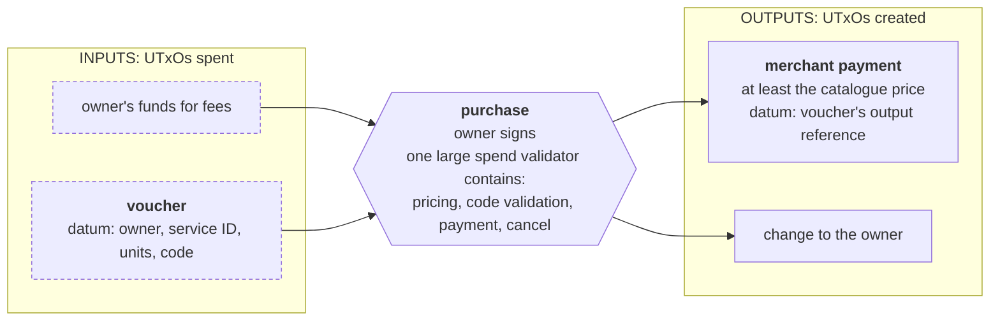
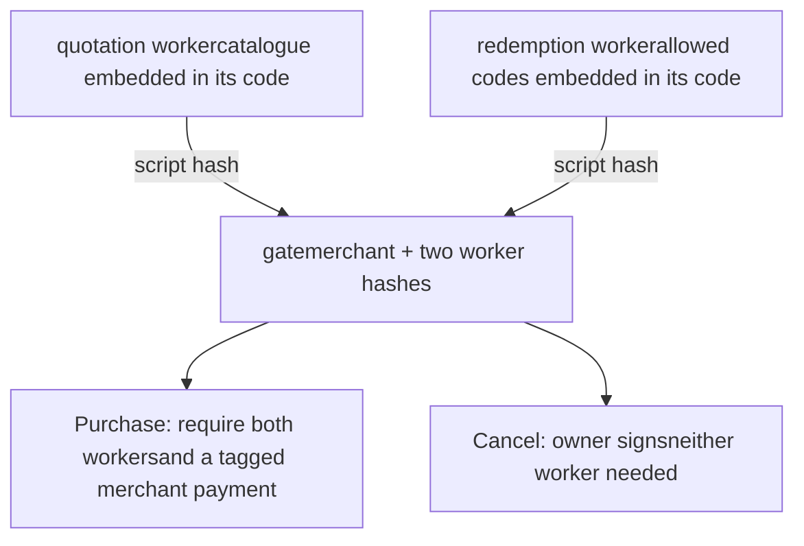
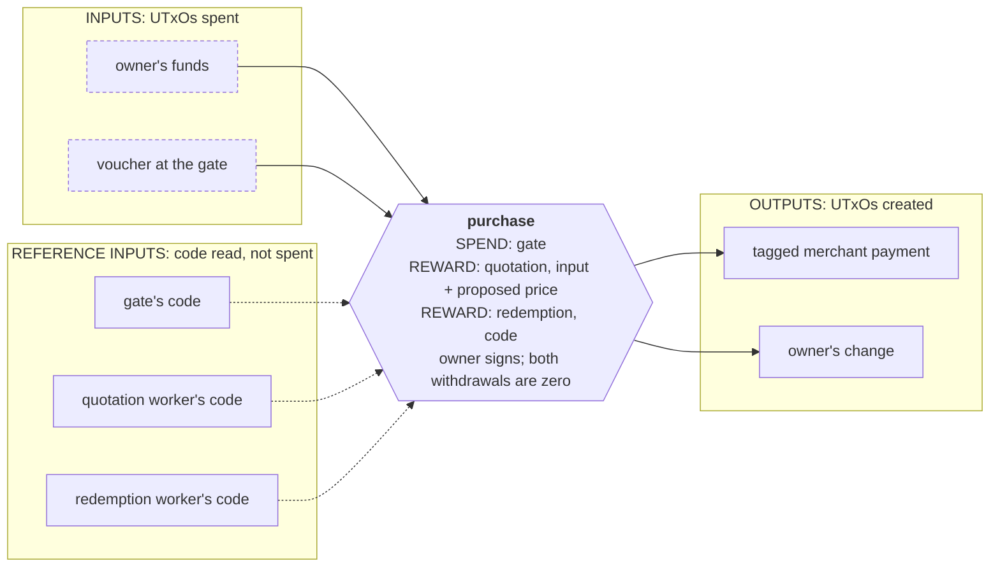

# Merkelized validator

> Split a large validator into a small gate and authenticated withdrawal workers. Bind each delegated input and proposed result, publish modules as reference scripts, and measure the deployment and execution trade-offs.

Different actions can need very different amounts of logic. Confirming an order may need a large price catalogue and policy checks; cancelling it may need only the owner's signature. A single validator still contains the code and embedded data for both actions. As those tables grow, the program can become too large to publish or carry in one transaction.

A **merkelized validator** separates the contract into a small gate and independently deployed workers. The gate pins each worker's script hash and checks its input/output redeemer in the current transaction. A withdraw-zero operation makes the ledger execute the worker, and a reference script supplies its code without putting the full program in the transaction's witness set.

This page compares a monolith with hand-written and [`aiken-design-patterns` v1.9.0](https://github.com/Anastasia-Labs/aiken-design-patterns/tree/v1.9.0) delegation. It covers **delegated computation** and **delegated validation**, including deployment costs and the remaining limits. The prerequisite is the whole [onboarding course](../../../lectures/introduction.md).

Despite the name, this example does not construct a [Merkle tree](./merkle-tree.md). It authenticates modules by their script hashes, not by a tree-membership proof.

## The protocol: buy or cancel a funded service order

Imagine a provider selling services by the unit, such as document conversion priced per document. A **service ID** identifies an entry in the provider's price catalogue, and the quantity says how many units the buyer wants.

The buyer sets aside ada in a **purchase voucher**: a UTxO at the contract holding the funds and a datum with the owner's key hash, service ID, quantity, and public redemption code. This separates funding an order from authorizing its final payment. The runnable fixture starts with the voucher already created.

The deployment fixes the merchant's address, the price catalogue, and a list of accepted redemption codes. A code is a public label that the purchase must carry; the contract checks whether it appears in that list. The owner can then choose:

- **Purchase:** sign, look up the service's unit price, multiply it by the quantity, check the code, and pay the merchant at least that amount. The payment identifies the voucher it settles.
- **Cancel:** sign and recover the funds, without running either lookup.

For example, if the selected service costs three ada per unit and the voucher requests two units, a purchase must pay the merchant at least six ada and use an accepted code. Cancelling that same order only needs the owner's signature. The owner authorizes where any remaining funds go.

**The contract's objective is to settle a funded order under the provider's fixed purchase rules, while keeping cancellation available to its owner.** It verifies authorization and payment; service delivery happens off-chain. Redemption codes are public and reusable, so knowing one does not replace the owner's signature.



### Why split the validator?

The two actions have different needs: purchase uses both tables, while cancel uses neither. Putting everything in one validator means:

- **Publishing it requires room for both tables in one transaction.** A reference script still has to be published in full before anyone can reference it.
- **Cancelling still loads the whole script.** Supplying it by reference makes the transaction smaller, but the referenced bytes still incur [per-byte fees](../../../../curriculum/fundamentals/core-concepts/fees.md#reference-script-fees).

The goal is to keep the same purchase and cancellation rules while publishing the large parts separately. Pricing illustrates **delegated computation**, because it produces an amount. The code check illustrates **delegated validation**, because it only approves or rejects an input. Cancellation shows why a small action should be able to omit both workers. The benchmark later grows the tables until the monolith no longer fits, while the individual modules still do.

### The data and shared checks

The service ID is named `service_id` in Aiken and `serviceId` in TypeScript. The fixture hashes labels such as `service:0` into 32-byte identifiers. `QuoteIO` and `CodeIO` use the library's public record shapes: `ComputationRedeemer<input, output>` contains `input_arg` and a proposed `result`; `ValidationRedeemer<input>` contains only `input_arg`.

<Tabs groupId="onchain">
<TabItem value="aiken" label="Aiken" default>

```aiken title="lib/voucher.ak"
use aiken/collection/list
use aiken/crypto.{VerificationKeyHash}
use aiken_design_patterns/merkelized_validator.{
  ComputationRedeemer, ValidationRedeemer,
}
use cardano/address.{Address}
use cardano/assets
use cardano/transaction.{InlineDatum, Output, OutputReference, Transaction}
```

```aiken title="lib/voucher.ak"
pub type Price {
  service_id: ByteArray,
  unit_price: Int,
}

/// Every version remembers the same purchase request in its datum.
pub type Voucher {
  owner: VerificationKeyHash,
  service_id: ByteArray,
  units: Int,
  redemption_code: ByteArray,
}

pub type QuoteInput {
  service_id: ByteArray,
  units: Int,
}

/// Worker redeemers share the library's public input/result data shape.
pub type QuoteIO =
  ComputationRedeemer<QuoteInput, Int>

pub type CodeIO =
  ValidationRedeemer<ByteArray>

pub type Action {
  Purchase { quote_redeemer: Int, code_redeemer: Int, payment_output: Int }
  Cancel
}
```

The catalogue and permitted codes are deployment parameters. They become immutable data embedded in the applied script, so increasing their size increases script bytes. They are not lists a buyer supplies in the redeemer.

The quotation requires a known 32-byte service ID, a positive bounded quantity, and a valid unit price. Code validation checks membership in the deployed list:

```aiken title="lib/rules.ak"
/// The deployed catalogue is embedded in the script, not supplied by a buyer.
pub fn quote(catalogue: List<Price>, input: QuoteInput) -> Int {
  expect bytearray.length(input.service_id) == 32
  expect input.units > 0 && input.units <= 1_000
  let price =
    list.expect_find(catalogue, fn(price) { price.service_id == input.service_id })
  expect price.unit_price >= 2_000_000
  price.unit_price * input.units
}
```

```aiken title="lib/rules.ak"
/// Codes are public eligibility categories, not secret passwords or signatures.
pub fn code_allowed(codes: List<ByteArray>, code: ByteArray) -> Bool {
  bytearray.length(code) == 32 && list.has(codes, code)
}
```

Every version constructs the wanted quotation input from the **supplied voucher datum** and requires its owner's signature:

```aiken title="lib/voucher.ak"
pub fn quote_input(voucher: Voucher) -> QuoteInput {
  QuoteInput { service_id: voucher.service_id, units: voucher.units }
}

pub fn owner_signs(voucher: Voucher, tx: Transaction) -> Bool {
  // Ledger-provided signatories are 28-byte key hashes; equality establishes length.
  list.has(tx.extra_signatories, voucher.owner)
}
```

The payment is checked independently of how its price was obtained:

```aiken title="lib/voucher.ak"
/// Each payment satisfies one voucher only. The owner authorizes disposition
/// of any change; the merchant must receive at least the verified price.
pub fn pays_merchant(
  output: Output,
  merchant: Address,
  own_ref: OutputReference,
  price: Int,
) -> Bool {
  let tag: Data = own_ref
  and {
    price >= 2_000_000,
    output.address == merchant,
    output.reference_script == None,
    output.datum == InlineDatum(tag),
    assets.flatten(assets.without_lovelace(output.value)) == [],
    assets.lovelace_of(output.value) >= price,
  }
}
```

It must go to the merchant's exact address, including the stake credential, hold only ada, carry no reference script, and identify **this voucher** by its `OutputReference`. Otherwise two identical vouchers could share one payment, the [double-satisfaction attack](../../../../curriculum/smart-contracts/security/vulnerabilities/double-satisfaction.md).

</TabItem>
<TabItem value="scalus" label="Scalus">

A [Scalus](https://scalus.org/) version is coming soon. The idea is identical, only the language differs.

</TabItem>
</Tabs>

## The naive contract

The straightforward contract puts both lookups and both actions in one program:

```aiken title="validators/naive.ak"
validator monolith(
  merchant: Address,
  catalogue: List<Price>,
  codes: List<ByteArray>,
) {
  spend(
    datum: Option<Voucher>,
    action: Action,
    own_ref: OutputReference,
    tx: Transaction,
  ) {
    expect Some(v) = datum
    expect voucher.owner_signs(v, tx)
    when action is {
      Purchase { payment_output, .. } -> {
        expect rules.code_allowed(codes, v.redemption_code)
        let price = rules.quote(catalogue, voucher.quote_input(v))
        voucher.pays_merchant(
          list.expect_at(tx.outputs, payment_output),
          merchant,
          own_ref,
          price,
        )
      }
      Cancel -> True
    }
  }

  else(_) {
    fail
  }
}
```

The monolith is a valid design when it fits. It reads its datum directly, checks the signature, runs the requested rules, and checks the payment. The delegation-index fields are unused in this version; the shared redeemer shape keeps the comparisons consistent.

With {costFigure(Costs, "policySize")} catalogue entries and permitted codes, the applied script is {costFigure(Costs, "versions.naive.setup.modules.root.scriptSize")} bytes. A cancel needs no lookup, but still carries or references that entire program. With {costFigure(Costs, "wide.policySize")} entries in each table, it grows to {costFigure(Costs, "wide.naive.modules.root.scriptSize")} bytes, larger than the fixture's {costFigure(Costs, "limits.size")}-byte transaction limit. It cannot be published as one reference script either: publication must include the script bytes in an output.

## The pattern

Keep authorization, routing, and payment checks in a **gate**. Move pricing into a **computation worker** and redemption-code membership into a **validation worker**. Instantiate the workers first, then apply their hashes to the gate.



Publishing a script does not execute it. A purchase includes two **zero-ada withdrawals**, each with the corresponding worker redeemer, and references the code needed to validate all three purposes:



A cancel references only the gate's code and creates no worker withdrawals. For a protocol with more actions, each branch can require only its own modules.

### A proposed result, not a cross-script return

The transaction builder computes a candidate price off-chain and places it in the quotation worker's redeemer. The gate checks the worker's exact hash and input, then reads that candidate price. The worker independently recomputes the price and rejects a false candidate.

No script calls another script, and no execution order is required. **The ledger accepts the transaction only if every required script succeeds.** The gate can approve its local checks while the worker refuses the computation; the entire transaction still fails. Reading another redeemer is safe only with the correct purpose/hash binding and the worker's verification rule.

For validation, there is no result to read. The gate matches the expected code to the validation worker's redeemer, and the worker must approve that code. This is the same atomic-validation principle as [transaction-level validation](./transaction-level-validation.md), applied to modules and explicit arguments.

### It expands composition, not the ledger limits

The total protocol can span several independently published scripts. This makes room for larger tables, specialized branches, or optimizations that increase code size, such as unrolling and inlining. The example uses embedded tables and unchanged lookup functions; it does not claim to optimize a function merely by moving it.

Each module must still fit in its **own publication transaction**. Every script executed contributes to the same transaction-wide CPU and memory budget. Under Conway, the sum of reference-script bytes in spent and referenced outputs is capped at {costFigure(Costs, "limits.referenceBytes")} bytes and pays [tiered per-byte fees](../../../../curriculum/fundamentals/core-concepts/fees.md#reference-script-fees), even for unused reference code. Capacity is not infinite.

## Design

The four questions from Intermediate:

1. **Requirements.** Only the owner may purchase or cancel. A purchase uses the deployed catalogue and redemption policy, and pays the merchant for this voucher. Large policy tables must be independently publishable.
2. **Actions.** Purchase and cancel at the gate; quotation and code validation as withdraw-zero workers; one-time credential registration and code publication during setup.
3. **What must be true.** The owner signs. A purchase binds two distinct worker hashes/purposes and their exact wanted inputs, obtains a worker-verified price, and checks the voucher-tagged payment. Each worker must execute in the same transaction and approve its own rule. A cancel requires no worker. Worker certificates allow registration only; delegation and deregistration are refused.
4. **What must be remembered.** Voucher data lives in the datum. The merchant and worker hashes are gate parameters. Catalogue/code data are worker parameters. Reference UTxOs hold code; they are not a mutable source of unverified worker identities.

Changing a worker's code or parameters changes its hash, and therefore changes the gate instance that trusts it. Moving identical code to a new reference UTxO preserves the hash and does not change the contract. There is no implicit upgrade through a caller-chosen reference address.

## Write it by hand

<Tabs groupId="onchain">
<TabItem value="aiken" label="Aiken" default>

The delegation helpers locate a redeemer, require **`Withdraw(Script(expected_hash))`**, decode its typed input/output record, and compare the actual input with the one wanted by the gate:

```aiken title="lib/delegation.ak"
/// Check the script purpose as well as the raw redeemer at the hinted position.
fn withdrawal_redeemer(
  hash: ScriptHash,
  redeemers: Pairs<ScriptPurpose, Redeemer>,
  index: Int,
) -> Data {
  let Pair(purpose, data) = list.expect_at(redeemers, index)
  expect purpose == Withdraw(Script(hash))
  data
}

pub fn computed_price(
  wanted: QuoteInput,
  worker: ScriptHash,
  redeemers: Pairs<ScriptPurpose, Redeemer>,
  index: Int,
) -> Int {
  expect io: ComputationRedeemer<QuoteInput, Int> = withdrawal_redeemer(
    worker,
    redeemers,
    index,
  )
  expect io.input_arg == wanted
  io.result
}

pub fn validated_code(
  wanted: ByteArray,
  worker: ScriptHash,
  redeemers: Pairs<ScriptPurpose, Redeemer>,
  index: Int,
) -> Bool {
  expect io: ValidationRedeemer<ByteArray> = withdrawal_redeemer(
    worker,
    redeemers,
    index,
  )
  io.input_arg == wanted
}
```

Checking just the data would allow an unrelated script purpose or an untrusted worker to impersonate the proof. Matching only the hash would allow the correct worker to prove a price for a different service ID or quantity. Both bindings matter.

The gate uses those helpers before checking the merchant payment:

```aiken title="validators/by_hand.ak"
validator gate(
  merchant: Address,
  quote_worker: ScriptHash,
  code_worker: ScriptHash,
) {
  spend(
    datum: Option<Voucher>,
    action: Action,
    own_ref: OutputReference,
    tx: Transaction,
  ) {
    expect Some(v) = datum
    expect voucher.owner_signs(v, tx)
    when action is {
      Purchase { quote_redeemer, code_redeemer, payment_output } -> {
        let price = delegation.computed_price(
          voucher.quote_input(v),
          quote_worker,
          tx.redeemers,
          quote_redeemer,
        )
        expect
          delegation.validated_code(
            v.redemption_code,
            code_worker,
            tx.redeemers,
            code_redeemer,
          )
        voucher.pays_merchant(
          list.expect_at(tx.outputs, payment_output),
          merchant,
          own_ref,
          price,
        )
      }
      Cancel -> True
    }
  }

  else(_) {
    fail
  }
}
```

The quotation worker proves that the declared result is correct. Its `publish` handler keeps the credential available by allowing registration and refusing other certificate actions:

```aiken title="validators/workers_by_hand.ak"
validator quotation(catalogue: List<Price>) {
  withdraw(
    io: ComputationRedeemer<QuoteInput, Int>,
    credential: Credential,
    tx: Transaction,
  ) {
    expect pairs.get_first(tx.withdrawals, credential) == Some(0)
    io.result == rules.quote(catalogue, io.input_arg)
  }

  publish(_redeemer: Data, certificate: Certificate, _tx: Transaction) {
    when certificate is {
      RegisterCredential { .. } -> True
      _ -> False
    }
  }

  else(_) {
    fail
  }
}
```

The redemption worker has only an input and a Boolean approval:

```aiken title="validators/workers_by_hand.ak"
validator redemption(codes: List<ByteArray>) {
  withdraw(
    io: ValidationRedeemer<ByteArray>,
    credential: Credential,
    tx: Transaction,
  ) {
    expect pairs.get_first(tx.withdrawals, credential) == Some(0)
    rules.code_allowed(codes, io.input_arg)
  }

  publish(_redeemer: Data, certificate: Certificate, _tx: Transaction) {
    when certificate is {
      RegisterCredential { .. } -> True
      _ -> False
    }
  }

  else(_) {
    fail
  }
}
```

Both workers require an actual zero withdrawal. Their credentials are computational observers, not accounts for earning stake rewards. In this example deregistration is permanently disabled, so the registration deposits are not recoverable through these validators.

</TabItem>
<TabItem value="scalus" label="Scalus">

A [Scalus](https://scalus.org/) version is coming soon. The idea is identical, only the language differs.

</TabItem>
</Tabs>

## The same with the library

<Tabs groupId="onchain">
<TabItem value="aiken" label="Aiken" default>

[`merkelized_validator` v1.9.0](https://github.com/Anastasia-Labs/aiken-design-patterns/blob/v1.9.0/lib/aiken-design-patterns/merkelized-validator.ak) supplies the four interfaces:

| Side | Function | What it establishes |
|---|---|---|
| Gate | `delegated_compute` | Expected withdrawal hash/purpose and matching input; returns a coerced proposed result |
| Gate | `delegated_validation` | Expected withdrawal hash/purpose and matching input |
| Worker | `computation_withdrawal_wrapper` | Proposed result equals `function(input_arg)` |
| Worker | `validation_withdrawal_wrapper` | `validation(input_arg)` succeeds |

The library's gate helpers initially read generic `Data`. The coercers require the expected quotation record, integer result, and bytearray code. The application still supplies authorization and payment checks:

```aiken title="validators/with_library.ak"
validator gate(
  merchant: Address,
  quote_worker: ScriptHash,
  code_worker: ScriptHash,
) {
  spend(
    datum: Option<Voucher>,
    action: Action,
    own_ref: OutputReference,
    tx: Transaction,
  ) {
    expect Some(v) = datum
    expect voucher.owner_signs(v, tx)
    when action is {
      Purchase { quote_redeemer, code_redeemer, payment_output } -> {
        let price = merkelized_validator.delegated_compute(
          voucher.quote_input(v),
          quote_worker,
          tx.redeemers,
          quote_redeemer,
          fn(data) {
            expect input: QuoteInput = data
            input
          },
          builtin.un_i_data,
        )
        expect
          merkelized_validator.delegated_validation(
            v.redemption_code,
            code_worker,
            tx.redeemers,
            code_redeemer,
            builtin.un_b_data,
          )
        voucher.pays_merchant(
          list.expect_at(tx.outputs, payment_output),
          merchant,
          own_ref,
          price,
        )
      }
      Cancel -> True
    }
  }

  else(_) {
    fail
  }
}
```

`delegated_compute` does not perform the computation itself. Likewise, `delegated_validation` returns whether the **input matches**, not whether this helper locally ran the validation rule. The configured worker must use the matching wrapper or an equivalent verification rule:

```aiken title="validators/workers_with_library.ak"
validator quotation(catalogue: List<Price>) {
  withdraw(
    io: ComputationRedeemer<QuoteInput, Int>,
    credential: Credential,
    tx: Transaction,
  ) {
    expect pairs.get_first(tx.withdrawals, credential) == Some(0)
    merkelized_validator.computation_withdrawal_wrapper(
      io,
      fn(input) { rules.quote(catalogue, input) },
    )
  }

  publish(_redeemer: Data, certificate: Certificate, _tx: Transaction) {
    when certificate is {
      RegisterCredential { .. } -> True
      _ -> False
    }
  }

  else(_) {
    fail
  }
}
```

```aiken title="validators/workers_with_library.ak"
validator redemption(codes: List<ByteArray>) {
  withdraw(
    io: ValidationRedeemer<ByteArray>,
    credential: Credential,
    tx: Transaction,
  ) {
    expect pairs.get_first(tx.withdrawals, credential) == Some(0)
    merkelized_validator.validation_withdrawal_wrapper(
      io,
      fn(code) { rules.code_allowed(codes, code) },
    )
  }

  publish(_redeemer: Data, certificate: Certificate, _tx: Transaction) {
    when certificate is {
      RegisterCredential { .. } -> True
      _ -> False
    }
  }

  else(_) {
    fail
  }
}
```

The zero-amount checks and certificate policy are application rules outside the wrappers. The wrappers do not register credentials, publish reference scripts, select authoritative hashes, or verify the merchant's payment.

### The index is into all redeemers

`redeemer_index` is the entry's position in **`tx.redeemers`**, not its position among withdrawals. The ledger orders purposes as `Spend < Mint < Publish < Withdraw < Vote < Propose`. This differs from the constructor order of Aiken's `ScriptPurpose`. Only purposes with Plutus redeemers occupy this list; ordinary wallet inputs do not.

Two workers need two positions. The upstream example reuses one index for two different worker hashes, which cannot satisfy both purpose/hash checks. The runnable example uses `quote_redeemer` and `code_redeemer`, each calculated from the complete shape it builds. An Aiken test proves that reusing one fails.

`list.at` and `list.expect_at` still walk lists. The library's lookup uses `list.at`; the hand-written version uses the faster `list.expect_at`, whose stdlib implementation skips two elements per recursive step. The library also routes data through coercer functions. These costs matter when every spend reads late entries in a large redeemer map, as the measurements show.

</TabItem>
<TabItem value="scalus" label="Scalus">

A [Scalus](https://scalus.org/) version is coming soon. The idea is identical, only the language differs.

</TabItem>
</Tabs>

## Build the transaction

<Tabs groupId="offchain">
<TabItem value="mesh" label="Mesh" default>

The Mesh project compares three versions and two ways to supply their code:

```ts title="src/lib/blueprint.ts"
export const VERSIONS = ["naive", "byHand", "withLibrary"] as const;
export type Version = typeof VERSIONS[number];
export type Source = "inline" | "reference";
export type Price = { serviceId: string; unitPrice: number };
export type Policy = { catalogue: Price[]; codes: string[] };
export type Script = { cbor: string; hash: string; size: number; scriptRef: string; address: string; rewardAddress: string };
export type Deployment = { version: Version; root: Script; quote?: Script; code?: Script };
export type Voucher = { owner: string; serviceId: string; units: number; redemptionCode: string };
```

The script helpers read the committed blueprint, apply parameters, and expose each hash/address. Reference size is measured from CSL's **script bytes**, excluding the reference-script wrapper and version tag, so it can be used for the ledger's per-byte charge:

```ts title="src/lib/blueprint.ts"
function compiled(title: string) {
  const validator = blueprint.validators.find((v) => v.title === `${title}.else`);
  if (!validator) throw new Error(`missing validator ${title}`);
  return validator.compiledCode;
}

function script(title: string, params: Data[]): Script {
  const cbor = applyParamsToScript(compiled(title), params);
  const hash = resolveScriptHash(cbor, "V3");
  const scriptRef = resolveScriptRef({ code: cbor, version: "V3" });
  // Ledger fees count raw script bytes, excluding CBOR/version wrappers.
  const size = scriptRefObject(scriptRef).plutus_script()!.bytes().length;
  return {
    cbor, hash, size, scriptRef,
    address: serializePlutusScript({ code: cbor, version: "V3" }, undefined, 0).address,
    rewardAddress: serializeRewardAddress(hash, true, 0),
  };
}

/// Mesh providers use the unwrapped [version, script] representation. CSL's
/// ScriptRef parser expects tag 24 around a CBOR bytestring containing it.
export function scriptRefObject(scriptRef: string) {
  return csl.ScriptRef.from_hex("d818" + applyCborEncoding(scriptRef));
}
```

Instantiation is ordered: workers first, then a gate that pins their hashes. The monolith instead embeds both tables itself. The deployment helper accepts base and enterprise merchant addresses and preserves whether each payment or stake credential is a key or a script:

```ts title="src/lib/blueprint.ts"
/// Instantiate workers first; their hashes are immutable parameters of the gate.
export function deploy(version: Version, merchant: string, policy: Policy): Deployment {
  const address = csl.Address.from_bech32(merchant);
  if (!csl.BaseAddress.from_address(address) && !csl.EnterpriseAddress.from_address(address)) {
    throw new Error("Merchant must be a base or enterprise payment address");
  }
  const catalogue = policy.catalogue.map(({ serviceId, unitPrice }) => mConStr0([serviceId, unitPrice]));
  const { pubKeyHash, scriptHash, stakeCredentialHash, stakeScriptCredentialHash } = deserializeAddress(merchant);
  const stakeHash = stakeCredentialHash || stakeScriptCredentialHash || undefined;
  const stakeIsScript = Boolean(stakeScriptCredentialHash);
  const merchantData = pubKeyHash
    ? mPubKeyAddress(pubKeyHash, stakeHash, stakeIsScript)
    : mScriptAddress(scriptHash, stakeHash, stakeIsScript);
  if (version === "naive") {
    return { version, root: script("naive.monolith", [merchantData, catalogue, policy.codes]) };
  }
  const module = version === "byHand" ? "workers_by_hand" : "workers_with_library";
  const quote = script(`${module}.quotation`, [catalogue]);
  const code = script(`${module}.redemption`, [policy.codes]);
  const root = script(`${version === "byHand" ? "by_hand" : "with_library"}.gate`, [merchantData, quote.hash, code.hash]);
  return { version, root, quote, code };
}
```

The builder computes a proposed price with the same catalogue and encodes the actual voucher request:

```ts title="src/lib/blueprint.ts"
export function voucherDatum(v: Voucher) {
  return mConStr0([v.owner, v.serviceId, v.units, v.redemptionCode]);
}

export function quoteInput(v: Voucher) {
  return mConStr0([v.serviceId, v.units]);
}

export function quotedPrice(policy: Policy, v: Voucher): number {
  const entry = policy.catalogue.find((p) => p.serviceId === v.serviceId);
  if (!entry || v.units < 1 || v.units > 1_000) throw new Error("invalid purchase request");
  return entry.unitPrice * v.units;
}
```

`Chain` is the fixed offline fixture from `src/lib/offline.ts`: funded owner wallet, merchant address, deployment/policy, vouchers, reference UTxOs, and an `OfflineEvaluator`. Stake-account fixtures represent already registered worker credentials with zero rewards; registration itself is a phase-1 rule outside that evaluator.

The minimum-ada helper includes the reference script's actual serialized output representation:

<details>
<summary>Minimum ada for a published module</summary>

```ts title="src/lib/transactions.ts"
export async function minimumReferenceAda(chain: Chain, script: Script): Promise<bigint> {
  const output = csl.TransactionOutput.new(csl.Address.from_bech32(chain.ownerAddress), csl.Value.new(csl.BigNum.from_str("100000000")));
  output.set_script_ref(scriptRefObject(script.scriptRef));
  const p = await chain.fetcher.fetchProtocolParameters(Number.NaN);
  const cost = csl.DataCost.new_coins_per_byte(csl.BigNum.from_str(p.coinsPerUtxoSize.toString()));
  return BigInt(csl.min_ada_for_output(output, cost).to_str());
}
```

</details>

Publish each module in a separate transaction, and register each distinct worker credential once:

```ts title="src/lib/transactions.ts"
/// Publish one module per transaction, so each publication fits independently.
export async function buildPublishTx(chain: Chain, script: Script): Promise<string> {
  const f = chain.funding;
  const amount: Asset[] = [{ unit: "lovelace", quantity: String(await minimumReferenceAda(chain, script)) }];
  return new MeshTxBuilder({ fetcher: chain.fetcher })
    .txIn(f.input.txHash, f.input.outputIndex, f.output.amount, f.output.address)
    .txOut(chain.ownerAddress, amount).txOutReferenceScript(script.cbor, "V3")
    .changeAddress(chain.ownerAddress).complete();
}
```

```ts title="src/lib/transactions.ts"
/// Register each worker once. These legacy registration certificates need no
/// Plutus execution and pay the protocol's stake-key deposit per credential.
export async function buildRegisterTx(chain: Chain): Promise<string> {
  if (!chain.deployment.quote || !chain.deployment.code) throw new Error("the monolith has no worker credentials");
  const f = chain.funding;
  return new MeshTxBuilder({ fetcher: chain.fetcher })
    .txIn(f.input.txHash, f.input.outputIndex, f.output.amount, f.output.address)
    .registerStakeCertificate(chain.deployment.quote.rewardAddress)
    .registerStakeCertificate(chain.deployment.code.rewardAddress)
    .changeAddress(chain.ownerAddress).complete();
}
```

The reference outputs belong to the publishing wallet in this example. Keeping them available is an operational responsibility: spending one removes that copy of the code, although identical code can be republished. The builder explicitly selects a normal funding input instead of allowing coin selection to consume reference outputs.

The plan freezes script inputs, outputs, and worker invocations before construction. In this builder the only Plutus purposes are the voucher spends and two withdrawals, so the worker indices are the number of script spends plus the workers' positions in script-hash order. A builder adding other purposes must account for those too:

```ts title="src/lib/transactions.ts"
export type Action = "purchase" | "cancel";
export type Plan = {
  inputs: { utxo: UTxO; redeemer: Data }[];
  withdrawals: { script: Script; redeemer: Data }[];
  payments: { address: string; lovelace: number; datum: Data }[];
  extraReferences: { utxo: UTxO; script: Script }[];
  signed: boolean;
};

/// The only Plutus purposes here are N spends and these two script withdrawals.
/// Wallet inputs have no redeemer and therefore do not occupy tx.redeemers.
export function transactionPlan(chain: Chain, action: Action): Plan {
  const { deployment: d, voucher: v, vouchers } = chain;
  const plan: Plan = { inputs: [], withdrawals: [], payments: [], extraReferences: [], signed: true };
  if (action === "cancel") {
    plan.inputs = vouchers.map((utxo) => ({ utxo, redeemer: mConStr1([]) }));
    return plan;
  }
  const price = quotedPrice(chain.policy, v);
  if (d.quote && d.code) {
    plan.withdrawals = [
      { script: d.quote, redeemer: mConStr0([quoteInput(v), price]) },
      { script: d.code, redeemer: mConStr0([v.redemptionCode]) },
    ].sort((a, b) => a.script.hash.localeCompare(b.script.hash));
  }
  // Indices into the whole script-purpose map, not indices into withdrawals.
  const quoteIndex = vouchers.length + plan.withdrawals.findIndex((w) => w.script.hash === d.quote?.hash);
  const codeIndex = vouchers.length + plan.withdrawals.findIndex((w) => w.script.hash === d.code?.hash);
  plan.inputs = vouchers.map((utxo, n) => ({
    utxo, redeemer: mConStr0([quoteIndex, codeIndex, n]),
  }));
  plan.payments = vouchers.map(({ input }) => ({
    address: chain.merchantAddress, lovelace: price,
    datum: mOutputReference(input.txHash, input.outputIndex),
  }));
  return plan;
}
```

The benchmark batches contain identical wanted quotation/code arguments. One withdrawal per worker proves those shared arguments once; every voucher still gets a separate tagged payment. A withdrawal credential has only one redeemer in a transaction, so **different wanted arguments cannot all reuse that one proof**. Mixed requests need a deliberately designed batch input/result interface or separate transactions.

Supply the gate and workers inline or through their published references. A cancel supplies no workers:

```ts title="src/lib/transactions.ts"
/// Carry or reference exactly the scripts this action executes. Explicit wallet
/// inputs keep published script UTxOs out of coin selection.
export async function buildTransaction(chain: Chain, plan: Plan, source: Source, evaluator?: IEvaluator): Promise<string> {
  const builder = new MeshTxBuilder({ fetcher: chain.fetcher, evaluator });
  const fund = chain.funding;
  builder.txIn(fund.input.txHash, fund.input.outputIndex, fund.output.amount, fund.output.address);
  for (const { utxo, redeemer } of plan.inputs) {
    builder.spendingPlutusScriptV3().txIn(utxo.input.txHash, utxo.input.outputIndex, utxo.output.amount, utxo.output.address);
    if (source === "inline") {
      builder.txInScript(chain.deployment.root.cbor).txInInlineDatumPresent().txInRedeemerValue(redeemer);
    } else {
      const script = chain.deployment.root;
      const ref = chain.references.get(script.hash)!;
      builder.spendingTxInReference(ref.input.txHash, ref.input.outputIndex, String(script.size), script.hash)
        .spendingReferenceTxInInlineDatumPresent().spendingReferenceTxInRedeemerValue(redeemer);
    }
  }
  for (const { script, redeemer } of plan.withdrawals) {
    builder.withdrawalPlutusScriptV3().withdrawal(script.rewardAddress, "0");
    if (source === "inline") builder.withdrawalScript(script.cbor).withdrawalRedeemerValue(redeemer);
    else {
      const ref = chain.references.get(script.hash)!;
      builder.withdrawalTxInReference(ref.input.txHash, ref.input.outputIndex, String(script.size), script.hash)
        .withdrawalRedeemerValue(redeemer);
    }
  }
  for (const payment of plan.payments) {
    builder.txOut(payment.address, [{ unit: "lovelace", quantity: String(payment.lovelace) }])
      .txOutInlineDatumValue(payment.datum);
  }
  for (const { utxo, script } of plan.extraReferences) {
    builder.readOnlyTxInReference(utxo.input.txHash, utxo.input.outputIndex, script.size);
  }
  if (plan.signed) builder.requiredSignerHash(chain.owner);
  const c = chain.collateral;
  return builder.txInCollateral(c.input.txHash, c.input.outputIndex, c.output.amount, c.output.address)
    .changeAddress(chain.ownerAddress).complete();
}
```

The setup tests publish actual reference outputs, use the resulting wallet change for subsequent transactions, and evaluate a purchase using those published modules. Nothing is submitted to a network.

</TabItem>
<TabItem value="evolution" label="Evolution">

An [Evolution](https://github.com/IntersectMBO/evolution-sdk) version is coming soon. The idea is identical, only the library calls differ.

</TabItem>
</Tabs>

## The numbers

`npm run bench` builds each transaction on fixed offline fixtures, evaluates every required script, signs offline to count the wallet witness, and writes `costs.json`. `npm test` repeats the measurements and fails if the file is stale. This page reads all figures from that file. Fees and transaction budgets use Mesh's default protocol parameters; the reference-byte cap and tier rules are the Conway rules. The reference-script fee sums the tier charges before rounding down to whole lovelace, following the [ledger implementation](https://github.com/IntersectMBO/cardano-ledger/blob/cardano-ledger-conway-1.19.0.0/eras/conway/impl/src/Cardano/Ledger/Conway/Tx.hs).

The normal deployment embeds **{costFigure(Costs, "policySize")} prices and codes**. Each request selects the final entries, and every voucher in a batch has the same service ID, quantity, and code. Both monolithic and split versions are measured inline **and** by reference, so the comparison does not attribute reference-script savings to delegation.

### Compiled modules and setup

**Raw applied script bytes**:

| Module | Monolith | By hand | With the library |
|---|--:|--:|--:|
| Spending script/gate | {costFigure(Costs, "versions.naive.setup.modules.root.scriptSize")} | {costFigure(Costs, "versions.byHand.setup.modules.root.scriptSize")} | {costFigure(Costs, "versions.withLibrary.setup.modules.root.scriptSize")} |
| Quotation worker | none | {costFigure(Costs, "versions.byHand.setup.modules.quote.scriptSize")} | {costFigure(Costs, "versions.withLibrary.setup.modules.quote.scriptSize")} |
| Redemption worker | none | {costFigure(Costs, "versions.byHand.setup.modules.code.scriptSize")} | {costFigure(Costs, "versions.withLibrary.setup.modules.code.scriptSize")} |
| Total deployed bytes | {costFigure(Costs, "versions.naive.setup.totalScriptSize")} | {costFigure(Costs, "versions.byHand.setup.totalScriptSize")} | {costFigure(Costs, "versions.withLibrary.setup.totalScriptSize")} |

**One-time reference deployment**, in ada. Publication is one transaction for the monolith or one per split module:

| Cost/holding | Monolith | By hand | With the library |
|---|--:|--:|--:|
| Publication fees, total | {costFigure(Costs, "versions.naive.setup.totalPublicationFee", "ada")} | {costFigure(Costs, "versions.byHand.setup.totalPublicationFee", "ada")} | {costFigure(Costs, "versions.withLibrary.setup.totalPublicationFee", "ada")} |
| Minimum ada held in reference outputs, total | {costFigure(Costs, "versions.naive.setup.totalMinimumAda", "ada")} | {costFigure(Costs, "versions.byHand.setup.totalMinimumAda", "ada")} | {costFigure(Costs, "versions.withLibrary.setup.totalMinimumAda", "ada")} |
| Worker-registration fee | none | {costFigure(Costs, "versions.byHand.setup.registrationFee", "ada")} | {costFigure(Costs, "versions.withLibrary.setup.registrationFee", "ada")} |
| Worker-registration deposits | none | {costFigure(Costs, "versions.byHand.setup.stakeDeposits", "ada")} | {costFigure(Costs, "versions.withLibrary.setup.stakeDeposits", "ada")} |

Minimum output ada is held in the publishing UTxOs rather than spent as a fee. Registration deposits are separate; these workers provide no deregistration path to recover them.

### Purchase execution and fees

**Memory units**, summed over every spend and reward handler. Inline and referenced code produce the same budgets in this example:

| Vouchers | Monolith | By hand | With the library |
|---|--:|--:|--:|
| 1 | {costFigure(Costs, "versions.naive.sources.reference.purchase.1.mem")} | {costFigure(Costs, "versions.byHand.sources.reference.purchase.1.mem")} | {costFigure(Costs, "versions.withLibrary.sources.reference.purchase.1.mem")} |
| 5 | {costFigure(Costs, "versions.naive.sources.reference.purchase.5.mem")} | {costFigure(Costs, "versions.byHand.sources.reference.purchase.5.mem")} | {costFigure(Costs, "versions.withLibrary.sources.reference.purchase.5.mem")} |
| 10 | {costFigure(Costs, "versions.naive.sources.reference.purchase.10.mem")} | {costFigure(Costs, "versions.byHand.sources.reference.purchase.10.mem")} | {costFigure(Costs, "versions.withLibrary.sources.reference.purchase.10.mem")} |
| 20 | {costFigure(Costs, "versions.naive.sources.reference.purchase.20.mem")} (over memory limit) | {costFigure(Costs, "versions.byHand.sources.reference.purchase.20.mem")} | {costFigure(Costs, "versions.withLibrary.sources.reference.purchase.20.mem")} |

**Purchase fees using reference scripts**, in ada:

| Vouchers | Monolith | By hand | With the library |
|---|--:|--:|--:|
| 1 | {costFigure(Costs, "versions.naive.sources.reference.purchase.1.fee", "ada")} | {costFigure(Costs, "versions.byHand.sources.reference.purchase.1.fee", "ada")} | {costFigure(Costs, "versions.withLibrary.sources.reference.purchase.1.fee", "ada")} |
| 5 | {costFigure(Costs, "versions.naive.sources.reference.purchase.5.fee", "ada")} | {costFigure(Costs, "versions.byHand.sources.reference.purchase.5.fee", "ada")} | {costFigure(Costs, "versions.withLibrary.sources.reference.purchase.5.fee", "ada")} |
| 10 | {costFigure(Costs, "versions.naive.sources.reference.purchase.10.fee", "ada")} | {costFigure(Costs, "versions.byHand.sources.reference.purchase.10.fee", "ada")} | {costFigure(Costs, "versions.withLibrary.sources.reference.purchase.10.fee", "ada")} |

The 20-voucher monolith was evaluated to measure its budget, but exceeds the transaction memory limit and cannot be submitted. It is not a valid high-fee alternative to the split version.

**One purchase, supplied code inline versus referenced**:

| Measurement | Monolith | By hand | With the library |
|---|--:|--:|--:|
| Signed bytes, inline | {costFigure(Costs, "versions.naive.sources.inline.purchase.1.size")} | {costFigure(Costs, "versions.byHand.sources.inline.purchase.1.size")} | {costFigure(Costs, "versions.withLibrary.sources.inline.purchase.1.size")} |
| Signed bytes, reference | {costFigure(Costs, "versions.naive.sources.reference.purchase.1.size")} | {costFigure(Costs, "versions.byHand.sources.reference.purchase.1.size")} | {costFigure(Costs, "versions.withLibrary.sources.reference.purchase.1.size")} |
| Fee, inline, ada | {costFigure(Costs, "versions.naive.sources.inline.purchase.1.fee", "ada")} | {costFigure(Costs, "versions.byHand.sources.inline.purchase.1.fee", "ada")} | {costFigure(Costs, "versions.withLibrary.sources.inline.purchase.1.fee", "ada")} |
| Fee, reference, ada | {costFigure(Costs, "versions.naive.sources.reference.purchase.1.fee", "ada")} | {costFigure(Costs, "versions.byHand.sources.reference.purchase.1.fee", "ada")} | {costFigure(Costs, "versions.withLibrary.sources.reference.purchase.1.fee", "ada")} |
| Reference-byte fee component, ada | {costFigure(Costs, "versions.naive.sources.reference.purchase.1.referenceFee", "ada")} | {costFigure(Costs, "versions.byHand.sources.reference.purchase.1.referenceFee", "ada")} | {costFigure(Costs, "versions.withLibrary.sources.reference.purchase.1.referenceFee", "ada")} |

References shrink the transaction but still charge for the loaded bytes. The split program's total byte count is larger here, so its purchase references cost more before considering execution.

### A small branch

**Cancel one voucher using references**:

| Measurement | Monolith | By hand | With the library |
|---|--:|--:|--:|
| Memory units | {costFigure(Costs, "versions.naive.sources.reference.cancel.1.mem")} | {costFigure(Costs, "versions.byHand.sources.reference.cancel.1.mem")} | {costFigure(Costs, "versions.withLibrary.sources.reference.cancel.1.mem")} |
| Referenced bytes | {costFigure(Costs, "versions.naive.sources.reference.cancel.1.referenceBytes")} | {costFigure(Costs, "versions.byHand.sources.reference.cancel.1.referenceBytes")} | {costFigure(Costs, "versions.withLibrary.sources.reference.cancel.1.referenceBytes")} |
| Fee, ada | {costFigure(Costs, "versions.naive.sources.reference.cancel.1.fee", "ada")} | {costFigure(Costs, "versions.byHand.sources.reference.cancel.1.fee", "ada")} | {costFigure(Costs, "versions.withLibrary.sources.reference.cancel.1.fee", "ada")} |

The signature work is nearly the same. The saving comes primarily from omitting both workers' code, even when the monolith is already supplied by reference. Attaching unused worker references would still charge their bytes; a test verifies that they do not run but do increase the fee.

### Capacity

**Largest fitting purchase batch** for these fixed identical requests:

| Supply | Monolith | By hand | With the library |
|---|--:|--:|--:|
| Inline | {costFigure(Costs, "versions.naive.sources.inline.largestPurchase.count")} | {costFigure(Costs, "versions.byHand.sources.inline.largestPurchase.count")} | {costFigure(Costs, "versions.withLibrary.sources.inline.largestPurchase.count")} |
| First inline limit | {costLimit(Costs, "versions.naive.sources.inline.largestPurchase.limitedBy")} | {costLimit(Costs, "versions.byHand.sources.inline.largestPurchase.limitedBy")} | {costLimit(Costs, "versions.withLibrary.sources.inline.largestPurchase.limitedBy")} |
| Reference | {costFigure(Costs, "versions.naive.sources.reference.largestPurchase.count")} | {costFigure(Costs, "versions.byHand.sources.reference.largestPurchase.count")} | {costFigure(Costs, "versions.withLibrary.sources.reference.largestPurchase.count")} |
| First reference limit | {costLimit(Costs, "versions.naive.sources.reference.largestPurchase.limitedBy")} | {costLimit(Costs, "versions.byHand.sources.reference.largestPurchase.limitedBy")} | {costLimit(Costs, "versions.withLibrary.sources.reference.largestPurchase.limitedBy")} |

**Wider policy:** {costFigure(Costs, "wide.policySize")} prices and codes in each version, raw applied bytes:

| Module | Monolith | By hand | With the library |
|---|--:|--:|--:|
| Spending script/gate | {costFigure(Costs, "wide.naive.modules.root.scriptSize")} | {costFigure(Costs, "wide.byHand.modules.root.scriptSize")} | {costFigure(Costs, "wide.withLibrary.modules.root.scriptSize")} |
| Quotation | none | {costFigure(Costs, "wide.byHand.modules.quote.scriptSize")} | {costFigure(Costs, "wide.withLibrary.modules.quote.scriptSize")} |
| Redemption | none | {costFigure(Costs, "wide.byHand.modules.code.scriptSize")} | {costFigure(Costs, "wide.withLibrary.modules.code.scriptSize")} |

The monolith exceeds {costFigure(Costs, "limits.size")} bytes before publication overhead and cannot be published. All split modules fit separately. A referenced purchase loads {costFigure(Costs, "wide.purchaseByHand.referenceBytes")} bytes and has a signed size of {costFigure(Costs, "wide.purchaseByHand.size")} bytes by hand, costing {costFigure(Costs, "wide.purchaseByHand.fee", "ada")} ada. The library version costs {costFigure(Costs, "wide.purchaseWithLibrary.fee", "ada")} ada. Both stay within the execution and reference-byte limits.

What these measurements establish:

- **Splitting is not automatically cheaper.** A single purchase adds two script executions and delegation checks. The monolith is cheaper for that case, inline or referenced.
- **Identical-input batches amortize the lookups.** At 10 vouchers, hand-written delegation uses {costSaving(Costs, "versions.naive.sources.reference.purchase.10.mem", "versions.byHand.sources.reference.purchase.10.mem")} less memory and pays {costSaving(Costs, "versions.naive.sources.reference.purchase.10.fee", "versions.byHand.sources.reference.purchase.10.fee")} less in reference-mode fees. The lookups run once per worker rather than once per voucher.
- **Redeemer lookups still grow with the batch.** Each gate reads worker entries after all the spend redeemers, so repeated index walks contribute quadratic work. The library's less efficient lookup and generic coercion path increase that overhead here.
- **Setup and bytes increase.** Three publications, extra output ada, and two registration deposits must be justified by the protocol's size or usage. The benefit is independent module publication and selecting only needed code, not a smaller total codebase.

## When to use it, and when not

Use it when an applied validator cannot fit in a publication transaction, when small actions should avoid loading unrelated large branches, or when size-increasing computation optimizations need separate modules. Batching can additionally help when several inputs require **exactly the same** computation or validation.

Keep a small monolith when it fits and is usually invoked once. A reference script for that monolith may already remove most of the transaction's script-byte overhead. The single-purchase measurements show why reference scripts alone should be evaluated before adding delegation.

For this example a Merkle commitment could also reduce the public code-list footprint, but that changes how membership is proved. The example deliberately retains the same rules in both architectures to measure the effects of partitioning and sharing.

### Security and operational boundaries

The Aiken and Mesh tests establish specific properties:

- **Authoritative module hashes.** The gate pins both worker hashes in parameters. A correctly executing alternative worker cannot replace one. Reference holders may be at another address when their actual code hashes match; the ledger authenticates code bytes, not the holder's datum.
- **Invocation is required.** Missing withdrawals and references containing code without worker invocations fail. A correct computation payload under a different script purpose is refused by the delegation helper.
- **Exact arguments.** Valid proofs for another service ID, quantity, or redemption code are refused by the gate. Results cannot be borrowed from a different request.
- **Verified proposed results.** A fabricated price with a corresponding payment passes neither the complete transaction nor the quotation worker. Tests assert the refusal comes from the reward handler, rather than mistaking the gate's local approval for transaction approval.
- **Checked independent hints.** Swapped indices, an index pointing at a spend, a shared index for two workers, and an index past the end all fail.
- **Fund authorization and payment binding.** Unsigned purchases/cancels, underpayment, redirected payments, wrong tags, and two vouchers pointing at one payment fail.
- **Stable observers and deployment.** Worker deregistration fails under `publish`. Setup tests use actual published reference outputs and wallet change; honest purchases assert every expected `SPEND` and `REWARD` run, while cancels run only spends.

The tests build each attack without an evaluator and first verify its honest counterpart. Script evaluation does not model the ledger's registration state or replace phase-1 checks. On a network, register the credentials before withdrawing, publish sufficiently funded outputs, and keep each required reference UTxO available.

These vouchers authorize payment, not service delivery. The owner may cancel, so an external service must decide when to fulfill a purchase. Invalid purchase data can still be cancelled if its owner key and datum are readable. Protocol upgrades need an explicit migration plan because changing pinned worker code changes the gate address.

## Run it

```bash
npx giget@latest gh:cardano-foundation/developer-portal/examples/onboarding/design-patterns/merkelized-validator merkelized-validator
cd merkelized-validator/on-chain/aiken
aiken check
aiken build
cp plutus.json ../../off-chain/mesh/blueprints/merkelized-validator.plutus.json
cd ../../off-chain/mesh
npm install
npm run typecheck
npm test
npm run bench
```

The blueprint and figures ship with the example. Rebuild and copy the blueprint after a validator change, then regenerate the benchmark and run the stale-cost test. The boundary search makes this benchmark longer than the simpler pattern examples.

## Go deeper

- [`merkelized_validator` v1.9.0](https://github.com/Anastasia-Labs/aiken-design-patterns/blob/v1.9.0/lib/aiken-design-patterns/merkelized-validator.ak): delegation and worker wrappers.
- [Transaction-level validation](./transaction-level-validation.md): the withdraw-zero coordination mechanism.
- [Reference inputs & reference scripts](../../../lectures/intermediate/13-reference-inputs-and-scripts.md): code publication, availability, and reference use.
- [Parameters](../../../lectures/intermediate/7-parameters.md): why worker parameters and hashes identify distinct deployments.
- [Reference-script fees](../../../../curriculum/fundamentals/core-concepts/fees.md#reference-script-fees) and [Conway's fee implementation](https://github.com/IntersectMBO/cardano-ledger/blob/cardano-ledger-conway-1.19.0.0/eras/conway/impl/src/Cardano/Ledger/Conway/Tx.hs): charging referenced bytes, used or not, and rounding the tier total down.
- [Conway reference-size validation](https://github.com/IntersectMBO/cardano-ledger/blob/master/eras/conway/impl/src/Cardano/Ledger/Conway/Rules/Ledger.hs) and [Conway parameters](https://github.com/IntersectMBO/cardano-ledger/blob/master/eras/conway/impl/src/Cardano/Ledger/Conway/PParams.hs): the reference-byte cap and tiers.
- [Additional delegation sample](https://github.com/keyan-m/aiken-delegation-sample): architectural examples; its current generic helper API differs from the pinned v1.9.0 API used here.
