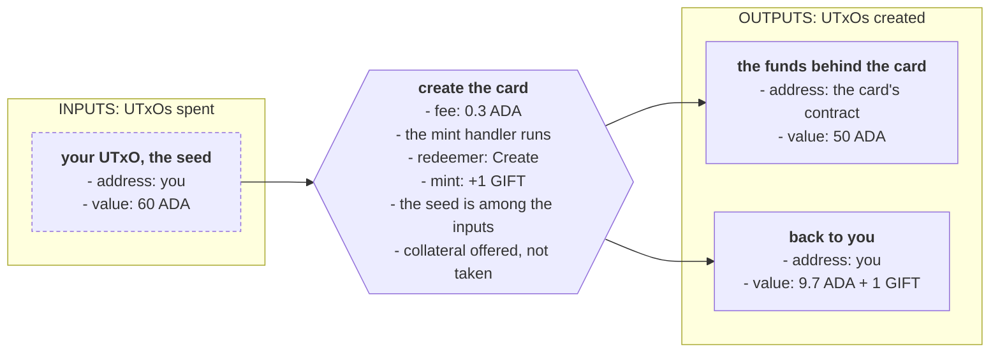
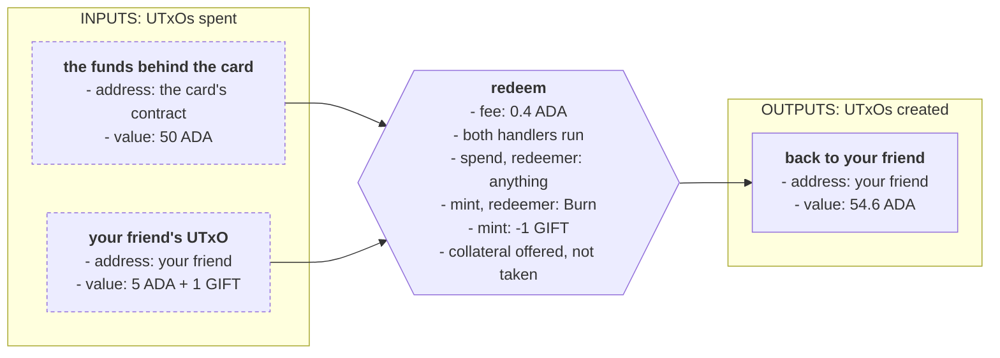
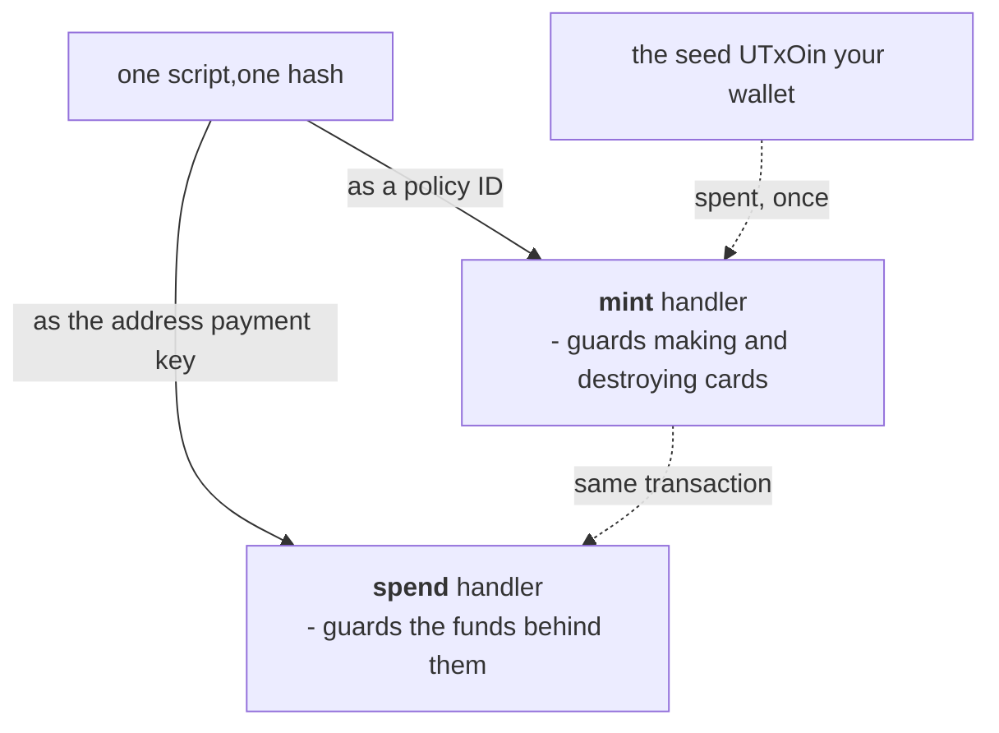
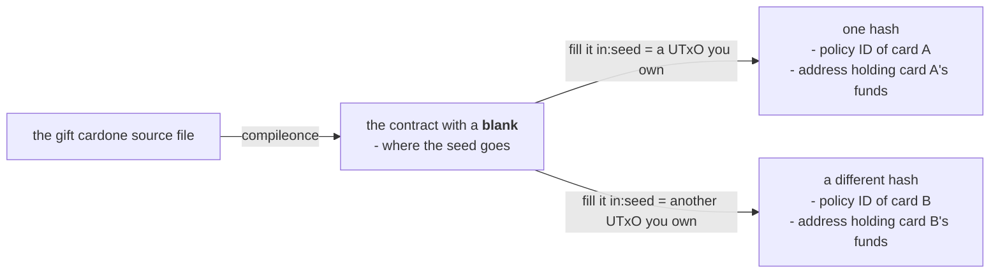

# Multi validators: a gift card

> One script guarding two actions at once, and a token that can only ever be created once, so that holding it is what releases the funds.

# Multi validators: a gift card

The last lecture had one purpose and one rule. This contract needs two things you have not met yet: **a state that is not in a datum** and **one script that guards two different purposes**.

## The idea

Let's say there's a shop that sells gift cards. You go there and buy a gift card redeemable for 50 ADA. You give the card to a friend. Your friend walks into the shop, hands over the card, gets 50 ADA transferred into his account, and the card is destroyed. Nobody can use it again.

In this case, we're trusting the shop will transfer the ADA to our friend. But what if we don't trust them? In that case, we don't need to go to the store. We can encode the logic for this use case in a smart contract that ensures these rules are followed, and that our friend gets paid!

## From idea to architecture

The same four questions as the last lecture.

**1. Write down the requirements.** Anybody may hold the card, and holding it is enough, so the card has no named owner. Anybody who holds the card can give it to anybody else. The funds and the card move together: the shop must not be able to release the goods and keep the card, and the customer must not be able to keep the card and take the goods. There is one card, and the shop must not be able to print a second one for the same funds.

**2. What actions are possible?** Two of them:

- Create a card.
- Redeem a card: destroy it and release the funds behind it.

Creating acts on a **token**, so it belongs to a `mint` handler. Redeeming acts on both a token and a **UTxO**, so it runs two handlers in one transaction: the `mint` handler destroys the card, and the `spend` handler releases the funds. The redeemer tells the mint handler which of its two jobs the transaction wants. Giving the card to somebody is not an action of the contract: the ledger moves tokens between wallets on its own, and that is what makes a card something you can hand to a friend. **[Validator purposes](/docs/developers/onboarding/lectures/intermediate/validator-purposes)** already showed that one script can declare both.

**3. What must be true for each action?** Creating a card is allowed once and never again. Remove that limit and anybody can make a second card, destroy that one instead, and take the 50 ADA that belongs to the first. Redeeming has a check in each handler, and they point at each other. The mint handler destroys a card only if the funds are taken in the same transaction. Let the card be destroyed on its own and your friend can throw it away without taking the goods: only one card can ever exist, so nothing is left that can release the funds, and the 50 ADA stays where it is for ever. Nobody gains anything, which is what makes it easy to do by accident. The spend handler releases the funds only if a card is destroyed in the same transaction. Remove that check and the funds leave without any card being destroyed. Anybody can take the 50 ADA, with or without a card, and your friend is left holding a card that opens nothing. One thing is not checked: how much is locked behind the card. The shop is trusted to lock the 50 ADA when it creates the card, so the contract does not look at the value.

**4. What has to be remembered to run the checks?** Nothing in a datum. The last lecture wrote the beneficiary into the datum, because a check had to know **who** may claim, and no check here needs a name. The state lives in the **token itself**. A token that exists means an unused card. A token that has been destroyed means a card that has been used. A token is a piece of state that anybody can hold and transfer, and it needs no datum.

The design in one sentence: **a card can only ever be created once, and the card and the funds have to move together in both directions: the funds are released only if a card is destroyed, and a card is destroyed only if the funds are released.**

## What makes it an NFT

Beginner defined an [NFT](/docs/developers/onboarding/lectures/beginner/tokens-fungible-and-nfts) as a token with a quantity of 1, under a policy that can never mint it again. Minting a quantity of 1 is easy. The hard part is the policy: it has to be impossible to run a second time.

Beginner's NFT used a native script with a deadline in it. Once the deadline passes, nobody can mint under that policy again. Before it passes, whoever holds the key can still mint more, so the token is only certainly unique after the deadline.

A validator can read the transaction, so it can ask for something stronger: **a specific UTxO must be spent in the transaction that creates the token**. A UTxO is consumed exactly once in the whole history of the chain. So a policy that asks for one can succeed at most once, and the card is unique from the block that created it.

That UTxO is called the **seed**, and a policy built this way is called a **one-shot policy**. The seed comes from your own wallet, and it is an ordinary UTxO holding ordinary ADA.

Creating a card is one transaction:



## How the two handlers cooperate

As **[the transaction context](/docs/developers/onboarding/lectures/intermediate/transaction-context)** showed, validators never call each other: each one judges the **same transaction** by its own rules. So the spend handler looks at the transaction that both handlers are part of, and it checks what that transaction destroys.

The mint handler looks the other way for the same reason. It asks whether the transaction spends a UTxO at this script's address, which is the check that stops a card being destroyed on its own. So the two handlers depend on each other: the funds need a burnt card, and a burnt card needs the funds to move.

Both handlers see this one transaction:



The spend rule asks whether a card was destroyed. It does not ask how many UTxOs that one destroyed card is releasing. Here each card guards a single locked UTxO, so the simpler question is enough. A contract that keeps several UTxOs at one address has to count them, and the Advanced track covers that problem under the name **[double satisfaction](/docs/developers/onboarding/lectures/advanced/detecting-vulnerabilities#double-satisfaction)**.

## Two purposes, one hash

Remember from **[validator purposes](/docs/developers/onboarding/lectures/intermediate/validator-purposes)** that one script has one hash, and that this hash can act as both its **address payment key** and its **policy ID**:



Because the two purposes share a hash, the spend purpose can look at what the transaction mints **under its own policy**. It does not need to be told which policy that is. It can read it from the address it is guarding.

## One card, one contract

The seed is a **[parameter](/docs/developers/onboarding/lectures/intermediate/parameters)**, so it is built into the contract's code before the contract has an address. Picking a different seed produces a different hash.

Every card therefore has a contract of its own, and its hash is both the policy ID and the address. The funds for one card sit at an address that belongs to that card alone:



Selling a second gift card means picking a second seed, then filling the blank in again with the two lines of off-chain code from **[parameters](/docs/developers/onboarding/lectures/intermediate/parameters#what-filling-the-blank-actually-involves)**.

## Try it

**Write the contract, then create a card and use it on the real network.**

<Tabs groupId="onchain">
<TabItem value="aiken" label="Aiken" default>

Start a new Aiken project for this contract, the way the last lecture did. This one needs no extra package:

```bash
cd on-chain
aiken new my-name/giftcard
cd giftcard
rm validators/placeholder.ak
```

Create `validators/giftcard.ak`. The imports first, contract and tests together:

```aiken title="validators/giftcard.ak"
use aiken/collection/dict
use aiken/collection/list
use cardano/address.{Address, Script, VerificationKey}
use cardano/assets.{PolicyId, from_lovelace}
use cardano/transaction.{Input, NoDatum, Output, OutputReference, Transaction}
```

Then the token name, the two actions, and the two handlers:

```aiken title="validators/giftcard.ak"
const card_name: ByteArray = "GIFT"

pub type CardAction {
  Create
  Burn
}

validator giftcard(utxo_ref: OutputReference) {
  mint(redeemer: CardAction, policy_id: PolicyId, self: Transaction) {
    expect [Pair(name, quantity)] =
      assets.tokens(self.mint, policy_id) |> dict.to_pairs()
    and {
      (name == card_name)?,
      when redeemer is {
        Create -> and {
            (quantity == 1)?,
            list.any(
              self.inputs,
              fn(input) { input.output_reference == utxo_ref },
            )?,
          }
        Burn -> and {
            (quantity == -1)?,
            list.any(
              self.inputs,
              fn(input) {
                input.output.address.payment_credential == Script(policy_id)
              },
            )?,
          }
      },
    }
  }

  spend(
    _datum: Option<Data>,
    _redeemer: Data,
    own_ref: OutputReference,
    self: Transaction,
  ) {
    expect Some(own_input) =
      list.find(self.inputs, fn(input) { input.output_reference == own_ref })
    expect Script(policy_id) = own_input.output.address.payment_credential
    expect [Pair(name, quantity)] =
      assets.tokens(self.mint, policy_id) |> dict.to_pairs()
    and {
      (name == card_name)?,
      (quantity == -1)?,
    }
  }

  else(_) {
    fail
  }
}
```

There is no datum type in this file, which is step 4: the token is the state. The two handlers are step 2, and the body of each one is step 3.

- `CardAction` is the mint redeemer, and it reaches the validator as a number: `Create` is constructor 0 and `Burn` is constructor 1.
- The **mint** handler asks a different question in each branch. `Create` asks for two things: one card is created, and `utxo_ref` is among the inputs. `list.any` compares references only, so the seed does not have to pay for anything or be sent anywhere. `Burn` asks for a card to be destroyed, which is minting a **negative** amount, and for a UTxO at this script's own address to be spent. It says nothing about the seed, because the seed was already spent when the card was created. It finds the script's address the same way the spend handler does, out of the `policy_id` it is handed, since that value is the script's hash.
- `assets.tokens` narrows the transaction's mint field to this policy, and `dict.to_pairs` turns what is left into a list. Matching that list against a single `Pair` is the same line you wrote for the vault's own policy in **[validator purposes](/docs/developers/onboarding/lectures/intermediate/validator-purposes)**, and it is what stops the policy minting a second name beside the card.
- The **spend** handler asks whether a card is being **destroyed** here. To find the policy ID, it looks for the input that it is guarding, takes the address of that input, and reads the script hash out of that address. That hash **is** the policy ID.

Then seven tests. Five of them call the `mint` handler and two call the `spend` handler:

```aiken title="validators/giftcard.ak"
// The script's own hash, which is also its policy id. 28 bytes, like any hash.
const policy: PolicyId =
  #"000000000000000000000000000000000000000000000000000000ff"

// The script's own address. Its payment credential holds the policy id, which
// is what the spend handler reads back out of it.
const script_address: Address =
  Address { payment_credential: Script(policy), stake_credential: None }

// An ordinary wallet address, for the UTxO the seed is spent from.
const wallet_address: Address =
  Address {
    payment_credential: VerificationKey(
      #"00000000000000000000000000000000000000000000000000000001",
    ),
    stake_credential: None,
  }

// The UTxO the policy is compiled around. Spending it is what allows the card
// to be created. A transaction id is 32 bytes.
const seed: OutputReference =
  OutputReference {
    transaction_id: #"0000000000000000000000000000000000000000000000000000000000000001",
    output_index: 0,
  }

// Some other UTxO, which is not the seed.
const other_ref: OutputReference =
  OutputReference {
    transaction_id: #"0000000000000000000000000000000000000000000000000000000000000002",
    output_index: 0,
  }

// The UTxO at the script's address that the spend handler is guarding.
const own_ref: OutputReference =
  OutputReference {
    transaction_id: #"0000000000000000000000000000000000000000000000000000000000000000",
    output_index: 0,
  }

// One UTxO being spent. Only two things about it matter: the reference, which
// the handlers compare against, and the address, which the spend handler reads
// the policy id out of.
fn input_at(ref: OutputReference, address: Address) -> Input {
  Input {
    output_reference: ref,
    output: Output {
      address,
      value: from_lovelace(5_000_000),
      datum: NoDatum,
      reference_script: None,
    },
  }
}

test create_ok_when_the_seed_is_spent() {
  let tx = Transaction {
    ..transaction.placeholder,
    inputs: [input_at(seed, wallet_address)],
    mint: assets.from_asset(policy, card_name, 1),
  }
  giftcard.mint(seed, Create, policy, tx)
}

test create_fails_without_the_seed() fail {
  let tx = Transaction {
    ..transaction.placeholder,
    inputs: [input_at(other_ref, wallet_address)],
    mint: assets.from_asset(policy, card_name, 1),
  }
  giftcard.mint(seed, Create, policy, tx)
}

test create_fails_for_two_cards() fail {
  let tx = Transaction {
    ..transaction.placeholder,
    inputs: [input_at(seed, wallet_address)],
    mint: assets.from_asset(policy, card_name, 2),
  }
  giftcard.mint(seed, Create, policy, tx)
}

test burn_ok_when_the_locked_utxo_is_spent() {
  let tx = Transaction {
    ..transaction.placeholder,
    inputs: [input_at(own_ref, script_address)],
    mint: assets.from_asset(policy, card_name, -1),
  }
  giftcard.mint(seed, Burn, policy, tx)
}

// Destroying the card on its own would leave the funds with nothing that can
// ever release them, since no second card can be created.
test burn_fails_on_its_own() fail {
  let tx = Transaction {
    ..transaction.placeholder,
    mint: assets.from_asset(policy, card_name, -1),
  }
  giftcard.mint(seed, Burn, policy, tx)
}

test redeem_ok_when_the_card_is_burned() {
  let tx = Transaction {
    ..transaction.placeholder,
    inputs: [input_at(own_ref, script_address)],
    mint: assets.from_asset(policy, card_name, -1),
  }
  giftcard.spend(seed, None, Void, own_ref, tx)
}

test redeem_fails_when_the_card_is_kept() fail {
  let tx = Transaction {
    ..transaction.placeholder,
    inputs: [input_at(own_ref, script_address)],
  }
  giftcard.spend(seed, None, Void, own_ref, tx)
}
```

The parameter comes first in every call, from **[parameters](/docs/developers/onboarding/lectures/intermediate/parameters)**. `seed` and `own_ref` are two different references on purpose: `seed` is the UTxO the policy was built from, and `own_ref` is the locked UTxO the spend handler is guarding.

```bash
aiken check
aiken build
```

Seven tests, seven passes. The four tests that are meant to fail also name what stopped them: three print the check that returned false, and `redeem_fails_when_the_card_is_kept` prints the match that found no minted token at all.

Now open `plutus.json` and find the three `giftcard.giftcard.*` entries. One is the mint handler, one is the spend handler, and one covers everything else. **All three share a hash**, and all three carry a `parameters` field naming the blank you left. The mint entry also names `CardAction` as its redeemer, with `Create` at index 0 and `Burn` at index 1.

Compare the hash with ours:

```
312eeec0e121aee21efb39db3298de48fd1e3a02ea21980b9ce5b538
```

Your seed is still missing, so this is the script with the blank in it. Filling the blank gives a different hash, and that one is the policy ID and the address of a real card.

[Aiken's own gift card example](https://aiken-lang.org/example--gift-card) builds the same contract together with its off-chain code, and is a good next thing to read.

</TabItem>
<TabItem value="scalus" label="Scalus">

A [Scalus](https://scalus.org/) version is coming soon. The idea is identical, only the language differs.

</TabItem>
</Tabs>

Stuck? The finished code is in the playground. See the **[introduction](/docs/developers/onboarding/lectures/intermediate/introduction#the-playground)**.

### Then run it

The playground has a small app for this contract. It locks 5 ADA behind the card rather than the story's 50, to save test ADA. From `playground/`:

<Tabs groupId="offchain">
<TabItem value="mesh" label="Mesh" default>

```bash
cd giftcard/off-chain/mesh
npm install
cp ../../../vault/off-chain/mesh/.env .env   # or fill in .env.example again
npm run dev
```

</TabItem>
<TabItem value="evolution" label="Evolution">

An [Evolution](https://github.com/IntersectMBO/evolution-sdk) version is coming soon. The idea is identical, only the library calls differ.

</TabItem>
</Tabs>

Connect your wallet and set up collateral, the same first two steps as the vault's app. No addresses appear yet, because the policy ID and the address are derived from a seed that is not chosen until you create a card. Then:

1. **Create a 5 ADA card.** One transaction spends the seed, mints the card and locks the funds. Refresh once it confirms: the policy ID and the address appear at the top, the same hash twice, and step 4 shows the locked UTxO and that you hold the card. On the explorer, the mint field shows the card with a quantity of 1, one output sits at the card's address, and the card is in the output that came back to you.
2. **Take the funds, keep the card.** The transaction is refused before anything is sent, because your SDK ran the contract first, and the spend handler found no card being burned.
3. **Redeem: burn the card, take the funds.** Approve it and wait. On the explorer, the inputs are the UTxO at the card's address and the UTxO of yours that held the card, the mint field shows the card with a quantity of -1, and the 5 ADA is an output at your own address. Refresh: nothing is left at the card's address, and the card no longer exists.

## Go deeper

- [One-shot policies](/docs/developers/curriculum/smart-contracts/write-a-validator#one-shot-policies): the same pattern on its own, without a contract around it.
- [Minting policies](/docs/developers/curriculum/native-tokens/minting-policies): the mint purpose in depth.
- [Token security](/docs/developers/curriculum/smart-contracts/security/vulnerabilities/token-security): what goes wrong when a token is used as a key.

Next: **[Modifying state: an oracle](/docs/developers/onboarding/lectures/intermediate/modifying-state)**.
