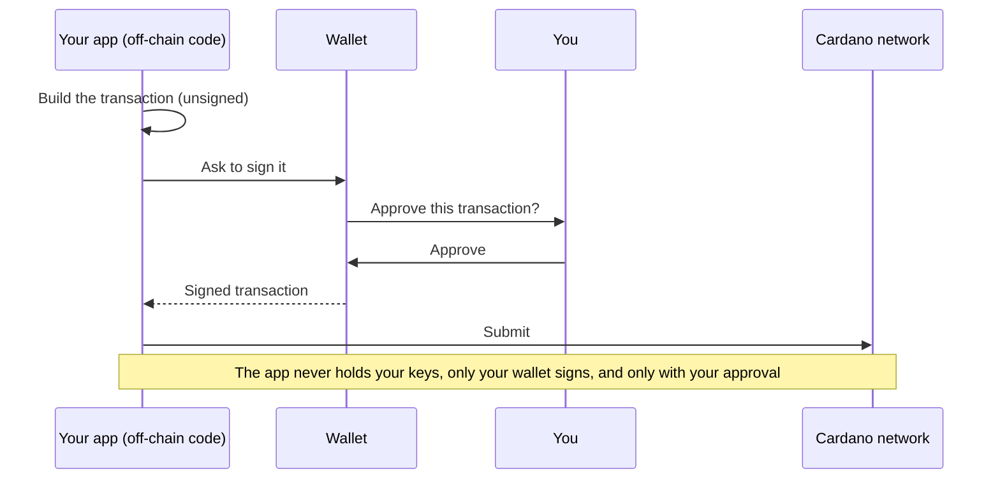

# Off-chain: build the transactions

> The off-chain code that builds the mint, lock, and swap transactions for the atomic swap.

# Off-chain: build the transactions

The contract from the last page only ever answers one question: _is this transaction allowed?_ It doesn't build transactions. That's this part's job.

"Off-chain" means the code that runs **on your computer** or a **regular server** (not on the blockchain). It's the program that assembles each transaction, creating tokens, making an offer, accepting one, and hands it to the wallet to sign and send. It can be written in many languages that have a Cardano SDK (pick one in the tabs below).

Each function below takes a **wallet** and a **provider** (your connection to the chain), so the exact same code works both in the browser and in the automated tests.

## The app prepares, your wallet signs

Notice what each function below returns: an **unsigned** transaction. The off-chain code only _prepares_ the transaction, it lays out the inputs, outputs, and rules, but it can't authorize it, and it never sees your private keys. Only your **wallet** can sign, and it does so only after you review and approve the request. The signed transaction is then submitted to the network. So even though the app builds the transaction, nothing moves without your explicit approval:



<Tabs groupId="offchain">
<TabItem value="mesh" label="Mesh" default>

## Find the contract

First we load the compiled `plutus.json` from the previous page. It tells us the contract's **address** (where offers get locked) and each person's token id.

```ts title="blueprint.ts"
// The compiled contract lives in `plutus.json`, produced by `aiken build` in
// ../../on-chain/aiken and copied here so the off-chain project is self-contained.

const PLUTUS_VERSION = "V3";

function compiledCode(title: string): string {
  const validator = blueprint.validators.find((v) => v.title === title);
  if (!validator) throw new Error(`validator "${title}" not found in plutus.json`);
  return validator.compiledCode;
}

/// The swap validator takes no parameters, so its script is fixed.
export const swapScriptCbor = applyParamsToScript(compiledCode("swap.swap.spend"), []);

/// Every offer is locked at this one script address.
export function swapAddress(networkId: number): string {
  return serializePlutusScript(
    { code: swapScriptCbor, version: PLUTUS_VERSION },
    undefined,
    networkId,
  ).address;
}

/// The minting policy is parameterized by the owner's key hash, so Alice and Bob
/// each get a distinct policy id and therefore a distinct token.
export function mintScriptCbor(ownerPubKeyHash: string): string {
  return applyParamsToScript(compiledCode("mint.token.mint"), [ownerPubKeyHash]);
}

export function tokenPolicyId(ownerPubKeyHash: string): string {
  return resolveScriptHash(mintScriptCbor(ownerPubKeyHash), PLUTUS_VERSION);
}
```

## Write the offer note

This builds the **datum** the offer note in the exact shape the contract expects: who to pay (the seller's full wallet address, payment key **and** stake key), and what they want back.

Notice how the price is built to **match the on-chain type field for field**. The contract's `PricedAsset { policy_id, asset_name, quantity }` becomes `mConStr0([policyId, assetName, quantity])` here, the same three fields, in the same order (`mConStr0` just means "constructor 0," the shape the contract reads back). The redeemers line up the same way: the on-chain `SwapAction { Swap, Cancel }` becomes `mConStr0([])` and `mConStr1([])`.

```ts title="datum.ts"
/// Encode the offer as the inline datum attached to the locked UTxO, the
/// exact shape the Aiken `SwapDatum` expects (a constructor of `owner` and a
/// list of `PricedAsset` constructors).
export function offerDatum(offer: SwapOffer): Data {
  const price = offer.price.map((asset) =>
    mConStr0([asset.policyId, asset.assetName, BigInt(asset.quantity)]),
  );
  const { pubKeyHash, stakeCredentialHash } = deserializeAddress(offer.owner);
  if (!stakeCredentialHash) {
    throw new Error("owner address has no stake key — use a normal wallet address");
  }
  // Store the owner's whole address (payment key + stake key) so the swap pays
  // them where their wallet can see it, not at a bare payment-key address.
  return mConStr0([mPubKeyAddress(pubKeyHash, stakeCredentialHash), price]);
}

/// Redeemers, matching the on-chain `SwapAction { Swap, Cancel }`.
export const swapRedeemer = mConStr0([]);
export const cancelRedeemer = mConStr1([]);
```

## Create a token

This builds a transaction that mints one token (Bob runs it for GOLD, Alice for SILVER).

```ts title="mint.ts"
/// Build an unsigned transaction that mints `quantity` of a token named
/// `assetNameHex` under the connected wallet's own minting policy. The minted
/// token lands back in the wallet as change.
export async function buildMintTx(
  wallet: Wallet,
  provider: IFetcher,
  assetNameHex: string,
  quantity: string,
): Promise<string> {
  const changeAddress = await wallet.getChangeAddress();
  const owner = deserializeAddress(changeAddress).pubKeyHash;
  const collateral = (await wallet.getCollateral())[0];
  if (!collateral) throw new Error("wallet has no collateral UTxO");

  const txBuilder = new MeshTxBuilder({ fetcher: provider });
  return await txBuilder
    .mintPlutusScriptV3()
    .mint(quantity, tokenPolicyId(owner), assetNameHex)
    .mintingScript(mintScriptCbor(owner))
    .mintRedeemerValue(mConStr0([]))
    .requiredSignerHash(owner)
    .txInCollateral(
      collateral.input.txHash,
      collateral.input.outputIndex,
      collateral.output.amount,
      collateral.output.address,
    )
    .changeAddress(changeAddress)
    .selectUtxosFrom(await wallet.getUtxos())
    .complete();
}
```

:::tip What just happened
Running this transaction creates a brand-new token and drops it into the wallet that made it. After it confirms, the GOLD (or SILVER) shows up in that wallet's balance.
:::

## Make an offer

This builds the transaction that moves Bob's GOLD **into the contract**, with the offer note attached.

```ts title="lock.ts"
/// Build an unsigned transaction that locks `assets` at the swap contract with
/// an offer datum saying the owner (the connected wallet) wants `price` back.
export async function buildLockTx(
  wallet: Wallet,
  provider: IFetcher,
  networkId: number,
  assets: Asset[],
  price: PricedAsset[],
): Promise<string> {
  const changeAddress = await wallet.getChangeAddress();

  const txBuilder = new MeshTxBuilder({ fetcher: provider });
  return await txBuilder
    .txOut(swapAddress(networkId), assets)
    .txOutInlineDatumValue(offerDatum({ owner: changeAddress, price }))
    .changeAddress(changeAddress)
    .selectUtxosFrom(await wallet.getUtxos())
    .complete();
}
```

:::tip What just happened
Bob's GOLD is no longer in his wallet, it now sits at the contract's address, tagged with "I want 5 SILVER." It stays there, visible to everyone, until someone accepts or Bob cancels. Note this transaction only _moves_ the token into the contract, the swap rule doesn't run here. It runs later, when someone spends this locked GOLD (the accept, or a cancel).
:::

## List the open offers

To show offers in the app, we read the contract's address and decode each locked token's note back into a readable offer.

```ts title="fetch-offers.ts"
/// An open offer read from the contract: the UTxO holding the locked asset,
/// plus the decoded terms.
export type Offer = {
  utxo: UTxO;
  owner: string; // the owner's full wallet address (bech32)
  price: PricedAsset[];
};

/// Read every open offer locked at the swap contract address, decoding each
/// locked UTxO's inline datum into an offer.
export async function fetchOffers(
  provider: IFetcher,
  networkId: number,
): Promise<Offer[]> {
  const utxos = await provider.fetchAddressUTxOs(swapAddress(networkId));
  const offers: Offer[] = [];
  for (const utxo of utxos) {
    const cbor = utxo.output.plutusData;
    if (!cbor) continue;
    const datum: any = deserializeDatum(cbor);
    offers.push({
      utxo,
      owner: serializeAddressObj(datum.fields[0], networkId),
      price: datum.fields[1].list.map((asset: any) => ({
        policyId: asset.fields[0].bytes,
        assetName: asset.fields[1].bytes,
        quantity: String(asset.fields[2].int),
      })),
    });
  }
  return offers;
}
```

## Accept an offer (the swap)

This is the heart of it. It builds the single transaction that pays the owner the price they asked for **and** takes the locked token, tagging the payment to this exact offer, exactly as the contract requires. Because this transaction spends a token sitting at the contract's address, it also **attaches the contract's code** (`txInScript`) so the network can run it and check the swap.

```ts title="swap.ts"
/// Build an unsigned transaction that fulfills `offer`: spend the locked UTxO,
/// pay the owner the price in an output *marked with the offer UTxO's reference*
/// (the double-satisfaction guard the validator checks), and take the asset.
export async function buildSwapTx(
  wallet: Wallet,
  provider: IFetcher,
  offer: Offer,
): Promise<string> {
  const changeAddress = await wallet.getChangeAddress();
  const collateral = (await wallet.getCollateral())[0];
  if (!collateral) throw new Error("wallet has no collateral UTxO");

  // The offer already stores the owner's full wallet address, so pay them there
  // directly, the validator checks the payment goes to this exact address.
  const ownerAddress = offer.owner;
  const price: Asset[] = offer.price.map((asset) => ({
    unit: asset.policyId + asset.assetName,
    quantity: asset.quantity,
  }));

  const txBuilder = new MeshTxBuilder({ fetcher: provider });
  return await txBuilder
    .spendingPlutusScriptV3()
    .txIn(
      offer.utxo.input.txHash,
      offer.utxo.input.outputIndex,
      offer.utxo.output.amount,
      offer.utxo.output.address,
    )
    .txInScript(swapScriptCbor)
    .txInInlineDatumPresent()
    .txInRedeemerValue(swapRedeemer)
    // Pay the owner the price, in an output marked with the offer's reference.
    .txOut(ownerAddress, price)
    .txOutInlineDatumValue(
      mOutputReference(offer.utxo.input.txHash, offer.utxo.input.outputIndex),
    )
    .txInCollateral(
      collateral.input.txHash,
      collateral.input.outputIndex,
      collateral.output.amount,
      collateral.output.address,
    )
    .changeAddress(changeAddress)
    .selectUtxosFrom(await wallet.getUtxos())
    .complete();
}
```

:::tip What just happened
In one transaction, Bob received his 5 SILVER and Alice walked away with the GOLD. Because both moves were in the same transaction, there was never a moment where one person had both, the trade was all-or-nothing.
:::

## Cancel an offer

If no one accepts, the owner can take their token back. This spends the locked UTxO with the `Cancel` action instead of `Swap`, and the contract allows it only when the owner signs, so we add them as a required signer. No one is paid, the token just returns to the owner.

```ts title="cancel.ts"
/// Build an unsigned transaction that cancels `offer`: the owner spends their own
/// locked UTxO with the `Cancel` redeemer and takes the asset back (it returns as
/// change). The validator only allows this if the owner signs, so we add the
/// owner's key as a required signer.
export async function buildCancelTx(
  wallet: Wallet,
  provider: IFetcher,
  offer: Offer,
): Promise<string> {
  const changeAddress = await wallet.getChangeAddress();
  const ownerPubKeyHash = deserializeAddress(changeAddress).pubKeyHash;
  const collateral = (await wallet.getCollateral())[0];
  if (!collateral) throw new Error("wallet has no collateral UTxO");

  const txBuilder = new MeshTxBuilder({ fetcher: provider });
  return await txBuilder
    .spendingPlutusScriptV3()
    .txIn(
      offer.utxo.input.txHash,
      offer.utxo.input.outputIndex,
      offer.utxo.output.amount,
      offer.utxo.output.address,
    )
    .txInScript(swapScriptCbor)
    .txInInlineDatumPresent()
    .txInRedeemerValue(cancelRedeemer)
    // The validator checks the owner signed, so require their key.
    .requiredSignerHash(ownerPubKeyHash)
    .txInCollateral(
      collateral.input.txHash,
      collateral.input.outputIndex,
      collateral.output.amount,
      collateral.output.address,
    )
    .changeAddress(changeAddress)
    .selectUtxosFrom(await wallet.getUtxos())
    .complete();
}
```

</TabItem>
<TabItem value="evolution" label="Evolution">

An [Evolution](https://github.com/IntersectMBO/evolution-sdk) version of the same steps is coming soon. The contract is identical — only the library calls differ.

</TabItem>
</Tabs>

**Go deeper:** the [Your first transaction](/docs/developers/curriculum/start-building/your-first-transaction) and [Transaction building](/docs/developers/curriculum/start-building/transaction-building) curriculum pages explain how Cardano transactions work in full.

Next: [put a web page on it](/docs/developers/onboarding/tutorial/frontend).
