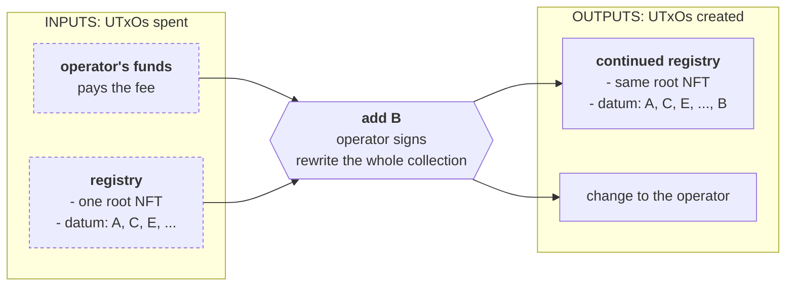
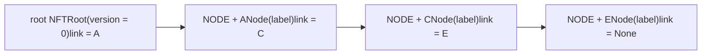
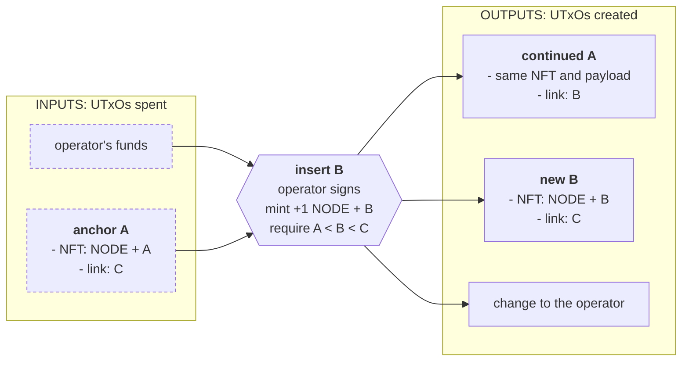
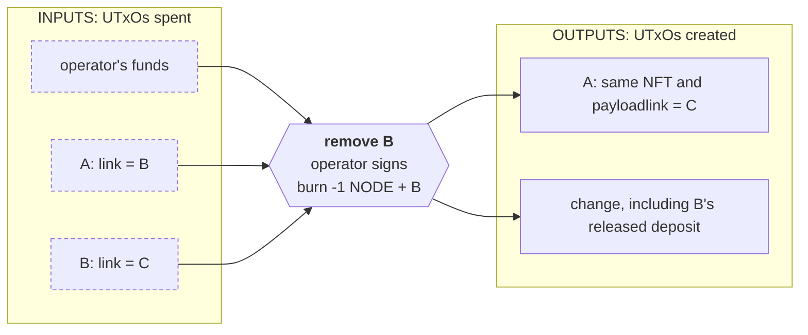
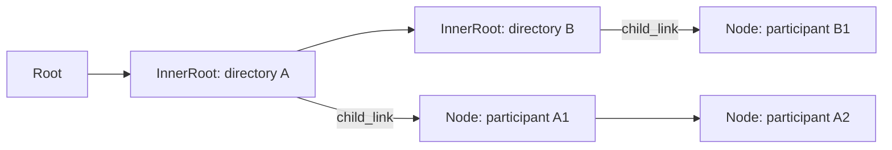

# Linked list

> Split a growing registry across authenticated UTxOs, change only its neighbors, and prove membership or absence with one reference input. Compare the costs with keeping every entry in one datum.

A growing collection eventually stops fitting comfortably in one datum. Every change has to replace that whole datum, every lookup has to search it, and every writer competes for the same UTxO. A **linked list** stores each entry in its own authenticated UTxO, with a pointer to the next entry. A change touches its neighbors rather than the whole collection.

This page builds a participant registry in three versions: one array datum, a linked list written by hand, and the same list with [`aiken-design-patterns` v1.9.0](https://github.com/Anastasia-Labs/aiken-design-patterns/tree/v1.9.0). It also covers the library's unordered operations, advanced list, and nested list. We asume you went over the [onboarding course](../lectures/introduction.md) or that you have built Cardano protocols in the past.

## The protocol

An **operator** maintains a directory of participants. Each participant has a 28-byte key and a label of at most 32 bytes. Only the operator can add, remove, or relabel entries. Other contracts can ask whether a key is present or absent without spending the directory. The registry attests what the operator registered; it does not prove who controls a key.

The obvious representation is one UTxO with every entry in its datum:



The baseline and the list share the application types. The list uses the library's `Element` data shape even in the hand-written version: `data` is either `Root` or `Node`, and `link` is `Some(next_key)` or `None`. Its checks are written out below.

<Tabs groupId="onchain">
<TabItem value="aiken" label="Aiken" default>

```aiken title="lib/registry.ak"
use aiken/collection/dict
use aiken/collection/list
use aiken/crypto.{VerificationKeyHash}
use aiken/primitive/bytearray
use aiken_design_patterns/linked_list.{Element, Node, Root}
use cardano/address.{Script}
use cardano/assets.{Assets, PolicyId}
use cardano/transaction.{
  InlineDatum, Input, Output, OutputReference, Transaction,
}
```

```aiken title="lib/registry.ak"
/// Disjoint NFT namespaces: the empty name is the root; NODE + a 28-byte key
/// identifies a participant. Keys are compared lexicographically.
pub const root_key = #""

pub const node_prefix = "NODE"

pub const prefix_length = 4

pub type RootState {
  version: Int,
}

pub type NodeState {
  label: ByteArray,
}

pub type ListDatum =
  Element<RootState, NodeState>

/// The baseline stores every participant in one authenticated datum.
pub type Entry {
  key: ByteArray,
  state: NodeState,
}

pub type Registry {
  entries: List<Entry>,
}
```

The **root NFT** has an empty asset name. A **node NFT** has the name `NODE ++ key`, exactly 32 bytes here. These namespaces cannot overlap. The datum stores only the successor's key, not its transaction hash: spending a node changes its output reference, but the NFT's name remains its identity.

The redeemers cover the lifecycle:

```aiken title="lib/registry.ak"
pub type MintAction {
  Init { output_index: Int }
  Insert { anchor_output: Int, node_output: Int }
  Remove { anchor_ref: OutputReference, anchor_output: Int }
  Deinit
}

pub type SpendAction {
  Structural { input_index: Int }
  Update { input_index: Int, output_index: Int }
}

pub type ArrayAction {
  Add { entry: Entry, output_index: Int }
  Delete { key: ByteArray, output_index: Int }
  Relabel { key: ByteArray, state: NodeState, output_index: Int }
  Close
}

/// Query demonstrations spend a separate probe, reading the registry without
/// spending it. In an application, the query key comes from its business rules.
pub type Query {
  Member { key: ByteArray, reference_index: Int }
  Absent { key: ByteArray, reference_index: Int }
}
```

The common checks enforce the label/key sizes, the operator's signature, and exact mint quantities. Each registry is one multi-purpose script, so its minting policy ID and spending credential are the same hash. The seed fixes the one-time initialization, as in [the oracle](../lectures/intermediate/12-modifying-state.md).

```aiken title="lib/registry.ak"
pub fn valid_entry(key: ByteArray, state: NodeState) -> Bool {
  bytearray.length(key) == 28 && bytearray.length(state.label) <= 32
}

pub fn authorized(operator: VerificationKeyHash, tx: Transaction) -> Bool {
  list.has(tx.extra_signatories, operator)
}

pub fn nonce_spent(seed: OutputReference, tx: Transaction) -> Bool {
  list.any(tx.inputs, fn(input) { input.output_reference == seed })
}

pub fn own_input(ref: OutputReference, inputs: List<Input>) -> Input {
  list.expect_find(inputs, fn(input) { input.output_reference == ref })
}

pub fn policy_of(input: Input) -> PolicyId {
  expect Script(policy) = input.output.address.payment_credential
  policy
}

pub fn only_mint(
  mint: Assets,
  policy: PolicyId,
  name: ByteArray,
  qty: Int,
) -> Bool {
  dict.to_pairs(assets.tokens(mint, policy)) == [Pair(name, qty)]
}

pub fn no_mint(mint: Assets, policy: PolicyId) -> Bool {
  dict.is_empty(assets.tokens(mint, policy))
}
```

An output's address cannot authenticate its datum. Anyone can send a fabricated entry to the registry address. The NFT from the pinned policy is what makes an entry genuine. These readers also require an inline typed datum, exactly one non-ada asset of quantity one, and no reference script:

```aiken title="lib/registry.ak"
/// An address alone is not an identity. Require exactly ada and one NFT from
/// the pinned policy, an inline typed datum, and no reference script.
pub fn read_element(
  output: Output,
  policy: PolicyId,
) -> (Option<ByteArray>, ListDatum) {
  expect output.reference_script == None
  expect [(p, name, quantity)] = assets.flatten(
    assets.without_lovelace(output.value),
  )
  expect p == policy && quantity == 1
  expect InlineDatum(raw) = output.datum
  expect element: ListDatum = raw
  let key = when element.data is {
    Root { .. } -> {
      expect name == root_key
      None
    }
    Node { data } -> {
      expect bytearray.take(name, prefix_length) == node_prefix
      let key = bytearray.drop(name, prefix_length)
      expect valid_entry(key, data)
      Some(key)
    }
  }
  (key, element)
}

pub fn read_array(output: Output, policy: PolicyId) -> Registry {
  expect output.reference_script == None
  expect [(p, name, quantity)] = assets.flatten(
    assets.without_lovelace(output.value),
  )
  expect p == policy && name == root_key && quantity == 1
  expect InlineDatum(raw) = output.datum
  expect registry: Registry = raw
  registry
}
```

</TabItem>
<TabItem value="scalus" label="Scalus">

A [Scalus](https://scalus.org/) version is coming soon. The idea is identical, only the language differs.

</TabItem>
</Tabs>

## The naive contract

The baseline mints the root NFT once, at its own address, with an empty array. An add checks the key is not already present, then appends the entry. A removal filters it out. Relabeling replaces that entry's payload. Every mutation reproduces the root NFT at the exact same address with the entire new array and at least its previous ada deposit. Closing requires the array to be empty and burns the root.

```aiken title="validators/naive.ak"
validator registry_array(seed: OutputReference, operator: ByteArray) {
  mint(action: MintAction, policy: PolicyId, tx: Transaction) {
    expect registry.authorized(operator, tx)
    when action is {
      Init { output_index } -> {
        expect registry.nonce_spent(seed, tx)
        let output = list.expect_at(tx.outputs, output_index)
        expect registry.read_array(output, policy) == Registry { entries: [] }
        output.address.payment_credential == Script(policy) && registry.only_mint(
          tx.mint,
          policy,
          registry.root_key,
          1,
        )
      }
      Deinit -> registry.only_mint(tx.mint, policy, registry.root_key, -1)
      _ -> fail
    }
  }

  spend(
    _datum: Option<Registry>,
    action: ArrayAction,
    ref: OutputReference,
    tx: Transaction,
  ) {
    expect registry.authorized(operator, tx)
    let input = registry.own_input(ref, tx.inputs)
    let policy = registry.policy_of(input)
    let old = registry.read_array(input.output, policy)
    when action is {
      Close ->
        old.entries == [] && registry.only_mint(
          tx.mint,
          policy,
          registry.root_key,
          -1,
        )
      _ -> {
        expect registry.no_mint(tx.mint, policy)
        let (entries, output_index) = when action is {
          Add { entry, output_index } -> {
            expect registry.valid_entry(entry.key, entry.state)
            expect !list.any(old.entries, fn(e) { e.key == entry.key })
            (list.concat(old.entries, [entry]), output_index)
          }
          Delete { key, output_index } -> {
            expect list.any(old.entries, fn(e) { e.key == key })
            (list.filter(old.entries, fn(e) { e.key != key }), output_index)
          }
          Relabel { key, state, output_index } -> {
            expect registry.valid_entry(key, state)
            expect list.any(old.entries, fn(e) { e.key == key })
            (
              list.map(
                old.entries,
                fn(e) {
                  if e.key == key {
                    registry.Entry { ..e, state }
                  } else {
                    e
                  }
                },
              ),
              output_index,
            )
          }
          Close -> fail
        }
        let output = list.expect_at(tx.outputs, output_index)
        and {
          output.address == input.output.address,
          registry.read_array(output, policy) == Registry { entries },
          assets.lovelace_of(output.value) >= assets.lovelace_of(
            input.output.value,
          ),
        }
      }
    }
  }

  else(_) {
    fail
  }
}
```

It works well for a small directory. But adding one entry costs {costFigure(Costs, "versions.naive.scenarios.insert.1.mem")} memory units with one existing participant, and {costFigure(Costs, "versions.naive.scenarios.insert.100.mem")} with 100. The transaction must serialize the entire continued datum too. Two otherwise unrelated relabels both spend the same registry UTxO, so only one can succeed against that version of the state.

## The pattern

Split the directory into a root and one UTxO per participant. Every element holds ada, its unique NFT, and the datum containing its payload and successor link. In this example the nodes are sorted by key:



These arrows are **datum links**, not transactions. Following one means finding the UTxO with that node NFT in an off-chain index. A script never needs to walk this whole chain to insert, remove, or read one entry.

### Insertion

To add B between A and C, spend A, mint B's NFT, and produce A pointing to B and B pointing to C. A is the **anchor**. C is neither spent nor needed as a reference input; A's authenticated link already names it.



The root can anchor an insertion before the first node. A terminal node can anchor one after the last. Strict comparisons prevent duplicate keys: the new key must be strictly between its neighbors, with a missing neighbor representing the boundary.

### Removal and data updates

To remove B, spend **both A and B**, burn B's NFT, and reproduce A with B's old link. The policy proves A actually pointed to B, so an unrelated node cannot be removed using A as the anchor.



Relabeling spends and reproduces **only that node**, without minting anything. Its address, NFT, and link stay the same. Two relabels of distinct nodes can use disjoint inputs. Two insertions into the same gap, or a relabel and removal of the same node, still compete. A linked list reduces the scope of [UTxO contention](../../curriculum/smart-contracts/security/vulnerabilities/resource-exhaustion.md#utxo-contention); it does not eliminate it.

### Membership and absence

An ascending list supports two proofs, each using **one authenticated reference input**:

- **Membership of B:** read the node with key B.
- **Absence of B:** read the anchor A whose key and successor straddle B: `A < B < C`.

The root proves a gap before the first node. A terminal node proves a gap after the last. An empty root proves every key absent. The strict comparisons are essential: A cannot prove A or C absent. An unordered list cannot prove absence this way.

The reader trusts these local proofs because every initialization and mutation preserved the global sorted-chain invariant. One arbitrary NFT or one sorted-looking datum would not be enough.

## Design

The four questions from Intermediate:

1. **Requirements.** One live entry per key, authenticated by the registry's policy. Only the operator mutates it. A reader can prove membership or absence without taking a write lock on the registry. Every continuing element keeps its deposit.
2. **Actions.** Initialize an empty root; insert a node; remove a node; update a node's label; destroy an empty root. A separate reader contract asks membership or absence questions.
3. **What must be true.** Initialization consumes the seed and places one root NFT at the registry. Insertion consumes exactly one authentic element, preserves its payload, wires both links, and mints only the new node NFT in strict order. Removal consumes exactly the linked pair, skips the removed node, and burns only its NFT. A data update changes no structure and mints no registry asset. Destruction burns an empty root. Every mutation needs the operator's signature.
4. **What must be remembered.** Root configuration, node labels, and successor keys live in datums. The NFT name carries the element's identity. The seed and operator key are script parameters. Readers pin the applied registry policy ID.

The spend and mint handlers cooperate as in [transaction-level validation](./transaction-level-validation.md). During a structural operation, each spend only requires a mint or burn under the list policy. That invokes the policy **once**; the policy proves the complete transition. During a label update, there is no minting policy invocation, so the spend must check its own continuation fully.

## Write it by hand

<Tabs groupId="onchain">
<TabItem value="aiken" label="Aiken" default>

The ordering and query helpers distinguish a root boundary from an actual node key. The same strict gap check is used by insertion and absence proofs:

```aiken title="lib/registry.ak"
/// Missing neighbors are the beginning/end of the list, not bytearray keys.
pub fn between(
  previous: Option<ByteArray>,
  key: ByteArray,
  next: Option<ByteArray>,
) -> Bool {
  let after_previous = when previous is {
    None -> True
    Some(previous) -> bytearray.compare(previous, key) == Less
  }
  let before_next = when next is {
    None -> True
    Some(next) -> bytearray.compare(key, next) == Less
  }
  after_previous && before_next
}

pub fn proves(
  query: Query,
  key: Option<ByteArray>,
  link: Option<ByteArray>,
) -> Bool {
  when query is {
    Member { key: wanted, .. } -> key == Some(wanted)
    Absent { key: wanted, .. } -> between(key, wanted, link)
  }
}

pub fn reference_index(query: Query) -> Int {
  when query is {
    Member { reference_index, .. } | Absent { reference_index, .. } ->
      reference_index
  }
}
```

The minting helper reads the real transaction outputs at the hinted indices and scans the **complete** input list for policy-bearing elements. Insertion requires exactly one; removal requires exactly two. An extra authentic input cannot pass through the cheap structural spend gate unnoticed.

```aiken title="lib/manual.ak"
/// Only inputs with this policy's assets can be list state. Always scan the
/// complete transaction inputs, never just the anchor named by the redeemer.
pub fn elements(tx: Transaction, policy: PolicyId) -> List<Input> {
  list.filter(tx.inputs, fn(i) { !registry.no_mint(i.output.value, policy) })
}

pub fn transition(action: MintAction, policy: PolicyId, tx: Transaction) -> Bool {
  when action is {
    Init { output_index } -> {
      let output = list.expect_at(tx.outputs, output_index)
      let (key, element) = registry.read_element(output, policy)
      expect
        key == None && element == Element {
          data: Root { data: RootState { version: 0 } },
          link: None,
        }
      output.address.payment_credential == Script(policy) && registry.only_mint(
        tx.mint,
        policy,
        registry.root_key,
        1,
      )
    }
    Insert { anchor_output, node_output } -> {
      expect [anchor] = elements(tx, policy)
      let continued = list.expect_at(tx.outputs, anchor_output)
      let node = list.expect_at(tx.outputs, node_output)
      let (anchor_key, old) = registry.read_element(anchor.output, policy)
      let (continued_key, next) = registry.read_element(continued, policy)
      let (new_key, new) = registry.read_element(node, policy)
      expect Some(key) = new_key
      expect Node { .. } = new.data
      expect anchor.output.address.payment_credential == Script(policy)
      and {
        continued.address == anchor.output.address,
        node.address.payment_credential == anchor.output.address.payment_credential,
        continued_key == anchor_key,
        next.data == old.data,
        next.link == Some(key),
        new.link == old.link,
        registry.between(anchor_key, key, old.link),
        assets.lovelace_of(continued.value) >= assets.lovelace_of(
          anchor.output.value,
        ),
        registry.only_mint(
          tx.mint,
          policy,
          bytearray.concat(registry.node_prefix, key),
          1,
        ),
      }
    }
    Remove { anchor_ref, anchor_output } -> {
      expect [first, second] = elements(tx, policy)
      let (anchor, removed) = if first.output_reference == anchor_ref {
        (first, second)
      } else {
        expect second.output_reference == anchor_ref
        (second, first)
      }
      let continued = list.expect_at(tx.outputs, anchor_output)
      let (anchor_key, old) = registry.read_element(anchor.output, policy)
      let (removed_key, node) = registry.read_element(removed.output, policy)
      let (continued_key, next) = registry.read_element(continued, policy)
      expect Some(key) = removed_key
      expect anchor.output.address.payment_credential == Script(policy)
      and {
        removed.output.address.payment_credential == anchor.output.address.payment_credential,
        continued.address == anchor.output.address,
        continued_key == anchor_key,
        next.data == old.data,
        old.link == Some(key),
        next.link == node.link,
        assets.lovelace_of(continued.value) >= assets.lovelace_of(
          anchor.output.value,
        ),
        registry.only_mint(
          tx.mint,
          policy,
          bytearray.concat(registry.node_prefix, key),
          -1,
        ),
      }
    }
    Deinit -> {
      expect [root] = elements(tx, policy)
      let (key, element) = registry.read_element(root.output, policy)
      key == None && element.link == None && root.output.address.payment_credential == Script(
        policy,
      ) && registry.only_mint(tx.mint, policy, registry.root_key, -1)
    }
  }
}
```

The validator supplies authorization and the one-time seed check, delegates structural transitions to that helper, and handles label updates locally:

```aiken title="validators/by_hand.ak"
validator registry_list(seed: OutputReference, operator: ByteArray) {
  mint(action: MintAction, policy: PolicyId, tx: Transaction) {
    expect registry.authorized(operator, tx)
    expect
      when action is {
        Init { .. } -> registry.nonce_spent(seed, tx)
        _ -> True
      }
    manual.transition(action, policy, tx)
  }

  spend(
    _datum: Option<ListDatum>,
    action: SpendAction,
    ref: OutputReference,
    tx: Transaction,
  ) {
    expect registry.authorized(operator, tx)
    let input_index = when action is {
      Structural { input_index } | Update { input_index, .. } -> input_index
    }
    let input = list.expect_at(tx.inputs, input_index)
    expect input.output_reference == ref
    let policy = registry.policy_of(input)
    when action is {
      Structural { .. } -> !registry.no_mint(tx.mint, policy)
      Update { output_index, .. } -> {
        expect registry.no_mint(tx.mint, policy)
        let output = list.expect_at(tx.outputs, output_index)
        let (key, old) = registry.read_element(input.output, policy)
        let (next_key, next) = registry.read_element(output, policy)
        // Only node labels are mutable; root configuration stays fixed.
        expect Some(_) = key
        and {
          output.address == input.output.address,
          key == next_key,
          old.link == next.link,
          assets.lovelace_of(output.value) >= assets.lovelace_of(
            input.output.value,
          ),
        }
      }
    }
  }

  else(_) {
    fail
  }
}
```

An index is a hint, not authorization. The spend checks that the input at its index is the one being spent. Mint output hints select actual outputs, which are then authenticated and checked. Both address rules matter: the **continued anchor** stays at the exact old address, including its stake credential; a **new node** must share its payment credential, but may use a different stake credential.

The demonstration reader spends a separate probe UTxO. Only this reader script executes; the registry is attached as a reference input:

```aiken title="validators/proofs.ak"
validator by_hand(policy: PolicyId) {
  spend(
    _datum: Option<Data>,
    query: Query,
    _ref: OutputReference,
    tx: Transaction,
  ) {
    let reference = list.expect_at(
      tx.reference_inputs,
      registry.reference_index(query),
    )
    let (key, element) = registry.read_element(reference.output, policy)
    registry.proves(query, key, element.link)
  }

  else(_) {
    fail
  }
}
```

The probe exists to exercise the proof with the real ledger context. It is not an application vault: anyone can spend it after supplying a valid query. An application derives the queried key from its own rules and uses the result to authorize its own action.

</TabItem>
<TabItem value="scalus" label="Scalus">

A [Scalus](https://scalus.org/) version is coming soon. The idea is identical, only the language differs.

</TabItem>
</Tabs>

## The same with the library

<Tabs groupId="onchain">
<TabItem value="aiken" label="Aiken" default>

The default [`linked_list` module](https://github.com/Anastasia-Labs/aiken-design-patterns/blob/v1.9.0/lib/aiken-design-patterns/linked-list.ak) checks the same structural transitions. The callbacks provide the registry's rules: typed and bounded node data, no reduction in anchor ada, and an authenticated root at the intended payment credential.

```aiken title="validators/with_library.ak"
validator registry_list(seed: OutputReference, operator: ByteArray) {
  mint(action: MintAction, policy: PolicyId, tx: Transaction) {
    expect registry.authorized(operator, tx)
    when action is {
      Init { output_index } ->
        linked_list.init(
          registry.nonce_spent(seed, tx),
          list.expect_at(tx.outputs, output_index),
          tx.mint,
          fn(address, _ada, data) {
            let expected: Data = RootState { version: 0 }
            address.payment_credential == Script(policy) && data == expected
          },
        )
          |> linked_list.run_root_with(policy, registry.root_key)
      Insert { anchor_output, node_output } -> {
        let node = list.expect_at(tx.outputs, node_output)
        linked_list.insert_ascending(
          list.expect_at(tx.outputs, anchor_output),
          node,
          tx.inputs,
          tx.mint,
          fn(_anchor, delta, _key, _data, _ada, key, data, _link) {
            expect state: NodeState = data
            delta >= 0 && registry.valid_entry(key, state)
          },
        )
          |> linked_list.run_element_with(
              policy,
              registry.root_key,
              registry.node_prefix,
              registry.prefix_length,
            )
      }
      Remove { anchor_ref, anchor_output } ->
        linked_list.remove(
          anchor_ref,
          list.expect_at(tx.outputs, anchor_output),
          tx.inputs,
          tx.mint,
          fn(
            _anchor,
            delta,
            _key,
            _data,
            _removed,
            _ada,
            _removed_key,
            _removed_data,
            _link,
          ) {
            delta >= 0
          },
        )
          |> linked_list.run_element_with(
              policy,
              registry.root_key,
              registry.node_prefix,
              registry.prefix_length,
            )
      Deinit ->
        linked_list.deinit(tx.inputs, tx.mint, fn(_input, _ada, _data) { True })
          |> linked_list.run_root_with(policy, registry.root_key)
    }
  }

  spend(
    _datum: Option<ListDatum>,
    action: SpendAction,
    ref: OutputReference,
    tx: Transaction,
  ) {
    expect registry.authorized(operator, tx)
    let input_index = when action is {
      Structural { input_index } | Update { input_index, .. } -> input_index
    }
    let input = list.expect_at(tx.inputs, input_index)
    expect input.output_reference == ref
    let policy = registry.policy_of(input)
    when action is {
      Structural { .. } ->
        linked_list.spend_for_adding_or_removing_an_element(policy, tx.mint)
      Update { output_index, .. } ->
        linked_list.spend_for_updating_elements_data(
          input_index,
          output_index,
          ref,
          tx.inputs,
          tx.outputs,
          tx.mint,
          fn(_address, delta, key, _old, new, _link) {
            expect Some(key) = key
            expect state: NodeState = new
            delta >= 0 && registry.valid_entry(key, state)
          },
        )
          |> linked_list.run_element_with(
              policy,
              registry.root_key,
              registry.node_prefix,
              registry.prefix_length,
            )
    }
  }

  else(_) {
    fail
  }
}
```

Helpers return a function awaiting the list's constants. `run_element_with` supplies the policy ID, root name, node prefix, and prefix length. Root-only operations use `run_root_with`; node-only readers use `run_node_with`. These runners configure the checks; they do not discover a policy on their own.

The library's `get_element_info` authenticates the reference and supplies its key and link to the same query check:

```aiken title="validators/proofs.ak"
validator with_library(policy: PolicyId) {
  spend(
    _datum: Option<Data>,
    query: Query,
    _ref: OutputReference,
    tx: Transaction,
  ) {
    let reference = list.expect_at(
      tx.reference_inputs,
      registry.reference_index(query),
    )
    linked_list.get_element_info(
      reference.output,
      fn(_address, _ada, key, _data, link) { registry.proves(query, key, link) },
    )
      |> linked_list.run_element_with(
          policy,
          registry.root_key,
          registry.node_prefix,
          registry.prefix_length,
        )
  }

  else(_) {
    fail
  }
}
```

**What remains the caller's responsibility:** the one-time nonce, operator authorization, NFT namespaces, key and payload rules, deposit changes, and the script wiring. Pass complete transaction inputs in ledger order, and select every supplied output from the real transaction outputs. `spend_for_adding_or_removing_an_element` only checks that the policy is invoked; it cannot make an arbitrary minting branch a valid list transition.

The hand-written reader fully decodes the typed payload. The library's structural helpers use generic `Data`, preserve it where needed, and decode application payloads in callbacks. That difference helps the library use fewer execution units here; it is still a larger compiled script. Measure your own application checks rather than assuming either implementation is always cheaper.

### Other default operations

The library also supports these operations, exercised by the helper-level tests in `lib/variants.ak`:

| Operation | Helper |
|---|---|
| Descending ordered insertion | `insert_descending` |
| Add after the terminal element without ordering | `append_unordered` |
| Add immediately after the root without ordering | `prepend_unordered` |
| Remove the first node and change root data using its payload | `fold_from_root` |
| Read only a root or only a node | `get_root_element_info`, `get_node_element_info` |

Descending insertion reverses both comparisons. Numeric keys need a **fixed-width byte encoding** if their numerical order matters: `00ff < 0100`, whereas `ff > 0100` as bytearrays. Participant keys here already have a fixed width.

Unordered appends and prepends still check NFT authentication and pointer wiring, but they do **not** prove key uniqueness or absence. The caller must supply a separate uniqueness rule, such as keys derived from unique consumed nonces. Do not switch this registry to unordered insertion while retaining its absence reader.

`fold_from_root` spends the root and its first node, burns that node's NFT, adopts its link, and lets the callback update root data. The test increments the root version. Ordinary `remove` preserves the anchor payload instead. Data-update helpers preserve the link and constructor, so they cannot stand in for a structural operation.

### Advanced lists

[`linked_list/advanced`](https://github.com/Anastasia-Labs/aiken-design-patterns/blob/v1.9.0/lib/aiken-design-patterns/linked-list/advanced.ak) keeps the same element type but allows **reference scripts** on elements and **caller-validated anchor payload changes** during insertion/removal. Structural continuations preserve the anchor's reference script. Data-update callbacks see both the old and new reference-script hashes and decide which changes are acceptable.

It also allows additional mints and burns under the same policy **outside the reserved root and node namespaces**. The callbacks receive those changes as `NonStructuralListAssets`, and same-policy inputs at other payment credentials as `NonStructuralListInputs`. These are separate classifications; allowing an extra asset does not allow an extra list node to be consumed.

This tested helper allows a new node carrying a specific reference script and exactly one unrelated `RECEIPT` mint. It rejects collected external same-policy inputs, preserves the anchor data, and keeps the deposit:

```aiken title="lib/variants.ak"
/// Advanced insertion can carry a reference script and an unrelated RECEIPT
/// mint. Every captured output is selected from the real transaction outputs.
pub fn insert_with_receipt(tx: Transaction, policy: PolicyId) -> Bool {
  let continued = list.expect_at(tx.outputs, 0)
  let node = list.expect_at(tx.outputs, 1)
  advanced.insert_ascending(
    continued,
    node,
    tx.inputs,
    tx.mint,
    fn(
      _anchor,
      delta,
      _anchor_key,
      old,
      next,
      _ada,
      key,
      data,
      _link,
      script,
      extra,
      external_inputs,
    ) {
      expect state: NodeState = data
      and {
        delta >= 0,
        old == next,
        registry.valid_entry(key, state),
        script == Some(policy),
        dict.to_pairs(extra) == [Pair("RECEIPT", 1)],
        external_inputs == [],
      }
    },
  )
    |> linked_list.run_element_with(
        policy,
        registry.root_key,
        registry.node_prefix,
        registry.prefix_length,
      )
}
```

The tests pair that accepted shape with an extra root mint and an extra node mint, both refused. Root initialization remains strict: only the singleton root mint is allowed. Every policy branch must respect that reserved asset, including application-specific branches. The advanced helpers still use the default structural spend gate.

### Nested lists

[`linked_list/nested`](https://github.com/Anastasia-Labs/aiken-design-patterns/blob/v1.9.0/lib/aiken-design-patterns/linked-list/nested.ak) adds an **InnerRoot**: a directory in the outer list, and an anchor for its own child list. Its normal `link` points to the next directory; its extra `child_link` points to its first participant.



The outer and child chains can have different ordering modes. `InnerRoot` and `Node` still share **one NFT namespace**, so keys must be unique across both roles, not merely within each directory. Ordered nested insertion checks only the affected chains; it cannot detect a key already used in another directory.

This variant uses generated element IDs. The helper requires a **consumed nonce UTxO** and derives each 28-byte key as `blake2b_224(CBOR(nonce_output_reference, role))`, with distinct `Directory` and `Participant` roles. The nonce can be the spent anchor itself. A nonce cannot be consumed twice, and this insertion creates exactly one element per role, so keys are globally unique under the hash's collision-resistance assumption. Every nested minting branch must enforce the same derivation and role assignments; a branch creating multiple children would also need a distinct index in each child's hash input.

The helper creates a directory with one child using `insert_inner_list_ascending`. The preparation callback checks the derived directory key, the per-node callback checks the derived child key and counts children, and the final callback requires exactly one child and validates the anchor change:

```aiken title="lib/variants.ak"
pub type NestedDatum =
  nested.Element<RootState, NodeState, NodeState>

pub type NestedRole {
  Directory
  Participant
}

/// One consumed nonce creates one directory and one child. Role tags separate
/// their 28-byte keys; the NODE prefix brings each asset name to 32 bytes.
pub fn nested_key(nonce: OutputReference, role: NestedRole) -> ByteArray {
  blake2b_224(cbor.serialise((nonce, role)))
}

/// Insert a directory containing its first participant. Outer and inner
/// ordering is local; nonce-derived keys enforce uniqueness across all chains.
/// Every nested mint branch must use the same key rule and role assignments.
pub fn insert_directory(
  tx: Transaction,
  policy: PolicyId,
  nonce: OutputReference,
) -> Bool {
  expect registry.nonce_spent(nonce, tx)
  nested.insert_inner_list_ascending(
    nested.Ascending,
    list.expect_at(tx.outputs, 0),
    list.expect_at(tx.outputs, 1),
    tx.inputs,
    [list.expect_at(tx.outputs, 2)],
    tx.mint,
    fn(_ada, key, data, _child_link, script) {
      expect state: NodeState = data
      expect key == nested_key(nonce, Directory)
      expect registry.valid_entry(key, state) && script == None
      0
    },
    fn(count, _index, address, _ada, key, data, _link, script) {
      expect state: NodeState = data
      expect key == nested_key(nonce, Participant)
      expect registry.valid_entry(key, state)
      expect address.payment_credential == Script(policy) && script == None
      count + 1
    },
    fn(
      _anchor,
      delta,
      _key,
      old,
      next,
      _old_link,
      count,
      extra,
      external_inputs,
    ) {
      delta >= 0 && old == next && count == 1 && dict.is_empty(extra) && external_inputs == []
    },
  )
    |> linked_list.run_element_with(
        policy,
        registry.root_key,
        registry.node_prefix,
        registry.prefix_length,
      )
}
```

The tests accept a first and second directory with fresh keys. They reject a reference-only nonce, a child key reused from another directory, keys reused across directory/child roles, and a child pointer that does not name the supplied child. `insert_inner_list_descending` changes the outer ordering; `insert_into_inner_list` inserts a child beneath an existing inner root or child anchor, with `Ascending`, `Descending`, or `Unordered` ordering. Those operations also need application-level global key uniqueness. Whole-list insertion supplies the child outputs in pointer order and must end at `None`.

The nested module also supplies initialization/destruction, data updates, and element/root/inner-root/node readers. Updates preserve both the ordinary link and an inner root's child link. Nested removal requires custom logic; the base module's `remove` does not understand two links. As with the advanced list, callbacks handle reference scripts and permitted non-structural assets and inputs.

These advanced and nested snippets are **helper-level examples**, tested by `aiken check`. The deployed registry and Mesh benchmark use the default ascending list, whose full validator is above.

</TabItem>
<TabItem value="scalus" label="Scalus">

A [Scalus](https://scalus.org/) version is coming soon. The idea is identical, only the language differs.

</TabItem>
</Tabs>

## Build the transaction

<Tabs groupId="offchain">
<TabItem value="mesh" label="Mesh" default>

The Mesh example uses three versions and the same datum layouts as Aiken:

```ts title="src/lib/blueprint.ts"
export const VERSIONS = ["naive", "byHand", "withLibrary"] as const;
export type Version = typeof VERSIONS[number];
export type Entry = { key: string; label: string };
export type Scripts = {
  version: Version;
  cbor: string;
  policy: string;
  address: string;
  proofCbor: string;
  proofAddress: string;
};
export const ROOT = "";
export const PREFIX = stringToHex("NODE");
```

```ts title="src/lib/blueprint.ts"
/// A 28-byte fixed-width ordering key. The fixture uses even keys so each gap
/// has a missing odd key to prove absent.
export function keyOf(n: number): string {
  return n.toString(16).padStart(56, "0");
}

export function entryData(entry: Entry) {
  return mConStr0([entry.key, mConStr0([stringToHex(entry.label)])]);
}

export function arrayDatum(entries: Entry[]) {
  return mConStr0([entries.map(entryData)]);
}

/// Element(Root(version) | Node(label), Some(next key) | None).
export function elementDatum(entry: Entry | undefined, next?: string) {
  const data = entry
    ? mConStr1([mConStr0([stringToHex(entry.label)])])
    : mConStr0([mConStr0([0])]);
  return mConStr0([data, next === undefined ? mConStr1([]) : mConStr0([next])]);
}
```

The offline chain applies the seed and operator parameters before hashing each registry, then applies that policy ID to its reader script. It supplies fixed UTxOs, protocol parameters, a test-only wallet, and `OfflineEvaluator`. `Chain` is the return type of `offlineChain` in `src/lib/offline.ts`; it contains those fixtures and the selected version's scripts. Nothing is submitted.

A plan records the inputs, outputs, mint, and references before construction:

```ts title="src/lib/registry.ts"
export type Mutation = "insert" | "remove" | "update" | "init" | "deinit";
export type Plan = {
  inputs: { utxo: UTxO; redeemer: Data; cbor: string }[];
  outputs: { address: string; amount: Asset[]; datum: Data }[];
  mint?: { name: string; quantity: string; redeemer: Data }[];
  references: UTxO[];
  signed: boolean;
};
```

The examples mutate the tail to keep the benchmark comparable: add after the last participant, remove the last, or relabel the last. The validator supports any valid anchor. A production builder finds the affected node and its predecessor from its off-chain index, using their NFTs rather than trusting the address.

Input indices are calculated **after including the chosen wallet input**, against ledger order:

```ts title="src/lib/registry.ts"
/// Fix wallet inputs before writing any spend input index.
export function byLedgerOrder(a: UTxO, b: UTxO): number {
  return a.input.txHash.localeCompare(b.input.txHash) || a.input.outputIndex - b.input.outputIndex;
}
```

The plan writes each continuation at a known output index. Insertion writes the anchor at zero and the new node at one. Removal includes both spend redeemers and one burn redeemer. The root's initialization and destruction use the same lifecycle helpers:

```ts title="src/lib/registry.ts"
/// Insert at the tail, remove/relabel the last node, or start/end an empty
/// registry. The off-chain index supplies the affected node and its predecessor.
export function mutationPlan(chain: Chain, action: Mutation, entry: Entry): Plan {
  const { deployed: d, entries } = chain;
  const plan: Plan = { inputs: [], outputs: [], references: [], signed: true };
  const addInput = (utxo: UTxO, redeemer: Data) =>
    plan.inputs.push({ utxo, redeemer, cbor: d.cbor });
  const addOutput = (utxo: UTxO, datum: Data) =>
    plan.outputs.push({ address: utxo.output.address, amount: utxo.output.amount, datum });
  const mint = (name: string, quantity: string, redeemer: Data) => {
    plan.mint = [{ name, quantity, redeemer }];
  };
  if (action === "init") {
    plan.outputs.push({
      address: d.address,
      amount: [
        { unit: "lovelace", quantity: "100000000" },
        { unit: d.policy, quantity: "1" },
      ],
      datum: d.version === "naive" ? arrayDatum([]) : elementDatum(undefined),
    });
    mint("", "1", mConStr0([0]));
    return plan;
  }
  if (d.version === "naive") {
    const input = chain.array!;
    if (action === "deinit") {
      addInput(input, mConStr3([]));
      mint("", "-1", mConStr3([]));
    } else if (action === "insert") {
      addInput(input, mConStr0([entryData(entry), 0]));
      addOutput(input, arrayDatum([...entries, entry]));
    } else if (action === "remove") {
      addInput(input, mConStr1([entry.key, 0]));
      addOutput(input, arrayDatum(entries.filter((e) => e.key !== entry.key)));
    } else {
      addInput(input, mConStr2([entry.key, mConStr0([stringToHex(entry.label)]), 0]));
      addOutput(input, arrayDatum(entries.map((e) => e.key === entry.key ? entry : e)));
    }
    return plan;
  }
  const last = chain.nodes.at(-1);
  const lastEntry = entries.at(-1);
  const index = (utxo: UTxO, others: UTxO[] = []) =>
    [chain.funding, utxo, ...others].sort(byLedgerOrder).findIndex((u) => u === utxo);
  if (action === "deinit") {
    addInput(chain.root!, mConStr0([index(chain.root!)]));
    mint("", "-1", mConStr3([]));
  } else if (action === "insert") {
    const anchor = last ?? chain.root!;
    addInput(anchor, mConStr0([index(anchor)]));
    addOutput(anchor, elementDatum(lastEntry, entry.key));
    plan.outputs.push({
      address: d.address,
      amount: [
        { unit: "lovelace", quantity: "100000000" },
        { unit: d.policy + PREFIX + entry.key, quantity: "1" },
      ],
      datum: elementDatum(entry),
    });
    mint(PREFIX + entry.key, "1", mConStr1([0, 1]));
  } else if (action === "remove") {
    if (!last || !lastEntry) throw new Error("no node to remove");
    const anchor = chain.nodes.at(-2) ?? chain.root!;
    addInput(anchor, mConStr0([index(anchor, [last])]));
    addInput(last, mConStr0([index(last, [anchor])]));
    addOutput(anchor, elementDatum(entries.at(-2)));
    mint(
      PREFIX + lastEntry.key,
      "-1",
      mConStr2([mOutputReference(anchor.input.txHash, anchor.input.outputIndex), 0]),
    );
  } else {
    if (!last) throw new Error("no node to update");
    addInput(last, mConStr1([index(last), 0]));
    addOutput(last, elementDatum(entry));
  }
  return plan;
}
```

A query attaches the authenticated node, or the baseline's whole array, as a reference input:

```ts title="src/lib/registry.ts"
/// The caller's query probe reads one authenticated reference UTxO. It does
/// not spend the registry or run its minting/spending handlers.
export function proofPlan(chain: Chain, present: boolean, key: string): Plan {
  const reference = chain.array ?? chain.nodes.at(-1) ?? chain.root!;
  return {
    inputs: [{
      utxo: chain.probe,
      cbor: chain.deployed.proofCbor,
      redeemer: present ? mConStr0([key, 0]) : mConStr1([key, 0]),
    }],
    outputs: [],
    references: [reference],
    signed: false,
  };
}
```

`enoughAda` computes the ledger minimum for the actual address, assets, and inline datum with `csl.min_ada_for_output`, adding ada when necessary. The benchmark deliberately supplies a large fixed deposit so the baseline's growing datum remains funded while measuring the size limit. That deposit is a fixture, not a recommended per-node amount.

<details>
<summary>The minimum-ada calculation</summary>

```ts title="src/lib/registry.ts"
/// OfflineEvaluator does not enforce phase-1 min-UTxO. Calculate it explicitly,
/// including tokens and inline datum, and preserve at least the input deposit.
async function enoughAda(chain: Chain, output: Plan["outputs"][number]): Promise<Asset[]> {
  const lovelace = output.amount.find((a) => a.unit === "lovelace")!.quantity;
  const value = csl.Value.new(csl.BigNum.from_str(lovelace));
  const multi = csl.MultiAsset.new();
  for (const a of output.amount.filter((a) => a.unit !== "lovelace")) {
    multi.set_asset(
      csl.ScriptHash.from_hex(a.unit.slice(0, 56)),
      csl.AssetName.new(Buffer.from(a.unit.slice(56), "hex")),
      csl.BigNum.from_str(a.quantity),
    );
  }
  value.set_multiasset(multi);
  const out = csl.TransactionOutput.new(csl.Address.from_bech32(output.address), value);
  out.set_plutus_data(csl.PlutusData.from_hex(serializeData(output.datum)));
  const p = await chain.fetcher.fetchProtocolParameters(Number.NaN);
  const cost = csl.DataCost.new_coins_per_byte(csl.BigNum.from_str(p.coinsPerUtxoSize.toString()));
  const minimum = BigInt(csl.min_ada_for_output(out, cost).to_str());
  return output.amount.map((a) =>
    a.unit === "lovelace" && BigInt(a.quantity) < minimum
      ? { ...a, quantity: minimum.toString() }
      : a,
  );
}
```

</details>

The transaction builder consumes exactly the chosen inputs. There is no late coin selection to shift the indices, and change comes last. Honest measurements pass the evaluator so execution fees reflect the actual scripts:

```ts title="src/lib/registry.ts"
/// Plans are exposed so tests can forge one field without running an evaluator
/// during construction. Honest builders pass the evaluator for accurate fees.
export async function buildPlan(chain: Chain, plan: Plan, evaluator?: IEvaluator): Promise<string> {
  const tx = new MeshTxBuilder({ fetcher: chain.fetcher, evaluator });
  const funding = chain.funding;
  tx.txIn(funding.input.txHash, funding.input.outputIndex, funding.output.amount, funding.output.address);
  for (const { utxo, redeemer, cbor } of plan.inputs) {
    tx.spendingPlutusScriptV3()
      .txIn(utxo.input.txHash, utxo.input.outputIndex, utxo.output.amount, utxo.output.address)
      .txInScript(cbor)
      .txInInlineDatumPresent()
      .txInRedeemerValue(redeemer);
  }
  for (const output of plan.outputs) {
    const amount = await enoughAda(chain, output);
    tx.txOut(output.address, amount).txOutInlineDatumValue(output.datum);
  }
  for (const mint of plan.mint ?? []) {
    tx.mintPlutusScriptV3()
      .mint(mint.quantity, chain.deployed.policy, mint.name)
      .mintingScript(chain.deployed.cbor)
      .mintRedeemerValue(mint.redeemer);
  }
  for (const ref of plan.references) {
    tx.readOnlyTxInReference(ref.input.txHash, ref.input.outputIndex);
  }
  if (plan.signed) tx.requiredSignerHash(chain.operator);
  const c = chain.collateral;
  return tx.txInCollateral(c.input.txHash, c.input.outputIndex, c.output.amount, c.output.address)
    .changeAddress(chain.walletAddress)
    .complete();
}
```

</TabItem>
<TabItem value="evolution" label="Evolution">

An [Evolution](https://github.com/IntersectMBO/evolution-sdk) version is coming soon. The idea is identical, only the library calls differ.

</TabItem>
</Tabs>

## The numbers

`npm run bench` builds each transaction on an in-memory chain, evaluates the compiled scripts, signs offline to count the wallet witness in transaction size, and writes `costs.json`. Every figure here comes from that file. `npm test` measures again and rejects stale figures. Limits and fee parameters are Mesh's defaults, so a live deployment should measure with its network's current parameters.

The independent variable is **participants already in the registry**, not inputs in a batch. The transaction changes or queries one participant. Membership selects the last entry and absence selects a key after it, so the naive reader searches the whole array.

**Memory units for adding one participant**, summed over all spend and mint handlers:

| Existing participants | One datum | By hand | With the library |
|---|--:|--:|--:|
| 1 | {costFigure(Costs, "versions.naive.scenarios.insert.1.mem")} | {costFigure(Costs, "versions.byHand.scenarios.insert.1.mem")} | {costFigure(Costs, "versions.withLibrary.scenarios.insert.1.mem")} |
| 5 | {costFigure(Costs, "versions.naive.scenarios.insert.5.mem")} | {costFigure(Costs, "versions.byHand.scenarios.insert.5.mem")} | {costFigure(Costs, "versions.withLibrary.scenarios.insert.5.mem")} |
| 10 | {costFigure(Costs, "versions.naive.scenarios.insert.10.mem")} | {costFigure(Costs, "versions.byHand.scenarios.insert.10.mem")} | {costFigure(Costs, "versions.withLibrary.scenarios.insert.10.mem")} |
| 20 | {costFigure(Costs, "versions.naive.scenarios.insert.20.mem")} | {costFigure(Costs, "versions.byHand.scenarios.insert.20.mem")} | {costFigure(Costs, "versions.withLibrary.scenarios.insert.20.mem")} |
| 100 | {costFigure(Costs, "versions.naive.scenarios.insert.100.mem")} | {costFigure(Costs, "versions.byHand.scenarios.insert.100.mem")} | {costFigure(Costs, "versions.withLibrary.scenarios.insert.100.mem")} |

**Fee for adding one participant**, in ada:

| Existing participants | One datum | By hand | With the library |
|---|--:|--:|--:|
| 1 | {costFigure(Costs, "versions.naive.scenarios.insert.1.fee", "ada")} | {costFigure(Costs, "versions.byHand.scenarios.insert.1.fee", "ada")} | {costFigure(Costs, "versions.withLibrary.scenarios.insert.1.fee", "ada")} |
| 5 | {costFigure(Costs, "versions.naive.scenarios.insert.5.fee", "ada")} | {costFigure(Costs, "versions.byHand.scenarios.insert.5.fee", "ada")} | {costFigure(Costs, "versions.withLibrary.scenarios.insert.5.fee", "ada")} |
| 10 | {costFigure(Costs, "versions.naive.scenarios.insert.10.fee", "ada")} | {costFigure(Costs, "versions.byHand.scenarios.insert.10.fee", "ada")} | {costFigure(Costs, "versions.withLibrary.scenarios.insert.10.fee", "ada")} |
| 20 | {costFigure(Costs, "versions.naive.scenarios.insert.20.fee", "ada")} | {costFigure(Costs, "versions.byHand.scenarios.insert.20.fee", "ada")} | {costFigure(Costs, "versions.withLibrary.scenarios.insert.20.fee", "ada")} |
| 100 | {costFigure(Costs, "versions.naive.scenarios.insert.100.fee", "ada")} | {costFigure(Costs, "versions.byHand.scenarios.insert.100.fee", "ada")} | {costFigure(Costs, "versions.withLibrary.scenarios.insert.100.fee", "ada")} |

**Memory units for membership**, one reference input in every version:

| Participants | One datum | By hand | With the library |
|---|--:|--:|--:|
| 1 | {costFigure(Costs, "versions.naive.scenarios.member.1.mem")} | {costFigure(Costs, "versions.byHand.scenarios.member.1.mem")} | {costFigure(Costs, "versions.withLibrary.scenarios.member.1.mem")} |
| 5 | {costFigure(Costs, "versions.naive.scenarios.member.5.mem")} | {costFigure(Costs, "versions.byHand.scenarios.member.5.mem")} | {costFigure(Costs, "versions.withLibrary.scenarios.member.5.mem")} |
| 10 | {costFigure(Costs, "versions.naive.scenarios.member.10.mem")} | {costFigure(Costs, "versions.byHand.scenarios.member.10.mem")} | {costFigure(Costs, "versions.withLibrary.scenarios.member.10.mem")} |
| 20 | {costFigure(Costs, "versions.naive.scenarios.member.20.mem")} | {costFigure(Costs, "versions.byHand.scenarios.member.20.mem")} | {costFigure(Costs, "versions.withLibrary.scenarios.member.20.mem")} |
| 100 | {costFigure(Costs, "versions.naive.scenarios.member.100.mem")} | {costFigure(Costs, "versions.byHand.scenarios.member.100.mem")} | {costFigure(Costs, "versions.withLibrary.scenarios.member.100.mem")} |

**Other operations at 100 participants**, memory units:

| Operation | One datum | By hand | With the library |
|---|--:|--:|--:|
| Remove | {costFigure(Costs, "versions.naive.scenarios.remove.100.mem")} | {costFigure(Costs, "versions.byHand.scenarios.remove.100.mem")} | {costFigure(Costs, "versions.withLibrary.scenarios.remove.100.mem")} |
| Relabel | {costFigure(Costs, "versions.naive.scenarios.update.100.mem")} | {costFigure(Costs, "versions.byHand.scenarios.update.100.mem")} | {costFigure(Costs, "versions.withLibrary.scenarios.update.100.mem")} |
| Prove absent | {costFigure(Costs, "versions.naive.scenarios.absent.100.mem")} | {costFigure(Costs, "versions.byHand.scenarios.absent.100.mem")} | {costFigure(Costs, "versions.withLibrary.scenarios.absent.100.mem")} |

**Script and transaction sizes**, bytes. Each registry script is included in the transaction, shared between its handlers:

| Size | One datum | By hand | With the library |
|---|--:|--:|--:|
| Applied registry script | {costFigure(Costs, "versions.naive.scriptSize")} | {costFigure(Costs, "versions.byHand.scriptSize")} | {costFigure(Costs, "versions.withLibrary.scriptSize")} |
| Insert with 100 existing participants, signed | {costFigure(Costs, "versions.naive.scenarios.insert.100.size")} | {costFigure(Costs, "versions.byHand.scenarios.insert.100.size")} | {costFigure(Costs, "versions.withLibrary.scenarios.insert.100.size")} |

What these measurements say:

- **For a tiny directory, one datum is cheaper to mutate.** It needs no node NFT mint and has a smaller script. Splitting the state adds fixed work.
- **The list's local cost does not depend on the whole registry size.** At 100 participants, hand-written insertion uses {costSaving(Costs, "versions.naive.scenarios.insert.100.mem", "versions.byHand.scenarios.insert.100.mem")} less memory than the baseline. Insertion into a registry with {costFigure(Costs, "largeList.size")} participants still uses {costFigure(Costs, "largeList.byHand.mem")} by hand and {costFigure(Costs, "largeList.withLibrary.mem")} with the library. This is constant in total collection size, not in the number of other inputs or outputs you put in a transaction.
- **The library needs fewer execution units but a higher insertion fee than the hand-written version.** Its larger included script outweighs that execution saving here. [Reference scripts](../lectures/intermediate/13-reference-inputs-and-scripts.md) change that trade-off; these measurements include the scripts directly.
- **The single-datum insertion limit is finite.** This fixture can add one participant with at most {costFigure(Costs, "arrayLimit.largestExisting")} already present. The last fitting signed transaction is {costFigure(Costs, "arrayLimit.last.size")} bytes against a {costFigure(Costs, "limits.size")}-byte limit, and the first limit reached is {costLimit(Costs, "arrayLimit.limitedBy")}. Beyond it, Mesh refuses construction. Different labels, witnesses, script deployment, or datum layouts change that threshold. This is an insertion limit for this builder, not a universal maximum for every action.
- **Reference inputs avoid copying the datum into the body, not reading it on-chain.** The naive membership transaction's size stays flat, but its execution cost grows as it scans the referenced array. The linked reader authenticates only one fixed-size element.

There is no corresponding total-entry limit to find by enlarging this linked-list transaction: it still touches the same local elements. The chain must nevertheless store every node, and every one requires its own minimum ada. Reading the entire directory or folding every node into a root is not constant-cost work.

## When to use it, and when not

Use a linked list when a **mutable collection** must outgrow one datum, changes can be local, and other scripts need authenticated membership or absence proofs. A sorted list is particularly useful for live registries and sets with a uniqueness rule.

Keep one datum for a small, bounded collection whose writers rarely compete. A linked list introduces NFTs, a mint/spend protocol, an off-chain index, and an ada deposit per element. For a mostly static set where only membership matters, a [Merkle tree](./merkle-tree.md) commits the set to one root instead; the reader supplies a hash proof rather than references to stored nodes.

Avoid a global counter updated on every insertion if the goal is independent writes: storing it in the root makes every insertion spend that root again. The registry's root configuration is fixed, so insertion into an existing gap does not require the root. The single operator key is an authorization choice, not a requirement of the list structure.

**Live uniqueness is not historical uniqueness.** Removal destroys the node, so the same key may be inserted later. To use insertion as a proof that an asset has never been minted before, retain its key permanently, prohibit its removal, and require every relevant mint to perform that insertion.

### Security

The Aiken and Mesh tests establish these boundaries:

- **One initialized root.** Initialization needs the pinned nonce and puts the root at the registry credential. Extra root minting during insertion is refused. Destruction of a nonempty registry is refused.
- **Authenticated proofs.** A fabricated datum at the right address without the policy NFT is refused. A missing key cannot prove membership, and an existing key cannot prove absence. Boundary tests cover the root, terminal node, and empty list.
- **No broken pointers.** Insertion must retain the old successor on the new node. Removal must bypass the removed node. Relabeling cannot change a link. Duplicate insertion is refused.
- **No extra structural inputs.** An insertion with an additional authentic input is refused by the minting policy. A structural spend without policy minting is refused by the spend script.
- **Checked hints.** A spend index naming the wallet input, an output index beyond the outputs, and a reference index beyond the references all fail.
- **Authorized, funded continuations.** Unsigned mutations, redirected continuations, missing continuation NFTs, shortened deposits, and labels beyond the size bound fail.
- **Library variant boundaries.** The default library refuses a reference script on a new node. The advanced helper accepts its permitted reference script and receipt but refuses extra root/node mints. The nested helper refuses a reference-only nonce, reused keys across directories or roles, and a broken child link.
- **A complete lifecycle.** Each version creates, inserts, relabels, removes, and closes using the actual outputs of the preceding transactions. Honest transactions assert every expected `MINT` and `SPEND` run; forged transactions are constructed without an evaluator and checked for refusal by the intended handler.

The list does not establish that an operator's registration is truthful. Readers must pin the **applied** policy ID, and application authorization must constrain the query they ask. A referenced UTxO must still exist when the reading transaction is processed; an update that spends it can require the reader to rebuild. The offline evaluator checks scripts, while network submission additionally enforces the ledger's phase-1 rules.

## Run it

```bash
npx giget@latest gh:cardano-foundation/developer-portal/examples/onboarding/design-patterns/linked-list linked-list
cd linked-list/on-chain/aiken
aiken check
aiken build
cp plutus.json ../../off-chain/mesh/blueprints/linked-list.plutus.json
cd ../../off-chain/mesh
npm install
npm run typecheck
npm test
npm run bench
```

The blueprint and measured figures ship with the example, so the Mesh tests can run without compiling Aiken first. After changing a validator, rebuild, copy the blueprint, and regenerate the figures before running the stale-cost check.

## Go deeper

- [Modifying state](../lectures/intermediate/12-modifying-state.md): continuing outputs and beacon authentication.
- [Missing UTxO authentication](../../curriculum/smart-contracts/security/vulnerabilities/missing-utxo-authentication.md): why the NFT, not the address, establishes state identity.
- [Resource exhaustion](../../curriculum/smart-contracts/security/vulnerabilities/resource-exhaustion.md): growing datums and UTxO contention.
- [Merkle Patricia trie](./merkle-patricia-trie.md) and [Merkle tree](./merkle-tree.md): other ways to organize or commit to large collections.
- [`linked_list` API](https://anastasia-labs.github.io/aiken-design-patterns/aiken_design_patterns/linked_list.html), [`advanced` API](https://anastasia-labs.github.io/aiken-design-patterns/aiken_design_patterns/linked_list/advanced.html), and [`nested` API](https://anastasia-labs.github.io/aiken-design-patterns/aiken_design_patterns/linked_list/nested.html): the library's contracts for callers.
- [Plutonomicon associative data structures](https://github.com/Plutonomicon/plutonomicon/blob/main/assoc.md#overview): the structure behind these local transitions.
