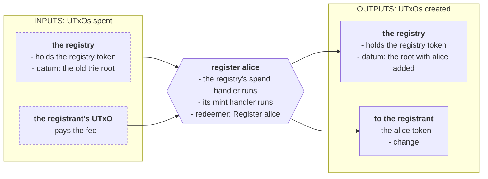
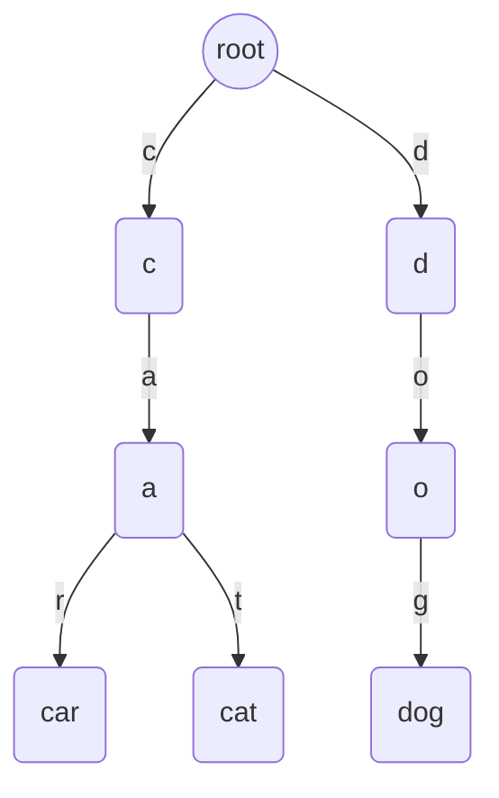
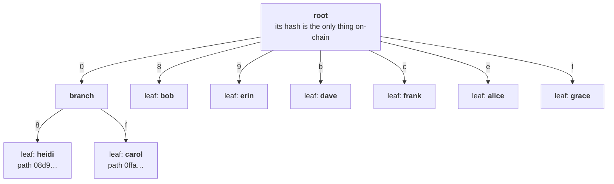

# Merkle Patricia trie

> Keep a key-value registry of any size behind one 32-byte root, and insert, update, delete and look up entries with short proofs. Measured against keeping every entry in the datum.

A registry that only grows cannot live in one datum for long. Every entry makes the datum larger, every check reads all of it, and at some point the transaction that rewrites it no longer fits. This pattern keeps the whole registry **off-chain**, as a trie, and puts only its **root**, 32 bytes, on-chain. A transaction that changes the registry brings a short **proof** that the change is correct, and the validator checks it against the root.

The trie is a **Merkle Patricia trie**, as implemented by [Merkle Patricia Forestry](https://github.com/aiken-lang/merkle-patricia-forestry), the library from the Aiken team. It is a map from keys to values with five operations: insert, update, delete, prove a key is present, and prove a key is absent. That last one is what a plain [Merkle tree](/docs/developers/onboarding/design-patterns/merkle-tree) cannot do cheaply, and it is what a registry of unique names needs.

## The protocol

An **open name registry**. Anyone can register a free name, and the name points at a key. Whoever registers a name receives a **name token**, and whoever holds the token controls the name. Three actions change the registry:

- **Register**: claim a name nobody holds, pointing at a key. Mints the name's token.
- **Retarget**: point a name at another key. Only the token's holder can.
- **Release**: give a name up. Burns its token, and the name is free again.

A separate contract reads the trie registry without changing it: **pay to a name**. Ada sent to a name waits until anyone releases it, to whichever key the name points at by then. This reader expects a trie root; the payment builders reject the naive registry's list datum.

A registration:



The registry is one UTxO, marked by a **registry token**. Names are minted under the same policy as that token, with the name as the token name. Every version on this page shares this much:

```aiken title="lib/names.ak"
/// The registry token uses the empty asset name. User-registered names must
/// be nonempty so their tokens cannot collide with it under this policy.
pub const registry_token: AssetName = ""
```

An asset's identity is its policy ID together with its asset name. The [ledger permits asset names of 0–32 bytes](https://github.com/IntersectMBO/cardano-ledger/blob/master/eras/conway/impl/cddl/data/conway.cddl), so the registry token's empty name is valid and distinct from ada. Reserving it leaves **1–32 bytes** for user-registered names. A name's target is a **28-byte payment verification-key hash**, checked on registration and retargeting.

The actions. Each carries what the version needs to check the change, its `proof`:

```aiken title="lib/names.ak"
/// What a transaction does to the registry. `proof` is whatever the version
/// needs to check the change: a trie proof, or nothing at all.
pub type Action<proof> {
  /// Claim a free name, pointing at `target`. Mints the name's token.
  Register { name: ByteArray, target: ByteArray, proof: proof }
  /// Point a name at a new target. Only whoever holds the name's token may.
  Retarget { name: ByteArray, old: ByteArray, new: ByteArray, proof: proof }
  /// Give a name up. Burns the name's token, so only its holder can.
  Release { name: ByteArray, target: ByteArray, proof: proof }
}
```

Every change spends the registry and recreates it. `continuation` finds both, and checks the new registry is the one registry UTxO again, holding only ada and its token, with at least the input's ada deposit. Preserving that deposit prevents a registrant from taking it as change. Rejecting other tokens prevents anyone from filling the registry with assets that make later transactions larger:

```aiken title="lib/names.ak"
/// The registry being spent, and the registry it becomes. Checks the input is
/// the registry, by its token, and the output is the one registry UTxO again:
/// the same address, holding only ADA and the registry token, preserving its
/// ADA deposit. Returns the policy, the old datum and the new one.
pub fn continuation(
  self: Transaction,
  own_ref: OutputReference,
) -> (PolicyId, Data, Data) {
  expect Some(own_input) = transaction.find_input(self.inputs, own_ref)
  let Output { address, value, datum, .. } = own_input.output
  expect Script(policy) = address.payment_credential
  expect assets.quantity_of(value, policy, registry_token) == 1
  expect InlineDatum(old) = datum
  // Locate the registry's next UTxO by its address, then check all of it.
  expect Some(next) = list.find(
    self.outputs,
    fn(output) { output.address == address },
  )
  expect
    assets.flatten(assets.without_lovelace(next.value)) == [
      (policy, registry_token, 1),
    ]
  expect next.reference_script == None
  expect assets.lovelace_of(next.value) >= assets.lovelace_of(value)
  expect InlineDatum(new) = next.datum
  (policy, old, new)
}
```

What was minted, and whether the transaction holds a name:

```aiken title="lib/names.ak"
/// Everything the transaction mints or burns under `policy`.
pub fn minted(mint: Assets, policy: PolicyId) -> Pairs<AssetName, Int> {
  assets.tokens(mint, policy) |> dict.to_pairs
}

/// Whether the transaction spends an input holding the token for `name`:
/// whoever can spend it holds the name.
pub fn holds_name(
  inputs: List<Input>,
  policy: PolicyId,
  name: ByteArray,
) -> Bool {
  list.any(
    inputs,
    fn(input) { assets.quantity_of(input.output.value, policy, name) > 0 },
  )
}
```

The minting policy creates the registry once, then lets names be minted and burned only while the registry is spent, so the spend handler sees every one:

```aiken title="lib/names.ak"
/// The policy's rule. Its first mint creates the registry: the one registry
/// token, minted by spending `seed`, so it can happen only once, sent to the
/// registry's own address with `empty` as its datum. After that, names are
/// minted and burned only while the registry is spent, so its spend handler
/// checks every one.
pub fn mint_ok(
  self: Transaction,
  policy: PolicyId,
  seed: OutputReference,
  empty: Data,
) -> Bool {
  if minted(self.mint, policy) == [Pair(registry_token, 1)] {
    let registry = Address {
      payment_credential: Script(policy),
      stake_credential: None,
    }
    and {
      list.any(self.inputs, fn(input) { input.output_reference == seed }),
      list.any(
        self.outputs,
        fn(output) {
          and {
            output.address == registry,
            assets.flatten(assets.without_lovelace(output.value)) == [
              (policy, registry_token, 1),
            ],
            output.datum == InlineDatum(empty),
          }
        },
      ),
    }
  } else {
    list.any(
      self.inputs,
      fn(input) {
        assets.quantity_of(input.output.value, policy, registry_token) == 1
      },
    )
  }
}
```

The spend handler and the mint handler are one validator, so the registry's address and its policy ID are the same hash, as in **[transaction-level validation](/docs/developers/onboarding/design-patterns/transaction-level-validation)**.

## The naive contract (the problem)

The obvious registry keeps every name and its target in its datum:

```aiken title="validators/naive.ak"
/// The obvious registry: every name and its target, in its datum.
pub type Names =
  Pairs<ByteArray, ByteArray>

validator registry(seed: OutputReference) {
  spend(
    _datum: Option<Data>,
    action: Action<Void>,
    own_ref: OutputReference,
    self: Transaction,
  ) {
    let (policy, old, new) = names.continuation(self, own_ref)
    expect old: Names = old
    expect new: Names = new
    let minted = names.minted(self.mint, policy)
    when action is {
      Register { name, target, .. } -> and {
          name != registry_token,
          bytearray.length(target) == 28,
          minted == [Pair(name, 1)],
          !pairs.has_key(old, name),
          new == [Pair(name, target), ..old],
        }
      Retarget { name, old: from, new: to, .. } -> and {
          minted == [],
          bytearray.length(to) == 28,
          names.holds_name(self.inputs, policy, name),
          pairs.get_first(old, name) == Some(from),
          new == list.map(
            old,
            fn(Pair(key, value)) {
              if key == name {
                Pair(key, to)
              } else {
                Pair(key, value)
              }
            },
          ),
        }
      Release { name, target, .. } -> and {
          minted == [Pair(name, -1)],
          pairs.get_first(old, name) == Some(target),
          new == list.filter(old, fn(Pair(key, _)) { key != name }),
        }
    }
  }

  mint(_redeemer: Data, policy: PolicyId, self: Transaction) {
    let none: Names = []
    names.mint_ok(self, policy, seed, none)
  }

  else(_) {
    fail
  }
}
```

The tests cover its registration, ownership and continuation rules. Its scaling problem is that the datum is the registry:

- **Every change reads and rewrites every name.** Registering checks the name against the whole list, and the new datum is the whole list again. A registration into a registry of 100 names uses {costFigure(Costs, "versions.naive.register.100.mem")} memory units, against {costFigure(Costs, "versions.naive.register.10.mem")} for 10.
- **It has a ceiling.** The new datum travels in the transaction. With the names and builder measured below, one more registration fits with at most **{costFigure(Costs, "naiveLimit.largestExisting")} names already present**. Different name lengths, witnesses or script deployment change that threshold.
- **It locks more ada as it grows.** A UTxO's minimum ada grows with its size, and the registry's datum is most of it. The builder tops up the deposit when necessary. This example preserves the deposit even when names are released; it has no refund or registry-closure action.

## The pattern (the solution)

**Keep the names in a trie off-chain, and only its root on-chain.**

A **trie**, or prefix tree, stores keys by their shared beginnings. Each step down the tree is one more symbol of the key, so keys that start the same way share a branch, and finding a key takes as many steps as the key is long, however many keys there are:



A **Merkle Patricia trie** changes three things:

1. **The path is the key's hash, not the key.** Each name's BLAKE2b-256 hash, written as 64 hexadecimal digits, is its path. So every node has up to 16 children, one per digit, and paths spread evenly however similar the names are.
2. **Lone branches collapse.** A path with no other key near it is stored as one step that skips the digits nobody shares. That is the "Patricia" part, and why the trie stays shallow: with _N_ names, a path is about log₁₆ _N_ steps deep.
3. **Every node carries a hash of what is below it.** A leaf's hash covers its key and value, and a branch's hash covers its children's. So the root's hash covers everything, and changing any entry changes the root.

The example registry used below holds eight names, `alice` to `heidi`. Their paths are the BLAKE2b-256 hashes of the names. `carol`'s starts `0f` and `heidi`'s starts `08`, so they share a branch. Every other name starts with a digit of its own:



**A proof is the neighbors along one path.** To show that a name sits in the trie with a given value, give the hashes of everything beside its path, one step per level. Hash the name and value up the path with those neighbors, and you get a root. If it is the root on-chain, the name is there with that value. With a few names, a proof is a couple of steps. With ten thousand, it is about half a kilobyte.

Here is the real proof for `carol` in that registry:

<CodeBlock language="json" title="the proof for carol, from costs.json">
  {JSON.stringify(Costs.example.steps, null, 2)}
</CodeBlock>

- **`branch`**: a node with up to 16 children. The first step here is the root, and its `neighbors` stand for its other children, `bob` to `grace`. The library arranges a branch's 16 children as a tiny Merkle tree of their own, so a proof needs only 4 hashes, not 15. That arrangement is the "forestry" in the name, and it keeps proofs small.
- **`leaf`**: a neighbor that is a single entry. Here it is `heidi`, below the same `0` branch as `carol`: its `key` is `heidi`'s whole path, starting `08d9`, and its `value` the hash of `heidi`'s target.
- **`fork`**, not in this proof: a neighbor that is itself a branch, after some shared digits.
- **`skip`**: how many digits the path shares at that level before it splits.

**One proof gives two roots.** Read with the name, a proof gives the root of the trie that holds it. Read without the name, the same proof gives the root of the trie that does not. So one proof covers every change:

| Change | The proof, read against the old root | The proof, read against the new root |
|---|---|---|
| Register | without the name | with the name and its target |
| Retarget | with the old target | with the new target |
| Release | with the name and its target | without the name |

The validator holds the old root, reads the new one from the output, and checks both. Nothing else about the registry is on-chain, or needs to be.

## Design

The four questions from the Intermediate track:

1. **Requirements.** Anyone can register a free name. A name has one holder at a time, and only the holder can retarget it or give it up. The registry can hold any number of names. Other contracts can look a name up without changing the registry.
2. **Actions.** Register, retarget and release, from the registry's spend handler, plus the policy that creates the registry once. Looking up is not an action: it reads the registry as a reference input.
3. **What must be true.** For every change: the registry comes back as the one registry UTxO with its deposit preserved, and the proof gives its old root and its new one. For a registration: the name is 1–32 bytes, the target is a 28-byte key hash, and exactly its token is minted. For a retarget: the new target is a 28-byte key hash, nothing is minted under this policy, and the transaction spends the name's token. For a release: exactly the name's token is burned.
4. **What must be remembered.** The trie's root, in the registry's datum. The names themselves are not remembered on-chain: whoever builds a transaction keeps the trie, and can rebuild it from the chain's history, because every change's redeemer carries its name and target.

## Implement the trie registry

<Tabs groupId="onchain">
<TabItem value="aiken" label="Aiken" default>

[Merkle Patricia Forestry](https://github.com/aiken-lang/merkle-patricia-forestry) has an on-chain library and a Node.js one that builds the trie and its proofs. We import the on-chain library next:

```toml title="aiken.toml"
[[dependencies]]
name = "aiken-lang/merkle-patricia-forestry"
version = "v2.1.0"
source = "github"
```

The library handles path compression, proof interpretation and hashing. Its `insert`, `update` and `delete` each take the old trie and a proof, check it, and return the new trie. The registry compares its root with the one in the output, while enforcing ownership, target lengths, token minting and deposit preservation:

```aiken title="validators/with_library.ak"
validator registry(seed: OutputReference) {
  /// The datum is the trie's root: 32 bytes, however many names it holds.
  spend(
    _datum: Option<Data>,
    action: Action<Proof>,
    own_ref: OutputReference,
    self: Transaction,
  ) {
    let (policy, old, new) = names.continuation(self, own_ref)
    expect old: ByteArray = old
    expect new: ByteArray = new
    let trie = mpf.from_root(old)
    let minted = names.minted(self.mint, policy)
    when action is {
      Register { name, target, proof } -> and {
          name != registry_token,
          bytearray.length(target) == 28,
          minted == [Pair(name, 1)],
          mpf.root(mpf.insert(trie, name, target, proof)) == new,
        }
      Retarget { name, old: from, new: to, proof } -> and {
          minted == [],
          bytearray.length(to) == 28,
          names.holds_name(self.inputs, policy, name),
          mpf.root(mpf.update(trie, name, proof, from, to)) == new,
        }
      Release { name, target, proof } -> and {
          minted == [Pair(name, -1)],
          mpf.root(mpf.delete(trie, name, target, proof)) == new,
        }
    }
  }

  mint(_redeemer: Data, policy: PolicyId, self: Transaction) {
    names.mint_ok(self, policy, seed, mpf.root(mpf.empty))
  }

  else(_) {
    fail
  }
}
```

These operations implement the two-root table above. Insertion proves absence against the old root and computes the root containing the new entry. `mpf.insert` performs those steps; comparing its result with the output datum ensures that the registry records exactly that change. Update checks the old value before computing the root with the new value, and deletion checks membership before computing the root without the entry.

- **Register** mints the name's token along with inserting the name.
- **Retarget** requires the transaction to spend that token.
- **Release** burns the token along with removing the name.

**The tests** at the bottom of `with_library.ak` cover empty and one-name tries, and reject taken names, wrong roots, wrong old targets, malformed targets and releases that leave the name present. The Mesh tests exercise multi-name tries, including benchmark sizes up to 10,000, and attack the shared checks through both registry versions.

```bash
aiken check
```

**The whole module:**

| Function | What it does |
|---|---|
| `from_root(root)` | The trie with this root. Fails unless it is 32 bytes. |
| `empty`, `is_empty` | The empty trie, whose root is 32 zero bytes, and a test for it. |
| `root(trie)` | The root, to store or compare. |
| `has(trie, key, value, proof)` | The key is in the trie with this value. `False` does not mean the key is absent: it may be there with another value. |
| `miss(trie, key, proof)` | The key is not in the trie. |
| `insert(trie, key, value, proof)` | The trie with the key added. Fails if the key is already there. |
| `delete(trie, key, value, proof)` | The trie with the key removed. Fails if it is not there with that value. |
| `update(trie, key, proof, old, new)` | The trie with the key's value changed. One check fewer than a delete and an insert. |
| `Proof`, `ProofStep`, `Neighbor` | A proof is a list of `Branch`, `Fork` and `Leaf` steps, as in the example above. |

Including the library adds about 2.5 KB to a compiled script, by its own measure.

</TabItem>
<TabItem value="scalus" label="Scalus">

A [Scalus](https://scalus.org/) version is coming soon. The idea is identical, only the language differs.

</TabItem>
</Tabs>

## Look a name up from another contract

The registry is useful to contracts that never change it. **Pay to a name** holds ADA for a name, and releases it to the key the name points at, proven with `has` against the registry, which it reads as a reference input:

```aiken title="validators/name_payment.ak"
/// Where a name points, with the proof.
pub type Resolution {
  target: ByteArray,
  proof: Proof,
}

/// ADA sent to a name. The datum is the name. Anyone may release the payment,
/// to the key the name points to at that moment, proven against the registry
/// read as a reference input.
validator name_payment(registry_policy: PolicyId) {
  spend(
    datum: Option<ByteArray>,
    resolution: Resolution,
    own_ref: OutputReference,
    self: Transaction,
  ) {
    expect Some(name) = datum
    // The registry is whichever reference input holds the registry token.
    expect Some(registry) = list.find(
      self.reference_inputs,
      fn(input) {
        assets.quantity_of(input.output.value, registry_policy, registry_token) == 1
      },
    )
    expect InlineDatum(root) = registry.output.datum
    expect root: ByteArray = root
    expect Some(own_input) = transaction.find_input(self.inputs, own_ref)
    let tag: Data = own_ref
    and {
      mpf.has(mpf.from_root(root), name, resolution.target, resolution.proof),
      // Paid to that key, tagged so one payment cannot serve two.
      list.any(
        self.outputs,
        fn(output) {
          and {
            output.address.payment_credential == VerificationKey(
              resolution.target,
            ),
            output.datum == InlineDatum(tag),
            assets.lovelace_of(output.value) >= assets.lovelace_of(
              own_input.output.value,
            ),
          }
        },
      ),
    }
  }

  else(_) {
    fail
  }
}
```

- **The registry is found by its token**, not by its address: only the one registry UTxO holds it.
- **The target and proof are checked against the current root.** If the name was retargeted after the ada was sent, the payment goes to the new key. The old target is refused. Updating just that name leaves its neighbor proof unchanged, so those proof steps can be reused with the new target; the tests cover both cases.
- **The payout is tagged** with the payment's output reference, so one output cannot release two payments. This is [double satisfaction](/docs/developers/curriculum/smart-contracts/security/vulnerabilities/double-satisfaction).

Reading the registry spends nothing, so multiple transactions can reference it. The referenced UTxO must still exist when each transaction is processed; a registry update can require readers to rebuild.

## Build the transaction

<Tabs groupId="offchain">
<TabItem value="mesh" label="Mesh" default>

The off-chain side keeps the whole trie, with the Node.js library `@aiken-lang/merkle-patricia-forestry`. Its proofs become the data the validator reads:

```ts title="src/lib/trie.ts"
/// A proof as the data the validator reads: `Proof` in the on-chain library,
/// a list of `Branch`, `Fork` and `Leaf` steps.
export function proofData(proof: Proof): Data {
  return (proof.toJSON() as Step[]).map((step) => {
    switch (step.type) {
      case "branch":
        return mConStr0([step.skip, step.neighbors]);
      case "fork":
        return mConStr1([
          step.skip,
          mConStr0([step.neighbor.nibble, step.neighbor.prefix, step.neighbor.root]),
        ]);
      case "leaf":
        return mConStr2([step.skip, step.neighbor.key, step.neighbor.value]);
    }
  });
}
```

A test converts hundreds of proofs this way and checks each against the library's own CBOR encoding, byte for byte, every kind of step included.

Each change prepares a proof and an `after` root while leaving the local trie at its confirmed `before` root. The library can produce an absence proof without retaining the proposed insertion; reading that proof with the new target gives the proposed root:

```ts title="src/lib/trie.ts"
export type PreparedChange = {
  before: string;
  after: string;
  proof: Data;
  /// Call only after observing `after` in the authenticated registry on-chain.
  confirm: (observedRoot: string) => Promise<void>;
};

/// Prepare an insertion without advancing the confirmed local trie.
export async function proveRegister(trie: Trie, name: string, target: string): Promise<PreparedChange> {
  nameHex(name);
  const value = Buffer.from(targetHash(target), "hex");
  return exclusive(trie, async () => {
    if (await trie.get(name)) throw new Error(`${name} is already registered`);
    const proof = await trie.prove(name, true);
    expectRoot(proof.verify(false, name), rootOf(trie));
    proof.setValue(value);
    return pending(trie, proof, hashHex(proof.verify(true, name)), async () => { await trie.insert(name, value); });
  });
}

/// One proof covers both values: the key and its neighbors stay in place.
export async function proveRetarget(trie: Trie, name: string, to: string): Promise<PreparedChange> {
  nameHex(name);
  const value = Buffer.from(targetHash(to), "hex");
  return exclusive(trie, async () => {
    const proof = await trie.prove(name);
    expectRoot(proof.verify(true, name), rootOf(trie));
    proof.setValue(value);
    return pending(trie, proof, hashHex(proof.verify(true, name)), async () => {
      await trie.delete(name);
      await trie.insert(name, value);
    });
  });
}

/// Prepare a deletion, proving the name while it is still present.
export async function proveRelease(trie: Trie, name: string): Promise<PreparedChange> {
  nameHex(name);
  return exclusive(trie, async () => {
    const proof = await trie.prove(name);
    expectRoot(proof.verify(true, name), rootOf(trie));
    return pending(trie, proof, hashHex(proof.verify(false, name)), async () => { await trie.delete(name); });
  });
}

/// Where `name` points, with the proof, for the contract that pays a name.
export async function proveResolution(trie: Trie, name: string): Promise<{ target: string; proof: Data }> {
  nameHex(name);
  return exclusive(trie, async () => {
    const target = await trie.get(name);
    if (!target) throw new Error(`${name} is not registered`);
    return { target: targetHash(target.toString("hex")), proof: proofData(await trie.prove(name)) };
  });
}
```

Use the prepared `proof` in the redeemer and `after` as the output datum. Before building, check that `before` matches the root in the authenticated registry input. After the transaction is confirmed, read its successor registry by the registry token and pass the observed root to `confirm`. Only then does the helper apply the change locally:

```ts title="src/lib/trie.ts"
function pending(trie: Trie, proof: Proof, after: string, apply: () => Promise<void>): PreparedChange {
  const before = rootOf(trie);
  let confirmed = false;
  return {
    before, after, proof: proofData(proof),
    confirm: (observedRoot) => exclusive(trie, async () => {
      if (confirmed) throw new Error("this change was already confirmed");
      if (observedRoot !== after) throw new Error("the on-chain root does not confirm this change; resync the trie");
      if (rootOf(trie) !== before) throw new Error("the local trie has advanced; discard this change and resync");
      await apply();
      expectRoot(trie.hash, after);
      confirmed = true;
    }),
  };
}
```

If construction or signing fails, discard the prepared change; there is nothing to undo in the local trie. If submission times out, check whether it landed before retrying. If another transaction spends the registry first, synchronize from confirmed history, verify the local root against the current registry, and prepare a new change. Replay the confirmed history after a chain rollback too. Await each helper call: the library temporarily mutates its store while making an absence proof, so these helpers reject overlapping access to the same trie.

Every change is the same transaction: spend the registry, recreate it with the new root, and mint or burn a name token if the action does:

```ts title="src/lib/registry.ts"
/// Spend the registry with `action`, and recreate it holding `next`. `mint`
/// is the name token minted (1) or burned (-1), if any. `holder` is a UTxO
/// holding the name's token, spent to show the transaction's builder holds the
/// name.
export async function buildChangeTx(
  registry: Registry,
  current: UTxO,
  action: Data,
  next: Data,
  mint?: { name: string; quantity: number },
  holder?: UTxO,
): Promise<string> {
  const script = registryScriptCbor(registry.version, registry.seed);
  const policy = registryPolicy(registry.version, registry.seed);
  const amount = await fundedAmount(registry, current.output.address, current.output.amount, next);
  const txBuilder = new MeshTxBuilder({ fetcher: registry.provider, evaluator: registry.evaluator })
    .spendingPlutusScriptV3()
    .txIn(current.input.txHash, current.input.outputIndex, current.output.amount, current.output.address)
    .txInScript(script)
    .txInInlineDatumPresent()
    .txInRedeemerValue(action)
    // Preserve the deposit and add ADA if the new datum needs more.
    .txOut(current.output.address, amount)
    .txOutInlineDatumValue(next);
  if (mint) {
    txBuilder
      .mintPlutusScriptV3()
      .mint(mint.quantity.toString(), policy, nameHex(mint.name))
      .mintingScript(script)
      .mintRedeemerValue(mConStr0([]));
  }
  if (holder) {
    txBuilder.txIn(holder.input.txHash, holder.input.outputIndex, holder.output.amount, holder.output.address);
  }
  return await finish(txBuilder, registry);
}
```

`fundedAmount` reads the provider's current `coinsPerUtxoSize` parameter and calls `withMinimumAda`. It preserves the supplied deposit and adds enough ada for the actual address, native assets and inline datum. This matters most for the naive registry's growing datum:

<details>
<summary>The minimum-ada calculation</summary>

```ts title="src/lib/value.ts"
/// Preserve the supplied deposit and top it up to the ledger minimum for this
/// address, native assets and inline datum. OfflineEvaluator does not check it.
export function withMinimumAda(address: string, amount: Asset[], datum: Data, coinsPerByte: number): Asset[] {
  let lovelace = BigInt(amount.find((a) => a.unit === "lovelace")?.quantity ?? "0");
  const tokens = amount.filter((a) => a.unit !== "lovelace");
  const multi = csl.MultiAsset.new();
  for (const asset of tokens) {
    multi.set_asset(
      csl.ScriptHash.from_hex(asset.unit.slice(0, 56)),
      csl.AssetName.new(Buffer.from(asset.unit.slice(56), "hex")),
      csl.BigNum.from_str(asset.quantity),
    );
  }
  const cost = csl.DataCost.new_coins_per_byte(csl.BigNum.from_str(coinsPerByte.toString()));
  // Recheck if topping up changes the CBOR width of the coin amount.
  for (;;) {
    const value = csl.Value.new(csl.BigNum.from_str(lovelace.toString()));
    if (tokens.length) value.set_multiasset(multi);
    const output = csl.TransactionOutput.new(csl.Address.from_bech32(address), value);
    output.set_plutus_data(csl.PlutusData.from_hex(serializeData(datum)));
    const minimum = BigInt(csl.min_ada_for_output(output, cost).to_str());
    if (lovelace >= minimum) return [{ unit: "lovelace", quantity: lovelace.toString() }, ...tokens];
    lovelace = minimum;
  }
}
```

</details>

Releasing a payment reads the registry without spending it:

```ts title="src/lib/registry.ts"
/// Release a payment sent to a name, to the key the name points to now. The
/// registry is read, not spent: it is a reference input.
export async function buildReleasePaymentTx(
  registry: TrieRegistry,
  payment: UTxO,
  registryUtxo: UTxO,
  resolution: { target: string; proof: Data },
): Promise<string> {
  requireTrie(registry);
  const policy = registryPolicy(registry.version, registry.seed);
  const paid = payment.output.amount.find((a) => a.unit === "lovelace")!.quantity;
  const target = targetHash(resolution.target);
  const address = serializeAddressObj(pubKeyAddress(target), registry.networkId);
  const tag = mOutputReference(payment.input.txHash, payment.input.outputIndex);
  const amount = await fundedAmount(registry, address, [{ unit: "lovelace", quantity: paid }], tag);
  const txBuilder = new MeshTxBuilder({ fetcher: registry.provider, evaluator: registry.evaluator })
    .spendingPlutusScriptV3()
    .txIn(payment.input.txHash, payment.input.outputIndex, payment.output.amount, payment.output.address)
    .txInScript(namePaymentScriptCbor(policy))
    .txInInlineDatumPresent()
    .txInRedeemerValue(mConStr0([target, resolution.proof]))
    .readOnlyTxInReference(registryUtxo.input.txHash, registryUtxo.input.outputIndex)
    .txOut(address, amount)
    // Tagged with the payment it releases, so it cannot count for another.
    .txOutInlineDatumValue(tag);
  return await finish(txBuilder, registry);
}
```

**Somebody has to keep the trie.** The chain holds only its root. A wallet, an indexer or the protocol's own service keeps the names, and builds proofs from them. Anyone can rebuild the trie from the chain: every change's redeemer carries its name and target, in order.

</TabItem>
<TabItem value="evolution" label="Evolution">

An [Evolution](https://github.com/IntersectMBO/evolution-sdk) version is coming soon. The idea is identical, only the library calls differ.

</TabItem>
</Tabs>

## The numbers

`npm run bench` builds each transaction against fixed offline fixtures, pins its funding input to avoid random coin selection, evaluates every compiled script, signs offline to include the wallet witness in its size, and writes `costs.json`. Both the registry fixtures and the generated outputs carry enough ada for their datums; the benchmark explicitly checks output minimum ada. This page reads that file, and `npm test` remeasures it. The limits, fees and cost models are Mesh's defaults; a live deployment should use its network's current parameters.

`OfflineEvaluator` checks scripts. It does not establish every ledger rule, such as valid signatures, unspent inputs or minimum ada. The lifecycle tests follow actual outputs from preceding transactions, and separate checks cover funding. Unexpected evaluation errors fail the benchmark rather than being counted as capacity limits.

**Registering one more name**, memory units used by all the scripts:

| Names already registered | Naive | Trie |
|--:|--:|--:|
| 10 | {costFigure(Costs, "versions.naive.register.10.mem")} | {costFigure(Costs, "versions.withLibrary.register.10.mem")} |
| 100 | {costFigure(Costs, "versions.naive.register.100.mem")} | {costFigure(Costs, "versions.withLibrary.register.100.mem")} |
| 1,000 | does not fit | {costFigure(Costs, "versions.withLibrary.register.1000.mem")} |
| 10,000 | does not fit | {costFigure(Costs, "versions.withLibrary.register.10000.mem")} |

**The fee**, in ADA, and the size of the proof:

| Names already registered | Naive fee | Trie fee | Proof size, bytes |
|--:|--:|--:|--:|
| 10 | {costFigure(Costs, "versions.naive.register.10.fee", "ada")} | {costFigure(Costs, "versions.withLibrary.register.10.fee", "ada")} | {costFigure(Costs, "versions.withLibrary.register.10.proofBytes")} |
| 100 | {costFigure(Costs, "versions.naive.register.100.fee", "ada")} | {costFigure(Costs, "versions.withLibrary.register.100.fee", "ada")} | {costFigure(Costs, "versions.withLibrary.register.100.proofBytes")} |
| 1,000 | does not fit | {costFigure(Costs, "versions.withLibrary.register.1000.fee", "ada")} | {costFigure(Costs, "versions.withLibrary.register.1000.proofBytes")} |
| 10,000 | does not fit | {costFigure(Costs, "versions.withLibrary.register.10000.fee", "ada")} | {costFigure(Costs, "versions.withLibrary.register.10000.proofBytes")} |

**The other operations**, in a registry of 100 names, memory units:

| Operation | Naive | Trie |
|---|--:|--:|
| Retarget | {costFigure(Costs, "versions.naive.operations.retarget.mem")} | {costFigure(Costs, "versions.withLibrary.operations.retarget.mem")} |
| Release | {costFigure(Costs, "versions.naive.operations.release.mem")} | {costFigure(Costs, "versions.withLibrary.operations.release.mem")} |
| Pay to a name | unsupported | {costFigure(Costs, "versions.withLibrary.operations.resolve.mem")} |

What the tables say:

- **For a handful of names, the list is cheaper.** At 10 names the naive registry uses less memory and pays a lower fee. Its script is about half the size: {costFigure(Costs, "versions.naive.scriptSize")} bytes, against {costFigure(Costs, "versions.withLibrary.scriptSize")} with the trie library.
- **By 100 names, the trie wins.** At 100 names, registering in the trie uses {costSaving(Costs, "versions.naive.register.100.mem", "versions.withLibrary.register.100.mem")} less memory than in the list.
- **The naive insertion limit belongs to this fixture.** Its last fitting registration starts with {costFigure(Costs, "naiveLimit.largestExisting")} names and produces a signed transaction of {costFigure(Costs, "naiveLimit.last.size")} bytes against a {costFigure(Costs, "limits.size")}-byte limit. The resulting registry has one more name. Increasing the starting count by one makes this builder refuse construction; this is not a universal maximum registry size.
- **The trie's cost follows path depth.** For evenly distributed key hashes, average depth grows roughly one step per sixteenfold increase in names. Individual paths differ. The new name here sits two levels deep in both the 10-name and the 100-name trie, so those rows are identical. At 10,000 names a registration still uses about 3% of the configured transaction memory budget.
- **Most of the trie's fee is its script.** It barely changes from 10 names to 10,000. Held as a [reference script](/docs/developers/onboarding/lectures/intermediate/reference-inputs-and-scripts), the registry would not be carried by each transaction, and its fee would drop.

## When to use it, and when not

**Use it** for a key-value registry that outgrows one datum, where contracts must check that a key is absent as well as present: unique names, one claim per address, a set of spent vouchers, a map of accounts to settings. Examples depending on this library include the [KYC extension of the Cardano Foundation's CIP-113 platform](https://github.com/cardano-foundation/cip113-programmable-tokens-platform/blob/ab75bd5d16f4c7d5e5a5ced54ec3bf3d5ff775ce/src/modules/kyc-extended/aiken.toml) and [Midgard's on-chain project](https://github.com/Anastasia-Labs/midgard/blob/41284d8974568f47ef35cb96e23acbf1b56894c2/onchain/aiken/aiken.toml).

**Choose another structure when:**

| If you need | Prefer | Because |
|---|---|---|
| A fixed list, such as an allowlist decided once | [Merkle tree](/docs/developers/onboarding/design-patterns/merkle-tree) | Simpler proofs. No absence proofs needed. |
| Many people changing the registry at the same time | [Linked list](/docs/developers/onboarding/design-patterns/linked-list) | Changes touching disjoint node UTxOs can happen in parallel. Each node locks its own minimum ada. |
| A few dozen entries at most | A list in the datum | Cheaper, as the 10-name row shows, and nothing to keep off-chain. |

**The costs you take on:**

- **One registry UTxO means one change at a time.** Two registrations that spend the same registry cannot both land. The second must be rebuilt against the new root, with a new proof. A busy registry would need batching: one transaction applying many changes, each proof made against the root the previous change produced. The registry on this page applies one change per transaction.
- **Someone must keep the trie.** Proofs come from the whole trie, and the chain holds only its root. If nobody keeps it, it can be rebuilt from history, but somebody has to.
- **Verification is against the current root.** Changes elsewhere in the trie generally change a proof's neighbor hashes. Updating the proved key's own value can preserve its proof steps, but they must accompany the new value. Always verify against the current root before submitting.

### Security

What makes the registry safe, each item with a test that expects the attack to be refused:

- **A taken name cannot be registered again.** Registering needs a proof that the name is absent from the current root, and no such proof exists for a name that is there.
- **The new root must be the one the proof gives.** Minting a name and leaving the registry unchanged is refused.
- **Only the holder of a name changes it.** A retarget from someone holding another name's token is refused. Releasing burns the token, so it needs the token too.
- **A name leaves the registry only with its token.** A release that removes the name but keeps the token is refused.
- **Names are minted only with the registry.** A mint that does not spend the registry is refused.
- **The registry deposit stays in the registry.** A registration that withdraws part of it is refused, and the builder tops it up when a larger datum requires more ada.
- **Targets have the right length.** Registration and retargeting with a target other than 28 bytes are refused even when off-chain checks are bypassed.
- **A lookup is checked against the current root.** Paying a name to its old target after it was retargeted is refused.

What the registry leaves to you:

- **Names are first come, first served.** Somebody watching for registrations can try to claim a name first. A protocol that needs fairness, such as an auction for short names, has to add it.
- **A name points at a key hash, not a full address.** The contract pays that key under any stake credential. Length validation does not prove that anyone possesses the corresponding private key.
- **Names are 1–32 bytes.** The registry does not normalize them, so two names that look alike are two different names. The Mesh helpers encode strings as UTF-8 and enforce the byte limit.

## Another design: a trie spread across UTxOs

A trie can also be kept on-chain node by node, one UTxO per node, so disjoint branches can change in parallel. [`aiken-trie`](https://github.com/Anastasia-Labs/aiken-trie) is a proof of concept. Its [0.0.1 release](https://github.com/Anastasia-Labs/aiken-trie/releases/tag/0.0.1) dates from 2024 and uses the older, pre-Plutus-V3 validator API. Its [actions](https://github.com/Anastasia-Labs/aiken-trie/blob/main/lib/aiken_trie/trie.ak) cover creation and insertion, without deletion or value updates. It authenticates on-chain nodes rather than providing MPF-style hash proofs. Study this design when independent writes justify storing and funding individual nodes; the runnable example here uses one off-chain trie behind its root.

## Run it

The whole example is one self-contained project. See the **[introduction](/docs/developers/onboarding/design-patterns/introduction#the-playground)** for the layout.

```bash
npx giget@latest gh:cardano-foundation/developer-portal/examples/onboarding/design-patterns/merkle-patricia-trie merkle-patricia-trie
cd merkle-patricia-trie/on-chain/aiken
aiken check                      # the validators' own tests, attacks included
cd ../../off-chain/mesh
npm install
npm run compile                  # build Aiken, copy its blueprint, and record the source fingerprint
npm run typecheck
npm run bench                    # measure again and rewrite costs.json
npm test                         # lifecycle, attacks, funding, staging, and the costs.json check
```

The blueprint and its source fingerprint ship with the example. `npm test` and `npm run bench` check that fingerprint first, so they refuse to evaluate stale compiled code after an Aiken edit. Run `npm run compile`, then `npm run bench` and `npm test` after changing a validator. With unchanged sources, the bundled blueprint lets the Mesh tests run without installing Aiken.

## Go deeper

- [Merkle Patricia Forestry](https://github.com/aiken-lang/merkle-patricia-forestry): the libraries, on-chain and off-chain, and [the technical analysis](https://github.com/aiken-lang/merkle-patricia-forestry/wiki/Technical-analysis) behind the forestry.
- [Merkle tree](/docs/developers/onboarding/design-patterns/merkle-tree) and [Linked list](/docs/developers/onboarding/design-patterns/linked-list): the other ways to keep a large set.
- [Transaction-level validation](/docs/developers/onboarding/design-patterns/transaction-level-validation): one validator with spend and mint handlers sharing one hash.
