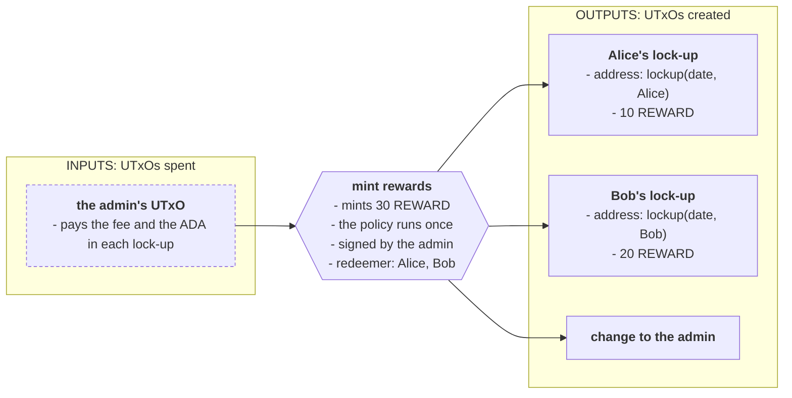
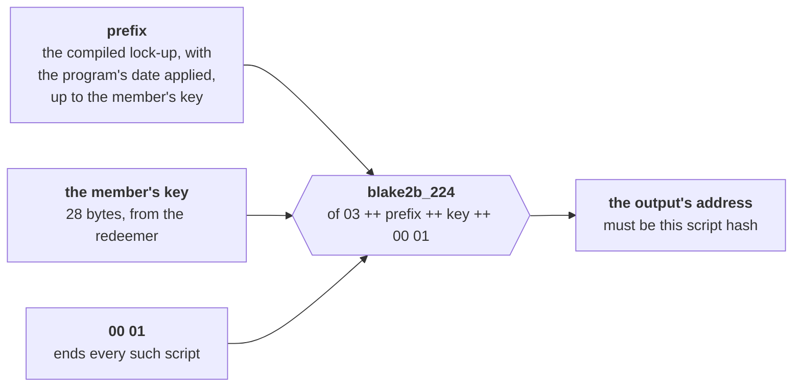

# Parameter validation

> Recognize on-chain that a script hash is an instance of a given parameterized script, by rebuilding the hash from the compiled script and the parameter, and measure it against a list of known hashes.

# Parameter validation

A parameterized script is a family of scripts. Apply a different parameter and you get a different script, with a different hash, address and policy ID, as **[parameters](/docs/developers/onboarding/lectures/intermediate/parameters)** showed. Off-chain, recognizing a member of the family is easy: apply the parameter and compare hashes. On-chain, a validator sees only a hash, and nothing about it says which script, or which parameter, produced it.

This pattern rebuilds the hash on-chain. A script hash covers a language tag and the serialized script. In the encoding used here, the last applied parameter sits near the end of the script's bytes. A validator that holds the bytes before that parameter, the **prefix**, can append a candidate parameter and the fixed ending, hash the result, and compare.

It is a narrow tool. If you control both scripts, a shared script with the parameter in a datum or a stake credential often does the same job more simply: see [When to use it](#when-to-use-it-and-when-not). This page writes the pattern by hand and with the [`aiken-design-patterns`](https://github.com/Anastasia-Labs/aiken-design-patterns) library, covers parameters of any size, and measures it against a list of known hashes.

## The protocol

A **rewards program** pays its members in `REWARD` tokens, and promises they stay locked until a date. Each member's tokens go into their own **lock-up**: a script, parameterized by the program's unlock date and the member's key, that requires the member's signature to spend, and only after that date. The member chooses where the funds go. Every member's lock-up has its own address, so anyone can send to it with a plain payment, and its owner finds their funds by address.

The guarantee lives in the minting policy: **every `REWARD` token ever minted starts inside a lock-up.** The admin decides who gets rewards and signs the mint. The policy checks that each output receiving tokens is a lock-up, for the member it names. That means recognizing a lock-up, and every member's lock-up has a different hash.



The lock-up, and the check it runs:

```aiken title="validators/lockup.ak"
/// A lock-up: only `owner` can authorize spending, after `unlock_at`.
/// The owner chooses the destination. One instance per member and per date.
validator lockup(unlock_at: Int, owner: VerificationKeyHash) {
  spend(
    _datum: Option<Data>,
    _redeemer: Data,
    _own_ref: OutputReference,
    self: Transaction,
  ) {
    lockups.unlocked(self, owner, unlock_at)
  }

  else(_) {
    fail
  }
}
```

```aiken title="lib/lockups.ak"
/// The owner signs, and the transaction happens after the unlock date: its
/// validity window starts after `unlock_at`, in POSIX milliseconds.
pub fn unlocked(
  self: Transaction,
  owner: VerificationKeyHash,
  unlock_at: Int,
) -> Bool {
  and {
    list.has(self.extra_signatories, owner),
    interval.is_entirely_after(self.validity_range, unlock_at),
  }
}
```

The lock-up knows nothing about rewards. It is a plain time lock, and it works for anything sent to it.

Every version of the policy on this page shares the token and how it counts what was minted:

```aiken title="lib/reward_token.ak"
/// The one token name the policy mints.
pub const reward_name: AssetName = "REWARD"

/// How many reward tokens the transaction mints: positive to mint, negative to
/// burn. Fails if anything else is minted under the policy.
pub fn minted(mint: Assets, policy: PolicyId) -> Int {
  expect [Pair(name, quantity)] = assets.tokens(mint, policy) |> dict.to_pairs
  expect name == reward_name
  quantity
}

/// The reward tokens an output holds.
pub fn rewards_in(output: Output, policy: PolicyId) -> Int {
  assets.quantity_of(output.value, policy, reward_name)
}
```

**Minting and moving existing rewards are separate operations.** Each policy requires the total rewards in outputs to equal the quantity minted. Since outputs must also equal inputs plus mint, a positive mint cannot consume existing tokens under this policy. The transaction builder excludes those UTxOs from funding. Withdrawals, ordinary transfers and burns can consume existing rewards.

The versions differ in how they recognize a lock-up. The last two also allow each member a later unlock date, with the program's date enforced as a minimum.

## The naive contract (the problem)

The obvious policy knows the lock-ups by their hashes. Compute every member's lock-up off-chain, and deploy the policy with the list:

```aiken title="validators/naive.ak"
validator rewards(admin: VerificationKeyHash, lockups: List<ScriptHash>) {
  mint(_redeemer: Data, policy_id: PolicyId, self: Transaction) {
    let quantity = reward_token.minted(self.mint, policy_id)
    if quantity < 0 {
      // Whoever holds reward tokens may burn them.
      True
    } else {
      and {
        list.has(self.extra_signatories, admin),
        reward_token.delivered_to_listed(self.outputs, policy_id, lockups) == quantity,
      }
    }
  }

  else(_) {
    fail
  }
}
```

```aiken title="lib/reward_token.ak"
/// Every output holding reward tokens sits at one of `lockups`, and returns how
/// many they hold in total.
pub fn delivered_to_listed(
  outputs: List<Output>,
  policy: PolicyId,
  lockups: List<ScriptHash>,
) -> Int {
  list.foldl(
    outputs,
    0,
    fn(output, total) {
      let quantity = rewards_in(output, policy)
      if quantity > 0 {
        expect Script(hash) = output.address.payment_credential
        expect list.has(lockups, hash)
        total + quantity
      } else {
        total
      }
    },
  )
}
```

It is correct, and it refuses every attack in the tests. Its problem is the list:

- **The list is part of the policy.** A member who joins after deployment has a lock-up the policy has never heard of. Adding them means a new list, so a new policy, so a new policy ID, and tokens under two policy IDs are two different tokens. A test shows a lock-up added later being refused.
- **Its cost grows with the program.** Every reward output searches the list until it finds a match, so a mint to _N_ members of an _N_-member program does _N_ searches of up to _N_ entries. A mint to 20 members uses {costFigure(Costs, "policies.naive.mints.20.mem")} memory units.
- **It has a ceiling.** The list travels inside the policy's script, and a script carried in a transaction must fit in it: in this benchmark's one-recipient mint, the policy can list at most **{costFigure(Costs, "largestNaiveList")} lock-ups**. Holding the list in an authenticated reference input instead would allow updates without redeploying, but it requires an update mechanism and keeps the lookup.

## The pattern (the solution)

**Rebuild the lock-up's hash from the member's key.** Three facts make it possible:

1. **A script hash covers the language and the script**: BLAKE2b-224 over a one-byte language tag, `03` for Plutus V3, followed by the single-CBOR-wrapped compiled script.
2. **The last parameter has a predictable position.** The compiled lock-up with its parameters applied ends with the 28-byte key, then two fixed bytes. Everything before that, the **prefix**, is the same for every member of the program. Extract it from a fully applied placeholder instance: applying a parameter also changes the script's application structure and length header.
3. **A key hash is always 28 bytes**, so every member's key lands in the same place and the prefix never changes length.

So the hash of a member's lock-up is:

```text
blake2b_224( 03  ++  prefix  ++  member's key  ++  00 01 )
```

The prefix is computed off-chain, once, from the compiled lock-up, and given to the policy as a parameter. The policy then recognizes any member's lock-up, including members who join long after it was deployed, with one hash per output and no list.



The parameters fixed for the whole program, here the unlock date, are applied before the prefix is cut, so they are part of it. Only the parameter that varies between instances is appended on-chain, and it must be the **last** parameter.

## Design

The four questions from the Intermediate track:

1. **Requirements.** Every reward token starts in a lock-up for the member it was given to. Only the admin mints. Members can join at any time without changing the policy.
2. **Actions.** Mint, which the admin signs, and burn, which anyone holding tokens may do. The lock-up has one action, withdraw.
3. **What must be true.** For a mint: the admin signs, and every output holding reward tokens has the script hash of the lock-up of the next member the redeemer names. Everything minted is accounted for in those outputs, and no input carries existing rewards under this policy. For a withdrawal: the owner signs, after the unlock date.
4. **What must be remembered.** The policy remembers the admin's key and the lock-up's prefix, both parameters. A lock-up remembers its unlock date and owner, also parameters: it needs no datum.

## Write it by hand

<Tabs groupId="onchain">
<TabItem value="aiken" label="Aiken" default>

The hash, written out:

```aiken title="validators/by_hand.ak"
/// A script hash covers a one-byte language tag, then the script's bytes.
const plutus_v3: ByteArray = #"03"

/// What follows a script's last parameter when that parameter is a byte
/// string: the byte that ends it, and the padding that ends the script.
const tail: ByteArray = #"0001"

/// The hash of `owner`'s lock-up. `prefix` is the compiled lock-up, with the
/// program's unlock date already applied, up to where the owner's key goes.
pub fn lockup_hash(prefix: ByteArray, owner: VerificationKeyHash) -> ScriptHash {
  plutus_v3
    |> bytearray.concat(prefix)
    |> bytearray.concat(owner)
    |> bytearray.concat(tail)
    |> blake2b_224
}
```

The prefix ends with the bytes that introduce the key: `1e`, the length of the chunk that follows, then `58 1c`, the CBOR header of a 28-byte byte string. The key follows. After it, `00` ends the chunk and `01` pads the script to a whole byte.

The policy walks the outputs with the members the redeemer names:

```aiken title="lib/reward_token.ak"
/// Every output holding reward tokens is a lock-up, and returns how many they
/// hold in total. Each such output, in order, belongs to the next entry of
/// `members`, and `lockup_of` gives the script hash that member's lock-up must
/// have. Fails on an output that is not that lock-up.
pub fn delivered(
  outputs: List<Output>,
  policy: PolicyId,
  members: List<member>,
  lockup_of: fn(member) -> ScriptHash,
) -> Int {
  do_deliver(outputs, policy, members, lockup_of, 0)
}

fn do_deliver(
  outputs: List<Output>,
  policy: PolicyId,
  members: List<member>,
  lockup_of: fn(member) -> ScriptHash,
  total: Int,
) -> Int {
  when outputs is {
    [] -> total
    [output, ..rest] -> {
      let quantity = rewards_in(output, policy)
      if quantity > 0 {
        expect [member, ..others] = members
        expect output.address.payment_credential == Script(lockup_of(member))
        do_deliver(rest, policy, others, lockup_of, total + quantity)
      } else {
        do_deliver(rest, policy, members, lockup_of, total)
      }
    }
  }
}
```

```aiken title="validators/by_hand.ak"
validator rewards(admin: VerificationKeyHash, lockup_prefix: ByteArray) {
  /// `members` names the owner of each output that receives rewards, in order.
  mint(
    members: List<VerificationKeyHash>,
    policy_id: PolicyId,
    self: Transaction,
  ) {
    let quantity = reward_token.minted(self.mint, policy_id)
    if quantity < 0 {
      True
    } else {
      and {
        list.has(self.extra_signatories, admin),
        reward_token.delivered(
          self.outputs,
          policy_id,
          members,
          fn(owner) { lockup_hash(lockup_prefix, owner) },
        ) == quantity,
      }
    }
  }

  else(_) {
    fail
  }
}
```

- **The redeemer names a member for each output that receives tokens.** The policy does not search for whose lock-up an output is. It is told, and it checks.
- **Each output must be exactly that member's lock-up.** Tokens sent to another member's lock-up, to a lock-up with a different date, to any other script, or to a key address, fail.
- **Everything minted must be in those outputs**, so the admin cannot keep a token back. Their total must equal the mint, which also excludes inputs carrying existing rewards.
- **Burning needs nothing**: whoever holds tokens may destroy them.

**The tests** at the bottom of `by_hand.ak` cover what the hash changes: the lock-up of a member other than the one named, a script that is not a lock-up, fewer members than outputs, and a member who joined after deployment, who needs nothing new. The checks every version shares are attacked in `naive.ak`.

```bash
aiken check
```

</TabItem>
<TabItem value="scalus" label="Scalus">

A [Scalus](https://scalus.org/) version is coming soon. The idea is identical, only the language differs.

</TabItem>
</Tabs>

## The same with the library

<Tabs groupId="onchain">
<TabItem value="aiken" label="Aiken" default>

[`aiken-design-patterns`](https://github.com/Anastasia-Labs/aiken-design-patterns) ships the pattern as [`parameter_validation`](https://github.com/Anastasia-Labs/aiken-design-patterns/blob/v1.9.0/lib/aiken-design-patterns/parameter-validation.ak), with an [`advanced`](https://github.com/Anastasia-Labs/aiken-design-patterns/blob/v1.9.0/lib/aiken-design-patterns/parameter-validation/advanced.ak) module for parameters of any size. Version v1.9.0 builds with stdlib v4.0.0 on Aiken v1.1.24, the toolchain every onboarding project uses, and brings two dependencies of its own:

```toml title="aiken.toml"
[[dependencies]]
name = "anastasia-labs/aiken-design-patterns"
version = "v1.9.0"
source = "github"

[[dependencies]]
name = "aiken-lang/fuzz"
version = "v3.0.0"
source = "github"

[[dependencies]]
name = "keyan-m/aiken-scott-utils"
version = "v1.5.0"
source = "github"
```

A member's key is already a hash, so the function is `apply_prehashed_param`:

```aiken title="validators/with_library.ak"
validator rewards(admin: VerificationKeyHash, lockup_prefix: ByteArray) {
  mint(
    members: List<VerificationKeyHash>,
    policy_id: PolicyId,
    self: Transaction,
  ) {
    let quantity = reward_token.minted(self.mint, policy_id)
    if quantity < 0 {
      True
    } else {
      and {
        list.has(self.extra_signatories, admin),
        reward_token.delivered(
          self.outputs,
          policy_id,
          members,
          fn(owner) {
            parameter_validation.apply_prehashed_param(3, lockup_prefix, owner)
          },
        ) == quantity,
      }
    }
  }

  else(_) {
    fail
  }
}
```

It computes exactly what `lockup_hash` does, with the language version as a number instead of a byte.

**The whole module.** The library covers one, two or three parameters, already hashed or not, and the instance's side as well:

| Function | Use it when |
|---|---|
| `apply_prehashed_param` | The parameter is already a hash, such as a key hash or a script hash. Used above. |
| `apply_prehashed_param_2`, `_3` | Two or three such parameters. The first may be any length. The others must be 28 bytes. |
| `apply_param` | The parameter is any value: the library hashes it with BLAKE2b-224 before appending it, so the instance must take that hash as its parameter. Used in [the next section](#parameters-of-any-size). |
| `apply_param_2`, `_3` | Two or three such values. |
| `wrapper_no_redeemer`, `_2`, `_3` | On the instance's side, for `apply_param`: takes the values from the redeemer, checks they hash to the parameters, and hands them to your code. |
| `wrapper`, `_2`, `_3` | The same, for an instance that also needs a redeemer of its own, through `ParameterizedRedeemer`. |
| `advanced.apply_param` | One parameter of any shape, appended as itself, not as a hash. Also used in [the next section](#parameters-of-any-size). |

The two- and three-parameter forms place the same 6 bytes, `00 4c 01 1e 58 1c`, between parameters: the end of one 28-byte parameter, and the start of the next. That is why every parameter after the first must be exactly 28 bytes.

</TabItem>
<TabItem value="scalus" label="Scalus">

A [Scalus](https://scalus.org/) version is coming soon. The idea is identical, only the language differs.

</TabItem>
</Tabs>

## Parameters of any size

A key hash is always 28 bytes. Other parameters can vary in encoded length: an integer's CBOR encoding grows as its value crosses encoding boundaries, and a record grows with its fields. Say each member gets **their own unlock date, at or after the program's date**, so a lock-up's parameter is a record:

```aiken title="lib/lockups.ak"
/// One member's lock-up terms, for programs where every member has their own
/// unlock date.
pub type Terms {
  owner: VerificationKeyHash,
  unlock_at: Int,
}
```

Its length changes with the date, so the fixed-size append above is no longer enough. The library offers two ways around that. Both policies also take `min_unlock_at` as a parameter and check each recipient's date against it. Changing the redeemer and output to agree on an earlier date cannot bypass that minimum.

<Tabs groupId="onchain">
<TabItem value="aiken" label="Aiken" default>

### Hash it

Make the lock-up's parameter the **hash** of the terms, which is always 28 bytes. The lock-up then cannot read its own terms from its parameter, so every spend states them in its redeemer, and the library's wrapper checks they hash to the parameter:

```aiken title="validators/lockup_terms.ak"
/// A lock-up whose terms are a parameter of any size. The script holds only
/// their hash, which is always 28 bytes. Every spend states the terms in its
/// redeemer, and the wrapper checks they hash to the parameter.
validator lockup_terms(terms_hash: Hash<Blake2b_224, Terms>) {
  spend(
    _datum: Option<Data>,
    redeemer: Parameter<Terms>,
    _own_ref: OutputReference,
    self: Transaction,
  ) {
    let terms <- parameter_validation.wrapper_no_redeemer(
      terms_hash,
      fn(terms) { cbor.serialise(terms) },
      redeemer,
    )
    lockups.unlocked(self, terms.owner, terms.unlock_at)
  }

  else(_) {
    fail
  }
}
```

The policy checks each member's date against `min_unlock_at`, serializes the terms the way the wrapper does, and lets `apply_param` hash and append them:

```aiken title="validators/hashed_terms.ak"
/// Rewards into `lockup_terms` instances: one per member, each with its own
/// unlock date, at or after `min_unlock_at`. The policy hashes each member's
/// terms the way the lock-up's wrapper does, and places the hash after the prefix.
validator rewards(
  admin: VerificationKeyHash,
  min_unlock_at: Int,
  lockup_prefix: ByteArray,
) {
  mint(members: List<Terms>, policy_id: PolicyId, self: Transaction) {
    let quantity = reward_token.minted(self.mint, policy_id)
    if quantity < 0 {
      True
    } else {
      and {
        list.has(self.extra_signatories, admin),
        reward_token.delivered(
          self.outputs,
          policy_id,
          members,
          fn(terms) {
            expect terms.unlock_at >= min_unlock_at
            parameter_validation.apply_param(
              3,
              lockup_prefix,
              cbor.serialise(terms),
            )
          },
        ) == quantity,
      }
    }
  }

  else(_) {
    fail
  }
}
```

Both sides must serialize the terms the same way. Here both use `cbor.serialise`.

### Append it as itself

The `advanced` module appends the terms themselves. The lock-up takes `Terms` as an ordinary parameter, with no hash and no wrapper:

```aiken title="validators/lockup_raw.ak"
/// The same lock-up, with its terms as the parameter itself: no hash and no
/// terms to supply in the redeemer.
validator lockup_raw(terms: Terms) {
  spend(
    _datum: Option<Data>,
    _redeemer: Data,
    _own_ref: OutputReference,
    self: Transaction,
  ) {
    lockups.unlocked(self, terms.owner, terms.unlock_at)
  }

  else(_) {
    fail
  }
}
```

After checking the minimum date, the policy hands each member's terms to `advanced.apply_param`, which serializes them on-chain and rebuilds every length that depends on them: the chunk lengths around the parameter, and the CBOR header around the whole script. So its prefix stops earlier, before the parameter's length byte, and leaves out the outer header:

```aiken title="validators/raw_terms.ak"
/// Rewards into `lockup_raw` instances, whose parameter is the terms
/// themselves, with dates at or after `min_unlock_at`.
/// `lockup_flat_prefix` is the compiled lock-up up to the
/// parameter, without the outer CBOR header: the library encodes the terms
/// and every length around them on-chain.
validator rewards(
  admin: VerificationKeyHash,
  min_unlock_at: Int,
  lockup_flat_prefix: ByteArray,
) {
  mint(members: List<Terms>, policy_id: PolicyId, self: Transaction) {
    let quantity = reward_token.minted(self.mint, policy_id)
    if quantity < 0 {
      True
    } else {
      and {
        list.has(self.extra_signatories, admin),
        reward_token.delivered(
          self.outputs,
          policy_id,
          members,
          fn(terms) {
            expect terms.unlock_at >= min_unlock_at
            advanced.apply_param(3, lockup_flat_prefix, terms)
          },
        ) == quantity,
      }
    }
  }

  else(_) {
    fail
  }
}
```

The catch: the lock-up must have been compiled with its parameter encoded exactly as `cbor.serialise` encodes it. The same value written in another valid CBOR form gives other bytes, so another hash, and the policy will not recognize it.

### Which to choose

| | Hash it | Append it as itself |
|---|---|---|
| The lock-up | Takes a hash. Every spend must state the terms in its redeemer. | Takes the terms. Nothing extra to spend it. |
| The policy | Hashes the terms, then one fixed-size append. | Serializes the terms and rebuilds the lengths on-chain: more work per output. |
| Off-chain | Compile the lock-up with the hash of the terms. | Compile the lock-up with the terms, in canonical CBOR. |
| Several parameters | Up to three, with `apply_param_2` and `_3`. | One. |

</TabItem>
<TabItem value="scalus" label="Scalus">

A [Scalus](https://scalus.org/) version is coming soon. The idea is identical, only the language differs.

</TabItem>
</Tabs>

## Build the transaction

<Tabs groupId="offchain">
<TabItem value="mesh" label="Mesh" default>

A member's lock-up is the compiled lock-up with their parameters applied. Which parameters depends on the kind of lock-up:

```ts title="src/lib/blueprint.ts"
/// `member`'s lock-up, compiled with its parameters applied, as Mesh hands it
/// to a transaction.
export function lockupScriptCbor(policy: Policy, member: Member): string {
  switch (lockupKind(policy)) {
    case "lockup":
      // The program's date first, then the member's key: the prefix ends
      // just before the key.
      return applyParamsToScript(compiledCode("lockup.lockup.spend"), [member.unlockAt, member.owner]);
    case "terms":
      // Only the hash of the terms goes into the script.
      return applyParamsToScript(compiledCode("lockup_terms.lockup_terms.spend"), [
        blake2b224(serializeData(termsData(member))),
      ]);
    case "raw":
      return applyParamsToScript(compiledCode("lockup_raw.lockup_raw.spend"), [termsData(member)]);
  }
}
```

**The prefix** is cut from a lock-up applied to a placeholder key. It always comes from the blueprint in use, so it cannot fall out of step with the compiled lock-up. If the bytes after the cut are not exactly the placeholder and the fixed tail, it fails rather than return a wrong prefix:

```ts title="src/lib/blueprint.ts"
/// Cut `script` just before its last parameter, a 28-byte placeholder. Checks
/// the cut-off part is exactly the placeholder and the two bytes that end every
/// such script, so a change in how scripts are encoded fails here, loudly.
function prefixBefore(script: string): string {
  const once = wrappedOnce(script);
  const ending = PLACEHOLDER + "0001";
  if (!once.endsWith(ending)) throw new Error("the parameter is not where a prefix expects it");
  return once.slice(0, once.length - ending.length);
}

/// The prefix of every lock-up in a program whose lock-ups open at
/// `unlockAt`: the date is applied, the owner's key is not.
export function lockupPrefix(unlockAt: number): string {
  return prefixBefore(applyParamsToScript(compiledCode("lockup.lockup.spend"), [unlockAt, PLACEHOLDER]));
}
```

The prefix for `advanced.apply_param` is cut further in:

```ts title="src/lib/blueprint.ts"
/// The prefix the library's `advanced.apply_param` takes: the compiled
/// `lockup_raw` up to the parameter, without the CBOR header around the whole
/// script, and without the byte that gives the parameter's length. The
/// library rebuilds both on-chain from the terms it is given.
export function rawFlatPrefix(): string {
  const placeholder = serializeData(termsData({ owner: PLACEHOLDER, unlockAt: 0 }));
  const once = wrappedOnce(applyParamsToScript(compiledCode("lockup_raw.lockup_raw.spend"), [termsData({ owner: PLACEHOLDER, unlockAt: 0 })]));
  // The CBOR header: 0x58 is followed by a one-byte length, 0x59 by two.
  const headerBytes = { "58": 2, "59": 3, "5a": 5 }[once.slice(0, 2)];
  if (!headerBytes) throw new Error("unexpected CBOR header on the compiled script");
  const flat = once.slice(headerBytes * 2);
  const lengthByte = (placeholder.length / 2).toString(16).padStart(2, "0");
  const ending = lengthByte + placeholder + "0001";
  if (!flat.endsWith(ending)) throw new Error("the parameter is not where a prefix expects it");
  return flat.slice(0, flat.length - ending.length);
}
```

:::warning A Mesh 1.9.1 bug with long parameters
Mesh 1.9.1's `applyParamsToScript` keeps only the first 64 bytes of a byte-string parameter, and drops the rest without an error. A prefix is hundreds of bytes long. A policy compiled that way gets a truncated prefix, and refuses every honest mint. This project applies the prefix with a small helper instead, `applyWithLongLast` in `src/lib/blueprint.ts`. Mesh applies the other parameters, with an empty byte string in the prefix's place, and the helper splices in the real prefix. If you apply long byte strings with Mesh, check what the script receives.
:::

**The mint** names the members in the redeemer, in the same order as their outputs. Outputs keep the order the builder adds them in:

```ts title="src/lib/rewards.ts"
/// The policy's redeemer: the owner of each output that receives rewards, in
/// order. The naive policy reads nothing from it.
function mintRedeemer(policy: Policy, members: Member[]): Data {
  switch (lockupKind(policy)) {
    case "lockup":
      return policy === "naive" ? mConStr0([]) : members.map((m) => m.owner);
    case "terms":
    case "raw":
      return members.map(termsData);
  }
}
```

```ts title="src/lib/rewards.ts"
/// Mint reward tokens straight into each member's lock-up.
export async function buildMintRewardsTx(mint: Mint): Promise<string> {
  const policyCbor = policyScriptCbor(mint.policy, mint.admin, mint.unlockAt, mint.listed);
  const rewardUnit = policyId(policyCbor) + REWARD_NAME_HEX;
  const total = mint.rewards.reduce((sum, r) => sum + r.quantity, 0);
  const txBuilder = new MeshTxBuilder({ fetcher: mint.provider, evaluator: mint.evaluator })
    .mintPlutusScriptV3()
    .mint(total.toString(), policyId(policyCbor), REWARD_NAME_HEX)
    .mintingScript(policyCbor)
    .mintRedeemerValue(mintRedeemer(mint.policy, mint.rewards.map((r) => r.member)));
  // Outputs keep the order they are added in, so they line up with the
  // redeemer's list of members.
  for (const { member, quantity } of mint.rewards) {
    txBuilder
      .txOut(lockupAddress(mint.policy, member, mint.networkId), [
        { unit: "lovelace", quantity: "2000000" },
        { unit: rewardUnit, quantity: quantity.toString() },
      ])
      .txOutInlineDatumValue(LOCKUP_DATUM);
  }
  txBuilder.requiredSignerHash(mint.admin);
  // Minting and moving existing rewards are separate transactions.
  return await finish(txBuilder, mint.wallet, rewardUnit);
}
```

**Funding** excludes collateral and UTxOs carrying this program's existing rewards. Tokens from other policies can still appear in funding inputs and change. If no eligible UTxO remains, fund the wallet with a separate ada UTxO before minting:

```ts title="src/lib/rewards.ts"
const funding = (await wallet.getUtxos()).filter(
  ({ input, output }) =>
    (input.txHash !== collateral.input.txHash || input.outputIndex !== collateral.input.outputIndex) &&
    !output.amount.some((asset) => asset.unit === rewardUnit && BigInt(asset.quantity) > 0n),
);
if (rewardUnit && funding.length === 0) {
  throw new Error(
    "no mint funding UTxOs without this program's REWARD tokens: fund the wallet with a separate ADA UTxO",
  );
}
```

**The withdrawal** is an ordinary script spend, after the member's unlock date and authorized by the owner. This builder sends the funds to the supplied wallet's change address; the owner must sign even if that is another wallet:

```ts title="src/lib/rewards.ts"
/// The owner authorizes spending after the lock-up opens. Funds go to
/// `wallet`'s change address; the owner's signature is required even if this
/// is another wallet. `from` is the slot the transaction's window starts at.
export async function buildWithdrawTx(
  wallet: IWallet,
  provider: IFetcher,
  policy: Policy,
  member: Member,
  lockup: UTxO,
  from: number,
  evaluator?: IEvaluator,
): Promise<string> {
  // A `lockup_terms` spend states its terms, for the wrapper to check.
  const redeemer = lockupKind(policy) === "terms" ? mConStr0([termsData(member)]) : mConStr0([]);
  const txBuilder = new MeshTxBuilder({ fetcher: provider, evaluator })
    .spendingPlutusScriptV3()
    .txIn(lockup.input.txHash, lockup.input.outputIndex, lockup.output.amount, lockup.output.address)
    .txInScript(lockupScriptCbor(policy, member))
    .txInInlineDatumPresent()
    .txInRedeemerValue(redeemer)
    .invalidBefore(from)
    .requiredSignerHash(member.owner);
  return await finish(txBuilder, wallet);
}
```

</TabItem>
<TabItem value="evolution" label="Evolution">

An [Evolution](https://github.com/IntersectMBO/evolution-sdk) version is coming soon. The idea is identical, only the library calls differ.

</TabItem>
</Tabs>

## The numbers

**The real gain is not in the table.** A member who joins tomorrow needs no new policy. The naive policy cannot pay an unlisted lock-up, and its list tops out at {costFigure(Costs, "largestNaiveList")} entries in this benchmark.

Every figure below is measured with Mesh's default protocol parameters. `npm run bench` builds each mint against a fixed in-memory UTxO set, runs the policy with Mesh's `OfflineEvaluator`, signs with the fixture admin wallet, and writes the totals to `costs.json`. Transaction sizes include the signature witness. Nothing is submitted to a node. This page reads that file. `npm test` measures again and fails if the file is out of date, and separately checks the measured size against a signed transaction. Each member receives 10 tokens. The naive policy lists exactly the members being paid, which is the best case for it: a real program lists every member, and the list only grows.

**Memory units used by one mint**:

| Members paid | Naive | By hand | With the library | Hashed terms | Raw terms |
|---|--:|--:|--:|--:|--:|
| 1 | {costFigure(Costs, "policies.naive.mints.1.mem")} | {costFigure(Costs, "policies.byHand.mints.1.mem")} | {costFigure(Costs, "policies.withLibrary.mints.1.mem")} | {costFigure(Costs, "policies.hashedTerms.mints.1.mem")} | {costFigure(Costs, "policies.rawTerms.mints.1.mem")} |
| 5 | {costFigure(Costs, "policies.naive.mints.5.mem")} | {costFigure(Costs, "policies.byHand.mints.5.mem")} | {costFigure(Costs, "policies.withLibrary.mints.5.mem")} | {costFigure(Costs, "policies.hashedTerms.mints.5.mem")} | {costFigure(Costs, "policies.rawTerms.mints.5.mem")} |
| 10 | {costFigure(Costs, "policies.naive.mints.10.mem")} | {costFigure(Costs, "policies.byHand.mints.10.mem")} | {costFigure(Costs, "policies.withLibrary.mints.10.mem")} | {costFigure(Costs, "policies.hashedTerms.mints.10.mem")} | {costFigure(Costs, "policies.rawTerms.mints.10.mem")} |
| 20 | {costFigure(Costs, "policies.naive.mints.20.mem")} | {costFigure(Costs, "policies.byHand.mints.20.mem")} | {costFigure(Costs, "policies.withLibrary.mints.20.mem")} | {costFigure(Costs, "policies.hashedTerms.mints.20.mem")} | {costFigure(Costs, "policies.rawTerms.mints.20.mem")} |

**The fee**, in ADA:

| Members paid | Naive | By hand | With the library | Hashed terms | Raw terms |
|---|--:|--:|--:|--:|--:|
| 1 | {costFigure(Costs, "policies.naive.mints.1.fee", "ada")} | {costFigure(Costs, "policies.byHand.mints.1.fee", "ada")} | {costFigure(Costs, "policies.withLibrary.mints.1.fee", "ada")} | {costFigure(Costs, "policies.hashedTerms.mints.1.fee", "ada")} | {costFigure(Costs, "policies.rawTerms.mints.1.fee", "ada")} |
| 5 | {costFigure(Costs, "policies.naive.mints.5.fee", "ada")} | {costFigure(Costs, "policies.byHand.mints.5.fee", "ada")} | {costFigure(Costs, "policies.withLibrary.mints.5.fee", "ada")} | {costFigure(Costs, "policies.hashedTerms.mints.5.fee", "ada")} | {costFigure(Costs, "policies.rawTerms.mints.5.fee", "ada")} |
| 10 | {costFigure(Costs, "policies.naive.mints.10.fee", "ada")} | {costFigure(Costs, "policies.byHand.mints.10.fee", "ada")} | {costFigure(Costs, "policies.withLibrary.mints.10.fee", "ada")} | {costFigure(Costs, "policies.hashedTerms.mints.10.fee", "ada")} | {costFigure(Costs, "policies.rawTerms.mints.10.fee", "ada")} |
| 20 | {costFigure(Costs, "policies.naive.mints.20.fee", "ada")} | {costFigure(Costs, "policies.byHand.mints.20.fee", "ada")} | {costFigure(Costs, "policies.withLibrary.mints.20.fee", "ada")} | {costFigure(Costs, "policies.hashedTerms.mints.20.fee", "ada")} | {costFigure(Costs, "policies.rawTerms.mints.20.fee", "ada")} |

**The most members one mint can pay in this benchmark**: {costFigure(Costs, "policies.naive.largestMint")} with the naive policy, limited by {costLimit(Costs, "policies.naive.limitedBy")}. {costFigure(Costs, "policies.byHand.largestMint")} by hand and {costFigure(Costs, "policies.withLibrary.largestMint")} with the library, {costFigure(Costs, "policies.hashedTerms.largestMint")} with hashed terms and {costFigure(Costs, "policies.rawTerms.largestMint")} with raw terms, all limited by {costLimit(Costs, "policies.byHand.limitedBy")}: outputs and redeemer entries grow with the number of members.

**The policy script**, in bytes, with its parameters applied: {costFigure(Costs, "policies.naive.mints.1.scriptSize")} for the naive policy listing one lock-up, growing to {costFigure(Costs, "policies.naive.mints.20.scriptSize")} for twenty. {costFigure(Costs, "policies.byHand.mints.1.scriptSize")} by hand, whatever the number of members, because the same prefix serves every member.

What the tables say:

- **For one member, the list is cheaper.** One lookup in a list of one costs less than one hash, and the naive script is smaller than a script carrying a prefix.
- **In memory, the pattern wins from a handful of members on, and the gap widens.** At 20 members the hand-written policy uses {costSaving(Costs, "policies.naive.mints.20.mem", "policies.byHand.mints.20.mem")} less memory. Its cost grows with the number of outputs. The naive policy's grows with the outputs times the length of the list.
- **In fees, the naive policy stays cheaper for longer**, because the pattern's script carries the prefix and is larger. The fee table shows where they cross. Held as a [reference script](/docs/developers/onboarding/lectures/intermediate/reference-inputs-and-scripts), the policy would not be carried by each mint, and the size difference would shrink.
- **The library costs about the same as the hand-written version.** It is the same hash, with the version byte built on-chain.
- **The terms variants cost more.** Both check a minimum date per recipient. Hashed terms add a hash and a serialization per output. Raw terms add the serialization and the length bookkeeping, and cost the most of the four pattern variants.

## When to use it, and when not

**Use it when the parameter has to be in the script's hash**, so the instance must be its own script:

- **Minting policies and stake validators with rules fixed in their parameters.** These script purposes have no datum argument. Recognizing an instance means recognizing the hash that commits to those parameters.
- **Addresses that receive plain payments.** A UTxO sent without a datum to a shared script belongs to nobody the script can tell. A per-instance address, like the lock-ups here, says whose it is by itself.
- **Scripts you do not control.** If another protocol exposes parameterized scripts, rebuilding their hashes lets your contract recognize new instances without maintaining an allowlist.

**Skip it when you control both scripts and a shared script will do.** The lock-ups could be one script, with the owner and date in each UTxO's datum. The policy would then check one address and one datum per output, which is cheaper and needs no prefix. If plain payments matter, the owner can go in the address's stake credential instead of a datum. Both designs are common. Prefer them unless one of the cases above applies.

**Know what you are depending on.** A prefix is the compiled bytes of one exact script. Change the lock-up's code, or compile it with another Aiken version, and its prefix changes. A policy deployed with the old prefix recognizes only lock-ups compiled from the old code. Keep the lock-up's compiled code as fixed as the policy that depends on it. A [CIP proposing a built-in for this](https://github.com/cardano-foundation/CIPs/pull/934) was closed without being adopted, so the byte-level approach is what exists.

### Security

What makes the policy safe, each item with a test that expects the attack to be refused:

- **Each output must be the lock-up of the member the redeemer names.** Swapping two members' outputs is refused. The naive policy cannot tell the difference: it reads no names, and only knows each lock-up is on its list.
- **The program's date cannot be shortened at mint time.** The fixed-date policies recognize only the configured lock-ups. The terms policies check `min_unlock_at` as well as the script hash: even matching earlier dates in the redeemer and output are refused. A member's later date still applies when they withdraw.
- **Everything minted must land in lock-ups.** Tokens kept in the admin's wallet are refused.
- **Only the admin mints.** A mint without the admin's signature is refused.
- **The terms are checked where they are used.** A `lockup_terms` spend with terms that do not hash to its parameter is refused, and so is a mint naming terms other than the lock-up's.
- **Minting is separate from moving existing rewards.** A positive mint that consumes existing rewards is refused, even if every reward output is a valid lock-up. The funding filter keeps the builder from choosing those inputs.

What the policy leaves to you:

- **The admin chooses who gets rewards, and how many.** In the terms variants, the admin can also choose a later unlock date for each member, but cannot go below the policy's minimum.
- **Tokens leave a lock-up once it opens.** After the date, the owner can send them anywhere. The guarantee is about the lock-up period.
- **The configuration is trusted.** The policy assumes its prefix really is the lock-up's; the naive policy instead trusts its list of hashes. Derive these from the blueprint and check the deployed policy's parameters, including the minimum date for the terms variants.
- **Reward outputs carry an empty datum.** Plutus V3 can spend a UTxO without one, but Mesh 1.9.1 will not build a script spend without a datum, so the off-chain code gives every reward output an empty one. The lock-up never reads it.

## Run it

The whole example is one self-contained project. See the **[introduction](/docs/developers/onboarding/design-patterns/introduction#the-playground)** for the layout.

```bash
npx giget@latest gh:cardano-foundation/developer-portal/examples/onboarding/design-patterns/parameter-validation parameter-validation
cd parameter-validation/on-chain/aiken
aiken check                      # the validators' own tests, attacks included
cd ../../off-chain/mesh
npm install
npm test                         # every mint, withdrawal and attack, run through the real scripts, and the costs.json check
npm run bench                    # measure again and rewrite costs.json
```

## Go deeper

- [Parameters](/docs/developers/onboarding/lectures/intermediate/parameters): how a parameter changes a script's hash and address.
- [`parameter_validation`](https://github.com/Anastasia-Labs/aiken-design-patterns/blob/v1.9.0/lib/aiken-design-patterns/parameter-validation.ak) and [`parameter_validation/advanced`](https://github.com/Anastasia-Labs/aiken-design-patterns/blob/v1.9.0/lib/aiken-design-patterns/parameter-validation/advanced.ak): the library's source.
- [Transaction-level validation](/docs/developers/onboarding/design-patterns/transaction-level-validation): another way two scripts recognize each other, by sharing one hash.
