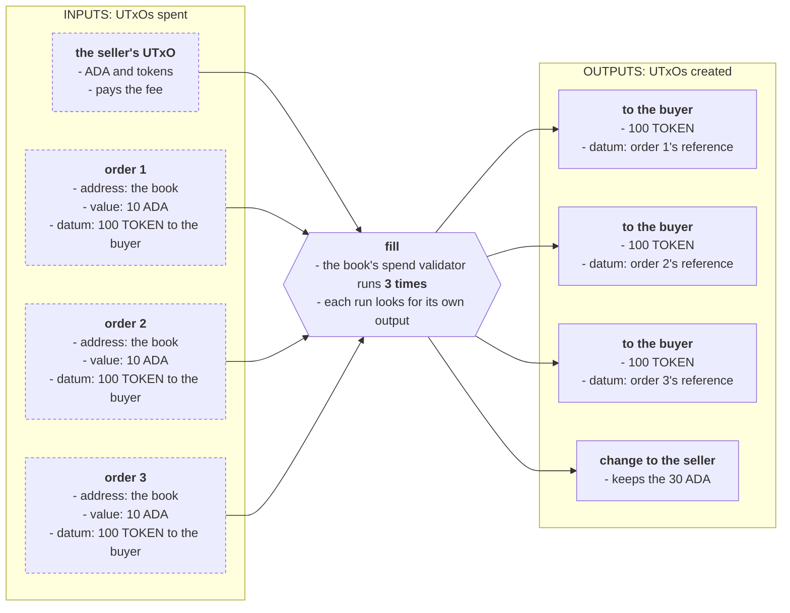
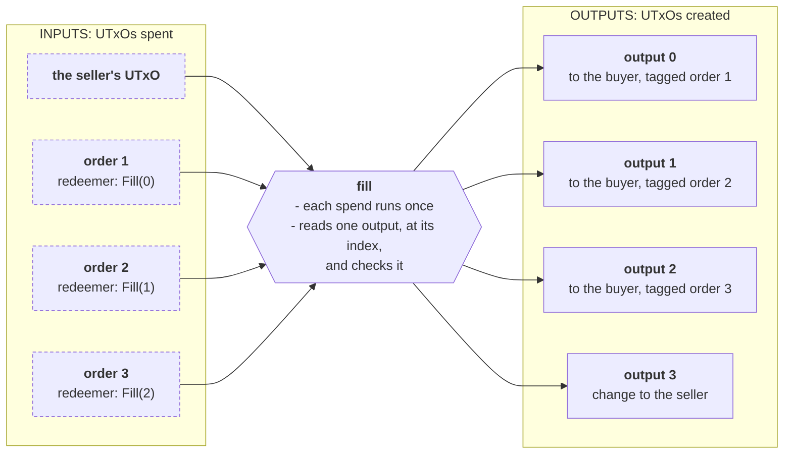
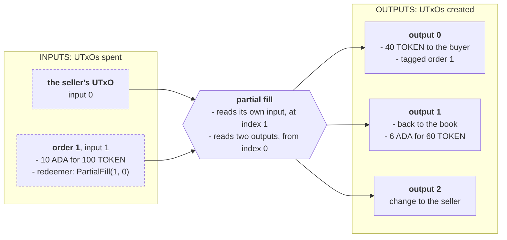

# UTxO indexers

> Tell each script input where its output is, with an index in the redeemer, instead of searching the transaction for it, and measure the difference.

# UTxO indexers

A validator often has to find something in its transaction: the output that pays for its input, or its own input among all the others. Searching for it means walking the list and inspecting each element until one matches, and when many inputs from the same script each search, the work grows with the square of the batch. This pattern does the search **off-chain**, where it is free, and passes the result in the redeemer as an **index**. The validator goes straight to that position and checks what it finds there.

This page covers the two **singular** indexers, where each input is pointed at its own outputs: **one-to-one**, one input and one output, and **one-to-many**, one input and several outputs. It writes both by hand and with the [`aiken-design-patterns`](https://github.com/Anastasia-Labs/aiken-design-patterns) library, and mesures the costs of all variants. The evolution of this, **multi** indexers, where one coordinator checks every input at once, is in **[batch indexers](/docs/developers/onboarding/design-patterns/batch-indexers)**.

## The protocol

**Simple orderbook:** A buyer locks ADA at the order book (a script address) with a datum that says which token they want, how many, and where to deliver them. This simplified orderbook allows only to buy with ADA.

**Anyone** holding the token may fill an order, as the **seller**: it delivers the tokens to the buyer and keeps the ADA. A seller with too few tokens may **partly fill** an order instead: it delivers some of the tokens, takes the same share of the ADA, and puts the rest of the order back on the book. The buyer can cancel an open order and take the ADA back.

A seller can fill many orders in one transaction, a **batch**, so each order has to find, among all the outputs, the one that pays it:



The order is a small record:

```aiken title="lib/order_book.ak"
/// What a buyer locks their ADA with: the token they want, how many, and where
/// to deliver them.
pub type Order {
  owner: Address,
  policy_id: PolicyId,
  asset_name: AssetName,
  quantity: Int,
}
```

The checks on whether an order is paid are shared by every version of the book on this page. Only the way each order finds its outputs changes:

```aiken title="lib/order_book.ak"
/// How many of the ordered token `output` delivers for the order locked at
/// `own_ref`, or `None` if it is not a delivery for that order.
///
/// A delivery pays the owner's exact address, stake credential included, and
/// holds nothing but ADA and the token ordered: no other tokens, and no
/// reference script. Its inline datum is the order's own output reference: no
/// two orders share one, so no output can count for two orders.
pub fn delivered(
  order: Order,
  own_ref: OutputReference,
  output: Output,
) -> Option<Int> {
  let tag: Data = own_ref
  if and {
    output.address == order.owner,
    output.reference_script == None,
    output.datum == InlineDatum(tag),
  } {
    when assets.flatten(assets.without_lovelace(output.value)) is {
      [(policy_id, asset_name, quantity)] ->
        if policy_id == order.policy_id && asset_name == order.asset_name {
          Some(quantity)
        } else {
          None
        }
      _ -> None
    }
  } else {
    None
  }
}

/// Whether `output` fills the whole order locked at `own_ref`. The order must
/// ask for a positive quantity, and the output deliver at least that much.
pub fn is_filled_by(
  order: Order,
  own_ref: OutputReference,
  output: Output,
) -> Bool {
  when delivered(order, own_ref, output) is {
    Some(quantity) -> order.quantity > 0 && quantity >= order.quantity
    None -> False
  }
}
```

- **The cheap comparisons come first.** The address and the datum are compared before the value is unpacked, so an output meant for something else is ignored early.
- **The owner's address must match exactly**, stake credential included. Matching only the key would let a seller deliver to the buyer's key under a stake credential of their own.
- **At least the quantity ordered, and nothing else.** The output holds only ADA and the token ordered: no other tokens and no reference script. Without that, a seller could pad the buyer's output with junk that makes it bigger and costlier to spend.
- **The order asks for something.** An order for zero tokens, or fewer, would hand its ADA to anyone who sends a tagged output, so the check refuses it.
- **The output carries the order's own output reference as its datum.** All three orders above are identical: same buyer, same token, same quantity. Without the tag, one output of 100 tokens would satisfy all three, and the seller would keep the tokens for the other two. This is [double satisfaction](/docs/developers/curriculum/smart-contracts/security/vulnerabilities/double-satisfaction). No two UTxOs share an output reference, so a tagged output can fill only one order.

### Partial fills

A partial fill pays out in two outputs: the payment, which `delivered` checks exactly as for a full fill, and the rest of the order, going back on the book. Every version of the book expects the rest **right after** its payment; [the pattern](#one-input-several-outputs) explains why.

```aiken title="lib/order_book.ak"
/// Whether `payment` and `remainder` fill part of the order spent from
/// `own_input`, and put the rest of it back on the book.
///
/// The payment delivers some of the tokens, but not all. The remainder goes
/// back to the order's own address, holds only ADA, and is the same order for
/// the tokens still owed. The seller takes at most its share of the ADA,
/// rounded in the buyer's favor.
pub fn is_partly_filled_by(
  order: Order,
  own_input: Output,
  own_ref: OutputReference,
  payment: Output,
  remainder: Output,
) -> Bool {
  expect Some(sent) = delivered(order, own_ref, payment)
  let rest = order.quantity - sent
  let rest_of_order: Data = Order { ..order, quantity: rest }
  and {
    sent > 0,
    rest > 0,
    remainder.address == own_input.address,
    assets.without_lovelace(remainder.value) == assets.zero,
    remainder.reference_script == None,
    remainder.datum == InlineDatum(rest_of_order),
    // kept / locked >= rest / ordered, without dividing.
    assets.lovelace_of(remainder.value) * order.quantity >= assets.lovelace_of(
      own_input.value,
    ) * rest,
  }
}
```

- **Something delivered, something left.** A partial fill that delivers nothing does nothing, and one that delivers everything is a fill.
- **The rest stays where it was**, at the order's own address, stake credential included, so the seller cannot move it to an address it controls.
- **The rest owes exactly what is left**, and holds only ADA.
- **The seller takes at most its share of the ADA.** The check compares `kept × ordered` with `locked × still owed` instead of dividing, so there is no rounding to argue about: any remainder of a division stays with the buyer.

## The naive contract (the problem)

The obvious book has each order search the outputs for one that fills it. A partial fill also searches the inputs for the order itself, because the share of ADA it may keep depends on what the order holds. Then it looks for the one output carrying the order's tag, and runs the full checks on it and on the output after it. The tag only locates the payment, cheaply: if the tagged output fails the checks, the spend fails, rather than the search moving on to accept something else.

```aiken title="validators/naive.ak"
validator orders {
  spend(
    datum: Option<Order>,
    action: Action,
    own_ref: OutputReference,
    self: Transaction,
  ) {
    expect Some(order) = datum
    when action is {
      // Look at every output until one fills this order.
      Fill -> list.any(self.outputs, order_book.is_filled_by(order, own_ref, _))
      Cancel -> order_book.owner_signs(self, order)
      // Find the order's own input, then look for the output that carries
      // this order's tag.
      PartialFill -> {
        expect Some(own_input) = transaction.find_input(self.inputs, own_ref)
        let tag: Data = own_ref
        has_partial_fill(
          self.outputs,
          order,
          own_input.output,
          own_ref,
          InlineDatum(tag),
        )
      }
    }
  }

  else(_) {
    fail
  }
}

/// Whether the output tagged for this order delivers part of it, with the rest
/// of the order right after it.
///
/// The tag only finds the payment: only this order's payment carries it, and
/// comparing it is cheap. Every check still runs on what it finds, and a
/// tagged output that fails them fails the spend, instead of the search going
/// on to accept something else.
fn has_partial_fill(
  outputs: List<Output>,
  order: Order,
  own_input: Output,
  own_ref: OutputReference,
  tag: Datum,
) -> Bool {
  when outputs is {
    [payment, remainder, ..rest] ->
      if payment.datum == tag {
        order_book.is_partly_filled_by(
          order,
          own_input,
          own_ref,
          payment,
          remainder,
        )
      } else {
        has_partial_fill([remainder, ..rest], order, own_input, own_ref, tag)
      }
    _ -> False
  }
}
```

It is correct, and it is expensive. With _N_ orders the spend runs _N_ times, and each run walks the outputs, running the check on each one until it finds its own. On average that is half the outputs, so the work grows with _N²_. Filling 10 orders uses {costFigure(Costs, "books.naive.fills.10.mem")} memory units, against {costFigure(Costs, "books.naive.fills.1.mem")} for one. A transaction may use at most {costFigure(Costs, "limits.mem")}, so this book can fill at most **{costFigure(Costs, "books.naive.largestFill")} orders** at a time.

## The pattern (the solution)

The seller builds the transaction, so it knows where every output is before any script runs. It writes each order's output position into that order's redeemer, and the spend goes straight there:



Three things make this safe and worth doing:

- **The index is a hint, not a promise.** Whoever builds the transaction chooses the redeemer, so the spend still runs the full check on whatever sits at that index. A wrong index makes the transaction fail. It never makes a wrong output acceptable.
- **An index alone does not stop double satisfaction.** Two orders can name the same index, and if nothing else ties the output to one order, both accept it. The tag in the shared check is what ties it. The library makes the same point: its indexer takes a `double_satisfaction_prevented` argument that it never checks, as a reminder that this part is yours.
- **Reaching the index still walks the list.** Aiken lists are linked lists, so `list.at` steps past every element before the one it wants. Stepping past an output is much cheaper than running the check on it, as we'll see in the cost numbers below.

### One input, several outputs

A partial fill has two outputs: the payment, and the rest of the order going back on the book. The redeemer points at the payment, and the rest sits **right after it**:



- **The rest of an order has no tag.** Its datum has to be the order itself, with fewer tokens owed, so there is no room for the reference of the order it came from. Two identical orders, both half filled, would leave two identical rests, and both could point at the same one. Requiring the rest **right after its own payment** closes that: payments are tagged, so no two orders share one, and so no two share the output after it.
- **A partial fill needs the order's own input.** The ADA the seller may take is a share of what the order holds, and a spend handler is not given its own value. So a partial fill also carries the input's index, and checks that the input there is the one being spent.

**Inputs and outputs are ordered differently.** Outputs are a list: they reach the script in exactly the order the builder wrote them. Inputs are a set: the ledger sorts them by transaction hash, then output index, whatever order the builder added them in. An index into the outputs is easy to compute. An index into the inputs has to be computed against the sorted order.

A full fill needs only the output index. A spend handler is already given its own datum and its own output reference, so it never has to find its own input. A partial fill takes the input index too, and the library version takes it for full fills as well. That is where the sorting matters.

## Design

The four questions from the Intermediate track:

1. **Requirements.** Every filled order delivers at least the quantity ordered, of the token ordered, to the owner's exact address. A partly filled order delivers some of it, and the seller takes no more than the same share of the ADA. Anyone may fill. Only the owner may cancel. Filling many orders should cost as little as possible.
2. **Actions.** Fill, partial fill and cancel, all carried out by the spend handler. A fill's redeemer carries the output's index, a partial fill's the input's and the payment's.
3. **What must be true:** 
    - For a fill: the output at the index pays the owner, enough of the token, tagged with this order's output reference. 
    - For a partial fill: the input at its index is this order, the output at its index pays part of it, and the next output is the rest of the order, at the book, owing the rest of the tokens and holding at least the rest of the ADA. 
    - For a cancel: the owner signs.
4. **What must be remembered.** The order itself, as the datum. A partial fill writes a new one, for what is still owed. The book takes no parameters.

## Write it by hand

<Tabs groupId="onchain">
<TabItem value="aiken" label="Aiken" default>

The redeemer says what the spender wants to do. `Fill` and `PartialFill` carry hints, and each version of the book decides what the hints are:

```aiken title="lib/order_book.ak"
/// What a spender wants to do with an order. A fill carries a hint about
/// where to look, and each indexed version of the book decides what that hint
/// is.
pub type Action<fill, partial> {
  /// Deliver all the tokens and take all the ADA. Anyone may.
  Fill(fill)
  /// Take the ADA back. Only the owner may.
  Cancel
  /// Deliver some of the tokens, take that share of the ADA, and put the rest
  /// of the order back on the book. Anyone may.
  PartialFill(partial)
}
```

A partial fill points at two places, its own input and its payment, so its hint is a pair of indices:

```aiken title="lib/order_book.ak"
/// Where to look for an order and its outputs: the order among the inputs,
/// and its first output among the outputs.
pub type InputAndOutput {
  input_index: Int,
  output_index: Int,
}
```

Here a fill's hint is the output's index, and a partial fill's is an `InputAndOutput`. Each spend reads only what its hint points at and runs the shared check on it:

```aiken title="validators/by_hand.ak"
validator orders {
  spend(
    datum: Option<Order>,
    action: Action<Int, InputAndOutput>,
    own_ref: OutputReference,
    self: Transaction,
  ) {
    expect Some(order) = datum
    when action is {
      Fill(output_index) -> {
        // The index is a hint, not a promise: whatever sits there still has
        // to fill this order, tag included.
        expect Some(output) = list.at(self.outputs, output_index)
        order_book.is_filled_by(order, own_ref, output)
      }
      Cancel -> order_book.owner_signs(self, order)
      PartialFill(InputAndOutput { input_index, output_index }) -> {
        // The share of the ADA depends on what the order holds, which only
        // its own input says. So a partial fill points at that too.
        expect Some(own_input) = list.at(self.inputs, input_index)
        expect own_input.output_reference == own_ref
        // One index, two outputs: the payment, and right after it the rest
        // of the order.
        expect [payment, remainder, ..] = list.drop(self.outputs, output_index)
        order_book.is_partly_filled_by(
          order,
          own_input.output,
          own_ref,
          payment,
          remainder,
        )
      }
    }
  }

  else(_) {
    fail
  }
}
```

For a fill, one line changed compared with the naive book: `list.at` instead of `list.any`. An index past the end of the outputs fails the `expect`, and an index that points at the wrong output fails the check.

A partial fill also points at its own input, because the seller's share of the ADA depends on what the order holds. `list.drop` skips to the payment and hands back the rest of the outputs from there, so the payment and the output right after it come out together, ready for the shared `is_partly_filled_by`.

A cancel needs the owner's signature:

```aiken title="lib/order_book.ak"
/// Whether the order's owner signed the transaction. Only a key can sign, so
/// an order owned by a script address can never be cancelled.
pub fn owner_signs(self: Transaction, order: Order) -> Bool {
  when order.owner.payment_credential is {
    VerificationKey(key) -> list.has(self.extra_signatories, key)
    Script(_) -> False
  }
}
```

**Test what the index changes.** The tests at the bottom of `by_hand.ak` point each index at the right place, at another order's output or input, past the end, and at a rest that is not right after its payment. The attacks on the shared checks, described above, are tested in `naive.ak`:

```bash
aiken check
```

</TabItem>
<TabItem value="scalus" label="Scalus">

A [Scalus](https://scalus.org/) version is coming soon. The idea is identical, only the language differs.

</TabItem>
</Tabs>

## The same with the library

<Tabs groupId="onchain">
<TabItem value="aiken" label="Aiken" default>

[`aiken-design-patterns`](https://github.com/Anastasia-Labs/aiken-design-patterns) ships the pattern as [`singular_utxo_indexer`](https://github.com/Anastasia-Labs/aiken-design-patterns/blob/v1.9.0/lib/aiken-design-patterns/singular-utxo-indexer.ak) and brings two dependencies of its own:

```toml title="aiken.toml"
[[dependencies]]
name = "anastasia-labs/aiken-design-patterns"
version = "v1.9.0"
source = "github"

[[dependencies]]
name = "aiken-lang/fuzz"
version = "v3.0.0"
source = "github"

[[dependencies]]
name = "keyan-m/aiken-scott-utils"
version = "v1.5.0"
source = "github"
```

The library's indexers take the input's index for a fill too, so a fill's hint is an `InputAndOutput`. Its `one_to_many` takes a list of output indices, so a partial fill gets a hint of its own:

```aiken title="validators/with_library.ak"
/// Where `one_to_many` looks: the order among the inputs, and its outputs
/// among the outputs.
pub type InputAndOutputs {
  input_index: Int,
  output_indices: List<Int>,
}
```

The same book, with the library's `one_to_one` finding the input and the output of a fill, and its `one_to_many` finding the input and both outputs of a partial fill:

```aiken title="validators/with_library.ak"
validator orders {
  spend(
    datum: Option<Order>,
    action: Action<InputAndOutput, InputAndOutputs>,
    own_ref: OutputReference,
    self: Transaction,
  ) {
    expect Some(order) = datum
    when action is {
      Fill(InputAndOutput { input_index, output_index }) -> {
        let _own_input, output <- singular_utxo_indexer.one_to_one(
          input_index: input_index,
          output_index: output_index,
          own_ref: own_ref,
          inputs: self.inputs,
          outputs: self.outputs,
          // Not checked by the library: the tag in `is_filled_by` is what
          // stops two orders from sharing an output.
          double_satisfaction_prevented: True,
        )
        order_book.is_filled_by(order, own_ref, output)
      }
      Cancel -> order_book.owner_signs(self, order)
      PartialFill(InputAndOutputs { input_index, output_indices }) -> {
        // The payment, and right after it the rest of the order.
        expect [payment_index, remainder_index] = output_indices
        expect remainder_index == payment_index + 1
        singular_utxo_indexer.one_to_many(
          input_index: input_index,
          output_indices: output_indices,
          own_ref: own_ref,
          inputs: self.inputs,
          outputs: self.outputs,
          double_satisfaction_prevented: True,
          // Runs once per output. Each output's job depends on the other,
          // so there is nothing to check here on its own.
          input_output_validator: fn(_own_input, _output_index, _output) {
            True
          },
          // Runs once, with every output the indices named, in order.
          input_collective_outputs_validator: fn(own_input, outputs) {
            expect [payment, remainder] = outputs
            order_book.is_partly_filled_by(
              order,
              own_input.output,
              own_ref,
              payment,
              remainder,
            )
          },
        )
      }
    }
  }

  else(_) {
    fail
  }
}
```

**What the library does differently.**

- `one_to_one` takes **two** indices, the input's and the output's, reads both, and checks that the input at its index is the one being spent. It then hands both to your function. That costs more here, because this book never uses the input, but it is what you want when the check needs the input's own value or address, which a spend handler is not given directly.
- `double_satisfaction_prevented` is a reminder, not a check. The library requires it to be `True` and does nothing else with it. Passing `True` is a promise that your check closes double satisfaction, which `is_filled_by` does with the tag.
- `one_to_many` takes a list of output indices that must go up, and runs two functions of yours: one on each output with its index, and one on all of them together. The outputs of a partial fill only make sense together, so the per-output function accepts everything and the collective one does the work. It does not check the indices are next to each other: that rule is this book's, so the book checks it before calling.
- [`multi_utxo_indexer`](https://github.com/Anastasia-Labs/aiken-design-patterns/blob/v1.9.0/lib/aiken-design-patterns/multi-utxo-indexer.ak) moves the indices into a single coordinator that checks every input at once. That is the subject of **[batch indexers](/docs/developers/onboarding/design-patterns/batch-indexers)**, and it pays off only when the check spans the whole batch.

The library finds the input and the output. What makes an output acceptable is still yours to write.

</TabItem>
<TabItem value="scalus" label="Scalus">

A [Scalus](https://scalus.org/) version is coming soon. The idea is identical, only the language differs.

</TabItem>
</Tabs>

## Build the transaction

<Tabs groupId="offchain">
<TabItem value="mesh" label="Mesh" default>

The indices are only right if they are computed against the transaction the scripts will see. Two things make that harder than it looks.

**The ledger sorts the inputs.** The builder has to sort them the same way before it counts:

```ts title="src/lib/orders.ts"
/// The order the scripts see inputs in. A transaction's inputs are a set:
/// however the builder adds them, the ledger sorts them by transaction hash,
/// then by output index. Use it with `sort`.
export function byLedgerOrder(a: UTxO, b: UTxO): number {
  if (a.input.txHash !== b.input.txHash) return a.input.txHash < b.input.txHash ? -1 : 1;
  return a.input.outputIndex - b.input.outputIndex;
}
```

**Coin selection adds inputs late.** A builder that picks the seller's funds while completing the transaction adds inputs after the indices were written, and shifts them. So the fill picks its inputs up front, then writes the outputs in the same order as the orders: order `n` is paid by output `n`, or, in a partial fill, by output `2n` with its rest at `2n + 1`:

```ts title="src/lib/orders.ts"
export async function buildFillTx(batch: Batch, book: Book, partly?: number): Promise<string> {
  const collateral = await collateralOf(batch.wallet);
  // Coin selection would add inputs after the indices were worked out and
  // shift them, so the seller's funds are chosen here, up front.
  const funds = withoutCollateral(await batch.wallet.getUtxos(), collateral);
  const orders = [...batch.orders].sort((a, b) => byLedgerOrder(a.utxo, b.utxo));
  const inputs = [...orders.map((order) => order.utxo), ...funds].sort(byLedgerOrder);
  const outputsPerOrder = partly === undefined ? 1 : 2;

  const script = bookScriptCbor(book);
  const txBuilder = new MeshTxBuilder({ fetcher: batch.provider, evaluator: batch.evaluator });
  orders.forEach(({ utxo }, n) => {
    // Order `n`, in ledger order, is paid by output `n` (or `2n`).
    const input = inputs.indexOf(utxo);
    const output = n * outputsPerOrder;
    txBuilder
      .spendingPlutusScriptV3()
      .txIn(utxo.input.txHash, utxo.input.outputIndex, utxo.output.amount, utxo.output.address)
      .txInScript(script)
      .txInInlineDatumPresent()
      .txInRedeemerValue(
        partly === undefined
          ? fillRedeemer(book, input, output)
          : partialFillRedeemer(book, input, output),
      );
  });
  for (const { utxo, owner, quantity } of orders) {
    const sent = partly ?? quantity;
    txBuilder
      .txOut(owner, [{ unit: TOKEN_UNIT, quantity: String(sent) }])
      // The tag: this output pays this order and no other.
      .txOutInlineDatumValue(mOutputReference(utxo.input.txHash, utxo.input.outputIndex));
    if (partly !== undefined) {
      txBuilder
        .txOut(utxo.output.address, [{ unit: "lovelace", quantity: rest(utxo, quantity, sent) }])
        .txOutInlineDatumValue(orderDatum(owner, quantity - sent));
    }
  }
  for (const { input, output } of funds) {
    txBuilder.txIn(input.txHash, input.outputIndex, output.amount, output.address);
  }
  return await txBuilder
    .txInCollateral(
      collateral.input.txHash,
      collateral.input.outputIndex,
      collateral.output.amount,
      collateral.output.address,
    )
    .changeAddress(await batch.wallet.getChangeAddress())
    .complete();
}
```

The rest of a partly filled order keeps its share of the ADA, rounded up, so the rounding always favors the buyer:

```ts title="src/lib/orders.ts"
/// The ADA the rest of an order keeps: the share still owed, rounded up, so
/// rounding always favors the buyer.
function rest(order: UTxO, quantity: number, sent: number): string {
  const locked = BigInt(order.output.amount.find((asset) => asset.unit === "lovelace")!.quantity);
  const owed = BigInt(quantity - sent);
  return ((locked * owed + BigInt(quantity) - 1n) / BigInt(quantity)).toString();
}
```

Each book reads a different redeemer:

```ts title="src/lib/orders.ts"
/// What each book's spend handler is told about where to look. `input` is the
/// order's position among the inputs, `output` the position of the output
/// that pays it.
export function fillRedeemer(book: Book, input: number, output: number): Data {
  switch (book) {
    case "naive":
      return mConStr0([]); // Fill: nothing to point at, the spend searches
    case "byHand":
      return mConStr0([output]); // Fill(output_index)
    case "withLibrary":
      return mConStr0([mConStr0([input, output])]); // Fill(InputAndOutput)
  }
}

/// The same for a partial fill, whose payment at `output` is followed by the
/// rest of the order at `output + 1`.
export function partialFillRedeemer(book: Book, input: number, output: number): Data {
  switch (book) {
    case "naive":
      return mConStr2([]); // PartialFill: the spend searches
    case "byHand":
      return mConStr2([mConStr0([input, output])]); // PartialFill(InputAndOutput)
    case "withLibrary":
      return mConStr2([mConStr0([input, [output, output + 1]])]); // PartialFill(InputAndOutputs)
  }
}
```

The change output goes last, after every payment, so it never moves an index.

A cancel spends one order, so it has nothing to point at. It needs the owner's signature:

```ts title="src/lib/orders.ts"
export async function buildCancelTx(
  ownerWallet: IWallet,
  provider: IFetcher,
  book: Book,
  order: Order,
  evaluator?: IEvaluator,
): Promise<string> {
  const owner = await ownerWallet.getChangeAddress();
  const collateral = await collateralOf(ownerWallet);
  const { utxo } = order;
  return await new MeshTxBuilder({ fetcher: provider, evaluator })
    .spendingPlutusScriptV3()
    .txIn(utxo.input.txHash, utxo.input.outputIndex, utxo.output.amount, utxo.output.address)
    .txInScript(bookScriptCbor(book))
    .txInInlineDatumPresent()
    .txInRedeemerValue(mConStr1([])) // Cancel
    // The signature every book looks for.
    .requiredSignerHash(deserializeAddress(owner).pubKeyHash)
    .txInCollateral(
      collateral.input.txHash,
      collateral.input.outputIndex,
      collateral.output.amount,
      collateral.output.address,
    )
    .changeAddress(owner)
    .selectUtxosFrom(withoutCollateral(await ownerWallet.getUtxos(), collateral))
    .complete();
}
```

</TabItem>
<TabItem value="evolution" label="Evolution">

An [Evolution](https://github.com/IntersectMBO/evolution-sdk) version is coming soon. The idea is identical, only the library calls differ.

</TabItem>
</Tabs>

## The numbers

Every figure below is measured, not estimated. `npm run bench` builds each fill on an in-memory chain with a fixed wallet and fixed orders of 10 ADA for 100 tokens each, runs every script in it with Mesh's `OfflineEvaluator`, and writes the totals to `costs.json`. This page reads that file. `npm test` measures again and fails if the file is out of date. The limits and fees come from Mesh's default protocol parameters. The live network's are protocol parameters too, so check the current values before you rely on an exact maximum.

**Memory units used by one fill**, all scripts added up:

| Orders | Naive | By hand | With the library |
|---|--:|--:|--:|
| 1 | {costFigure(Costs, "books.naive.fills.1.mem")} | {costFigure(Costs, "books.byHand.fills.1.mem")} | {costFigure(Costs, "books.withLibrary.fills.1.mem")} |
| 5 | {costFigure(Costs, "books.naive.fills.5.mem")} | {costFigure(Costs, "books.byHand.fills.5.mem")} | {costFigure(Costs, "books.withLibrary.fills.5.mem")} |
| 10 | {costFigure(Costs, "books.naive.fills.10.mem")} | {costFigure(Costs, "books.byHand.fills.10.mem")} | {costFigure(Costs, "books.withLibrary.fills.10.mem")} |
| 20 | {costFigure(Costs, "books.naive.fills.20.mem")} | {costFigure(Costs, "books.byHand.fills.20.mem")} | {costFigure(Costs, "books.withLibrary.fills.20.mem")} |

**The fee**, in ADA:

| Orders | Naive | By hand | With the library |
|---|--:|--:|--:|
| 1 | {costFigure(Costs, "books.naive.fills.1.fee", "ada")} | {costFigure(Costs, "books.byHand.fills.1.fee", "ada")} | {costFigure(Costs, "books.withLibrary.fills.1.fee", "ada")} |
| 5 | {costFigure(Costs, "books.naive.fills.5.fee", "ada")} | {costFigure(Costs, "books.byHand.fills.5.fee", "ada")} | {costFigure(Costs, "books.withLibrary.fills.5.fee", "ada")} |
| 10 | {costFigure(Costs, "books.naive.fills.10.fee", "ada")} | {costFigure(Costs, "books.byHand.fills.10.fee", "ada")} | {costFigure(Costs, "books.withLibrary.fills.10.fee", "ada")} |
| 20 | {costFigure(Costs, "books.naive.fills.20.fee", "ada")} | {costFigure(Costs, "books.byHand.fills.20.fee", "ada")} | {costFigure(Costs, "books.withLibrary.fills.20.fee", "ada")} |

**Memory units used by one partial fill**, each order 40% filled:

| Orders | Naive | By hand | With the library |
|---|--:|--:|--:|
| 1 | {costFigure(Costs, "books.naive.partialFills.1.mem")} | {costFigure(Costs, "books.byHand.partialFills.1.mem")} | {costFigure(Costs, "books.withLibrary.partialFills.1.mem")} |
| 5 | {costFigure(Costs, "books.naive.partialFills.5.mem")} | {costFigure(Costs, "books.byHand.partialFills.5.mem")} | {costFigure(Costs, "books.withLibrary.partialFills.5.mem")} |
| 10 | {costFigure(Costs, "books.naive.partialFills.10.mem")} | {costFigure(Costs, "books.byHand.partialFills.10.mem")} | {costFigure(Costs, "books.withLibrary.partialFills.10.mem")} |
| 20 | {costFigure(Costs, "books.naive.partialFills.20.mem")} | {costFigure(Costs, "books.byHand.partialFills.20.mem")} | {costFigure(Costs, "books.withLibrary.partialFills.20.mem")} |

**The most orders one transaction can fill**:

| | Naive | By hand | With the library |
|---|--:|--:|--:|
| Fills | {costFigure(Costs, "books.naive.largestFill")} | {costFigure(Costs, "books.byHand.largestFill")} | {costFigure(Costs, "books.withLibrary.largestFill")} |
| Limit reached first | {costLimit(Costs, "books.naive.limitedBy")} | {costLimit(Costs, "books.byHand.limitedBy")} | {costLimit(Costs, "books.withLibrary.limitedBy")} |
| Partial fills | {costFigure(Costs, "books.naive.largestPartialFill")} | {costFigure(Costs, "books.byHand.largestPartialFill")} | {costFigure(Costs, "books.withLibrary.largestPartialFill")} |

What the tables say:

- **For a single order, the naive book is cheaper**, whole or partial. With one order to look at, a search finds it at once, and the index only adds a redeemer to decode.
- **From a handful of orders on, the index wins, and the gap widens.** At 20 orders the hand-written book uses {costSaving(Costs, "books.naive.fills.20.mem", "books.byHand.fills.20.mem")} less memory than the naive one and pays a {costSaving(Costs, "books.naive.fills.20.fee", "books.byHand.fills.20.fee")} lower fee. For partial fills the saving is smaller, {costSaving(Costs, "books.naive.partialFills.20.mem", "books.byHand.partialFills.20.mem")}, because the naive book finds a partial fill's payment by its tag, one cheap comparison per output.
- **The cost still grows faster than the number of orders.** `list.at` walks to its index, so the last order walks past every output before its own. That walk is cheap, but it is still _N²_ in the number of orders.
- **The library costs more than the hand-written version**: {costFigure(Costs, "books.withLibrary.fills.20.mem")} against {costFigure(Costs, "books.byHand.fills.20.mem")} at 20 full fills. It also reads and checks the input index, which a full fill does not need, and calls your check through a function. For partial fills both versions read the input, and the gap is the library's own overhead: {costFigure(Costs, "books.withLibrary.partialFills.20.mem")} against {costFigure(Costs, "books.byHand.partialFills.20.mem")}. That overhead is large enough that the library's partial fills cost more than the naive book's at every size measured here ({costFigure(Costs, "books.naive.partialFills.20.mem")} at 20 orders).
- **Partial fills fit fewer orders per transaction.** Each order has two outputs, and its own input to find.

## When to use it, and when not

**Use it** when many UTxOs of one script are spent together and each has to find something in the transaction: its own output, a specific input, a reference input. The search moves off-chain, where it is free.

**Skip it** when:

- **UTxOs are almost always spent one at a time.** The 1-order row above: the index costs more.
- **The check is about the whole transaction**, such as a total paid or a conservation of value. Every input would run the same check, with or without an index. Run it once instead, with **[transaction-level validation](/docs/developers/onboarding/design-patterns/transaction-level-validation)**.

### Security

What makes these books safe, each item with a test that expects the attack to be refused:

- **Every index is checked.** The spend runs the full check on the output it is pointed at, and the library also checks the input index points at the order being spent. A test points each index somewhere else, and the transaction fails.
- **Outputs are tagged with the order they fill**, so no output can fill two orders, whichever indices point at it. See [double satisfaction](/docs/developers/curriculum/smart-contracts/security/vulnerabilities/double-satisfaction).
- **The owner's address is matched in full**, so tokens cannot be delivered to the buyer's key under a stake credential the seller chose.
- **The buyer's output holds only what they ordered**, so it cannot be padded with junk tokens or a reference script.
- **An order must ask for a positive quantity**, so a mistyped datum cannot give its ADA away for nothing.
- **The rest of a partly filled order sits right after its own payment**, so two identical orders cannot share one rest.
- **The rest stays on the book and keeps its share of the ADA**, owing exactly the tokens still due, so a partial fill cannot take more than it delivers.
- **Only the owner can cancel.**

What the books leave to you:

- **The owner should be a key address.** Only a key can sign a cancel, and fills carry the order's reference as their datum, which a script owner may not accept.
- **Orders are only as good as their datum.** An order sent without a datum, or with one the book cannot read, is locked for good: neither a fill nor a cancel gets past `expect Some(order) = datum`. Build the datum in your own code, never from user input as it comes.
- **The price is the ADA in the order.** The book checks the tokens, not the ADA: whatever the order holds goes to the seller, tokens included if the buyer locked any by mistake. A buyer who wants a better price places a smaller order.
- **Partial fills can be small.** A seller may fill one token of an order at a time, each time paying the transaction fee. That costs the seller, not the buyer, but it leaves the order on the book longer. A protocol that minds can add a minimum fill to the datum.
- **Sellers compete.** Two sellers filling the same order in different transactions cannot both succeed. One transaction fails, and its seller builds another without that order.

## Run it

The whole example is one self-contained project. See the **[introduction](/docs/developers/onboarding/design-patterns/introduction#the-playground)** for the layout.

```bash
npx giget@latest gh:cardano-foundation/developer-portal/examples/onboarding/design-patterns/utxo-indexers utxo-indexers
cd utxo-indexers/on-chain/aiken
aiken check                      # the validators' own tests, attacks included
cd ../../off-chain/mesh
npm install
npm test                         # every transaction and attack, run through the real scripts, and the costs.json check
npm run bench                    # measure again and rewrite costs.json
```

## Go deeper

- [Batch indexers](/docs/developers/onboarding/design-patterns/batch-indexers): the multi indexers, one coordinator for a whole batch.
- [Transaction-level validation](/docs/developers/onboarding/design-patterns/transaction-level-validation): the coordinator the multi indexers are built on.
- [Double satisfaction](/docs/developers/curriculum/smart-contracts/security/vulnerabilities/double-satisfaction): the attack the tag closes, in full.
- [`aiken-design-patterns` v1.9.0](https://github.com/Anastasia-Labs/aiken-design-patterns/tree/v1.9.0): the library's source and its own examples.
