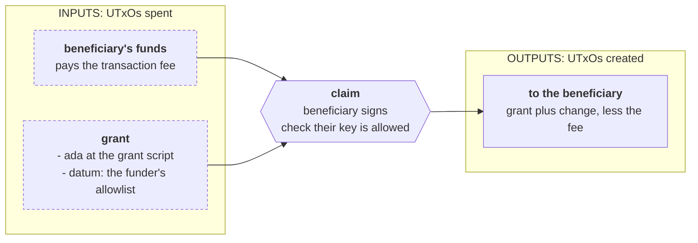
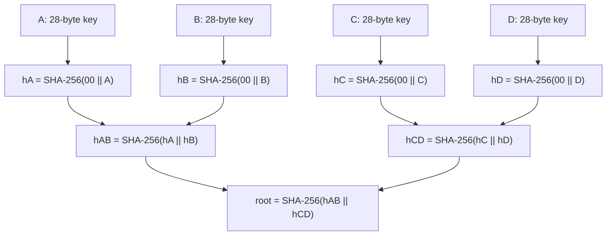
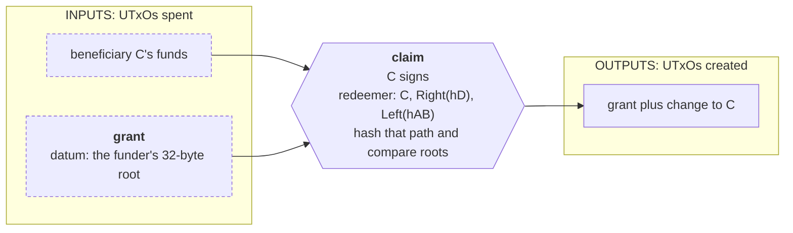

import Tabs from "@theme/Tabs";
import TabItem from "@theme/TabItem";
import CodeBlock from "@theme/CodeBlock";
import extractRegion from "@site/src/utils/extractRegion";
import costFigure, { costSaving, costLimit } from "@site/src/utils/costFigure";
import AllowlistAiken from "!!raw-loader!@site/examples/onboarding/design-patterns/merkle-tree/on-chain/aiken/lib/allowlist.ak";
import MerkleAiken from "!!raw-loader!@site/examples/onboarding/design-patterns/merkle-tree/on-chain/aiken/lib/merkle.ak";
import NaiveAiken from "!!raw-loader!@site/examples/onboarding/design-patterns/merkle-tree/on-chain/aiken/validators/naive.ak";
import ByHandAiken from "!!raw-loader!@site/examples/onboarding/design-patterns/merkle-tree/on-chain/aiken/validators/by_hand.ak";
import TreeMesh from "!!raw-loader!@site/examples/onboarding/design-patterns/merkle-tree/off-chain/mesh/src/lib/tree.ts";
import BlueprintMesh from "!!raw-loader!@site/examples/onboarding/design-patterns/merkle-tree/off-chain/mesh/src/lib/blueprint.ts";
import GrantsMesh from "!!raw-loader!@site/examples/onboarding/design-patterns/merkle-tree/off-chain/mesh/src/lib/grants.ts";
import Costs from "@site/examples/onboarding/design-patterns/merkle-tree/off-chain/mesh/costs.json";

A **Merkle tree** lets a contract remember a large collection as one small commitment: a root hash. To prove that one item is included, the transaction supplies the item and the sibling hashes on its path to the root. The contract hashes that path and compares the result with the root it already trusts.

The tree and its proofs are built **off-chain**. On-chain work grows with the proof's depth, about the logarithm of the collection size, instead of searching every item. This page uses a SHA-256 tree to authorize an allowlisted grant, compares it with a list in the datum, and measures both implementations. We asume you went over the [onboarding course](../lectures/introduction.md) or that you have built Cardano protocols in the past.

## The protocol

A funder publishes **one grant UTxO**, choosing an allowlist of payment verification-key hashes. Any listed beneficiary may consume the entire grant, provided they sign. The first valid spend takes it; it is not a distribution of one allocation per listed person.



The beneficiary's signature authorizes their spend, so they may choose another destination too. Membership without that signature is insufficient: allowlists and proofs are public, and copying a member's proof must not let somebody else take the grant.

There are two ways to remember the funder's allowlist: store every key, or store its root. The redeemer names the beneficiary; the Merkle version also carries the proof. These public types are shared by the example:

<Tabs groupId="onchain">
<TabItem value="aiken" label="Aiken" default>

<CodeBlock language="aiken" title="lib/allowlist.ak">
  {extractRegion(AllowlistAiken, "imports")}
</CodeBlock>

<CodeBlock language="aiken" title="lib/allowlist.ak">
  {extractRegion(AllowlistAiken, "types")}
</CodeBlock>

`Left` and `Right` say **where the sibling goes**, not which side the beneficiary is on. Each sibling is a 32-byte SHA-256 digest. The path is ordered from the leaf upward. The implementation caps it at 32 steps to bound work on an untrusted redeemer; the proof does not itself establish a collection's size.

Both contracts share the signature check. The Merkle verifier uses the following leaf serialization:

<CodeBlock language="aiken" title="lib/allowlist.ak">
  {extractRegion(AllowlistAiken, "application")}
</CodeBlock>

The leaf bytes are `00 || beneficiary_key_hash`, exactly 29 bytes. The `00` is one byte, not the text characters `0` and `0`. Hashing the printable hex representation would produce a different root. [Why these lengths matter](#leaf-and-branch-encoding) is part of the design, not an SDK detail.

</TabItem>
<TabItem value="scalus" label="Scalus">

A [Scalus](https://scalus.org/) version is coming soon. The idea is identical, only the language differs.

</TabItem>
</Tabs>

## The naive contract

Put the list in the datum and search it:

<CodeBlock language="aiken" title="validators/naive.ak">
  {extractRegion(NaiveAiken, "validator")}
</CodeBlock>

The spend reads its **supplied datum directly**, because the ledger supplies the datum belonging to the UTxO being spent. There is no separate state lookup or input-datum decoding. The actual question is simply whether the signing key occurs in the list.

This is a reasonable choice for a small allowlist. With the claimant last in the list, a claim uses {costFigure(Costs, "versions.naive.sizes.1.claim.mem")} memory units for one member and {costFigure(Costs, "versions.naive.sizes.256.claim.mem")} for 256. Publishing the larger datum also requires more bytes and more minimum ada.

An inline datum already on-chain is not copied into the spending transaction body merely because the script reads it. Consequently, **publication size** grows with this list, while a claim's execution cost grows with the search. These are separate measurements below.

## The pattern

Hash each member, combine ordered pairs of child digests, and keep only the final root in the grant's datum:



Changing a leaf changes its ancestors and therefore the root, assuming the hash function's collision and second-preimage resistance. The commitment is to the **ordered collection and tree shape**: reordering the same members can change the root. Membership verification does not prove uniqueness or sortedness.

### Follow one path

To prove C is present, supply `Right(hD)` and then `Left(hAB)`:

1. Hash C's leaf bytes to obtain `hC`.
2. Combine `hC || hD` to obtain `hCD`.
3. Combine `hAB || hCD` to obtain the candidate root.
4. Compare that candidate with the root in the grant's datum.

There is no need to reveal A and B or rebuild their subtree. For a balanced tree with _N_ leaves, the path has at most `ceil(log2(N))` siblings. Doubling a power-of-two list adds one hash step, rather than doubling the search.

The claim transaction now supplies the path:



The root comes from the existing datum. A claimant cannot replace it with a root for their own set in the redeemer.

### Tree shape and edge cases

This example follows the [`aiken-merkle-tree` 0.0.1 convention](https://github.com/Anastasia-Labs/aiken-merkle-tree/blob/0.0.1/lib/aiken_merkle_tree/mt.ak): recursively split the ordered list at `floor(length / 2)`. Children stay ordered. There is **no padding** or duplication of the final leaf.

For `[A, B, C]`, the left child is A and the right child contains B and C. A needs one sibling; B and C need two. With one member, the root is that member's leaf hash and the proof is empty. The off-chain builder returns `undefined` for an empty list; the funding fixtures require a nonempty list, and the committed-grant validator requires a 32-byte root.

A proof format from a sorted-pair tree, a padded tree, or a different hashing algorithm is not interchangeable with this one. Choose the convention once, publish it with the dataset, and use it in both the builder and verifier.

### Leaf and branch encoding

If leaves are arbitrary bytes and branches hash `left_hash || right_hash` without a distinguishing encoding, an internal node's 64-byte preimage could itself be presented as a leaf. That confuses two structural roles **without finding a hash collision**.

Here the admitted leaf preimage is exactly **29 bytes**, and the admitted branch preimage is exactly **64 bytes**. The beneficiary must be a 28-byte key hash, and both child hashes must be 32 bytes. These disjoint encodings remove that ambiguity for this allowlist.

The application supplies the fixed leaf encoding and enforces widths. If you generalize to variable-length leaf records, define an unambiguous scheme, such as separate tags on **both** leaf and branch preimages, and change construction and verification together. Adding a leaf tag alone does not solve the general variable-length case.

## Design

The four questions from Intermediate:

1. **Requirements.** Any allowlisted key may consume this grant only with its signature. The stored commitment is the funder's choice. A large list should not require large persistent datums or a full on-chain search.
2. **Actions.** Publish a grant with the chosen list/root; claim the whole grant. Publishing is a payment to a script address, so no spend validator runs then. Claiming runs one spend validator. Tree construction and proof generation are off-chain operations, not additional validator purposes.
3. **What must be true.** The claim names a 28-byte signing key. In the baseline it occurs in the datum list. In the pattern its serialized leaf and correctly ordered, bounded proof reconstruct the datum's 32-byte root. No prefix of the proof is accepted early: every supplied step must be consumed before comparing roots.
4. **What must be remembered.** The baseline remembers the members; the pattern remembers the root. The claimant supplies a proof, but not the trusted root. Nothing remembers whether this beneficiary has claimed a different grant.

The datum root is sufficient to protect **the funds in this grant**. It is not an authenticated global directory. Anyone can create another UTxO at this script address with another root. A contract reading a shared root as a reference input would need to authenticate that configuration, for example with the beacon pattern from [modifying state](../lectures/intermediate/12-modifying-state.md).

## Write it by hand

<Tabs groupId="onchain">
<TabItem value="aiken" label="Aiken" default>

The verifier hashes the leaf once and hashes one ordered pair per sibling. It checks the widths and the remaining depth before combining a supplied sibling:

<CodeBlock language="aiken" title="lib/merkle.ak">
  {extractRegion(MerkleAiken, "verify")}
</CodeBlock>

An empty proof still has a check: the leaf hash must equal the root. A truncated path normally leaves a subtree hash that differs from the root. An extra step hashes past the intended root and fails too. A direction bit matters because `hash(left || right)` is generally different from `hash(right || left)`.

The validator combines membership with the signature check, using the datum already supplied to its spend handler:

<CodeBlock language="aiken" title="validators/by_hand.ak">
  {extractRegion(ByHandAiken, "validator")}
</CodeBlock>

The verifier and the application are separate. Reconstructing a root proves inclusion; requiring the included beneficiary to sign is what authorizes this grant's spend. If the proof authenticates member-specific allocations, deadlines, or other entitlement data, include those fields in the leaf encoding and enforce their consequences in the validator. Shared rules, such as a campaign-wide deadline, can instead be authenticated through the grant datum or validator parameters.

</TabItem>
<TabItem value="scalus" label="Scalus">

A [Scalus](https://scalus.org/) version is coming soon. The idea is identical, only the language differs.

</TabItem>
</Tabs>

## Library references

Earlier implementations include [`aiken-lang/trees`](https://github.com/aiken-lang/trees) and [`Anastasia-Labs/aiken-merkle-tree`](https://github.com/Anastasia-Labs/aiken-merkle-tree), derived from it. Both demonstrate tree construction and membership proofs using older Aiken APIs; Anastasia Labs' [`0.0.1` release](https://github.com/Anastasia-Labs/aiken-merkle-tree/tree/0.0.1) uses stdlib 1.7.0. Their source is useful for studying the pattern, but we won't use them directly since their older versions are not compatible with modern Aiken. The runnable example uses the hand-written verifier above.

## Build the transaction

<Tabs groupId="offchain">
<TabItem value="mesh" label="Mesh" default>

The Mesh project has the same two contract versions and a public TypeScript proof representation:

<CodeBlock language="ts" title="src/lib/blueprint.ts">
  {extractRegion(BlueprintMesh, "versions")}
</CodeBlock>

<CodeBlock language="ts" title="src/lib/tree.ts">
  {extractRegion(TreeMesh, "types")}
</CodeBlock>

Node's SHA-256 hashes decoded bytes. The leaf and branch helpers implement the same width and ordering rules as Aiken:

<CodeBlock language="ts" title="src/lib/tree.ts">
  {extractRegion(TreeMesh, "hashes")}
</CodeBlock>

The publisher fixes the member order, builds the tree once, and keeps the dataset or a proof service available. This builder rejects duplicate and malformed keys. `proofAt` uses a known member index to follow one path; a production app can maintain a member-to-index map:

<CodeBlock language="ts" title="src/lib/tree.ts">
  {extractRegion(TreeMesh, "construction")}
</CodeBlock>

The proof and claim are encoded to match the public Aiken constructors:

<CodeBlock language="ts" title="src/lib/tree.ts">
  {extractRegion(TreeMesh, "encoding")}
</CodeBlock>

<CodeBlock language="ts" title="src/lib/blueprint.ts">
  {extractRegion(BlueprintMesh, "data")}
</CodeBlock>

`Chain` is the fixture returned by `offlineChain` in `src/lib/offline.ts`: a fixed funded wallet, collateral, the dataset/tree/proof, the chosen grant, a fetcher, and an offline evaluator. Each grant holds enough ada for both datum layouts. The minimum-ada helpers calculate the actual inline datum's requirement:

<details>
<summary>The minimum-ada calculation</summary>

<CodeBlock language="ts" title="src/lib/grants.ts">
  {extractRegion(GrantsMesh, "minimum-ada")}
</CodeBlock>

</details>

Publish the datum selected by the funder:

<CodeBlock language="ts" title="src/lib/grants.ts">
  {extractRegion(GrantsMesh, "lock")}
</CodeBlock>

The claimant prepares the beneficiary and its proof. A plan is exposed so attack tests can alter a field before construction:

<CodeBlock language="ts" title="src/lib/grants.ts">
  {extractRegion(GrantsMesh, "plan")}
</CodeBlock>

The claim spends the grant, includes the member as a **required signer**, offers collateral, and returns the funds to the claimant. Passing the evaluator lets the builder price the actual execution:

<CodeBlock language="ts" title="src/lib/grants.ts">
  {extractRegion(GrantsMesh, "claim")}
</CodeBlock>

The publish-then-claim tests use the actual grant output and wallet change produced by the publication transaction. No network provider, submitter, or real funds are used.

</TabItem>
<TabItem value="evolution" label="Evolution">

An [Evolution](https://github.com/IntersectMBO/evolution-sdk) version is coming soon. The idea is identical, only the library calls differ.

</TabItem>
</Tabs>

## The numbers

`npm run bench` builds and evaluates real transactions against fixed offline fixtures, signs offline to count the wallet witness in transaction size, and writes `costs.json`. This page reads those figures; `npm test` measures again and refuses stale results. Fees and limits use Mesh's default protocol parameters. The independent variable is **allowlist members**, not grants consumed in a batch.

The claimant is last in the dataset, giving the naive version a full list search. The Merkle tree uses the same ordered members as the list datum, with the leaf encoding and balanced split described above. The grant amount is a large fixed fixture, not the minimum-ada requirement shown below.

**Claim memory units**, one spend handler in every version:

| Members | List datum | Merkle proof |
|---|--:|--:|
| 1 | {costFigure(Costs, "versions.naive.sizes.1.claim.mem")} | {costFigure(Costs, "versions.byHand.sizes.1.claim.mem")} |
| 5 | {costFigure(Costs, "versions.naive.sizes.5.claim.mem")} | {costFigure(Costs, "versions.byHand.sizes.5.claim.mem")} |
| 10 | {costFigure(Costs, "versions.naive.sizes.10.claim.mem")} | {costFigure(Costs, "versions.byHand.sizes.10.claim.mem")} |
| 20 | {costFigure(Costs, "versions.naive.sizes.20.claim.mem")} | {costFigure(Costs, "versions.byHand.sizes.20.claim.mem")} |
| 100 | {costFigure(Costs, "versions.naive.sizes.100.claim.mem")} | {costFigure(Costs, "versions.byHand.sizes.100.claim.mem")} |
| 256 | {costFigure(Costs, "versions.naive.sizes.256.claim.mem")} | {costFigure(Costs, "versions.byHand.sizes.256.claim.mem")} |

**Claim fee**, in ada:

| Members | List datum | Merkle proof |
|---|--:|--:|
| 1 | {costFigure(Costs, "versions.naive.sizes.1.claim.fee", "ada")} | {costFigure(Costs, "versions.byHand.sizes.1.claim.fee", "ada")} |
| 5 | {costFigure(Costs, "versions.naive.sizes.5.claim.fee", "ada")} | {costFigure(Costs, "versions.byHand.sizes.5.claim.fee", "ada")} |
| 10 | {costFigure(Costs, "versions.naive.sizes.10.claim.fee", "ada")} | {costFigure(Costs, "versions.byHand.sizes.10.claim.fee", "ada")} |
| 20 | {costFigure(Costs, "versions.naive.sizes.20.claim.fee", "ada")} | {costFigure(Costs, "versions.byHand.sizes.20.claim.fee", "ada")} |
| 100 | {costFigure(Costs, "versions.naive.sizes.100.claim.fee", "ada")} | {costFigure(Costs, "versions.byHand.sizes.100.claim.fee", "ada")} |
| 256 | {costFigure(Costs, "versions.naive.sizes.256.claim.fee", "ada")} | {costFigure(Costs, "versions.byHand.sizes.256.claim.fee", "ada")} |

**Storage and publication with 256 members**:

| Measurement | List datum | Root datum |
|---|--:|--:|
| Serialized datum bytes | {costFigure(Costs, "versions.naive.sizes.256.datumSize")} | {costFigure(Costs, "versions.byHand.sizes.256.datumSize")} |
| Signed publication bytes | {costFigure(Costs, "versions.naive.sizes.256.lock.size")} | {costFigure(Costs, "versions.byHand.sizes.256.lock.size")} |
| Publication fee, ada | {costFigure(Costs, "versions.naive.sizes.256.lock.fee", "ada")} | {costFigure(Costs, "versions.byHand.sizes.256.lock.fee", "ada")} |
| Minimum output ada | {costFigure(Costs, "versions.naive.sizes.256.lock.minimumAda", "ada")} | {costFigure(Costs, "versions.byHand.sizes.256.lock.minimumAda", "ada")} |

The root itself is 32 bytes; the serialized datum includes its constructor and CBOR framing. Minimum output ada is held in the UTxO, not paid as a transaction fee.

**Claim CPU steps and sizes at 256 members**:

| Measurement | List datum | Merkle proof |
|---|--:|--:|
| CPU steps | {costFigure(Costs, "versions.naive.sizes.256.claim.cpu")} | {costFigure(Costs, "versions.byHand.sizes.256.claim.cpu")} |
| Included script bytes | {costFigure(Costs, "versions.naive.scriptSize")} | {costFigure(Costs, "versions.byHand.scriptSize")} |
| Signed claim bytes | {costFigure(Costs, "versions.naive.sizes.256.claim.size")} | {costFigure(Costs, "versions.byHand.sizes.256.claim.size")} |

What the measurements say:

- **Small lists favor the baseline.** At the measured sizes up to 20, scanning needs fewer execution units and a lower claim fee than the Merkle version. Hashing and proof handling have fixed and per-level costs.
- **Execution savings arrive before fee savings.** At 100 members the hand-written verifier uses fewer memory units, but its claim fee is still higher: the proof and larger included script add bytes. At 256 it uses {costSaving(Costs, "versions.naive.sizes.256.claim.mem", "versions.byHand.sizes.256.claim.mem")} less memory and pays {costSaving(Costs, "versions.naive.sizes.256.claim.fee", "versions.byHand.sizes.256.claim.fee")} less in claim fees.
- **Publication and storage benefit independently of a claim's fee.** At 256 members the root datum has a smaller publication transaction and lower minimum output ada. The root remains fixed-size as the allowlist grows.

The largest allowlist this fixture can **publish as one list datum** is {costFigure(Costs, "listPublicationLimit.members")} members. Its signed publication is {costFigure(Costs, "listPublicationLimit.lastSize")} bytes against a {costFigure(Costs, "limits.size")}-byte transaction limit, and {costLimit(Costs, "listPublicationLimit.limitedBy")} is the first limit reached. Mesh refuses the next construction. This is the limit of this publication layout and witness set, not a claim-size limit or a universal limit for every representation.

For a Merkle allowlist with **{costFigure(Costs, "largeTree.members")} members**, the claimant supplies {costFigure(Costs, "largeTree.byHand.proofSteps")} sibling steps, encoded in {costFigure(Costs, "largeTree.byHand.proofSize")} proof bytes. The claim uses {costFigure(Costs, "largeTree.byHand.claim.mem")} memory units and costs {costFigure(Costs, "largeTree.byHand.claim.fee", "ada")} ada. Publication still uses the same fixed-size root datum.

There is no batch maximum here: each transaction claims one grant. Increasing the dataset requires off-chain storage and construction work, while on-chain claims grow with proof depth. These figures include each spending script directly; using a [reference script](../lectures/intermediate/13-reference-inputs-and-scripts.md) changes the byte/fee trade-off.

## When to use it, and when not

Use a Merkle commitment when a contract needs to verify individual items from a **large, mostly static dataset**, and the publisher can make that dataset or its proofs available. Allowlists, snapshot entitlements, and commitments to messages from another system fit this shape. The [sidechain toolkit case study](https://github.com/Anastasia-Labs/aiken-merkle-tree#case-study), linked by Anastasia Labs, illustrates the cross-system use case; proving message inclusion still needs a separately trusted root and application rules for consuming the message.

Keep a small list when its storage is bounded and its claim cost is already acceptable. The measured one-to-20-member cases above are cheaper with the simple scan. A Merkle tree adds a serialization protocol, dataset distribution, and proof generation.

For a frequently changing on-chain registry, consider a [linked list](./linked-list.md). It stores authenticated nodes and supports local mutations and ordered absence proofs. A [Merkle Patricia trie](./merkle-patricia-trie.md) is the structure to use when key-addressed updates and absence proofs matter.

### What membership does not provide

- **Authorization.** This grant also checks the member's signature. A bridge or entitlement contract needs its own action-specific rules after verifying inclusion.
- **One claim per person.** The ledger prevents this grant UTxO from being consumed twice, but a proof is reusable for another grant carrying the same root. An airdrop needs separate claimed-state or a uniquely consumed entitlement, bound to the campaign and allocation.
- **An absence proof.** Failure to provide a valid membership proof does not prove a key absent. Sorted/sparse Merkle constructions can support different proof rules, but this membership tree does not implement them.
- **Data availability.** A root cannot regenerate the dataset or a missing proof. Publish reproducible ordering, encoding, and the data needed to obtain proofs before relying on the commitment.
- **Automatic updates or contention relief.** Changing the collection changes its root and may invalidate old proofs. The example grants keep their root until consumed. A shared mutable-root contract needs an authenticated update mechanism and still has contention on that configuration UTxO.
- **Dataset semantics.** A valid path does not prove the whole dataset is complete, unique, sorted, or honestly selected. Those are commitments the application must establish elsewhere.

### Security

The tests verify specific properties rather than establishing a general security guarantee:

- **Signature binding.** Membership without the required member signature is refused in every version. A signing non-member is refused. A copied proof cannot prove another listed key.
- **Commitment binding.** Changing the datum root makes the old proof fail. The root is never accepted from the claimant's redeemer.
- **Path integrity.** Altered siblings, reversed sibling directions, reversed paths, truncation, and appended steps are refused by the intended spend script.
- **Encoding and width checks.** Short/oversized sibling digests, short/empty roots, and a root built with untagged leaf bytes fail. The fixed member and digest widths keep leaf and branch preimages disjoint.
- **A meaningful depth boundary.** A matching 32-step proof is accepted; a matching 33-step proof is refused. The latter is rejected for its depth even though hashing all its steps would reach its supplied root.
- **Construction interoperability.** Mesh-generated proofs run through the compiled Aiken verifier. Tests cover empty/singleton trees, odd splits, and left/middle/right leaves.
- **Actual publication outputs.** Publish-then-claim tests use the grant datum and wallet change produced by the publication transaction, and assert exactly one `SPEND` run.
- **Proof reuse is explicit.** The same public proof is accepted for two separate grants with the same root. It is not mistaken for replay protection.

Attack helpers first evaluate their unchanged honest transaction, then build the altered transaction **without an evaluator**, and assert refusal by the spend handler. Script tests do not replace the ledger's phase-1 checks, including actual signature witnesses, minimum output ada, and transaction limits.

## Run it

```bash
npx giget@latest gh:cardano-foundation/developer-portal/examples/onboarding/design-patterns/merkle-tree merkle-tree
cd merkle-tree/on-chain/aiken
aiken check
aiken build
cp plutus.json ../../off-chain/mesh/blueprints/merkle-tree.plutus.json
cd ../../off-chain/mesh
npm install
npm run typecheck
npm test
npm run bench
```

The compiled blueprint and figures ship with the project. After changing a validator, rebuild, copy the blueprint, regenerate `costs.json`, and run the tests. Keep the off-chain builder's leaf encoding and tree shape in agreement with the verifier.

## Go deeper

- [Cryptographic primitives](../../curriculum/fundamentals/cryptographic-primitives.md#how-do-merkle-trees-enable-efficient-verification): hashing and the membership-proof idea.
- [`aiken-merkle-tree` 0.0.1 source](https://github.com/Anastasia-Labs/aiken-merkle-tree/blob/0.0.1/lib/aiken_merkle_tree/mt.ak): an older standalone implementation from Anastasia Labs.
- [`aiken-lang/trees`](https://github.com/aiken-lang/trees): the earlier Aiken tree implementation it derives from.
- [Linked list](./linked-list.md) and [Merkle Patricia trie](./merkle-patricia-trie.md): other collection/proof structures.
- [Missing UTxO authentication](../../curriculum/smart-contracts/security/vulnerabilities/missing-utxo-authentication.md): how to authenticate a shared root read from a reference UTxO.
- [Double satisfaction](../../curriculum/smart-contracts/security/vulnerabilities/double-satisfaction.md): why an inclusion check alone cannot bind a payment or entitlement to exactly one action.
