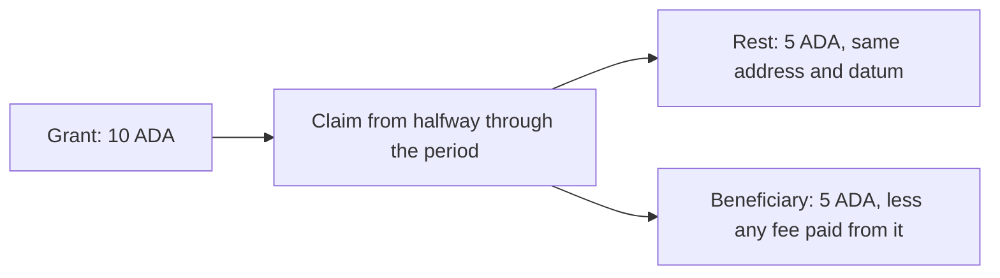

import CodeBlock from "@theme/CodeBlock";
import extractRegion from "@site/src/utils/extractRegion";
import costFigure from "@site/src/utils/costFigure";
import VestingAiken from "!!raw-loader!@site/examples/onboarding/design-patterns/validity-range/on-chain/aiken/lib/vesting.ak";
import NaiveAiken from "!!raw-loader!@site/examples/onboarding/design-patterns/validity-range/on-chain/aiken/validators/naive.ak";
import EndpointsAiken from "!!raw-loader!@site/examples/onboarding/design-patterns/validity-range/on-chain/aiken/validators/with_endpoints.ak";
import ByHandAiken from "!!raw-loader!@site/examples/onboarding/design-patterns/validity-range/on-chain/aiken/validators/by_hand.ak";
import WithLibraryAiken from "!!raw-loader!@site/examples/onboarding/design-patterns/validity-range/on-chain/aiken/validators/with_library.ak";
import ScheduleAiken from "!!raw-loader!@site/examples/onboarding/design-patterns/validity-range/on-chain/aiken/lib/schedule.ak";
import ScheduledNaiveAiken from "!!raw-loader!@site/examples/onboarding/design-patterns/validity-range/on-chain/aiken/validators/scheduled_naive.ak";
import ScheduledAiken from "!!raw-loader!@site/examples/onboarding/design-patterns/validity-range/on-chain/aiken/validators/scheduled.ak";
import ScheduleMesh from "!!raw-loader!@site/examples/onboarding/design-patterns/validity-range/off-chain/mesh/src/lib/schedule.ts";
import VestingMesh from "!!raw-loader!@site/examples/onboarding/design-patterns/validity-range/off-chain/mesh/src/lib/vesting.ts";
import BlueprintMesh from "!!raw-loader!@site/examples/onboarding/design-patterns/validity-range/off-chain/mesh/src/lib/blueprint.ts";
import Costs from "@site/examples/onboarding/design-patterns/validity-range/off-chain/mesh/costs.json";

A validator reads the transaction's **validity range** rather than a clock. [Handling time](/docs/developers/onboarding/lectures/intermediate/handling-time) used that range to check a deadline. Some contracts need more: a numeric bound for interest, vesting, or a limit on the window's width.

**Normalization converts an interval to one canonical representation of the same set of integer times.** It resolves inclusive and exclusive bounds once, so later code works with included endpoints and explicit cases for unbounded or empty intervals.

This is an **optional code-organization pattern with modest, situational benefits**. It adds execution and script bytes. Its value grows when several operations share an interval, or when a contract accepts different encodings from an external schema. For one endpoint, a small flag-aware helper is often enough. The important security decisions remain which bound to use, how to round amounts, and which states the protocol permits.

## Choose the amount of interval handling you need

- **One deadline check:** use the stdlib's `interval.is_entirely_after` or `interval.is_entirely_before` for a strict comparison. Choose the predicate that matches the intended equality behavior.
- **One numeric endpoint:** require that bound to be finite and honor its inclusive flag. [The endpoint version](#a-smaller-alternative-read-one-endpoint) below does this.
- **Several operations on an interval:** consider normalization so they share one interpretation of bounds, emptiness, and infinities.
- **Your own datum format:** prefer a type that expresses the actual protocol. `Linear { start, end }` and `Cliff { at }` are clearer vesting schedules than a general interval unless you need compatibility with an interval-based schema.

For today's ledger-produced transaction range, all four implementations below enforce the same vesting rules. Normalization makes the interval interpretation reusable; it does not fix an exploitable bug in the direct-reading version on that ledger.

## The example: a linear vesting grant

A grantor locks ADA for a beneficiary. Nothing has vested at `start`, everything has vested at `end`, and the amount grows linearly between them. Two actions need a time as a number:

- **Claim:** the beneficiary takes what has vested and returns the unvested rest under the same datum.
- **Clawback:** the grantor takes back the unvested amount and pays the remaining vested amount to the beneficiary.

Whoever builds the transaction chooses its window. Each action must use the endpoint that protects the other party:

- **Price a claim at the earliest permitted time.** At inclusion, at least that much has vested. Using the latest time would permit early claims.
- **Price a clawback at the latest permitted time.** At inclusion, at most that much has vested. Using the earliest time could underpay the beneficiary.

These are conservative bounds, not a way to discover the actual inclusion time. A wide window can reduce what the builder receives. [Time handling](/docs/developers/curriculum/smart-contracts/security/vulnerabilities/time-handling) explains the underlying attacks.



### Design

1. **Requirements:** the beneficiary may claim only vested funds; a clawback must preserve their vested entitlement.
2. **Actions:** `Claim` and `Clawback`, both in the `spend` handler.
3. **Checks:** the right party signs, the needed time bound exists, and the rest or beneficiary payment covers the appropriate amount. Each linear-grant transaction spends one grant from that validator.
4. **State:** beneficiary address, grantor key, start, end, and total. The UTxO holds the remaining balance.

<CodeBlock language="aiken" title="lib/vesting.ak">
  {extractRegion(VestingAiken, "grant")}
</CodeBlock>

All versions share the same amount checks. They keep the unvested amount as a fraction and compare by cross-multiplication:

<CodeBlock language="aiken" title="lib/vesting.ak">
  {extractRegion(VestingAiken, "unvested")}
</CodeBlock>

<details>
<summary>The shared claim, clawback, and authorization checks</summary>

<CodeBlock language="aiken" title="lib/vesting.ak">
  {extractRegion(VestingAiken, "claim")}
</CodeBlock>

<CodeBlock language="aiken" title="lib/vesting.ak">
  {extractRegion(VestingAiken, "clawback")}
</CodeBlock>

<CodeBlock language="aiken" title="lib/vesting.ak">
  {extractRegion(VestingAiken, "helpers")}
</CodeBlock>

`only_grant` prevents two inputs from sharing one continuing output. The clawback payment carries the spent grant's output reference as its tag. This binds the payment to this input; an unrelated validator must also check payment tags to prevent cross-contract sharing. A tag cannot control what another validator counts. See [double satisfaction](/docs/developers/curriculum/smart-contracts/security/vulnerabilities/double-satisfaction).

The beneficiary's full on-chain address is checked, including the stake credential.

</details>

## Direct reading: correct for today's ledger

An `Interval` has a lower and an upper bound. Each bound combines `NegativeInfinity`, `Finite(t)`, or `PositiveInfinity` with an `is_inclusive` flag. For POSIX times, `t` is an integer number of milliseconds. These give 36 combinations of bound types and flags, with arbitrary integers in the finite cases.

Different combinations can describe the same set. For example, `(5,000,000, 6,000,000)` and `[5,000,001, 5,999,999]` contain exactly the same integer times. Flags on infinite bounds do not change which finite times are included.

The ledger produces a much narrower set of shapes for a Plutus V3 transaction:

| Transaction bounds | Validator's range |
|---|---|
| Both | Finite lower included; finite upper excluded |
| Lower only | Finite lower included; upper at +∞ |
| Upper only | Lower at −∞; finite upper excluded |
| Neither | −∞ to +∞ |

See the [Conway translation](https://github.com/IntersectMBO/cardano-ledger/blob/56ddee12ec768b85d14c62da049a33fc05114323/eras/conway/impl/src/Cardano/Ledger/Conway/TxInfo.hs#L799-L811). Finite bounds are converted from slot numbers to the POSIX times at which those slots start.

`naive.ak` is the ledger-specific baseline. It reads a finite lower bound directly and subtracts one millisecond from a finite upper bound. Its `expect` statements deliberately reject a missing required endpoint:

<CodeBlock language="aiken" title="validators/naive.ak">
  {extractRegion(NaiveAiken, "naive")}
</CodeBlock>

This is correct for the transaction shapes above. It is not a general interval interpreter: ignoring flags gives different answers for equivalent encodings in synthetic contexts or datum intervals.

### A smaller alternative: read one endpoint

Honor the flag at the bound the action uses:

<CodeBlock language="aiken" title="validators/with_endpoints.ak">
  {extractRegion(EndpointsAiken, "endpoints")}
</CodeBlock>

<CodeBlock language="aiken" title="validators/with_endpoints.ak">
  {extractRegion(EndpointsAiken, "with-endpoints")}
</CodeBlock>

This handles equivalent endpoint encodings without constructing a normalized range or inspecting the other bound. It is sufficient for this grant's transaction window: the ledger already ensures an admitted transaction has a nonempty validity window.

For an arbitrary interval in a datum, these helpers alone do not establish that the other bound is sensible or that the interval is nonempty. Validate those conditions separately or normalize the whole interval.

### What the historical encoding change demonstrates

Before Conway, an upper-only window was translated to an **inclusive** upper endpoint in the [Alonzo translation](https://github.com/IntersectMBO/cardano-ledger/blob/56ddee12ec768b85d14c62da049a33fc05114323/eras/alonzo/impl/src/Cardano/Ledger/Alonzo/Plutus/TxInfo.hs#L327-L337). Conway uses an exclusive one, including for V1 and V2 contexts.

The ledger's admission rule still required `slot < invalidHereafter`; see [`inInterval`](https://github.com/IntersectMBO/cardano-ledger/blob/56ddee12ec768b85d14c62da049a33fc05114323/eras/allegra/impl/src/Cardano/Ledger/Allegra/Scripts.hs). The old context's extra endpoint did not allow inclusion in that excluded slot.

The Aiken tests supply inclusive upper bounds as **synthetic interval cases**, not evidence of an exploitable historical clawback. They show why a general interpreter must read the flag. Flag-aware helpers and normalization both do that. Neither guarantees unchanged behavior across a hard fork: changing `(-∞, t]` to `(-∞, t)` changes the represented set, so their interpreted endpoints should differ.

## The pattern: normalize the whole interval

Resolve each excluded finite bound to the nearest included integer: add one for the lower bound, subtract one for the upper. Then classify the result:

| Interval shape | Canonical representation |
|---|---|
| Finite, nonempty | `ClosedRange { lower, upper }`, both included |
| No lower bound | `FromNegInf { upper }` |
| No upper bound | `ToPosInf { lower }` |
| No bounds | `Always` |
| Empty | `InvalidRange` |

Equivalent encodings now produce the same value. Consumers can match on those five cases without reading flags again. This is useful when several checks share the interval; it also centralizes empty-interval handling.

### Write it by hand

<CodeBlock language="aiken" title="validators/by_hand.ak">
  {extractRegion(ByHandAiken, "normalized")}
</CodeBlock>

<CodeBlock language="aiken" title="validators/by_hand.ak">
  {extractRegion(ByHandAiken, "normalize")}
</CodeBlock>

Two details matter:

- After adjusting finite endpoints, **`lower > upper` means empty**. Equality is a valid singleton: `(9, 11)` contains the integer `10`.
- A lower bound at +∞ or an upper bound at −∞ contains no finite time.

The grant normalizes once per spend. A claim accepts `ClosedRange` or `ToPosInf`; a clawback accepts `ClosedRange` or `FromNegInf`:

<CodeBlock language="aiken" title="validators/by_hand.ak">
  {extractRegion(ByHandAiken, "by-hand")}
</CodeBlock>

This makes all range cases visible together. The endpoint version expresses the same required-bound rejection with `expect`. Both are deliberate policies.

### The library version and its limitation

[`aiken-design-patterns` v1.9.0](https://github.com/Anastasia-Labs/aiken-design-patterns/blob/v1.9.0/lib/aiken-design-patterns/validity-range-normalization.ak) exports `NormalizedTimeRange` and `normalize_time_range` from `aiken_design_patterns/validity_range_normalization`.

<CodeBlock language="aiken" title="validators/with_library.ak">
  {extractRegion(WithLibraryAiken, "with-library")}
</CodeBlock>

**v1.9.0 incorrectly classifies singleton integer intervals as empty.** It checks `lower >= upper` after resolving the flags. `[10, 10]` contains `10`, so returning `InvalidRange` loses a member of the original set. This is a semantic limitation, not an equally valid normalization convention.

Current one-second slot boundaries cannot produce a one-millisecond transaction window, so the difference does not affect these transaction-range examples. For general datum intervals, use the hand-written conversion here or a library version whose singleton behavior you have verified. The tests pin all four singleton encodings so a dependency change requires review.

## Build the transaction

The Mesh builders use Preview's slot configuration. The off-chain grant and its datum are:

<CodeBlock language="ts" title="src/lib/blueprint.ts">
  {extractRegion(BlueprintMesh, "grant")}
</CodeBlock>

`beneficiaryDatum` preserves key **and script** stake credentials. The builders support base and enterprise beneficiary addresses with a key payment credential; unsupported forms are rejected rather than partially encoded. The grantor also needs a key payment credential.

Every spend declares its validity window in slots:

<CodeBlock language="ts" title="src/lib/vesting.ts">
  {extractRegion(VestingMesh, "window")}
</CodeBlock>

**Rounding depends on the action.** If the exact unvested amount is `U`:

- A claim must return at least `ceil(U)`.
- A clawback may retain at most `floor(U)`, so it pays at least `held − floor(U)` to the beneficiary.

Using `held − ceil(U)` would underpay by one lovelace whenever `U` is non-integral, and the validator would reject it.

<CodeBlock language="ts" title="src/lib/vesting.ts">
  {extractRegion(VestingMesh, "unvested")}
</CodeBlock>

The claim uses the start of its `from` slot:

<CodeBlock language="ts" title="src/lib/vesting.ts">
  {extractRegion(VestingMesh, "claim")}
</CodeBlock>

The clawback uses one millisecond before its `until` slot starts:

<CodeBlock language="ts" title="src/lib/vesting.ts">
  {extractRegion(VestingMesh, "clawback")}
</CodeBlock>

**Both output kinds must meet minimum ADA:** the claim's continuing output and the clawback's tagged beneficiary payment. The builders calculate the minimum for the actual address and datum, rechecking if the amount's encoding grows. A claim may leave more than the exact unvested amount for a later claim. A clawback may pay more than the vested amount, funded by the grantor through transaction balancing.

`buildLockTx` writes a linear `Grant` and accepts only the linear-validator versions. It rejects amounts below the output minimum instead of silently changing the grant total. The scheduled grant has a separate locking API below.

## The numbers

`npm run bench` recompiles the validators, builds four scenarios per version with fixed wallets and a 10 ADA grant, evaluates the scripts, and writes `costs.json`. `npm test` also recompiles before evaluating, then checks the recorded costs. These measurements use Mesh's default protocol parameters and carry the script in the transaction.

For a **claim halfway through the grant, with a 100-slot window**:

| Implementation | Memory units | CPU steps | Script bytes | Fee, ADA |
|---|---:|---:|---:|---:|
| Ledger-specific direct reading | {costFigure(Costs, "versions.naive.claimBetween.mem")} | {costFigure(Costs, "versions.naive.claimBetween.cpu")} | {costFigure(Costs, "versions.naive.claimBetween.scriptSize")} | {costFigure(Costs, "versions.naive.claimBetween.fee", "ada")} |
| Flag-aware endpoint helpers | {costFigure(Costs, "versions.withEndpoints.claimBetween.mem")} | {costFigure(Costs, "versions.withEndpoints.claimBetween.cpu")} | {costFigure(Costs, "versions.withEndpoints.claimBetween.scriptSize")} | {costFigure(Costs, "versions.withEndpoints.claimBetween.fee", "ada")} |
| Hand-written normalization | {costFigure(Costs, "versions.byHand.claimBetween.mem")} | {costFigure(Costs, "versions.byHand.claimBetween.cpu")} | {costFigure(Costs, "versions.byHand.claimBetween.scriptSize")} | {costFigure(Costs, "versions.byHand.claimBetween.fee", "ada")} |
| Library normalization | {costFigure(Costs, "versions.withLibrary.claimBetween.mem")} | {costFigure(Costs, "versions.withLibrary.claimBetween.cpu")} | {costFigure(Costs, "versions.withLibrary.claimBetween.scriptSize")} | {costFigure(Costs, "versions.withLibrary.claimBetween.fee", "ada")} |

The endpoint helpers are the useful middle baseline: they handle the flags while reading only what the action needs. Full normalization resolves both bounds and constructs the range shape. For this grant, that extra work buys organization rather than additional protection for a real transaction window.

The full results in `costs.json` also cover lower-only claims, upper-only clawbacks, and clawbacks with both bounds. The scripts remain well below the fixture's {costFigure(Costs, "limits.mem")} memory-unit transaction limit. Fees here include script bytes; a [reference script](/docs/developers/onboarding/lectures/intermediate/reference-inputs-and-scripts) changes that fee comparison.

## An interval in a datum

An external schema may represent a vesting period as an interval. Unlike a transaction window, its writer can choose arbitrary bounds and flags:

<CodeBlock language="aiken" title="lib/schedule.ak">
  {extractRegion(ScheduleAiken, "scheduled-grant")}
</CodeBlock>

Here normalization has a direct correctness benefit: **equivalent period encodings should produce the same vesting amounts**. Four encodings of the same finite period leave the same rest in both Aiken and Mesh tests. The tests also reject a rest one lovelace below the required amount.

The baseline `scheduled_naive.ak` reads two finite bounds and ignores the flags:

<CodeBlock language="aiken" title="validators/scheduled_naive.ak">
  {extractRegion(ScheduledNaiveAiken, "scheduled-naive")}
</CodeBlock>

Its finite-bound assumptions also mean a datum with an infinite endpoint cannot be spent. This illustrates a **state-design problem**: locking is a plain payment and runs no validator. Normalizing the period alone would not solve it if the contract still rejected the resulting shape.

### Choose schedule semantics and a recovery policy separately

The scheduled example makes these explicit choices:

- **`ClosedRange`:** linear vesting from its first to its last moment. A singleton is a cliff that vests at that moment.
- **`FromNegInf`:** a cliff at its last moment. This is this protocol's interpretation of a period with no start.
- **`ToPosInf`, `Always`, `InvalidRange`:** nothing vests, claims fail, and the grantor may refund the whole balance.

<CodeBlock language="aiken" title="validators/scheduled.ak">
  {extractRegion(ScheduledAiken, "scheduled")}
</CodeBlock>

The refund branch checks only the grantor signature. It needs no time bound or one-grant restriction because there is no beneficiary payment or continuing output to share. Normal linear/cliff spends still use the shared checks.

These are **additional protocol rules**, not consequences of normalization. Another design could reject unsupported schedules during authenticated initialization, or use a dedicated schedule type. Arbitrary malformed deposits, unusable party credentials, and wrong datum types still need consideration: normalization does not guarantee that every deposit can be recovered.

The library's singleton defect matters here. Substituting v1.9.0's normalizer would classify a one-moment cliff as `InvalidRange` and route it to the refund policy, even after it vested. This example therefore uses the hand-written normalizer for the datum period.

### Lock a scheduled grant

The off-chain period type supports finite bounds and the usual unbounded ends:

<CodeBlock language="ts" title="src/lib/schedule.ts">
  {extractRegion(ScheduleMesh, "period")}
</CodeBlock>

Use the dedicated locking function so the validator receives `ScheduledGrant`, not `Grant`:

<CodeBlock language="ts" title="src/lib/vesting.ts">
  {extractRegion(VestingMesh, "lock-scheduled")}
</CodeBlock>

For subsequent spends, `vestingOf(grant, period)` supplies the resolved schedule to the shared claim/clawback builders. Continuing outputs copy the input's datum byte for byte. Builder tests spend actual lock outputs, including closed periods, cliffs, singletons, empty periods, and periods with no end.

`scheduledNaive` is an intentionally restricted comparison. Do not lock an unbounded period there: both actions reject it. The locking API encodes the right datum type; it does not run the spending validator or establish that an arbitrary schedule is supported.

### Interpret the scheduled costs carefully

For the same finite-period claim with both transaction bounds:

| Implementation | Memory units | Script bytes | Fee, ADA |
|---|---:|---:|---:|
| Scheduled baseline | {costFigure(Costs, "versions.scheduledNaive.claimBetween.mem")} | {costFigure(Costs, "versions.scheduledNaive.claimBetween.scriptSize")} | {costFigure(Costs, "versions.scheduledNaive.claimBetween.fee", "ada")} |
| Scheduled with normalization and refund policy | {costFigure(Costs, "versions.scheduled.claimBetween.mem")} | {costFigure(Costs, "versions.scheduled.claimBetween.scriptSize")} | {costFigure(Costs, "versions.scheduled.claimBetween.fee", "ada")} |

This comparison includes two interval conversions **and** broader schedule handling. It does not isolate normalization's cost, and it is not the price of a general recovery guarantee.

## What the tests establish

- **Interval semantics:** property tests compare normalized membership with `interval.contains` and check equivalent finite encodings. Unit tests cover empty ranges, infinities, all singleton encodings, and the library's limitation.
- **Time and amounts:** claims use the lower endpoint, clawbacks the upper; missing required endpoints fail. Fractional grants test both rounding directions, including rejection one lovelace below the required rest or payment.
- **State and authorization:** actual locking outputs can be spent; continuing datums are preserved; wrong datum types fail. Wrong signers, shared claim rests, and missing or incorrect payment tags are rejected.
- **Addresses and output minima:** key-staked, script-staked, and enterprise beneficiaries receive the correct payment. Changed addresses fail. Tests check the ledger minimum against actual serialized outputs, including small clawback payments.
- **Recovery policy:** cliffs and singletons vest at the chosen moment. Empty and unbounded schedules allow only the authorized refund. Aiken tests also cover refunds with no transaction time bound and multiple refundable grants.

The offline evaluator runs the compiled scripts; it is not full ledger admission. It does not establish that the current slot is inside the window or perform every phase-one check. Minimum-output tests are separate for that reason.

Grants track **ADA only**; tokens accidentally sent to them are not protected by the amount checks. The grantor may claw back at any time under this protocol. An irrevocable grant needs different action rules.

## Run it

The example is a self-contained project; see [the playground](./introduction.md#the-playground). Use Aiken v1.1.24 and Node 22 with native TypeScript support (22.18 or newer):

```bash
npx giget@latest gh:cardano-foundation/developer-portal/examples/onboarding/design-patterns/validity-range validity-range
cd validity-range/on-chain/aiken
aiken check
cd ../../off-chain/mesh
npm install
npm run typecheck
npm test             # recompiles and copies the blueprint, then runs regressions and cost checks
npm run bench        # recompiles, measures all versions, and rewrites costs.json
```

**Use normalization when a shared canonical interval makes the code easier to reason about.** For this grant's transaction range, the endpoint helpers are sufficient. For user-supplied intervals, preserving equivalent representations is valuable, while schedule validation and fund recovery remain separate design work.

## Go deeper

- [Handling time: vesting](/docs/developers/onboarding/lectures/intermediate/handling-time): a deadline checked with stdlib predicates.
- [Time handling](/docs/developers/curriculum/smart-contracts/security/vulnerabilities/time-handling): choosing a conservative endpoint.
- [Transactions: validity intervals and time](/docs/developers/curriculum/fundamentals/core-concepts/transactions#validity-intervals-and-time): conversion from slots to POSIX time.
- [`aiken-design-patterns` v1.9.0 source](https://github.com/Anastasia-Labs/aiken-design-patterns/tree/v1.9.0): the pinned library implementation, including its singleton limitation.
