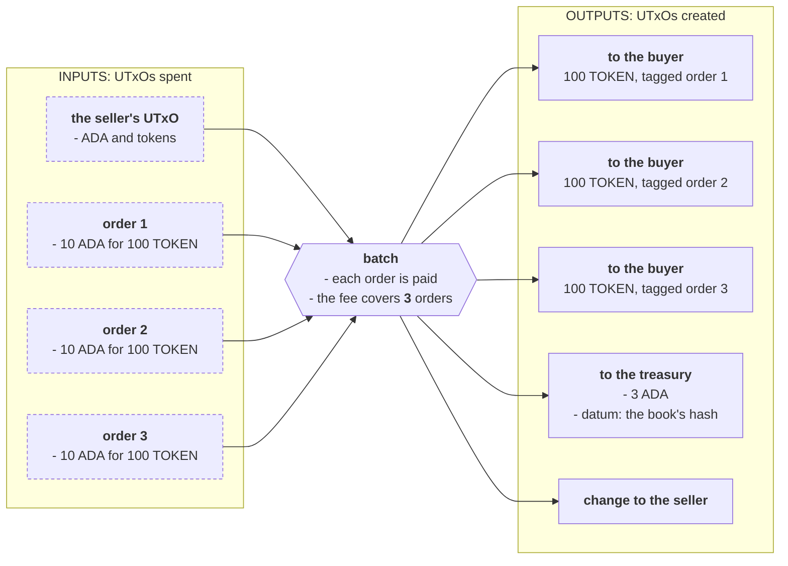
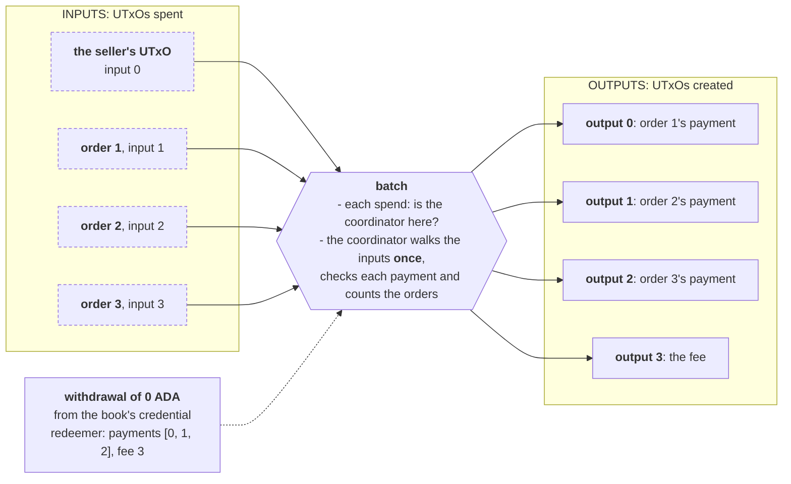

import Tabs from "@theme/Tabs";
import TabItem from "@theme/TabItem";
import CodeBlock from "@theme/CodeBlock";
import extractRegion from "@site/src/utils/extractRegion";
import costFigure, { costSaving, costLimit } from "@site/src/utils/costFigure";
import OrderBookAiken from "!!raw-loader!@site/examples/onboarding/design-patterns/batch-indexers/on-chain/aiken/lib/order_book.ak";
import PerOrderAiken from "!!raw-loader!@site/examples/onboarding/design-patterns/batch-indexers/on-chain/aiken/validators/per_order.ak";
import ByHandAiken from "!!raw-loader!@site/examples/onboarding/design-patterns/batch-indexers/on-chain/aiken/validators/by_hand.ak";
import WithLibraryAiken from "!!raw-loader!@site/examples/onboarding/design-patterns/batch-indexers/on-chain/aiken/validators/with_library.ak";
import MixedByHandAiken from "!!raw-loader!@site/examples/onboarding/design-patterns/batch-indexers/on-chain/aiken/validators/mixed_by_hand.ak";
import MixedWithLibraryAiken from "!!raw-loader!@site/examples/onboarding/design-patterns/batch-indexers/on-chain/aiken/validators/mixed_with_library.ak";
import OrdersMesh from "!!raw-loader!@site/examples/onboarding/design-patterns/batch-indexers/off-chain/mesh/src/lib/orders.ts";
import Costs from "@site/examples/onboarding/design-patterns/batch-indexers/off-chain/mesh/costs.json";

# Batch indexers

**[UTxO indexers](/docs/developers/onboarding/lectures/advanced/design-patterns/utxo-indexers)** point each script input at its own outputs, and each input checks itself. That is the right tool while every check is about one input. When a check is about the **whole batch**, such as a fee that depends on how many inputs there are, every input has to look at every other one, and the work grows with the square of the batch again.

This pattern combines indices with **[transaction-level validation](/docs/developers/onboarding/lectures/advanced/design-patterns/transaction-level-validation)**: one **coordinator** walks every input of the batch once, in the ledger's order, and an index for each tells it where that input's outputs are. It covers the two **multi** indexers of the [`aiken-design-patterns`](https://github.com/Anastasia-Labs/aiken-design-patterns) library: one where the coordinator only needs the indices, and one where it also reads each input's own redeemer. Both are written by hand and with the library, and measured.

## The protocol

**The order book from [UTxO indexers](/docs/developers/onboarding/lectures/advanced/design-patterns/utxo-indexers#the-protocol), initially restricted to full fills and cancellation, with a protocol fee:** A buyer locks ADA with a datum that says which token they want, how many, and where to deliver them. A seller fills many orders in one transaction, delivers each one's tokens, and keeps the ADA. What is new: every batch pays the protocol's **treasury** a fee of 1 ADA **for each order it fills**, in a single output.

We'll add Partial fills back in [Mixed batches](#mixed-batches-reading-each-orders-redeemer), where the coordinator reads each order's redeemer to distinguish full and partial fills.



Each full fill is checked exactly as on the UTxO indexers page: the owner's exact address, only the token ordered, and the order's own output reference as the tag. The fee adds a batch-wide check:

<CodeBlock language="aiken" title="lib/order_book.ak">
  {extractRegion(OrderBookAiken, "fee")}
</CodeBlock>

The fee output is tagged with the book's hash, for the same reason payments are tagged with their order: two books paying the same treasury in one transaction cannot share one fee.

## Checking the batch from every order (the problem)

The full-fill version of the book from the UTxO indexers page, with the fee added. Each order still goes straight to its payment by index, but the fee depends on how many orders the batch fills, and an order only learns that by counting them:

<CodeBlock language="aiken" title="validators/per_order.ak">
  {extractRegion(PerOrderAiken, "per-order")}
</CodeBlock>

Every order runs the same count over every input and checks the same fee output, and all of them reach the same answer. With _N_ orders that is _N_ walks over _N_ inputs. A batch of 20 orders uses {costFigure(Costs, "whole.perOrder.batches.20.mem")} memory units, and this book fits at most **{costFigure(Costs, "whole.perOrder.largestBatch")} orders** in one transaction.

## The pattern (the solution)

Count once. A **coordinator**, here a withdraw-zero stake validator in the same validator as the book, runs once per transaction and walks every input. Each order's spend only checks that the coordinator runs, as in transaction-level validation:



The coordinator's redeemer lists where each order's payment is, **in the order the orders appear among the inputs**, and where the fee is. Three rules make that list safe to accept from whoever built the transaction:

- **The coordinator finds the orders itself.** It walks every input and picks out those locked at the book. A list of orders handed to it could leave one out, and an order left out is an order nobody checks.
- **Every order takes the next index.** Run out of indices while orders remain, or finish with indices to spare, and the batch is refused.
- **The indices only go up.** No payment can be used twice, and the walk through the outputs only ever moves forward, so the whole batch is one pass over the inputs and one over the outputs.

The coordinator's redeemer needs no input indices: the coordinator walks the inputs anyway, and meets each order where it is. Each order's spend still takes its own input's index, to learn the book's hash without searching for itself.

## Design

The four questions from the Intermediate track:

1. **Requirements.** Every order in a batch is paid, as in UTxO indexers. The treasury receives 1 ADA for each order. Only the owner may cancel. A batch should cost as little as possible.
2. **Actions.** Fill, carried out by two handlers: one `spend` per order, and the coordinator once per batch. Cancel, by the spend alone. Registering the coordinator's stake credential, once.
3. **What must be true.** For each `spend` that fills: the book's own coordinator runs. For the coordinator: every input at the book is paid at the next index, the indices go up, none are left over, and the fee output pays the treasury enough for the orders it counted, tagged with the book's hash. For a cancel: the owner signs, and the coordinator does not run.
4. **What must be remembered.** Each order as its datum, and the treasury's address as the book's **parameter**.

## Write it by hand

<Tabs groupId="onchain">
<TabItem value="aiken" label="Aiken" default>

### The coordinator

What the coordinator is told:

<CodeBlock language="aiken" title="validators/by_hand.ak">
  {extractRegion(ByHandAiken, "batch")}
</CodeBlock>

The book, with its coordinator. The spend finds its own input by index to learn the book's hash, then looks for the withdrawal. The `withdraw` handler walks the batch and checks the fee for the orders it counted:

<CodeBlock language="aiken" title="validators/by_hand.ak">
  {extractRegion(ByHandAiken, "coordinator")}
</CodeBlock>

The walk takes the inputs, the payments and the outputs together. `position` is the index of the first output it has not passed yet, so `list.drop` only ever moves forward:

<CodeBlock language="aiken" title="validators/by_hand.ak">
  {extractRegion(ByHandAiken, "walk")}
</CodeBlock>

**A cancel never shares a transaction with the coordinator.** The coordinator expects every order it meets to be filled, so a cancelled order in a batch would fail it anyway. But the rule matters more for the library's second variant below, which does not walk every input, so it lives in the shared code:

<CodeBlock language="aiken" title="lib/order_book.ak">
  {extractRegion(OrderBookAiken, "cancel")}
</CodeBlock>

### Mixed batches: reading each order's redeemer

Add partial fills from the UTxO indexers page: a batch may fill some orders whole and others in part, with the rest of each partial fill right after its payment. The coordinator now needs to know which is which, and that is a choice each order's spend already states in its redeemer: `Fill` or `PartialFill`. So the coordinator reads it:

<CodeBlock language="aiken" title="validators/mixed_by_hand.ak">
  {extractRegion(MixedByHandAiken, "walk")}
</CodeBlock>

- **The redeemer is found by the input it spends.** `redeemer_of` matches `Spend(own_ref)` exactly, so no other script's redeemer, and no other order's, can stand in for this one.
- **The search never starts over.** The ledger lists spend redeemers in the order of the inputs they spend, so the walk through the redeemers moves forward with the walk through the inputs.
- **A partial fill takes two outputs.** The next order's payment index must be past both.

**Test each handler on its own.** The tests at the bottom of each file give the coordinator a full batch, a short fee, a short payment, a reused payment, an order left out, and indices that go back, and give the spend a missing coordinator and a cancel inside a batch:

```bash
aiken check
```

</TabItem>
<TabItem value="scalus" label="Scalus">

A [Scalus](https://scalus.org/) version is coming soon. The idea is identical, only the language differs.

</TabItem>
</Tabs>

## The same with the library

<Tabs groupId="onchain">
<TabItem value="aiken" label="Aiken" default>

[`aiken-design-patterns`](https://github.com/Anastasia-Labs/aiken-design-patterns) ships both coordinators in [`multi_utxo_indexer`](https://github.com/Anastasia-Labs/aiken-design-patterns/blob/v1.9.0/lib/aiken-design-patterns/multi-utxo-indexer.ak). Version v1.9.0 builds with stdlib v4.0.0 on Aiken v1.1.24, the toolchain every onboarding project uses, and brings two dependencies of its own:

```toml title="aiken.toml"
[[dependencies]]
name = "anastasia-labs/aiken-design-patterns"
version = "v1.9.0"
source = "github"

[[dependencies]]
name = "aiken-lang/fuzz"
version = "v3.0.0"
source = "github"

[[dependencies]]
name = "keyan-m/aiken-scott-utils"
version = "v1.5.0"
source = "github"
```

### `one_to_one_no_redeemer`

The coordinator for whole fills:

<CodeBlock language="aiken" title="validators/with_library.ak">
  {extractRegion(WithLibraryAiken, "coordinator")}
</CodeBlock>

- **It takes pairs**: each order's input index with its payment's output index. It walks the inputs and checks that each order sits at the input index it was given, so the input indices add nothing the walk does not already know, but they must be right.
- **Both indices must go up**, and every input at the book must have a pair, as in the hand-written walk.
- **It returns `True` once every pair passes**, so whatever spans the batch, here the fee, is checked after it, outside your function. The pairs are one per order, so their count is the order count.
- **It reaches each output from the start of the list** with `list.at`, where the hand-written walk keeps going from the last one. That, and the extra index, is the difference in the numbers below.

### `one_to_one_with_redeemer`

The coordinator for mixed batches, which hands your function each order's redeemer:

<CodeBlock language="aiken" title="validators/mixed_with_library.ak">
  {extractRegion(MixedWithLibraryAiken, "coordinator")}
</CodeBlock>

It finds the redeemers differently from the hand-written version, and that changes what the spend has to check:

- **It goes through every spend redeemer in the transaction**, other scripts' included, and keeps those that name the coordinator's credential. So the spend redeemer carries the coordinator's credential, and the function that reads it must not fail on a redeemer it does not recognize: it uses a soft cast (`if redeemer is Fill { .. }: Action`) and treats anything else as naming nobody.
- **It pairs redeemers with indices by position**: the first redeemer kept with the first pair, and so on.
- **It does not walk the inputs.** It checks the inputs the pairs point at, and that there are as many pairs as redeemers kept. An order whose redeemer names some other credential is never kept, and never checked.

That last point is why the spend checks that its redeemer names **its own** coordinator, and why a cancel refuses to share a transaction with the coordinator. Without either rule, a seller could spend an order with a redeemer the coordinator never sees, or cancel an order of its own in the batch, and point the pairs past an order it means to keep. The tests try both.

The library walks the batch and pairs things up. What a payment must be, what the fee must be, and which redeemers must be seen are still yours to write.

</TabItem>
<TabItem value="scalus" label="Scalus">

A [Scalus](https://scalus.org/) version is coming soon. The idea is identical, only the language differs.

</TabItem>
</Tabs>

## Build the transaction

<Tabs groupId="offchain">
<TabItem value="mesh" label="Mesh" default>

As on the UTxO indexers page, the indices are only right if they are counted against the transaction the scripts will see: the inputs in the ledger's order, and the seller's funds chosen up front so coin selection adds nothing later. The batch lays out every output before it writes any redeemer:

<CodeBlock language="ts" title="src/lib/orders.ts">
  {extractRegion(OrdersMesh, "batch", "fee")}
</CodeBlock>

The fee is one output for the whole batch, tagged with the book's hash:

<CodeBlock language="ts" title="src/lib/orders.ts">
  {extractRegion(OrdersMesh, "fee")}
</CodeBlock>

Each book reads different redeemers, from its spends and from its coordinator:

<CodeBlock language="ts" title="src/lib/orders.ts">
  {extractRegion(OrdersMesh, "redeemers")}
</CodeBlock>

The coordinator's stake credential is registered once per book, by anyone, for a 2 ADA deposit. Nobody may deregister it: the book has no owner to return the deposit to, and switching the coordinator off would stop every batch:

<CodeBlock language="ts" title="src/lib/orders.ts">
  {extractRegion(OrdersMesh, "register")}
</CodeBlock>

</TabItem>
<TabItem value="evolution" label="Evolution">

An [Evolution](https://github.com/IntersectMBO/evolution-sdk) version is coming soon. The idea is identical, only the library calls differ.

</TabItem>
</Tabs>

## The numbers

Every figure below is measured, not estimated. `npm run bench` builds each batch on an in-memory chain with a fixed wallet and fixed orders of 10 ADA for 100 tokens each, runs every script in it with Mesh's `OfflineEvaluator`, and writes the totals to `costs.json`. This page reads that file. The limits and fees come from Mesh's default protocol parameters, so check the live network's before you rely on an exact maximum.

**Memory units used by one batch of whole fills**, all scripts added up:

| Orders | Every order checks | Coordinator, by hand | Coordinator, library |
|---|--:|--:|--:|
| 1 | {costFigure(Costs, "whole.perOrder.batches.1.mem")} | {costFigure(Costs, "whole.byHand.batches.1.mem")} | {costFigure(Costs, "whole.withLibrary.batches.1.mem")} |
| 5 | {costFigure(Costs, "whole.perOrder.batches.5.mem")} | {costFigure(Costs, "whole.byHand.batches.5.mem")} | {costFigure(Costs, "whole.withLibrary.batches.5.mem")} |
| 10 | {costFigure(Costs, "whole.perOrder.batches.10.mem")} | {costFigure(Costs, "whole.byHand.batches.10.mem")} | {costFigure(Costs, "whole.withLibrary.batches.10.mem")} |
| 20 | {costFigure(Costs, "whole.perOrder.batches.20.mem")} | {costFigure(Costs, "whole.byHand.batches.20.mem")} | {costFigure(Costs, "whole.withLibrary.batches.20.mem")} |

**The fee**, in ADA:

| Orders | Every order checks | Coordinator, by hand | Coordinator, library |
|---|--:|--:|--:|
| 1 | {costFigure(Costs, "whole.perOrder.batches.1.fee", "ada")} | {costFigure(Costs, "whole.byHand.batches.1.fee", "ada")} | {costFigure(Costs, "whole.withLibrary.batches.1.fee", "ada")} |
| 5 | {costFigure(Costs, "whole.perOrder.batches.5.fee", "ada")} | {costFigure(Costs, "whole.byHand.batches.5.fee", "ada")} | {costFigure(Costs, "whole.withLibrary.batches.5.fee", "ada")} |
| 10 | {costFigure(Costs, "whole.perOrder.batches.10.fee", "ada")} | {costFigure(Costs, "whole.byHand.batches.10.fee", "ada")} | {costFigure(Costs, "whole.withLibrary.batches.10.fee", "ada")} |
| 20 | {costFigure(Costs, "whole.perOrder.batches.20.fee", "ada")} | {costFigure(Costs, "whole.byHand.batches.20.fee", "ada")} | {costFigure(Costs, "whole.withLibrary.batches.20.fee", "ada")} |

**Memory units for the coordinators that read redeemers**, given whole fills only, and given mixed batches where every other order is only partly filled:

| Orders | By hand, whole | By hand, mixed | Library, whole | Library, mixed |
|---|--:|--:|--:|--:|
| 5 | {costFigure(Costs, "whole.mixedByHand.batches.5.mem")} | {costFigure(Costs, "mixed.mixedByHand.batches.5.mem")} | {costFigure(Costs, "whole.mixedLibrary.batches.5.mem")} | {costFigure(Costs, "mixed.mixedLibrary.batches.5.mem")} |
| 10 | {costFigure(Costs, "whole.mixedByHand.batches.10.mem")} | {costFigure(Costs, "mixed.mixedByHand.batches.10.mem")} | {costFigure(Costs, "whole.mixedLibrary.batches.10.mem")} | {costFigure(Costs, "mixed.mixedLibrary.batches.10.mem")} |
| 20 | {costFigure(Costs, "whole.mixedByHand.batches.20.mem")} | {costFigure(Costs, "mixed.mixedByHand.batches.20.mem")} | {costFigure(Costs, "whole.mixedLibrary.batches.20.mem")} | {costFigure(Costs, "mixed.mixedLibrary.batches.20.mem")} |

**The most orders one batch can take**:

| | Every order checks | Coordinator, by hand | Coordinator, library | Reads redeemers, by hand | Reads redeemers, library |
|---|--:|--:|--:|--:|--:|
| Whole fills | {costFigure(Costs, "whole.perOrder.largestBatch")} | {costFigure(Costs, "whole.byHand.largestBatch")} | {costFigure(Costs, "whole.withLibrary.largestBatch")} | {costFigure(Costs, "whole.mixedByHand.largestBatch")} | {costFigure(Costs, "whole.mixedLibrary.largestBatch")} |
| Limit reached first | {costLimit(Costs, "whole.perOrder.limitedBy")} | {costLimit(Costs, "whole.byHand.limitedBy")} | {costLimit(Costs, "whole.withLibrary.limitedBy")} | {costLimit(Costs, "whole.mixedByHand.limitedBy")} | {costLimit(Costs, "whole.mixedLibrary.limitedBy")} |
| Mixed batches | | | | {costFigure(Costs, "mixed.mixedByHand.largestBatch")} | {costFigure(Costs, "mixed.mixedLibrary.largestBatch")} |

What the tables say:

- **For a single order, checking from the order is cheaper.** The coordinator is a second script run, and with one order there is nothing to share.
- **From a handful of orders on, the coordinator wins, and the gap widens.** At 20 orders the hand-written coordinator uses {costSaving(Costs, "whole.perOrder.batches.20.mem", "whole.byHand.batches.20.mem")} less memory and pays a {costSaving(Costs, "whole.perOrder.batches.20.fee", "whole.byHand.batches.20.fee")} lower fee.
- **The library costs more than the hand-written walk**: {costFigure(Costs, "whole.withLibrary.batches.20.mem")} against {costFigure(Costs, "whole.byHand.batches.20.mem")} at 20 orders, for the extra index it checks and for reaching each output from the start of the list.
- **Reading redeemers by hand costs a little more**: {costFigure(Costs, "whole.mixedByHand.batches.20.mem")} against {costFigure(Costs, "whole.byHand.batches.20.mem")} for the same whole batch. Its walk through the redeemers moves forward with the inputs.
- **The library's redeemer variant costs much more**: {costFigure(Costs, "whole.mixedLibrary.batches.20.mem")} for the same batch. It soft-casts every spend redeemer in the transaction before it starts, then reaches each input and output from the start of its list.

### When the coordinator does not pay off

The fee is what made the coordinator worth it. Take the fee away, and each order's check is about that order alone. A coordinator then saves nothing: it runs each order's check in a second script, while every order's spend still runs to confirm the coordinator is there, so the batch costs more, not less. If nothing in the check spans the batch, stay with **[UTxO indexers](/docs/developers/onboarding/lectures/advanced/design-patterns/utxo-indexers)**.

## When to use it, and when not

**Use it** when many UTxOs of one script are spent together, each needs its own outputs found, **and** something must hold for the batch as a whole: a fee or a total, a count, a conservation of value across all of them.

**Skip it** when:

- **The check is about each input alone.** Use [UTxO indexers](/docs/developers/onboarding/lectures/advanced/design-patterns/utxo-indexers).
- **The check is about the whole transaction and no input has outputs of its own**, such as everything taken going to one beneficiary. Use [transaction-level validation](/docs/developers/onboarding/lectures/advanced/design-patterns/transaction-level-validation) without indices.
- **Batches are usually one or two inputs.** The coordinator is a second script run.

**Which coordinator?** Use the one that only takes indices when every input in a batch is treated the same. Read the inputs' redeemers only when inputs choose between actions, and read them by the input they spend.

### Security

What makes these books safe, each item with a test that expects the attack to be refused:

- **Every order is checked.** The hand-written coordinators walk every input, and the library's first variant does too. The library's second variant checks only the orders whose redeemers name it, so each order's spend insists on naming its own coordinator.
- **A cancel never shares a batch.** With the library's second variant, a seller could otherwise cancel an order of its own inside a batch, and use the gap to slip another order past the coordinator.
- **No payment counts twice.** Payments are tagged with their order, and the indices only go up.
- **The fee counts every order**, and is tagged with the book's hash, so two books cannot share one fee.
- **The spend checks for its own coordinator**, so a batch without it, or with somebody else's, is refused.
- **Nobody can deregister or delegate the coordinator's stake credential.** See [Staking and certificate control](/docs/developers/curriculum/smart-contracts/security/vulnerabilities/staking-and-certificates).

What the books leave to you, beyond what the UTxO indexers page lists:

- **The 2 ADA registration deposit stays locked**, because nobody may deregister the credential.
- **Rewards paid into the coordinator's account go to whoever batches next.** A withdrawal takes the account's whole balance, and nothing here sends it anywhere in particular.
- **Offline tests do not check registration.** On the live network, a batch fails until the coordinator's credential is registered.

## Run it

The whole example is one self-contained project. See the **[introduction](/docs/developers/onboarding/lectures/advanced/design-patterns/introduction#the-playground)** for the layout.

```bash
npx giget@latest gh:cardano-foundation/developer-portal/examples/onboarding/design-patterns/batch-indexers batch-indexers
cd batch-indexers/on-chain/aiken
aiken check                      # the validators' own tests, attacks included
cd ../../off-chain/mesh
npm install
npm test                         # every transaction and attack, run through the real scripts, and the costs.json check
npm run bench                    # measure again and rewrite costs.json
```

## Go deeper

- [UTxO indexers](/docs/developers/onboarding/lectures/advanced/design-patterns/utxo-indexers): the singular indexers, and the order book this page builds on.
- [Transaction-level validation](/docs/developers/onboarding/lectures/advanced/design-patterns/transaction-level-validation): the withdraw-zero coordinator.
- [Double satisfaction](/docs/developers/curriculum/smart-contracts/security/vulnerabilities/double-satisfaction): why payments and the fee carry tags.
- [`aiken-design-patterns` v1.9.0](https://github.com/Anastasia-Labs/aiken-design-patterns/tree/v1.9.0): the library's source and its own examples.
