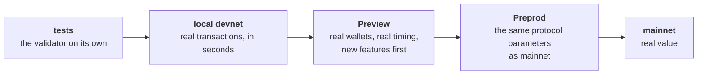

import Tabs from "@theme/Tabs";
import TabItem from "@theme/TabItem";
import CodeBlock from "@theme/CodeBlock";
import extractRegion from "@site/src/utils/extractRegion";
import Never from "!!raw-loader!@site/examples/onboarding/lectures/advanced/oracle/on-chain/aiken/validators/never.ak";
import Blueprint from "!!raw-loader!@site/examples/onboarding/lectures/advanced/oracle/off-chain/mesh/src/lib/blueprint.ts";
import ReferenceScript from "!!raw-loader!@site/examples/onboarding/lectures/advanced/oracle/off-chain/mesh/src/lib/reference-script.ts";
import Network from "!!raw-loader!@site/examples/onboarding/lectures/advanced/oracle/off-chain/mesh/src/lib/network.ts";
import ViteConfig from "!!raw-loader!@site/examples/onboarding/lectures/advanced/oracle/off-chain/mesh/vite.config.ts";
import Operator from "!!raw-loader!@site/examples/onboarding/lectures/advanced/oracle/off-chain/mesh/scripts/operator.ts";
import Record from "!!raw-loader!@site/examples/onboarding/lectures/advanced/oracle/off-chain/mesh/src/lib/deployment.ts";
import Confirm from "!!raw-loader!@site/examples/onboarding/lectures/advanced/oracle/off-chain/mesh/src/lib/confirm.ts";
import Deploy from "!!raw-loader!@site/examples/onboarding/lectures/advanced/oracle/off-chain/mesh/scripts/deploy.ts";
import App from "!!raw-loader!@site/examples/onboarding/lectures/advanced/oracle/off-chain/mesh/src/app.tsx";
import Health from "!!raw-loader!@site/examples/onboarding/lectures/advanced/oracle/off-chain/mesh/src/lib/health.ts";
import Monitor from "!!raw-loader!@site/examples/onboarding/lectures/advanced/oracle/off-chain/mesh/scripts/monitor.ts";

# Going to production

**[Optimization](/docs/developers/onboarding/lectures/advanced/optimization#optimize-before-you-deploy)** ended on a rule: what you deploy is what you live with, because the hash is the address. Until now, deploying meant pressing a button in a page on Preview, and the only user was you.

In production other people use the contract, and it holds value they cannot afford to lose. This lecture covers what changes: the network, where the chain data comes from, how a deployment is done and written down, what fails only when real people use it, how to watch it, and how to change it once it is live.

## The path to mainnet

Every network on the way catches something the one before it cannot:



Preview gets protocol upgrades first, which is why the Intermediate track ran there. **Preprod** runs with the protocol parameters mainnet has, so the limits and prices from optimization are the ones mainnet uses. It is the last rehearsal: deploy there from the same scripts, with the same steps, that you will use on mainnet. The handbook's **[testnets are your staging environments](/docs/developers/curriculum/production/going-to-production#testnets-are-your-staging-environments)** has the details of each network.

## Where the chain data comes from

Your app reads UTxOs, evaluates scripts and submits transactions through a **provider**. Blockfrost has been yours since **[frontend integration](/docs/developers/onboarding/lectures/intermediate/frontend-integration)**. There are three ways to get one:

- **A hosted provider**, such as Blockfrost, Koios or Maestro. Fastest to start. You live with its rate limits, and your app stops when it does.
- **Your own infrastructure**: a node with a query layer beside it. Most control, and you run it.
- **A managed platform** that runs that infrastructure for you.

In Mesh a provider is an interface, `IFetcher`, and every builder in the oracle takes one as an argument. Switching providers or networks changes no builder. The same interface lets you put two providers behind one, so a failure of the first falls through to the second. **[Harden your provider](/docs/developers/curriculum/production/going-to-production#harden-your-provider)** has the pattern, and **[connecting to the chain](/docs/developers/curriculum/production/connecting-to-the-chain)** compares every option.

The key stays where the browser cannot reach it, as it did in **[the browser cannot keep a secret](/docs/developers/onboarding/lectures/intermediate/frontend-integration#the-browser-cannot-keep-a-secret)**.

## Deploy

Nothing is uploaded when a Cardano contract is deployed. A deployment is a few transactions that create the UTxOs your protocol starts from: for the oracle, the beacon and the first rate at the oracle's address, and the consumer's code published as a reference script. Their order is fixed by the chain of hashes from **[which UTxO is the oracle?](/docs/developers/onboarding/lectures/intermediate/modifying-state#which-utxo-is-the-oracle)**: the seed decides the policy ID, and the policy ID decides the addresses.

Four habits make a deployment one you can trust:

**Deploy from a script, not a page.** A script runs the same steps every time, on Preprod and then on mainnet. It waits for each transaction, and it writes down what it did. It signs with an **operator key** that does one job, not with your personal wallet. On mainnet that key signs offline, as in the [secure transaction workflow](/docs/operators/security/secure-workflow).

**Publish reference scripts where nothing can spend them.** **[Reference scripts](/docs/developers/onboarding/lectures/intermediate/reference-inputs-and-scripts#what-to-watch-out-for)** warned that the UTxO holding one must stay unspent. At your own address, one careless transaction of yours spends it and breaks every transaction that points at it. At the address of a validator that says no to everything, nobody can spend it, you included. The ADA beside the script is locked there for good too, so it should be the least the ledger accepts.

**Wait before you build on it.** A transaction in the newest block can still be rolled back, and a deployment built on one that was rolled back points at UTxOs that do not exist. Every block added on top makes that less likely. The handbook's **[finality](/docs/developers/curriculum/fundamentals/consensus-and-ouroboros#how-does-finality-work)** section puts practical finality at 10 to 20 blocks, a few minutes.

**Write it down.** The Intermediate app remembered its oracle in one browser's storage. A deployment belongs in a file in the repository: the seed, the operator, the addresses, where the reference script is, and the transactions that created them. Nothing in it is secret, and everyone reads the same one: the operator's scripts, the app, an auditor, and you a year from now.

## What fails only in production

Your tests built one transaction against a chain that held still. A public network does not hold still:

- **Contention.** Two users who build against the same UTxO cannot both succeed: the second transaction fails, because its input is gone. The oracle avoids this for its readers, who only reference it. **[Optimization](/docs/developers/onboarding/lectures/advanced/optimization#four-places-to-optimize)** covers designs that avoid it for writers.
- **Stale reads.** A provider can be a block or two behind the tip, and your app can be holding a UTxO that was spent a moment ago. A retry has to read the chain again and rebuild, not resend the old transaction. See [resilient submission](/docs/developers/curriculum/start-building/transaction-building#resilient-submission-retry-safe).
- **Validity windows.** A transaction built with a window from **[handling time](/docs/developers/onboarding/lectures/intermediate/handling-time)** that waits too long for a signature is no longer valid when it arrives.
- **Rollbacks.** A transaction your app showed as done can disappear with its block. Show users the difference between submitted, in a block, and settled.
- **Changed parameters.** The limits and prices from optimization are protocol parameters, and governance can change them. A contract with no headroom can stop fitting the day they change.

## Watch it

Once a contract is live, the chain is the only place that knows whether it still works. Ask it on a schedule, and alert when the answer is wrong. For each guarantee you wrote down, ask the chain whether it still holds:

- The state UTxOs exist, and each one carries its beacon. The beacon is nowhere else.
- The data in them is something the protocol can use.
- The reference scripts are still where the deployment record says.
- The record still matches the compiled code. A rebuild from changed code gives different addresses.

Then the things that move slowly until they stop everything: the value at the script's address, how close each validator is to the limits at the largest size you expect, and the transactions your own code failed to submit. When a question needs every event rather than the current state, an indexer answers it. See **[indexing and analytics](/docs/developers/curriculum/production/indexing-and-analytics)**.

## When you have to change it

A fix is a new contract at a new address. The UTxOs at the old address stay under the old rules, and they move to the new contract only if the old rules allow it. A vault's owner can take the funds out and lock them again. A vesting contract keeps its funds until the date, whatever is wrong with it.

So the plan for changing a contract has to exist before it holds anything, and it has two shapes:

- **Migration.** Every rule leaves a way out to a new version, and the app moves users across. Simple, and slow, because every user has to act.
- **Upgradability.** The validator does not hold all of its logic. It checks that a second script approved the transaction, and reads that script's hash from a UTxO the protocol controls, marked by a beacon. Changing the hash in that UTxO changes the rules without changing the address. This is the withdraw zero trick from optimization, with the hash read from state instead of fixed in a parameter.

Upgradability moves trust. Whoever can change that hash can change every rule, including who may take the funds. That power is a guarantee you have to write down and protect, usually with several signatures and a delay before a change takes effect, so users can leave first. The **[contracts library](https://github.com/input-output-hk/contracts-library)** has a ready-to-use upgradability protocol, so you do not have to design that part yourself.

## Launch checklist

- Every guarantee is written down, and every attack you know of is a test that is refused. ([Detecting vulnerabilities](/docs/developers/onboarding/lectures/advanced/detecting-vulnerabilities))
- Costs are measured, with headroom at the largest size you expect. ([Optimization](/docs/developers/onboarding/lectures/advanced/optimization))
- Every guarantee has a property, and the audit question is decided. ([Higher assurance](/docs/developers/onboarding/lectures/advanced/higher-assurance))
- The deployment is rehearsed on Preprod, from the scripts that will deploy mainnet.
- The provider key is server-side, and the operator key does one job and signs offline on mainnet.
- Reference scripts sit at an address nothing can spend.
- The deployment record is committed.
- A monitor runs on a schedule and alerts on a failed check.
- The plan for changing the contract is written down.

The handbook's **[going to production](/docs/developers/curriculum/production/going-to-production#checklist)** has the checklist for the rest of the app.

## Try it

<Tabs groupId="offchain">
<TabItem value="mesh" label="Mesh" default>

Take the oracle from **[modifying state](/docs/developers/onboarding/lectures/intermediate/modifying-state)** to Preprod. The beacon, the oracle and the consumer stay byte for byte the same. Who runs what changes: the operator deploys, updates and monitors the oracle from scripts on their own machine, and the page in the browser is for the oracle's users.

You need a [Blockfrost](https://blockfrost.io/) project for **Preprod**, a key that starts with `preprod`, and Lace switched to Preprod with some test ADA from the [faucet](/docs/developers/curriculum/start-building/networks-and-test-ada#get-test-ada).

Start from a copy of the oracle in your Intermediate playground:

```bash
cp -r playground/oracle oracle-production
cd oracle-production
```

You change the files you already know by hand. The files that are new hold more plumbing than ideas, so you copy those from `oracle/off-chain/mesh/` in the **[example project](/docs/developers/onboarding/lectures/advanced/introduction#the-example-project)**, and read the part of each that matters.

### 1. Park the script where nothing can spend it

Add a fourth validator to the on-chain project, in `on-chain/aiken/validators/never.ak`:

<CodeBlock language="aiken" title="on-chain/aiken/validators/never.ak">
  {extractRegion(Never, "never")}
</CodeBlock>

Every spend returns `False`, and every other purpose fails. It has no parameters, so its address is the same for everyone who compiles it, and anyone can check what it does by compiling it. Build the blueprint and copy it across, as in **[frontend integration](/docs/developers/onboarding/lectures/intermediate/frontend-integration)**:

```bash
cd on-chain/aiken
aiken build
cp plutus.json ../../off-chain/mesh/blueprints/oracle.plutus.json
cd ../../off-chain/mesh
```

The three validators you already had compile to the same code as before, so their hashes do not change.

Every command from here runs from `off-chain/mesh/`. Add the address to `src/lib/blueprint.ts`, and import `applyCborEncoding` from `@meshsdk/core` beside `applyParamsToScript`:

<CodeBlock language="ts" title="src/lib/blueprint.ts">
  {extractRegion(Blueprint, "never-address")}
</CodeBlock>

Then replace the publish builder in `src/lib/reference-script.ts`, and add `neverAddress` to its import from `./blueprint.ts`:

<CodeBlock language="ts" title="src/lib/reference-script.ts">
  {extractRegion(ReferenceScript, "publish-reference-script")}
</CodeBlock>

The builder gives an output with no amount the least the ledger accepts for its size. For the consumer that is about 2.87 ADA, where the Intermediate app put 10 ADA you could take back.

### 2. One name for the network

The Intermediate app wrote Preview into the key, the network ID and the explorer link. Create `src/lib/network.ts`, so one name decides all three:

<CodeBlock language="ts" title="src/lib/network.ts">
  {extractRegion(Network, "networks")}
</CodeBlock>

Replace `vite.config.ts`, so the proxy targets the named network and refuses a key for another one before it starts:

<CodeBlock language="ts" title="vite.config.ts">
  {ViteConfig}
</CodeBlock>

And replace `.env`. `OPERATOR_MNEMONIC` stays empty until the next step:

```bash title=".env"
BLOCKFROST_API_KEY=preprodYourKeyHere
VITE_NETWORK=preprod
OPERATOR_MNEMONIC=
```

### 3. The operator's scripts

Copy the `scripts/` folder from the example project into `off-chain/mesh/`, beside `src/`, and copy `src/lib/deployment.ts`, `src/lib/confirm.ts` and `src/lib/health.ts` into your `src/lib/`. The scripts run with Node directly, as the tests do. Add `"scripts"` to `"include"` in `tsconfig.json`, so `npm run typecheck` checks them too, and register them:

```bash
npm pkg set scripts.operator:new="node scripts/new-operator.ts"
npm pkg set scripts.deploy="node scripts/deploy.ts"
npm pkg set scripts.update="node scripts/update.ts"
npm pkg set scripts.monitor="node scripts/monitor.ts"
```

`scripts/operator.ts` is what every script shares. Its top half:

<CodeBlock language="ts" title="scripts/operator.ts">
  {extractRegion(Operator, "setup")}
</CodeBlock>

`process.loadEnvFile` reads `.env` into `process.env` without a library. These scripts never reach a browser, so they may read the key and the recovery phrase. The provider gets the key itself, and the wallet is a `MeshWallet` built from the operator's recovery phrase, the same kind of wallet your offline tests use.

The rest of `scripts/operator.ts` reads and writes the deployment record, signs and submits a transaction and waits for it, and sets up collateral. A faucet pays into a single UTxO, and a script transaction needs a second one of pure ADA as collateral, so the operator pays 5 ADA to itself once. `scripts/new-operator.ts` and `scripts/update.ts` are a few lines each.

Create the operator's key:

```bash
npm run operator:new
```

It prints a recovery phrase and an address. Put the phrase in `.env` as `OPERATOR_MNEMONIC`, in double quotes, and send test ADA to the address from the faucet.

### 4. Deploy, and write it down

The record is a type in `src/lib/deployment.ts`:

<CodeBlock language="ts" title="src/lib/deployment.ts">
  {extractRegion(Record, "record")}
</CodeBlock>

The seed and the operator are the inputs. Everything under them is derived from them and the blueprint. The file also has `derive`, which computes those values, and two small helpers. The waiting is in `src/lib/confirm.ts`:

<CodeBlock language="ts" title="src/lib/confirm.ts">
  {extractRegion(Confirm, "wait-for-confirmations")}
</CodeBlock>

A provider reports how many blocks sit on top of the block a transaction is in, and the script asks again until there are enough. Then the body of `scripts/deploy.ts`:

<CodeBlock language="ts" title="scripts/deploy.ts">
  {extractRegion(Deploy, "deploy")}
</CodeBlock>

The two builders are the ones the Intermediate page called from its buttons, with the operator's wallet in place of Lace. The script refuses to run when a record exists: a second run would mint a second beacon from a second seed, which is a second oracle at a second address.

One change to a builder makes this safe to run from a fresh wallet. `buildOracleCreateTx` in `src/lib/oracle.ts` picked the first UTxO as the seed, and that can be the collateral. Pick the first one that is not:

```ts title="src/lib/oracle.ts"
  const seedUtxo = utxos.find(
    (utxo) =>
      utxo.input.txHash !== collateral.input.txHash ||
      utxo.input.outputIndex !== collateral.input.outputIndex,
  );
```

Deploy:

```bash
npm run deploy
```

It sets up collateral, then sends two transactions and waits for ten blocks on top of each, so it takes several minutes. Each transaction prints its explorer link. When it finishes, open `deployments/preprod.json`. The first transaction is the one **[modifying state](/docs/developers/onboarding/lectures/intermediate/modifying-state#then-run-it)** showed: the seed, the minted beacon and the oracle's output. The second has one output at `never`, with the consumer's code attached. In a real project you commit the record.

### 5. The page for its users

The page publishes nothing now, and remembers nothing. Everything it needs to find is in the record. Replace `src/app.tsx` with the one in the example project. It reads the record for the network in `.env`:

<CodeBlock language="tsx" title="src/app.tsx">
  {extractRegion(App, "load-record")}
</CodeBlock>

The publish, update, close and publish-script buttons are gone. What is left is what a user does: read the rate, lock ADA at the consumer, and unlock it through the published script. Run it:

```bash
npm run dev
```

Connect Lace on Preprod, set up collateral, lock 5 ADA, refresh, and unlock it. On the explorer, the unlock has the oracle as a reference input and the script UTxO at `never` as a second one, and carries no script of its own.

### 6. Update it, and watch it

The operator updates the rate from a script:

```bash
npm run update -- 150
```

The checks are the function in `src/lib/health.ts`:

<CodeBlock language="ts" title="src/lib/health.ts">
  {extractRegion(Health, "checks")}
</CodeBlock>

Each check asks the chain, never the record alone or the last transaction you sent. Below the function are two helpers: one turns a provider error into an empty answer, so the check that needed it fails, and one turns a datum that does not decode into no rate. `scripts/monitor.ts` prints the answers and sets the exit code:

<CodeBlock language="ts" title="scripts/monitor.ts">
  {extractRegion(Monitor, "monitor")}
</CodeBlock>

```bash
npm run monitor
```

Four lines, each starting with `ok`. Now publish a rate the consumer refuses, and ask again:

```bash
npm run update -- 0
npm run monitor; echo "exit code: $?"
```

The rate check fails, and the exit code is 1. That code is what a scheduler or a CI job alerts on: run the monitor every few minutes, and page someone when it exits with 1. Put the rate back with `npm run update -- 150`.

The example project's `src/oracle.test.ts` builds a deployment in memory and breaks it in the ways the monitor looks for: a stray beacon, a rate of zero, an edited record, a missing script. It also tests the publish builder's new address. Copy it over yours, since your old tests call the publish builder without a network, and run `npm test`.

Stuck? The finished code is `oracle/` in the example project. See the **[introduction](/docs/developers/onboarding/lectures/advanced/introduction#the-example-project)**.

</TabItem>
<TabItem value="evolution" label="Evolution">

An [Evolution](https://github.com/IntersectMBO/evolution-sdk) version is coming soon. The idea is identical, only the library calls differ.

</TabItem>
</Tabs>

## You have finished the Advanced track

You can think as an attacker before you write a contract and again before you deploy it, write the attacks as tests, and check every guarantee against generated transactions. You can measure what a contract costs and make it cheaper in four places. You can deploy it from a script, write the deployment down, watch it, and plan for the day it has to change.

- The **design patterns**: the shapes production contracts take, each with when to use it and what it costs.
- The **[Tutorial](/docs/developers/onboarding/tutorial/overview)** builds an atomic swap from end to end, front end included.
- The **[contracts library](https://github.com/input-output-hk/contracts-library)**: contracts with specifications and proofs, to use, compose or fork.

## Go deeper

- [Going to production](/docs/developers/curriculum/production/going-to-production): the handbook's checklist for the whole app, from tests to onboarding users.
- [Connecting to the chain](/docs/developers/curriculum/production/connecting-to-the-chain): every kind of provider and infrastructure, and how to choose.
- [Use a provider](/docs/developers/curriculum/production/use-a-provider): keys, endpoints and limits.
- [Self-hosting](/docs/developers/curriculum/production/self-hosting): running your own node and query layer.
- [Transaction chaining](/docs/developers/curriculum/production/transaction-chaining): building the next transaction before the last one is in a block.
- [Indexing and analytics](/docs/developers/curriculum/production/indexing-and-analytics): following every event instead of reading the current state, and handling rollbacks.
- [Consensus and Ouroboros](/docs/developers/curriculum/fundamentals/consensus-and-ouroboros#how-does-finality-work): why a block can be rolled back, and when it no longer can.
- [Secure transaction workflow](/docs/operators/security/secure-workflow): build online, sign offline, submit online.
