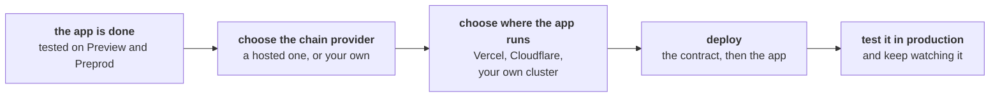
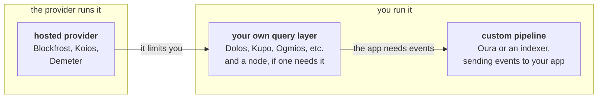
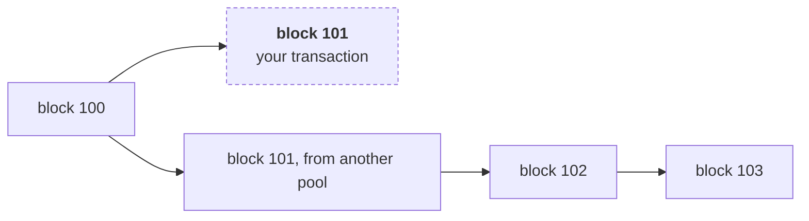

# Going to production

> The infrastructure under a Cardano app: hosted providers, when to run your own, custom pipelines, and rollbacks. Then deploying the contract and the app, watching them, and planning for a fix.

# Going to production

**[Optimization](/docs/developers/onboarding/lectures/advanced/optimization#optimize-before-you-deploy)** ended on a rule: what you deploy is what you live with, because the hash is the address. Until now, the only user of your app was you, on a test network, with the app running on your own machine.

In production, other people use the contract, and it holds value they cannot afford to lose. This lecture starts with the infrastructure under the app: where it reads the chain from, when that has to change, and what to do when the chain takes a block back. Then it deploys the contract and the app, and shows how to watch them and what a fix means once the contract is live.

## The path to production

Going to production is a short list of steps:



1. **The app is done.** The contract passes its tests, and the whole app has run on a test network. **Preprod** has the protocol parameters mainnet has, so it is the last rehearsal: run there the same scripts and steps you will run on mainnet. The handbook's **[testnets are your staging environments](/docs/developers/curriculum/production/going-to-production#testnets-are-your-staging-environments)** has the details of each network.
2. **Choose the chain provider**: the service, or your own node, that the app reads the chain through. See **[where the chain data comes from](#where-the-chain-data-comes-from)**, and **[rollbacks](#rollbacks)** for what the app does when the chain takes a block back.
3. **Choose where the app runs**: a host for the page and for the small server that keeps the provider key. See **[deploy the app](#deploy-the-app)**.
4. **Deploy**: first the contract, see **[deploy the contract](#deploy-the-contract)**, then the app.
5. **Test it in production**, and keep watching it. See **[watch it](#watch-it)**.

The **[Try it](#try-it)** takes the same steps with the oracle, on Preprod.

## Where the chain data comes from

Your app reads UTxOs, evaluates scripts and submits transactions through a **provider**. Blockfrost has been yours since **[frontend integration](/docs/developers/onboarding/lectures/intermediate/frontend-integration)**. As an app grows, what sits behind that word changes, from a service you rent to infrastructure you run:



Each step to the right gives you more control and more to run. You need the last one when your app has to react to events on the chain, such as a transaction reaching an address. Then you build a pipeline with a tool such as Oura.

### Start with a hosted provider

A hosted provider such as **Blockfrost**, **Koios** or **Demeter** runs the node, the database and the API for you. You get a base URL and a key, and you can start in minutes. In return you live with its rate limits and its prices, and your app stops when the provider does.

Demeter also hosts the tools you would otherwise run yourself, such as node access, Ogmios, Kupo, Dolos, etc., each one as a service. Choose it when you want to work with those tools directly but do not want to run servers.

Most providers offer a REST API, so each query is an HTTP request: the UTxOs at an address, the current protocol parameters, or the submission of a signed transaction. Some tools, such as Ogmios, use a WebSocket instead, which keeps one connection open for many requests. You can also put two providers behind one, so that a failure of the first falls through to the second. **[Harden your provider](/docs/developers/curriculum/production/going-to-production#harden-your-provider)** has the pattern, and **[use a provider](/docs/developers/curriculum/production/use-a-provider)** sets up each hosted API.

Your SDK usually sends these requests for you, through a built-in client for each provider it supports. Each provider also documents its own API, so your app can call it directly. You need this when your SDK does not support a provider yet, which is common for a new one, or does not cover one of its endpoints.

### When to run your own

Start thinking about your own infrastructure when one of these becomes true:

- **Limits or cost.** Your traffic reaches the provider's rate limits, or its bill at your volume costs more than running a server.
- **One point of failure.** The provider being down means your app is down, and a second provider is not enough.
- **Data the API does not give.** You need a query the API does not offer, or answers faster than a round trip to it.

### Your own query layer

A query layer is the software that reads the chain and answers your app's questions, on servers you operate. A full Cardano node is optional:

- **Dolos**, from TxPipe, needs no full node. It follows the chain from a relay you trust, keeps the data in one process, and serves it to your app, including a Blockfrost-compatible API.
- **Kupo** sits beside a Cardano node you run. The node alone holds the chain but cannot answer "which UTxOs are at this address" quickly. Kupo builds that index and serves it over HTTP.
- **Ogmios** sits beside a Cardano node you run. It gives your app the node's queries, script evaluation and transaction submission over WebSocket.

**[Self-hosting](/docs/developers/curriculum/production/self-hosting)** shows the common stacks, and **[connecting to the chain](/docs/developers/curriculum/production/connecting-to-the-chain)** compares every option.

### When you need something custom

A provider answers questions: what is at this address now? Some apps need the chain to tell them when something happens: a payment arrives at the script, an order is placed, a beacon moves. Asking the provider again and again works for a while, and stops working as the app grows.

At that point you build a **pipeline**, with a tool such as **[Oura](https://docs.txpipe.io/oura/v2)**, from TxPipe. A pipeline is a chain of stages. A **source** follows the chain block by block, from a node or a service. **Filters** keep only the events your app cares about. A **sink** sends each event on, to a webhook, a queue or a database. When no built-in filter does what you need, you can write your own stage and compile it to WebAssembly. An **indexer** goes one step further and stores exactly the slice of the chain your app queries.

**[Indexing and analytics](/docs/developers/curriculum/production/indexing-and-analytics)** in the handbook covers indexers, and the Oura documentation has the sources, filters and sinks a pipeline can use.

## Rollbacks

The newest blocks are not final. Two stake pools can each produce a block for the same slot, and for a short time different nodes follow different versions of the chain. The network settles on the longer one, and the blocks on the other version are dropped, with every transaction in them:



The dashed block was dropped. A transaction in it can still land in a later block if it is submitted again and its inputs are still unspent. But anything your app did because it saw that block, such as showing "paid" or recording an order, is now wrong.

Every block added on top makes a rollback less likely. The handbook's **[finality](/docs/developers/curriculum/fundamentals/consensus-and-ouroboros#how-does-finality-work)** section puts practical finality at 10 to 20 blocks, a few minutes. There are three ways to handle the time before that.

**Wait for a buffer of blocks.** Treat a transaction as done only when a number of blocks sit on top of it. This is the simplest way. The cost is delay: at a block about every 20 seconds, ten blocks is more than three minutes, and users wait that long to see the result. The deploy script in the Try it below waits like this.

**React to rollback events.** Act on new blocks at once, and undo when the chain takes one back. A node, or a pipeline that follows it, sends a rollback event that names the last block still on the chain. Your app removes everything it recorded after that block. Users see results right away, and your code has to be able to undo each of its actions.

**Use a tool that handles it.** Oura's **rollback buffer** filter holds blocks until they reach a depth you choose, and sends a rollback event only when a rollback goes deeper than that. Indexers such as Kupo remove the dropped blocks from their own data, so a query to them only answers from the current chain.

Whichever you choose, show users the difference between submitted, in a block, and settled.

## Deploy the app

A Cardano app usually has two parts to deploy. The page is static files that any host can serve. The provider key needs a server, because **[the browser cannot keep a secret](/docs/developers/onboarding/lectures/intermediate/frontend-integration#the-browser-cannot-keep-a-secret)**. In the Intermediate app that server was the development server on your machine, which is not there in production.

For a simple app, a host that serves static files and runs small **serverless functions** covers both parts. Vercel and Cloudflare are two of them: the page is served from their network, and a function of a few lines adds the key to each request on its way to the provider. There is no server to keep running, and their free plans are enough to try it.

As the app grows, the same two parts move to infrastructure you control. Once you run your own node or a pipeline, the app's server usually runs beside them, in containers on your own cluster or with a cloud provider, and the page can stay on a static host.

## Deploy the contract

Nothing is uploaded when a Cardano contract is deployed. A deployment is a few transactions that create the UTxOs your protocol starts from. For the oracle these are the beacon and the first rate at the oracle's address, and the consumer's code published as a reference script. Four habits make a deployment one you can trust:

- **Deploy from a script, not a page.** A script runs the same steps every time, on Preprod and then on mainnet. It signs with an **operator key** that does one job, not with your personal wallet. On mainnet that key signs offline, as in the [secure transaction workflow](/docs/operators/security/secure-workflow).
- **Publish reference scripts where nothing can spend them.** The UTxO holding a **[reference script](/docs/developers/onboarding/lectures/intermediate/reference-inputs-and-scripts#what-to-watch-out-for)** must stay unspent. At the address of a validator that refuses every spend, nobody can spend it, you included.
- **Wait before you build on it.** Each deployment transaction waits for its buffer of blocks before the next one uses it.
- **Write it down.** The seed, the operator, the addresses, where the reference script is, and the transactions that created them go in a file in the repository. Nothing in it is secret, and the operator's scripts, the app and an auditor all read the same one.

## What fails only in production

Your tests built one transaction against a chain that held still. A public network does not hold still:

- **Contention.** Two users who build against the same UTxO cannot both succeed: the second transaction fails, because its input is gone. The oracle avoids this for its readers, who only reference it. **[Optimization](/docs/developers/onboarding/lectures/advanced/optimization#protocol-level)** covers designs that avoid it for writers.
- **Stale reads.** A provider can be a block or two behind the tip, and your app can be holding a UTxO that was spent a moment ago. A retry has to read the chain again and rebuild, not resend the old transaction. See [resilient submission](/docs/developers/curriculum/start-building/transaction-building#resilient-submission-retry-safe).
- **Validity windows.** A transaction built with a window from **[handling time](/docs/developers/onboarding/lectures/intermediate/handling-time)** that waits too long for a signature is no longer valid when it arrives.
- **Rollbacks.** A transaction your app showed as done can disappear with its block. See **[rollbacks](#rollbacks)**.
- **Changed parameters.** The limits from optimization are protocol parameters, and governance can change them. If your contract uses almost all of a limit and the limit goes down, its transactions no longer fit, and funds that only those transactions can unlock stay locked.

## Watch it

Once a contract is live, the chain is the only place that knows whether it still works. Ask it on a schedule, and alert when the answer is wrong:

- The state UTxOs exist, and each one carries its beacon. The beacon is nowhere else.
- The data in them is something the protocol can use.
- The reference scripts are still where the deployment record says.
- The record still matches the compiled code. A rebuild from changed code gives different addresses.

Watch the slow numbers too: the value at the script's address, how close each validator is to the limits at the largest size you expect, and the transactions your own code failed to submit.

When a check finds a bug in the contract, the fix is a new contract at a new address. The UTxOs at the old address stay under the old rules, and they move to the new contract only if those rules allow it. So decide before launch how users will move to a new version, and check that the rules let them.

## Launch checklist

- Every guarantee is written down, and every attack you know of is a test that is refused. ([Detecting vulnerabilities](/docs/developers/onboarding/lectures/advanced/detecting-vulnerabilities))
- Costs are measured, with headroom at the largest size you expect. ([Optimization](/docs/developers/onboarding/lectures/advanced/optimization))
- The provider is chosen, with a second one to fall back to, and you know which signal would make you run your own.
- The app knows what it does when a block is rolled back.
- The deployment is rehearsed on Preprod, from the scripts that will deploy mainnet.
- The provider key lives only on the server, and the operator key does one job and signs offline on mainnet.
- Reference scripts sit at an address nothing can spend, and the deployment record is committed.
- The app is deployed from files you checked, with no secrets among them.
- A monitor runs on a schedule and alerts on a failed check.
- The plan for changing the contract is written down.

The handbook's **[going to production](/docs/developers/curriculum/production/going-to-production#checklist)** has the checklist for the rest of the app.

## Try it

<Tabs groupId="offchain">
<TabItem value="mesh" label="Mesh" default>

Take the oracle from **[modifying state](/docs/developers/onboarding/lectures/intermediate/modifying-state)** to Preprod, then put its page on the internet. The contract stays byte for byte the same. The operator deploys, updates and watches the oracle with scripts on their own machine, and the page is for the oracle's users.

You need a [Blockfrost](https://blockfrost.io/) project for **Preprod**, with a key that starts with `preprod`, and Lace switched to Preprod with some test ADA from the [faucet](/docs/developers/curriculum/start-building/networks-and-test-ada#get-test-ada). For the last steps, you need a free account with the host you choose.

### 1. Deploy the oracle to Preprod

Download the **[example project](/docs/developers/onboarding/lectures/advanced/introduction#the-example-project)** into `advanced/`, and start from its finished oracle:

```bash
cp -r advanced/oracle oracle-production
cd oracle-production/off-chain/mesh
npm install
cp .env.example .env
```

Put your Preprod key in `.env` as `BLOCKFROST_API_KEY`. Then create the operator's key:

```bash
npm run operator:new
```

It prints a recovery phrase and an address. Put the phrase in `.env` as `OPERATOR_MNEMONIC`, in double quotes, and send test ADA to the address from the faucet. Then deploy:

```bash
npm run deploy
```

The script sends two transactions: one mints the beacon and locks the first rate, and one publishes the consumer's code at an address nothing can spend. After each one it waits for a buffer of ten blocks, so it takes several minutes. The waiting is this function in `src/lib/confirm.ts`:

```ts title="src/lib/confirm.ts"
export async function waitForConfirmations(
  fetcher: IFetcher,
  txHash: string,
  depth: number,
  { intervalMs = 20_000, timeoutMs = 20 * 60_000 } = {},
): Promise<void> {
  const deadline = Date.now() + timeoutMs;
  for (;;) {
    const confirmations = await confirmationsOf(fetcher, txHash);
    if (confirmations >= depth) return;
    if (Date.now() > deadline) {
      throw new Error(`${txHash}: ${confirmations} of ${depth} confirmations, giving up`);
    }
    await new Promise((resolve) => setTimeout(resolve, intervalMs));
  }
}
```

When it finishes, `deployments/preprod.json` holds the record. In a real project you commit it. Check the page on your machine:

```bash
npm run dev
```

Connect Lace on Preprod, lock 5 ADA at the consumer, refresh, and unlock it.

### 2. Move the key into a function

On your machine, the page reaches Blockfrost through the proxy in `vite.config.ts`, which only exists while `npm run dev` runs. A host needs the same proxy as a function. The page's provider sends every call to `/api/blockfrost/...`, so the function has to answer every path under it. The example has one function for each host. Open the one for yours.

<Tabs groupId="hosting">
<TabItem value="vercel" label="Vercel" default>

A Vercel function is a file in `api/`. The proxy is `api/blockfrost.ts`:

```ts title="api/blockfrost.ts"
type Env = { BLOCKFROST_API_KEY?: string; VITE_NETWORK?: string };

export default {
  async fetch(request: Request): Promise<Response> {
    const url = new URL(request.url);
    const path = url.searchParams.get("path") ?? "";
    url.searchParams.delete("path");
    return forward(request, path, url.search, process.env);
  },
};
```

Below it, in the same file, `forward` sends the request on to Blockfrost with the key added:

```ts title="api/blockfrost.ts"
const NETWORKS = ["preview", "preprod", "mainnet"];

/// Send one request on to Blockfrost, with the key added.
async function forward(request: Request, path: string, search: string, env: Env): Promise<Response> {
  const network = env.VITE_NETWORK ?? "";
  const key = env.BLOCKFROST_API_KEY ?? "";
  // A Blockfrost key starts with the name of its network.
  if (!NETWORKS.includes(network) || !key.startsWith(network)) {
    return new Response("BLOCKFROST_API_KEY does not belong to VITE_NETWORK", { status: 500 });
  }
  // The page only reads (GET) and submits or evaluates (POST).
  if (request.method !== "GET" && request.method !== "POST") {
    return new Response("method not allowed", { status: 405 });
  }
  const response = await fetch(`https://cardano-${network}.blockfrost.io/api/v0/${path}${search}`, {
    method: request.method,
    headers: {
      project_id: key,
      "content-type": request.headers.get("content-type") ?? "application/json",
    },
    body: request.method === "POST" ? await request.arrayBuffer() : undefined,
  });
  return new Response(response.body, {
    status: response.status,
    headers: { "content-type": response.headers.get("content-type") ?? "application/json" },
  });
}
```

The function refuses a key for another network, and passes only reads and submissions. One file answers one path, so a rewrite in `vercel.json` sends every path under `/api/blockfrost/` to it, with the rest of the path in the `path` query parameter:

<CodeBlock language="json" title="vercel.json">
  {VercelJson}
</CodeBlock>

The Vercel command line uploads every file in the folder that it is not told to ignore, and it does not ignore `.env` on its own. Your `.env` holds the operator's recovery phrase, which is why the example has a `.vercelignore`:

<CodeBlock language="bash" title=".vercelignore">
  {VercelIgnore}
</CodeBlock>

</TabItem>
<TabItem value="cloudflare" label="Cloudflare">

A Cloudflare Pages function is a file in `functions/`, and its path is the URL it answers. The name `[[path]]` makes one file answer every path under its folder. The proxy is `functions/api/blockfrost/[[path]].ts`:

```ts title="functions/api/blockfrost/[[path]].ts"
type Env = { BLOCKFROST_API_KEY?: string; VITE_NETWORK?: string };

type Context = { request: Request; env: Env; params: { path?: string | string[] } };

export async function onRequest(context: Context): Promise<Response> {
  const segments = context.params.path ?? [];
  const path = Array.isArray(segments) ? segments.join("/") : segments;
  return forward(context.request, path, new URL(context.request.url).search, context.env);
}
```

Below it, in the same file, `forward` sends the request on to Blockfrost with the key added:

```ts title="functions/api/blockfrost/[[path]].ts"
const NETWORKS = ["preview", "preprod", "mainnet"];

/// Send one request on to Blockfrost, with the key added.
async function forward(request: Request, path: string, search: string, env: Env): Promise<Response> {
  const network = env.VITE_NETWORK ?? "";
  const key = env.BLOCKFROST_API_KEY ?? "";
  // A Blockfrost key starts with the name of its network.
  if (!NETWORKS.includes(network) || !key.startsWith(network)) {
    return new Response("BLOCKFROST_API_KEY does not belong to VITE_NETWORK", { status: 500 });
  }
  // The page only reads (GET) and submits or evaluates (POST).
  if (request.method !== "GET" && request.method !== "POST") {
    return new Response("method not allowed", { status: 405 });
  }
  const response = await fetch(`https://cardano-${network}.blockfrost.io/api/v0/${path}${search}`, {
    method: request.method,
    headers: {
      project_id: key,
      "content-type": request.headers.get("content-type") ?? "application/json",
    },
    body: request.method === "POST" ? await request.arrayBuffer() : undefined,
  });
  return new Response(response.body, {
    status: response.status,
    headers: { "content-type": response.headers.get("content-type") ?? "application/json" },
  });
}
```

The function refuses a key for another network, and passes only reads and submissions. Cloudflare reads the key from `context.env`, where you put it in the next step. The deploy uploads only the built page and this function, so `.env` never leaves your machine.

</TabItem>
</Tabs>

`src/proxy.test.ts` runs both functions against a stand-in for Blockfrost, so `npm test` checks them without a network or an account.

### 3. Deploy the page

<Tabs groupId="hosting">
<TabItem value="vercel" label="Vercel" default>

Link the folder to a new Vercel project, and give it the two variables. Each command asks for the value:

```bash
npx vercel@65 link
npx vercel@65 env add BLOCKFROST_API_KEY --environment production
npx vercel@65 env add VITE_NETWORK --environment production
```

Vercel builds the page on its own servers, with `npm run build`, so the build reads these variables there. Deploy:

```bash
npx vercel@65 deploy --prod
```

It prints your app's URL.

</TabItem>
<TabItem value="cloudflare" label="Cloudflare">

Create a Pages project, and give it the two variables. Each `secret put` asks for the value:

```bash
npx wrangler@4 pages project create oracle-production --production-branch main
npx wrangler@4 pages secret put BLOCKFROST_API_KEY --project-name oracle-production
npx wrangler@4 pages secret put VITE_NETWORK --project-name oracle-production
```

Cloudflare serves the page you build on your machine. Build it, and deploy the result:

```bash
npm run build
npx wrangler@4 pages deploy dist --project-name oracle-production
```

It prints your app's URL.

</TabItem>
</Tabs>

Open the URL, connect Lace on Preprod, and lock and unlock 5 ADA as you did on your machine. In the browser's network tab, every call to Blockfrost goes to your own site, and none of them carries the key.

### 4. Update it, and watch it

The operator updates the rate from a script, on their own machine:

```bash
npm run update -- 150
```

Reload the page and the new rate is there. The monitor asks the chain whether the deployment still holds. Its checks are the function in `src/lib/health.ts`:

```ts title="src/lib/health.ts"
export async function checkDeployment(
  fetcher: IFetcher,
  networkId: number,
  record: DeploymentRecord,
): Promise<Check[]> {
  const unit = beaconUnitOf(record);

  // 1. The record was written for this blueprint. A record edited by hand, or
  //    a blueprint rebuilt from changed code, gives different addresses.
  const derived = derive(networkId, record.seed, record.operator);
  const matches =
    derived.beaconPolicyId === record.beaconPolicyId &&
    derived.oracleAddress === record.oracleAddress &&
    derived.consumerAddress === record.consumerAddress &&
    derived.consumerScriptHash === record.consumerScriptHash;

  // 2. Exactly one beacon exists, and it sits at the oracle's address.
  const holders = await orNothing(fetcher.fetchAssetAddresses(unit));
  const oneBeacon =
    holders.length === 1 &&
    holders[0]!.address === record.oracleAddress &&
    holders[0]!.quantity === "1";

  // 3. The oracle's UTxO carries a rate the consumer accepts.
  const oracles = await orNothing(fetcher.fetchAddressUTxOs(record.oracleAddress, unit));
  const rate = oracles.length === 1 ? readRate(oracles[0]!) : undefined;

  // 4. The reference script is still where the record says, unspent.
  const stored = await orNothing(fetcher.fetchAddressUTxOs(record.consumerScript.address));
  const script = stored.find((utxo) => isAt(utxo, record.consumerScript));

  return [
    { ok: matches, what: "the record matches the blueprint" },
    {
      ok: oneBeacon,
      what: oneBeacon
        ? "one beacon, held by the oracle"
        : `the beacon is held by ${holders.length} addresses, expected only the oracle`,
    },
    {
      ok: rate !== undefined && rate > 0,
      what:
        rate === undefined
          ? `${oracles.length} UTxOs hold the beacon at the oracle's address, expected one with a rate`
          : `the oracle's rate is ${rate}, and the consumer needs it above 0`,
    },
    {
      ok: script?.output.scriptHash === record.consumerScriptHash,
      what: script
        ? "the consumer's reference script is published and unspent"
        : "the consumer's reference script is missing",
    },
  ];
}
```

`scripts/monitor.ts` prints each answer and sets the exit code:

```ts title="scripts/monitor.ts"
const checks = await checkDeployment(provider, network.id, readRecord());
for (const check of checks) {
  console.log(`${check.ok ? "ok  " : "FAIL"}  ${check.what}`);
}
process.exitCode = checks.every((check) => check.ok) ? 0 : 1;
```

```bash
npm run monitor
```

Four lines, each starting with `ok`. Publish a rate the consumer refuses, and ask again:

```bash
npm run update -- 0
npm run monitor; echo "exit code: $?"
```

The rate check fails, and the exit code is 1. That code is what a scheduler alerts on: run the monitor every few minutes, from a scheduled job in your CI or on your own server, and alert the operator when it exits with 1. Put the rate back with `npm run update -- 150`.

Stuck? The finished code is `oracle/` in the example project. See the **[introduction](/docs/developers/onboarding/lectures/advanced/introduction#the-example-project)**.

</TabItem>
<TabItem value="evolution" label="Evolution">

An [Evolution](https://github.com/IntersectMBO/evolution-sdk) version is coming soon. The idea is identical, only the library calls differ.

</TabItem>
</Tabs>

## You have finished the Advanced track

You can think as an attacker before you write a contract and again before you deploy it, write the attacks as tests, and check every guarantee against generated transactions. You can measure what a contract costs and make it cheaper at four levels. You know what runs under a Cardano app, when to change it, and how to handle a rollback. You can deploy a contract and its app, watch them, and plan for the day the contract has to change.

This is the end of the onboarding. From here:

- **[What to build](/docs/developers/onboarding/what-to-build/overview)** lists what people build on Cardano today and the open spaces nobody has filled yet.
- The **[contracts library](https://github.com/input-output-hk/contracts-library)**: contracts with specifications and proofs, to use or fork. Its first one, linear vesting, is still in progress.
- The **[developer community](/docs/community/cardano-developer-community)** is where you ask questions and show what you built.
- The **[talent pool](/talent)** and **[grants and funding](https://cardano.org/grants-funding/)** connect you with hackathons, jobs and money to build your idea.

## Go deeper

- [Going to production](/docs/developers/curriculum/production/going-to-production): the handbook's checklist for the whole app, from tests to onboarding users.
- [Connecting to the chain](/docs/developers/curriculum/production/connecting-to-the-chain): every kind of provider and infrastructure, and how to choose.
- [Use a provider](/docs/developers/curriculum/production/use-a-provider): keys, endpoints and limits for each hosted API.
- [Self-hosting](/docs/developers/curriculum/production/self-hosting): running your own node and query layer, and Demeter as the managed version.
- [Indexing and analytics](/docs/developers/curriculum/production/indexing-and-analytics): indexing only the data your app needs, and handling rollbacks while you do.
- [Oura](https://docs.txpipe.io/oura/v2): pipelines that follow the chain and send events to your app, including the rollback buffer.
- [Consensus and Ouroboros](/docs/developers/curriculum/fundamentals/consensus-and-ouroboros#how-does-finality-work): why a block can be rolled back, and when it no longer can.
- [Transaction chaining](/docs/developers/curriculum/production/transaction-chaining): building the next transaction before the last one is in a block.
- [Secure transaction workflow](/docs/operators/security/secure-workflow): build online, sign offline, submit online.
